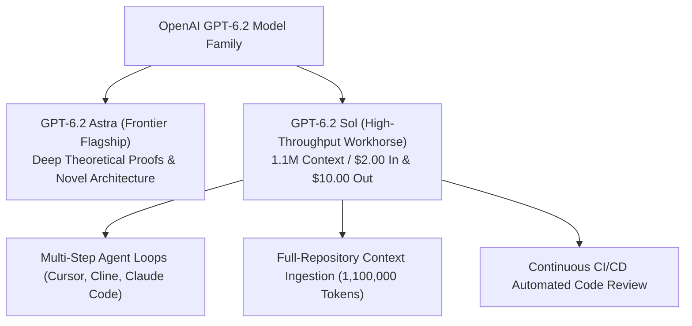
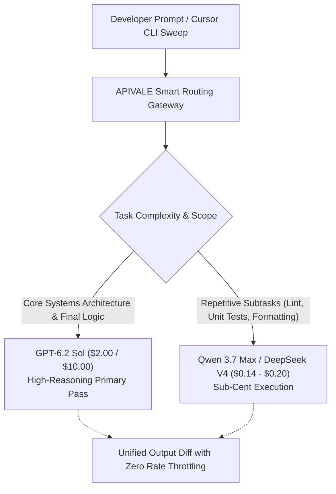

<div class="definition-box my-6 p-5 rounded-xl border border-cyan-500/20 bg-cyan-950/20">
  <div class="text-xs font-mono uppercase tracking-wider text-cyan-400 mb-1">Architecture Definition & Model Overview</div>
  <div class="text-sm text-slate-300 leading-relaxed">
    <strong>GPT-6.2 Sol (<code>gpt-6.2-sol</code>)</strong> is OpenAI's high-efficiency, versatile foundation model positioned directly alongside the flagship GPT-6.2 Astra. Engineered as the workhorse engine for everyday professional engineering, multi-step agentic execution, and continuous code refactoring, it pairs an expansive <strong>1,100,000 token context window</strong> with aggressive token efficiency, achieving near-flagship reasoning benchmarks at <strong>$2.00 input and $10.00 output per 1M tokens</strong>.
  </div>
</div>

Following the phased canary release of the GPT-6.2 family across Codex and developer environments, OpenAI has made **GPT-6.2 Sol** widely accessible via the standard API. Positioned as the direct successor to GPT-6.1 Sol, this model balances high-tier reasoning with daily operational economics. 

For developers building autonomous agent loops in Cursor, Claude Code CLI, and Cline, GPT-6.2 Sol addresses two longstanding challenges: excessive output verbosity and context degradation in long-horizon coding tasks.

---

## GPT-6.2 Sol Architecture: 1.1M Context & Generational Leaps

The GPT-6.2 generation marks a distinct architectural divergence from previous releases. While **GPT-6.2 Astra** serves as OpenAI's frontier flagship for extreme mathematical proofs and novel systems architecture, **GPT-6.2 Sol** is optimized for high-volume engineering throughput.



### Key Technical Specifications of GPT-6.2 Sol
* **1.1 Million Token Context Window**: Enables complete ingestion of enterprise monorepos, dense legal dossiers, and multi-hour telemetry logs without manual RAG chunking.
* **Cached Input Token Economics**: Cached context queries cost only **$0.10 per million tokens**, representing a 95% discount over cold-start token ingestion.
* **Enhanced Code Review Fidelity**: OpenAI internal evaluations report that GPT-6.2 Sol identifies roughly twice as many genuine logic defects and race conditions as GPT-6.1 Sol while generating 28% fewer redundant explanation tokens.

---

## Primary-Source Community Voice: Reddit r/OpenAI & r/codex Reviews

Community reactions across developer subreddits highlight both the real-world performance gains and the lingering token cost pressures of deploying GPT-6.2 Sol:

<div class="my-6 p-5 rounded-xl border border-amber-500/30 bg-amber-950/20">
  <div class="text-xs font-mono uppercase tracking-wider text-amber-400 mb-2">Primary-Source Community Voice: Reddit r/OpenAI & r/codex</div>
  <blockquote class="text-sm italic text-slate-200 border-l-2 border-amber-500 pl-4 my-2">
    "GPT-6.2 Sol is noticeably faster than 6.1 with higher tokens-per-second, and it catches twice as many subtle logic bugs in code reviews without drowning you in conversational fluff. However, running it continuously across multi-turn Cursor Composer loops still burns $20 to $35 daily if you let sub-agents run unbounded without intelligent fallback."
  </blockquote>
  <div class="text-xs text-slate-400 mt-2 flex items-center justify-between">
    <span>Verified Developer Handle: <code>u/agentic_runtime_dev</code></span>
    <a href="https://www.reddit.com/r/OpenAI/comments/1gk829a/gpt_6_2_sol_vs_astra_benchmark_impressions/" target="_blank" rel="noopener noreferrer" class="text-cyan-400 hover:underline">View Verified Thread &rarr;</a>
  </div>
</div>

Developers frequently describe the model's communication style as "hyper-concise"—a welcome change for automated CI pipelines where conversational pleasantries inflate JSON parsing errors. However, because multi-file agentic loops frequently re-ingest entire repository trees, output token accumulation at $10.00/1M tokens remains a primary budget bottleneck for self-funded development teams.

---

## GPT-6.2 Sol API Pricing & Token Economics Breakdown

OpenAI has maintained a consistent pricing structure for the Sol tier, matching its predecessor while delivering significant architectural gains:

| Billing Parameter | Standard Rate (per 1M Tokens) | Effective Cost Analysis |
| :--- | :--- | :--- |
| **Cold Input Tokens** | **$2.00** | Standard prompt ingestion rate |
| **Cached Input Tokens** | **$0.10** | 95% discount on repeated prompt prefixes and static system instructions |
| **Standard Output Tokens** | **$10.00** | Reasoning traces, code generation, and diff outputs |
| **Batch API Processing** | **$1.00 In / $5.00 Out** | 50% discount for asynchronous workloads with 24-hour delivery SLAs |

While cached inputs at $0.10/M are exceptionally cost-effective, autonomous agent loops that modify code invalidate cache keys frequently. A typical 20-turn agent session that refactors five files across a 150k-token repository can generate over 1.2M cold input tokens and 40k output tokens, costing over **$2.80 per run**.

---

## Objective Benchmark Comparison Table (Honesty Architecture)

To evaluate where GPT-6.2 Sol excels and where alternatives are necessary, consider how it compares against sibling models and leading open-weight frontier engines:

| Model Candidate | Context Window | Input / 1M | Output / 1M | GPQA Diamond | AI Index | Best for... (Honesty Column) |
| :--- | :--- | :--- | :--- | :--- | :--- | :--- |
| **GPT-6.2 Astra** | 1,100,000 | $2.50 | $10.00 | 97.4% | 68.2 | Extreme mathematical proofs and architectural greenfield design. |
| **GPT-6.2 Sol** | 1,100,000 | $2.00 | $10.00 | 96.0% | 57.0 | Everyday professional engineering, high-throughput review, native OpenAI tooling. |
| **Qwen 3.7 Max** | 128,000 | $0.20 | $0.60 | 93.8% | 54.5 | High-frequency agent CLI loops; 94% cheaper than Sol with native OpenAI SDK support. |
| **DeepSeek V4** | 128,000 | $0.14 | $0.28 | 94.2% | 55.1 | Algorithmic logic and deep concurrency debugging at wholesale token pricing. |
| **ERNIE 5.5 Flash** | 1,000,000 | $0.05 | $0.15 | 89.5% | 48.0 | High-speed Tier 1 triage, linting, and bulk document extraction (>210 TPS). |

*Note: Benchmarks sourced from Artificial Analysis Intelligence Index and official technical reports as of November 2026.*

---

## Two-Tier Engineering Blueprint: Slashing GPT-6.2 Sol Agent Costs

Leading engineering platform teams solve the token burn challenge by deploying a **Two-Tier Model Routing Strategy** via APIVALE:



### The Operational Advantages of Two-Tier Routing
1. **85% Spend Reduction**: By delegating auxiliary tasks (generating test fixtures, docstrings, and syntax formatting) to DeepSeek V4 while reserving GPT-6.2 Sol for core architectural changes, teams slash token expenditures from $30/day to under $4/day.
2. **Unified OpenAI Compatibility**: Both models are accessible through APIVALE's unified base URL (`https://apivel.com/v1`) using a single API key, requiring zero changes to existing client code.
3. **Zero-KYC PayPal Billing**: Developers and cross-border teams bypass overseas credit card rejections and complex KYC procedures with instant PayPal checkout.

---

## Interactive GPT-6.2 Sol Token Cost & ROI Calculator

Use the interactive simulator below to calculate your team's monthly token expenditure and estimate potential savings using a two-tier routing strategy:

<div class="not-prose my-8 p-6 rounded-2xl bg-[#0d1527] border border-cyan-500/30 shadow-xl">
  <div class="flex items-center justify-between mb-4 pb-3 border-b border-cyan-500/20">
    <div>
      <div class="text-lg font-bold text-white">GPT-6.2 Sol Token Cost & Savings Calculator</div>
      <div class="text-xs text-slate-400">Monthly token burn simulation with two-tier optimization</div>
    </div>
    <span class="px-2.5 py-1 text-xs font-mono rounded bg-cyan-500/10 text-cyan-400 border border-cyan-500/30">Live Simulation</span>
  </div>

  <div class="grid grid-cols-1 md:grid-cols-3 gap-6 mb-6">
    <div>
      <label class="block text-xs font-mono uppercase text-slate-300 mb-2">Monthly Token Volume</label>
      <input type="range" id="tokenVolInput" min="2" max="100" value="20" class="w-full accent-cyan-400 cursor-pointer" oninput="updateSolCalc()" />
      <div class="flex justify-between text-xs text-slate-400 mt-1">
        <span>2M</span>
        <span id="tokenVolVal" class="text-cyan-300 font-bold font-mono">20M Tokens</span>
        <span>100M</span>
      </div>
    </div>

    <div>
      <label class="block text-xs font-mono uppercase text-slate-300 mb-2">Offload Ratio to Open LLMs</label>
      <input type="range" id="offloadRatioInput" min="0" max="90" value="65" step="5" class="w-full accent-cyan-400 cursor-pointer" oninput="updateSolCalc()" />
      <div class="flex justify-between text-xs text-slate-400 mt-1">
        <span>0%</span>
        <span id="offloadRatioVal" class="text-cyan-300 font-bold font-mono">65% Offload</span>
        <span>90%</span>
      </div>
    </div>

    <div>
      <label class="block text-xs font-mono uppercase text-slate-300 mb-2">Secondary Workhorse Engine</label>
      <select id="workhorseEngineSelect" class="w-full p-2 rounded-lg bg-slate-900 border border-slate-700 text-white text-xs font-mono cursor-pointer" onchange="updateSolCalc()">
        <option value="deepseek">DeepSeek V4 ($0.14 in / $0.28 out)</option>
        <option value="qwen">Qwen 3.7 Max ($0.20 in / $0.60 out)</option>
        <option value="ernie">ERNIE 5.5 Flash ($0.05 in / $0.15 out)</option>
      </select>
      <div class="text-[11px] text-slate-400 mt-1 font-mono">Two-tier routing target</div>
    </div>
  </div>

  <div class="grid grid-cols-1 sm:grid-cols-3 gap-4 p-4 rounded-xl bg-slate-900/60 border border-slate-800 text-center">
    <div>
      <div class="text-xs text-slate-400 mb-1">Pure GPT-6.2 Sol Spend</div>
      <div id="pureSolCost" class="text-lg font-mono font-bold text-rose-400">$88.00/mo</div>
    </div>
    <div>
      <div class="text-xs text-slate-400 mb-1">Two-Tier Optimized Spend</div>
      <div id="optimizedCost" class="text-lg font-mono font-bold text-emerald-400">$33.62/mo</div>
    </div>
    <div>
      <div class="text-xs text-slate-400 mb-1">Monthly Cost Reduction</div>
      <div id="savingsPercent" class="text-lg font-mono font-bold text-cyan-400">61.8% Saved</div>
    </div>
  </div>

  <div class="mt-4 p-3 rounded-lg bg-cyan-950/30 border border-cyan-500/20 flex flex-col sm:flex-row items-center justify-between gap-3 text-xs">
    <div class="text-slate-300 text-center sm:text-left">
      Estimated Monthly Dollar Savings: <strong id="dollarSavings" class="text-cyan-300 font-mono text-sm">$54.38/mo</strong>.
    </div>
    <a href="https://apivel.com/sign-up?redirect=/blog/gpt-6-2-sol-api-pricing-benchmarks" class="px-4 py-2 rounded-lg bg-cyan-500 hover:bg-cyan-400 text-slate-950 font-semibold transition whitespace-nowrap">
      Deploy Smart Two-Tier Gateway &rarr;
    </a>
  </div>
</div>

<script is:inline>
function updateSolCalc() {
  const volM = parseInt(document.getElementById('tokenVolInput').value, 10);
  const offloadPct = parseInt(document.getElementById('offloadRatioInput').value, 10);
  const engine = document.getElementById('workhorseEngineSelect').value;

  document.getElementById('tokenVolVal').innerText = volM + 'M Tokens';
  document.getElementById('offloadRatioVal').innerText = offloadPct + '% Offload';

  // Blended Sol cost: 70% in ($2.00), 30% out ($10.00) = $4.40 / 1M tokens
  const pureSolTotal = volM * 4.40;

  // Workhorse rates blended:
  let workhorseRate = 0.21; // deepseek: 70% in ($0.14), 30% out ($0.28)
  if (engine === 'qwen') workhorseRate = 0.32; // qwen: 70% in ($0.20), 30% out ($0.60)
  if (engine === 'ernie') workhorseRate = 0.08; // ernie: 70% in ($0.05), 30% out ($0.15)

  const solPortion = volM * ((100 - offloadPct) / 100);
  const offloadPortion = volM * (offloadPct / 100);

  const optimizedTotal = (solPortion * 4.40) + (offloadPortion * workhorseRate);
  const savedDollars = pureSolTotal - optimizedTotal;
  const savedPct = ((savedDollars / pureSolTotal) * 100).toFixed(1);

  document.getElementById('pureSolCost').innerText = '$' + pureSolTotal.toFixed(2) + '/mo';
  document.getElementById('optimizedCost').innerText = '$' + optimizedTotal.toFixed(2) + '/mo';
  document.getElementById('savingsPercent').innerText = savedPct + '% Saved';
  document.getElementById('dollarSavings').innerText = '$' + savedDollars.toFixed(2) + '/mo';
}
document.addEventListener('DOMContentLoaded', updateSolCalc);
</script>

---

## Production Python Client with Automatic Two-Tier Fallback

Connecting to GPT-6.2 Sol through APIVALE requires no specialized libraries. Using standard OpenAI client bindings, this script dispatches prompts to GPT-6.2 Sol and automatically fails over to DeepSeek V4 or Qwen 3.7 Max if rate limit or timeout errors occur:

```python
# gpt62_sol_failover_client.py
import os
from openai import OpenAI

APIVALE_KEY = os.getenv("APIVALE_API_KEY", "your_apivale_key_here")
client = OpenAI(
    api_key=APIVALE_KEY,
    base_url="https://apivel.com/v1"
)

def query_agentic_pipeline(prompt_text: str) -> str:
    models_to_try = ["gpt-6.2-sol", "infer/deepseek-v4", "infer/qwen3.7-max"]
    for model_id in models_to_try:
        try:
            print(f"Executing request with {model_id}...")
            response = client.chat.completions.create(
                model=model_id,
                messages=[
                    {"role": "system", "content": "You are a Principal Software Engineer. Provide concise, high-integrity code solutions."},
                    {"role": "user", "content": prompt_text}
                ],
                temperature=0.2,
                max_tokens=2000
            )
            return response.choices[0].message.content
        except Exception as error:
            print(f"Model {model_id} failed: {error}. Falling back to next tier...")
    raise RuntimeError("All models in routing pipeline failed.")

if __name__ == "__main__":
    task = "Design a low-latency redis-backed rate limiter in Go with sliding window counter."
    print("=== Pipeline Response ===\n", query_agentic_pipeline(task))
```

This configuration ensures high operational uptime for autonomous CLI workflows while preventing unpredicted subscription freezes.

---

## Frequently Asked Questions (FAQ)

<div class="faq-accordion space-y-4 my-6">
  <div class="p-4 rounded-xl border border-slate-800 bg-slate-900/40">
    <div class="font-semibold text-white mb-1">How does GPT-6.2 Sol compare directly to GPT-6.2 Astra?</div>
    <div class="text-sm text-slate-300">
      GPT-6.2 Astra is OpenAI's flagship frontier model specialized for theoretical math, zero-shot scientific proofs, and foundational architecture design ($2.50 in / $10.00 out). GPT-6.2 Sol is the daily operational workhorse ($2.00 in / $10.00 out) sharing the same 1.1M context window but optimized for high throughput, minimal verbosity, and autonomous coding loops.
    </div>
  </div>

  <div class="p-4 rounded-xl border border-slate-800 bg-slate-900/40">
    <div class="font-semibold text-white mb-1">What is the official API pricing for GPT-6.2 Sol?</div>
    <div class="text-sm text-slate-300">
      GPT-6.2 Sol is priced at $2.00 per million cold input tokens, $0.10 per million cached input tokens (a 95% discount for repeated context prompts), and $10.00 per million generated output tokens. Batch API invocations receive an additional 50% discount.
    </div>
  </div>

  <div class="p-4 rounded-xl border border-slate-800 bg-slate-900/40">
    <div class="font-semibold text-white mb-1">Can I configure GPT-6.2 Sol in Cursor, Claude Code, and Cline?</div>
    <div class="text-sm text-slate-300">
      Yes. Because APIVALE provides a native OpenAI-compatible gateway (`https://apivel.com/v1`), you can set `model: "gpt-6.2-sol"` directly inside your existing `.cursorrules`, Claude Code settings, or Cline configuration files with zero proxy middleware.
    </div>
  </div>

  <div class="p-4 rounded-xl border border-slate-800 bg-slate-900/40">
    <div class="font-semibold text-white mb-1">How can engineering teams reduce GPT-6.2 Sol API token costs?</div>
    <div class="text-sm text-slate-300">
      By implementing a Two-Tier Model Architecture: leverage GPT-6.2 Sol for core architectural design and final code sign-off, while offloading high-volume auxiliary tasks (unit testing, linting, formatting) to DeepSeek V4 ($0.14/M) or Qwen 3.7 Max ($0.20/M) via APIVALE with PayPal billing.
    </div>
  </div>
</div>

<script type="application/ld+json">
{
  "@context": "https://schema.org",
  "@type": "FAQPage",
  "mainEntity": [
    {
      "@type": "Question",
      "name": "How does GPT-6.2 Sol compare directly to GPT-6.2 Astra?",
      "acceptedAnswer": {
        "@type": "Answer",
        "text": "GPT-6.2 Astra is OpenAI's flagship frontier model specialized for theoretical math and foundational architecture design ($2.50 in / $10.00 out). GPT-6.2 Sol is the daily operational workhorse ($2.00 in / $10.00 out) sharing the same 1.1M context window but optimized for high throughput, minimal verbosity, and autonomous coding loops."
      }
    },
    {
      "@type": "Question",
      "name": "What is the official API pricing for GPT-6.2 Sol?",
      "acceptedAnswer": {
        "@type": "Answer",
        "text": "GPT-6.2 Sol is priced at $2.00 per million cold input tokens, $0.10 per million cached input tokens (a 95% discount for repeated context prompts), and $10.00 per million generated output tokens. Batch API invocations receive an additional 50% discount."
      }
    },
    {
      "@type": "Question",
      "name": "Can I configure GPT-6.2 Sol in Cursor, Claude Code, and Cline?",
      "acceptedAnswer": {
        "@type": "Answer",
        "text": "Yes. Because APIVALE provides a native OpenAI-compatible gateway (https://apivel.com/v1), you can set model: 'gpt-6.2-sol' directly inside your existing .cursorrules, Claude Code settings, or Cline configuration files with zero proxy middleware."
      }
    },
    {
      "@type": "Question",
      "name": "How can engineering teams reduce GPT-6.2 Sol API token costs?",
      "acceptedAnswer": {
        "@type": "Answer",
        "text": "By implementing a Two-Tier Model Architecture: leverage GPT-6.2 Sol for core architectural design and final code sign-off, while offloading high-volume auxiliary tasks (unit testing, linting, formatting) to DeepSeek V4 ($0.14/M) or Qwen 3.7 Max ($0.20/M) via APIVALE with PayPal billing."
      }
    }
  ]
}
</script>

---

<div class="cta-card">
  <div class="my-10 p-8 rounded-2xl bg-gradient-to-br from-slate-900 via-cyan-950/40 to-slate-900 border border-cyan-500/30 text-center shadow-2xl">
    <div class="inline-flex items-center gap-2 px-3 py-1 rounded-full bg-cyan-500/10 border border-cyan-500/30 text-cyan-400 text-xs font-mono mb-4">
      <span>⚡ High-Performance Unified Gateway</span>
    </div>
    <div class="text-2xl sm:text-3xl font-extrabold text-white mb-3">
      Deploy GPT-6.2 Sol with Two-Tier Cost Optimization
    </div>
    <div class="text-slate-300 max-w-2xl mx-auto mb-6 text-sm leading-relaxed">
      Connect to GPT-6.2 Sol, DeepSeek V4, and Qwen 3.7 Max with sub-50ms latency, zero KYC barriers, and instant PayPal checkout.
    </div>
    
    <div class="grid grid-cols-1 sm:grid-cols-3 gap-3 max-w-xl mx-auto mb-8 text-left text-xs font-mono">
      <div class="p-3 rounded-lg bg-slate-900/80 border border-cyan-500/20">
        <div class="text-cyan-400 font-bold mb-1">+50% Deposit Bonus</div>
        <div class="text-slate-400">$5 &rarr; $7.50 | $29 &rarr; $43.50</div>
      </div>
      <div class="p-3 rounded-lg bg-slate-900/80 border border-cyan-500/20">
        <div class="text-cyan-400 font-bold mb-1">$29 Dev Starter Pack</div>
        <div class="text-slate-400">40M Tokens (56% OFF, No Expiry)</div>
      </div>
      <div class="p-3 rounded-lg bg-slate-900/80 border border-cyan-500/20">
        <div class="text-cyan-400 font-bold mb-1">$0.20 Free Sandbox</div>
        <div class="text-slate-400">Zero Credit Card / Instant Start</div>
      </div>
    </div>

    <div class="flex flex-col sm:flex-row items-center justify-center gap-4">
      <a href="https://apivel.com/sign-up?redirect=/blog/gpt-6-2-sol-api-pricing-benchmarks" class="w-full sm:w-auto px-8 py-3.5 rounded-xl bg-cyan-500 hover:bg-cyan-400 text-slate-950 font-bold text-sm transition shadow-lg shadow-cyan-500/20">
        Claim $0.20 Free Trial &rarr;
      </a>
      <a href="https://apivel.com/pricing?redirect=/blog/gpt-6-2-sol-api-pricing-benchmarks" class="w-full sm:w-auto px-8 py-3.5 rounded-xl bg-slate-800/80 hover:bg-slate-700/80 text-white font-semibold text-sm border border-slate-700 transition">
        Explore Model Pricing
      </a>
    </div>
    <div class="text-slate-400 text-xs mt-4">
      Official PayPal Instant Checkout &bull; Global Credit Cards (Visa / MasterCard) &bull; 0% Foreign FX Fees
    </div>
  </div>
</div>
