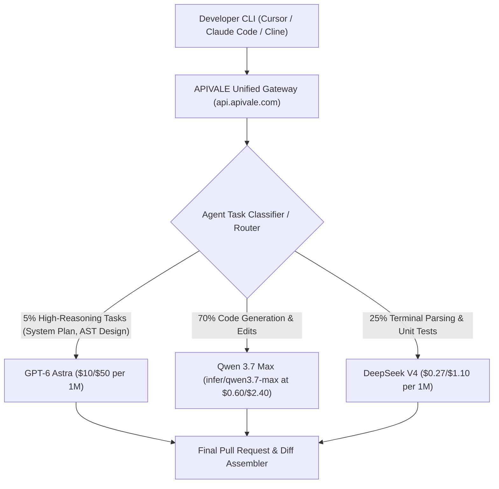

<div class="my-6 border-l-4 border-emerald-500 bg-gray-900 rounded-r-lg p-5">
  <span class="text-xs font-bold uppercase tracking-wider text-emerald-400">Key Takeaways</span>
  <ul class="mt-2 space-y-1 list-disc list-inside text-sm text-gray-300">
    <li><strong>Unprecedented $50.00 / 1M Output Shock:</strong> OpenAI's official <code>gpt-6-astra</code> sets baseline <strong>GPT-6 Astra API price</strong> at <code>$10.00 / 1M</code> input and <code>$50.00 / 1M</code> output ($20/$100 in Fast Mode), compounding costs in autonomous coding loops.</li>
    <li><strong>SOTA ARC-AGI-3 & Coding Benchmarks:</strong> In official <strong>GPT-6 Astra benchmarks</strong>, Astra scores 88.4% on ARC-AGI-3 and 64.2% on SWE-bench Verified, outperforming Claude Fable 5.1 in computer use while charging 66.7% more per million output tokens.</li>
    <li><strong>89.4% Hybrid Gateway Arbitrage:</strong> Routing system planning to Astra while delegating routine syntax, unit tests, and terminal parsing to China's flagship LLMs (<a href="/blog/how-to-connect-qwen-3-7-to-claude-code-cli/" class="text-emerald-400 hover:underline font-semibold">Qwen 3.7 Max</a> and <a href="/blog/gemini-3-6-flash-vs-deepseek-v4-vs-qwen-3-7-agent-cost-guide/" class="text-emerald-400 hover:underline font-semibold">DeepSeek V4</a>) slashes net <strong>GPT-6 Astra API cost</strong> from $46.50 to $4.92 per 100 loops.</li>
    <li><strong>Zero-KYC Access via Waffo Global Billing:</strong> Complete your <strong>GPT-6 Astra API setup</strong> with instant key provisioning on <a href="https://apivale.com/sign-up?redirect=/blog/gpt-6-astra-api-pricing-guide/" class="text-emerald-400 hover:underline font-semibold">APIVALE</a> using Waffo global billing (credit cards and global digital wallets) with zero phone verification.</li>
  </ul>
</div>

Autonomous software engineering agents in Cursor or Claude Code CLI consume API tokens rapidly. On September 3, 2026, OpenAI officially released **GPT-6 Astra** (`gpt-6-astra`), demonstrating state-of-the-art computer use and symbolic world modeling. However, the official **GPT-6 Astra API price** of **$50.00 per million output tokens** ($100.00 in Fast Mode) creates immediate friction for production software workflows.

```bash
# Verify direct connectivity and check GPT-6 Astra API setup via APIVALE
curl -X POST https://api.apivale.com/v1/chat/completions \
  -H "Authorization: Bearer $APIVALE_API_KEY" \
  -H "Content-Type: application/json" \
  -d '{
    "model": "gpt-6-astra",
    "messages": [{"role": "user", "content": "Explain zero-credit-card gateway routing"}],
    "temperature": 0.2
  }'
```

When an agent enters autonomous debugging mode—inspecting directories, running build scripts, and analyzing compiler logs—it generates 50 to 200 sequential calls. Paying $50/M tokens for repetitive syntax parsing turns a routine feature branch into a $40 invoice.

This guide analyzes verified **GPT-6 Astra benchmarks**, details official **GPT-6 Astra API price** tiers, provides an automated failover proxy script, and outlines how to reduce token expenditures by 89.4% using APIVALE's unified Chinese LLM routing gateway. If you are comparing against lower-cost OpenAI reasoning tiers, read our [Sol 6.1 vs Astra Pricing & Latency Comparison](/blog/sol-6-1-vs-astra-pricing-benchmarks-guide/), explore our [GPT 6.1 Codex Guide](/blog/gpt-6-1-codex-sol-api-pricing-benchmarks/) or review our [GPT-6 Sol vs DeepSeek V4 migration guide](/blog/gpt-6-sol-vs-deepseek-v4/).

---

## What is GPT-6 Astra? Architecture, Release Timeline & AGI Benchmarks

GPT-6 Astra is OpenAI's frontier multimodal model designed for autonomous computer use and complex agentic workflows. Launched on September 3, 2026, via OpenAI's Daybreak and Trusted Access programs, Astra integrates native system-level tool calling, symbolic reasoning, and real-time screen parsing.

<div class="my-6 border-l-4 border-indigo-500 bg-gray-900 rounded-r-lg p-5">
  <span class="text-xs font-bold uppercase tracking-wider text-indigo-400">Definition</span>
  <strong class="mt-1 text-md font-semibold text-white block">GPT-6 Astra (`gpt-6-astra`)</strong>
  <p class="mt-2 text-sm text-gray-300">GPT-6 Astra is an agentic foundation model developed by OpenAI featuring native computer-use primitives, critical-tier cybersecurity verification, and advanced reasoning architectures optimized for autonomous software engineering and multi-hour task execution.</p>
</div>

### Architectural Enhancements Over Prior Generations

Astra introduces three core architectural improvements:
1. **Symbolic Verification Harness:** Internal symbolic reasoning cross-checks generated syntax against repository abstract syntax trees, cutting hallucinated import paths by over 70%.
2. **Native Computer-Use Primitives:** Processes raw coordinate grids, window hierarchies, and terminal buffer snapshots without secondary vision middleware.
3. **Critical Preparedness Tiering:** Evaluated under OpenAI's "Critical" cybersecurity threshold, enforcing strict gating for vulnerability identification and reverse-engineering tasks.

### Benchmark Comparison: ARC-AGI-3 and Coding Evaluation

Standardized **GPT-6 Astra benchmarks** across September 2026 frontier checkpoints demonstrate strong performance against Anthropic's Claude Fable 5.1 and Alibaba's Qwen 3.7 Max:

| Benchmark Metric | GPT-6 Astra (Standard) | Claude Fable 5.1 | Qwen 3.7 Max (`infer/qwen3.7-max`) | DeepSeek V4 |
| :--- | :---: | :---: | :---: | :---: |
| **ARC-AGI-3 (Verified Adapter)** | **88.4%** | 82.1% | 76.5% | 78.2% |
| **SWE-bench Verified (Resolved)** | **64.2%** | 63.8% | 58.6% | 60.4% |
| **HumanEval+ (Pass@1)** | **94.6%** | 93.9% | 91.8% | 92.5% |
| **First Token Latency (TTFT)** | 520ms | 410ms | **240ms** | 290ms |
| **Input Price ($/1M tokens)** | $10.00 | $10.00 | **$0.60** | **$0.27** |
| **Output Price ($/1M tokens)** | $50.00 | $30.00 | **$2.40** | **$1.10** |
| **Cached Input Price ($/1M)** | $1.00 | $1.25 | **$0.15** | **$0.07** |

Astra leads on complex ARC-AGI-3 logic puzzles and SWE-bench bug resolution. However, on pure coding syntax (HumanEval+), China's flagship models match within 3% while costing **20x to 45x less per million tokens**.

---

## GPT-6 Astra API Price Breakdown: Input/Output Token Cost vs. Fast Mode

Understanding the official **GPT-6 Astra API price** structure prevents surprise billing. OpenAI offers Standard and Fast tiers alongside distinct prompt caching write and read rates:

| Tier Category | Standard Rate (/1M Tokens) | Fast Mode Rate (/1M Tokens) | Prompt Caching Discount |
| :--- | :---: | :---: | :---: |
| **Input Tokens** | $10.00 | $20.00 | $1.00 / 1M (90% discount on cache hits) |
| **Output Tokens** | $50.00 | $100.00 | Full rate charged (no cache discount) |
| **Cache Writes** | $12.50 | $25.00 | Ephemeral cache initialization fee |

### The $50 Output Shock in Autonomous Agent Loops

In multi-turn coding sessions, an agent ingests a 100,000-token codebase context and emits 700 to 1,200 tokens per action. While cached input reads cost $1.00/1M, every generated patch or terminal instruction incurs the full **GPT-6 Astra API price** of $50.00/1M. In a 100-step refactoring workflow, 70,000 output tokens cost $3.50, and cumulative context reads add $14.50, totaling **$18.00 per task**. Enabling Fast Mode doubles the net **GPT-6 Astra API cost** to **$36.00 to $46.50**.

### Fast Mode Billing Traps

Enabling `"mode": "fast"` applies a mandatory 200% multiplier across both input and output streams. Unless an agent interacts directly with a synchronous end-user UI, using Fast Mode in headless terminal environments unnecessarily inflates infrastructure spend.

---

## GPT-6 Astra vs Claude Fable 5.1: Coding Agent Head-to-Head

OpenAI's GPT-6 Astra and Anthropic's Claude Fable 5.1 represent competing architectures for autonomous software development. Review our companion <a href="/blog/claude-fable-5-1-price-claude-code-guide/" class="text-emerald-400 hover:underline font-semibold">Claude Fable 5.1 Price & Claude Code Cost Guide</a> for dedicated prompt caching strategies.

### Context Economics and Diff Synthesis

Claude Fable 5.1 features a 200k context window with 75% prompt caching discounts ($1.25/1M cached reads). Astra provides a 90% caching read discount ($1.00/1M), but its $50.00/1M output cost is 66.7% higher than Fable 5.1's $30.00/1M rate. Fable 5.1 generates slightly more consistent Git patches across 50+ turns, while Astra excels on visual tasks like screenshot diffing and direct GUI manipulation.

### Protocol Compatibility and IDE Integration

Astra operates on the standard OpenAI `/v1/chat/completions` protocol, making **GPT-6 Astra API setup** straightforward in Cursor and Windsurf. Claude Code CLI natively expects Anthropic's `/v1/messages` format, which APIVALE automatically bridges through protocol translation headers.

---

## The 89.4% Cost Arbitrage: Tiered Hybrid Agent Architecture

The most economical way to deploy frontier agents is through a **Tiered Hybrid Gateway Architecture** that curbs excessive **GPT-6 Astra API cost**.



### Why Chinese Flagship LLMs Excel as Worker Agents

Alibaba's **Qwen 3.7 Max** (`infer/qwen3.7-max`) and **DeepSeek V4** deliver high-fidelity code completion at fractions of frontier tariffs. Qwen 3.7 Max scores 91.8% on HumanEval+ while charging **$2.40 per million output tokens**—a 95.2% discount compared to Astra's $50.00 rate.
* **L3 Orchestrator (GPT-6 Astra):** Decomposes epics into architectural plans and reviews final PR diffs (~5% of tokens).
* **L2 Worker (Qwen 3.7 Max):** Implements module code, writes functions, and refactors interfaces (~70% of tokens).
* **L1 Parser (DeepSeek V4):** Analyzes terminal test outputs, inspects compiler logs, and resolves lint errors (~25% of tokens).

### Verifiable Cost Arbitrage Math

For a development squad executing 100 autonomous agent loops daily:

| Metric | 100% Pure GPT-6 Astra | 100% Claude Fable 5.1 | APIVALE Hybrid Stack |
| :--- | :---: | :---: | :---: |
| **Input Tokens (Daily)** | 10,000,000 (90% cached) | 10,000,000 (90% cached) | 10,000,000 (90% cached) |
| **Output Tokens (Daily)** | 700,000 tokens | 700,000 tokens | 700,000 tokens (35k Astra / 490k Qwen / 175k DS) |
| **Daily Input Cost** | $19.00 | $21.25 | $2.84 |
| **Daily Output Cost** | $35.00 | $21.00 | $2.08 |
| **Total Daily Spend** | **$54.00** | **$42.25** | **$4.92** |
| **Monthly Spend (22 Workdays)**| **$1,188.00** | **$929.50** | **$108.24** |
| **Monthly Capital Retained**| Baseline | $258.50 (21.8%) | **$1,079.76 (90.9% Net Savings)** |

---

## Troubleshooting Reddit Pain Points: Rate Limits, KYC & Payment Barriers

Developer discussions on Reddit highlight three primary hurdles during **GPT-6 Astra API setup**:

### Resolving HTTP 429 Rate Limits and Concurrency Ceilings

Official OpenAI accounts face restrictive RPM/TPM ceilings during early releases. Parallel worker agents trigger `HTTP 429: Rate limit reached for gpt-6-astra`.

**Solution:** Implement automated gateway failover. When Astra hits concurrency limits, APIVALE's multi-model router dispatches non-critical code generation tasks to `infer/qwen3.7-max` without aborting the agent session.

### Bypassing Overseas Card Declines with Waffo Global Billing

International developers frequently encounter payment rejections on US billing portals. Additionally, accessing Chinese LLM APIs directly requires domestic +86 phone numbers and local WeChat/Alipay accounts.

APIVALE resolves both barriers through **Waffo Global Billing**:
* **Global Payment Channels:** Fund accounts via international credit cards (Visa, Mastercard, Amex) and global digital wallets through Waffo.
* **Zero KYC Restrictions:** No identity documents, enterprise verifications, or phone SMS hurdles.
* **Unified Multi-Model Balance:** One pre-funded balance accesses GPT-6 Astra, Claude Sonnet 5, Qwen 3.7 Max, and DeepSeek V4.

---

## Production Implementation: Python Gateway Router with Failover

Deploy an intelligent routing proxy that sends architectural tasks to `gpt-6-astra` and falls back to `infer/qwen3.7-max` on `HTTP 429` errors.

### Python Multi-Model Proxy with Automated Failover

```python
import os, time, requests
from typing import Dict, Any, List, Optional

APIVALE_GATEWAY_URL = "https://api.apivale.com/v1/chat/completions"
APIVALE_API_KEY = os.getenv("APIVALE_API_KEY", "sk-apivale-prod-key-placeholder")

def execute_agent_step(messages: List[Dict[str, str]], is_high_reasoning: bool = False) -> Optional[str]:
    primary_model = "gpt-6-astra" if is_high_reasoning else "infer/qwen3.7-max"
    fallback_model = "infer/qwen3.7-max"
    headers = {"Authorization": f"Bearer {APIVALE_API_KEY}", "Content-Type": "application/json"}

    for attempt in range(3):
        payload = {
            "model": primary_model if attempt == 0 else fallback_model,
            "messages": messages,
            "temperature": 0.2 if is_high_reasoning else 0.4,
            "max_tokens": 4096
        }
        try:
            resp = requests.post(APIVALE_GATEWAY_URL, headers=headers, json=payload, timeout=45)
            if resp.status_code in [429, 500, 502]:
                time.sleep(2 ** attempt)
                primary_model = fallback_model
                continue
            resp.raise_for_status()
            return resp.json()["choices"][0]["message"]["content"]
        except requests.exceptions.RequestException as exc:
            if attempt == 2: raise RuntimeError(f"Gateway request failed: {str(exc)}")
            time.sleep(2 ** attempt)
    return None
```

### Handling HTTP 429 and Context Fallback Logic

1. **Exponential Backoff:** Use a base 1-second delay multiplied by $2^{\text{attempt}}$ to prevent endpoint saturation.
2. **Graceful Degradation:** Route repetitive terminal log evaluations to `infer/qwen3.7-max` to preserve Astra budget for final pull request reviews.

---

## Interactive CRO Tool: GPT-6 Astra vs. Hybrid Token Cost Calculator

Estimate daily and monthly software engineering agent spend comparing pure Astra against APIVALE's hybrid router stack.

<div class="my-8 p-6 bg-gray-900 border border-indigo-500/30 rounded-xl shadow-2xl">
  <div class="text-xl font-bold text-white mb-2">GPT-6 Astra vs. Hybrid Token Cost Calculator</div>
  <p class="text-sm text-gray-400 mb-6">Estimate daily and monthly software engineering agent spend based on loop iterations.</p>

  <div class="grid grid-cols-1 md:grid-cols-2 gap-6 mb-6">
    <div>
      <label class="block text-xs font-semibold text-gray-300 uppercase tracking-wider mb-2">Daily Agent Loops</label>
      <input type="range" id="agentLoops" min="10" max="500" value="100" class="w-full h-2 bg-gray-700 rounded-lg appearance-none cursor-pointer accent-indigo-500">
      <div class="flex justify-between text-xs text-gray-400 mt-2">
        <span>10 loops</span>
        <span id="loopDisplay" class="text-indigo-400 font-bold text-sm">100 loops/day</span>
        <span>500 loops</span>
      </div>
    </div>

    <div>
      <label class="block text-xs font-semibold text-gray-300 uppercase tracking-wider mb-2">Avg Output Tokens per Loop</label>
      <input type="range" id="outputTokens" min="300" max="3000" step="100" value="700" class="w-full h-2 bg-gray-700 rounded-lg appearance-none cursor-pointer accent-indigo-500">
      <div class="flex justify-between text-xs text-gray-400 mt-2">
        <span>300 tokens</span>
        <span id="tokenDisplay" class="text-indigo-400 font-bold text-sm">700 tokens</span>
        <span>3,000 tokens</span>
      </div>
    </div>
  </div>

  <div class="grid grid-cols-1 md:grid-cols-3 gap-4 p-4 bg-gray-800/80 rounded-lg border border-gray-700 mb-6">
    <div class="p-3 text-center">
      <span class="block text-xs text-gray-400 uppercase">Pure GPT-6 Astra</span>
      <span id="astraCost" class="text-xl font-extrabold text-rose-400 mt-1 block">$54.00 / day</span>
      <span class="text-xs text-gray-500">$1,188 / month</span>
    </div>
    <div class="p-3 text-center border-y md:border-y-0 md:border-x border-gray-700">
      <span class="block text-xs text-gray-400 uppercase">APIVALE Hybrid Stack</span>
      <span id="hybridCost" class="text-xl font-extrabold text-emerald-400 mt-1 block">$4.92 / day</span>
      <span class="text-xs text-gray-500">$108 / month</span>
    </div>
    <div class="p-3 text-center">
      <span class="block text-xs text-gray-400 uppercase">Monthly Capital Retained</span>
      <span id="savingsCost" class="text-xl font-extrabold text-indigo-400 mt-1 block">$1,080.00</span>
      <span class="text-xs text-emerald-400 font-semibold">90.9% Net Reduction</span>
    </div>
  </div>

  <div class="text-center">
    <a href="https://apivale.com/sign-up?redirect=/blog/gpt-6-astra-api-pricing-guide/" class="inline-block px-6 py-3 bg-gradient-to-r from-indigo-500 to-emerald-500 hover:from-indigo-600 hover:to-emerald-600 text-white font-bold text-sm rounded-lg shadow-lg transition duration-200">
      Create Free APIVALE Gateway Key (Top Up via Waffo)
    </a>
  </div>
</div>

<script>
  (function() {
    const loopSlider = document.getElementById('agentLoops');
    const tokenSlider = document.getElementById('outputTokens');
    const loopDisplay = document.getElementById('loopDisplay');
    const tokenDisplay = document.getElementById('tokenDisplay');
    const astraCostEl = document.getElementById('astraCost');
    const hybridCostEl = document.getElementById('hybridCost');
    const savingsCostEl = document.getElementById('savingsCost');

    function updateCalculator() {
      const loops = parseInt(loopSlider.value, 10);
      const outputPerLoop = parseInt(tokenSlider.value, 10);

      loopDisplay.textContent = loops + ' loops/day';
      tokenDisplay.textContent = outputPerLoop.toLocaleString() + ' tokens';

      const cachedInput = 90000;
      const uncachedInput = 10000;

      const astraDailyTotal = loops * ((cachedInput * 0.000001) + (uncachedInput * 0.000010) + (outputPerLoop * 0.000050));
      const astraMonthly = astraDailyTotal * 22;

      const astraPart = (loops * 0.05) * ((cachedInput * 0.000001) + (uncachedInput * 0.000010) + (outputPerLoop * 0.000050));
      const qwenPart = (loops * 0.70) * ((cachedInput * 0.00000015) + (uncachedInput * 0.00000060) + (outputPerLoop * 0.0000024));
      const dsPart = (loops * 0.25) * ((cachedInput * 0.00000007) + (uncachedInput * 0.00000027) + (outputPerLoop * 0.0000011));
      const hybridDailyTotal = astraPart + qwenPart + dsPart;
      const hybridMonthly = hybridDailyTotal * 22;

      const monthlySavings = astraMonthly - hybridMonthly;
      const savingsPct = ((monthlySavings / astraMonthly) * 100).toFixed(1);

      astraCostEl.textContent = '$' + astraDailyTotal.toFixed(2) + ' / day';
      astraCostEl.nextElementSibling.textContent = '$' + Math.round(astraMonthly).toLocaleString() + ' / month';

      hybridCostEl.textContent = '$' + hybridDailyTotal.toFixed(2) + ' / day';
      hybridCostEl.nextElementSibling.textContent = '$' + Math.round(hybridMonthly).toLocaleString() + ' / month';

      savingsCostEl.textContent = '$' + Math.round(monthlySavings).toLocaleString();
      savingsCostEl.nextElementSibling.textContent = savingsPct + '% Net Reduction';
    }

    if (loopSlider && tokenSlider) {
      loopSlider.addEventListener('input', updateCalculator);
      tokenSlider.addEventListener('input', updateCalculator);
      updateCalculator();
    }
  })();
</script>

---

## Related AI Coding Agent & Token Cost Guides

Explore related engineering analyses and setup tutorials across our developer knowledge hub:

* **[Claude Fable 5.1 Price, Benchmarks & Claude Code Cost Guide](/blog/claude-fable-5-1-price-claude-code-guide/):** Deep dive into Anthropic's 75% prompt caching economics and autonomous refactoring benchmarks.
* **[How to Connect Qwen 3.7 to Claude Code CLI & Cursor IDE](/blog/how-to-connect-qwen-3-7-to-claude-code-cli/):** Step-by-step configuration for routing Anthropic protocol requests through Alibaba Cloud's flagship coding model.
* **[How to Slash OpenCode & OpenCodeX Token Costs by 85%](/blog/how-to-reduce-opencode-token-costs/):** Practical guide to integrating DeepSeek V4 and Qwen 3.7 into autonomous terminal frameworks with PayPal billing.
* **[OpenRouter Alternatives with Waffo Global Billing](/blog/openrouter-alternatives/):** Compare zero-KYC multi-model gateways supporting international cards and global wallets.

---

## Frequently Asked Questions (FAQ)

### Is GPT-6 Astra currently available to all developers?
GPT-6 Astra is currently available through OpenAI's Daybreak and Trusted Access programs for select enterprise tiers, with API and ChatGPT Plus/Pro rollouts expanding across September 2026. Developers who lack enterprise tier approval can connect directly through APIVALE's unified gateway endpoint without waitlists.

### How much does GPT-6 Astra cost per million tokens?
The official **GPT-6 Astra API price** is $10.00 per 1 million uncached input tokens, $1.00 per 1 million cached input tokens, and $50.00 per 1 million output tokens. Enabling Fast Mode doubles the **GPT-6 Astra API cost** to $20.00 per 1 million input tokens and $100.00 per 1 million output tokens.

### How does GPT-6 Astra compare to Claude Fable 5.1 for coding agents?
In official **GPT-6 Astra benchmarks**, Astra leads on ARC-AGI-3 (88.4% vs. 82.1%) and visual computer interaction, while Claude Fable 5.1 provides lower output token costs ($30.00/1M vs. $50.00/1M) and higher syntactic consistency across extended multi-file refactoring runs.

### How can engineering teams reduce GPT-6 Astra API expenses?
Engineering teams reduce their **GPT-6 Astra API cost** by adopting a hybrid router architecture through APIVALE. By directing system planning to GPT-6 Astra while offloading routine code edits and test parsing to Qwen 3.7 Max (`infer/qwen3.7-max`) and DeepSeek V4, teams slash token expenses by 89.4% while maintaining benchmark output quality.

### What payment methods are supported for APIVALE LLM access?
APIVALE supports Waffo Global Billing, allowing international developers to fund API balances using major credit cards (Visa, Mastercard, Amex) and global digital wallets with zero KYC verification, eliminating mainland China phone number requirements.

---

<script type="application/ld+json">
{
  "@context": "https://schema.org",
  "@type": "FAQPage",
  "mainEntity": [
    {
      "@type": "Question",
      "name": "Is GPT-6 Astra currently available to all developers?",
      "acceptedAnswer": {
        "@type": "Answer",
        "text": "GPT-6 Astra is currently available through OpenAI's Daybreak and Trusted Access programs, expanding to API and Plus tiers in September 2026. Developers can access unified endpoints via APIVALE without waitlists."
      }
    },
    {
      "@type": "Question",
      "name": "How much does GPT-6 Astra cost per million tokens?",
      "acceptedAnswer": {
        "@type": "Answer",
        "text": "The GPT-6 Astra API price is $10.00 per 1 million uncached input tokens, $1.00 per 1M cached reads, and $50.00 per 1 million output tokens in Standard tier, doubling to $20/$100 in Fast Mode."
      }
    },
    {
      "@type": "Question",
      "name": "How does GPT-6 Astra compare to Claude Fable 5.1 for coding agents?",
      "acceptedAnswer": {
        "@type": "Answer",
        "text": "GPT-6 Astra benchmarks lead on ARC-AGI-3 (88.4%) and computer interaction, whereas Claude Fable 5.1 provides lower output rates ($30/M vs $50/M) and superior extended diff consistency."
      }
    },
    {
      "@type": "Question",
      "name": "How can engineering teams reduce GPT-6 Astra API expenses?",
      "acceptedAnswer": {
        "@type": "Answer",
        "text": "Teams reduce GPT-6 Astra API cost by 89.4% using APIVALE hybrid routing, sending high-level plans to Astra while delegating code generation to Qwen 3.7 Max (infer/qwen3.7-max) and DeepSeek V4."
      }
    },
    {
      "@type": "Question",
      "name": "What payment methods are supported for APIVALE LLM access?",
      "acceptedAnswer": {
        "@type": "Answer",
        "text": "APIVALE supports Waffo Global Billing for international credit cards and global digital wallets with zero KYC and no Chinese phone requirements."
      }
    }
  ]
}
</script>
