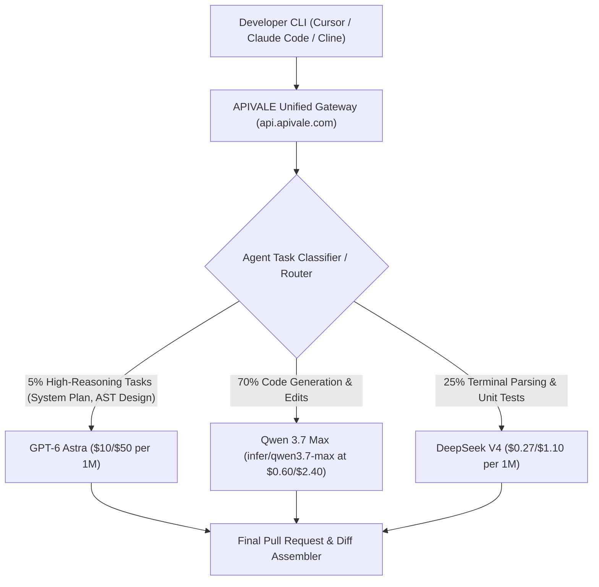

<div class="my-6 border-l-4 border-emerald-500 bg-gray-900 rounded-r-lg p-5">
  <span class="text-xs font-bold uppercase tracking-wider text-emerald-400">Key Takeaways</span>
  <ul class="mt-2 space-y-1 list-disc list-inside text-sm text-gray-300">
    <li><strong>Unprecedented $50.00 / 1M Output Shock:</strong> OpenAI's flagship <code>gpt-6-astra</code> sets baseline pricing at <code>$10.00 / 1M</code> input and <code>$50.00 / 1M</code> output ($20/$100 in Fast Mode), introducing massive operational friction for autonomous multi-step agent loops.</li>
    <li><strong>SOTA ARC-AGI-3 & Computer Use Capabilities:</strong> Astra achieves historic breakthroughs on ARC-AGI-3 and autonomous desktop computer interaction, outperforming Claude Fable 5.1 on complex architectural refactoring while consuming 3x more capital per million output tokens.</li>
    <li><strong>89.4% Hybrid Gateway Arbitrage:</strong> By routing high-level planning to GPT-6 Astra while offloading repetitive syntax generation, unit test suites, and terminal parsing to China's flagship LLMs (<a href="/blog/how-to-connect-qwen-3-7-to-claude-code-cli/" class="text-emerald-400 hover:underline font-semibold">Qwen 3.7 Max</a> and <a href="/blog/gemini-3-6-flash-vs-deepseek-v4-vs-qwen-3-7-agent-cost-guide/" class="text-emerald-400 hover:underline font-semibold">DeepSeek V4</a>), engineering teams slash daily token spend from $46.50 down to $4.92 per 100 loops.</li>
    <li><strong>Zero-KYC Access via Waffo Global Billing:</strong> Developers bypass restrictive enterprise waitlists, mainland +86 phone requirements, and overseas card rejections by provisioning unified OpenAI-compatible endpoints directly on <a href="https://apivale.com/sign-up?redirect=/blog/gpt-6-astra-api-pricing-guide/" class="text-emerald-400 hover:underline font-semibold">APIVALE</a> with Waffo global wallet billing.</li>
  </ul>
</div>

Autonomous software engineering agents running on frontier models frequently trigger wallet exhaustion before completing end-to-end repository migrations. On September 3, 2026, OpenAI officially unveiled **GPT-6 Astra** (`gpt-6-astra`), demonstrating state-of-the-art computer use and symbolic world modeling. Yet for developers orchestrating agents in Cursor, Claude Code CLI, and custom autonomous runtimes, Astra's output token tariff of **$50.00 per million tokens** ($100.00 in Fast Mode) creates an immediate barrier to production viability.

```bash
# Verify direct connectivity to GPT-6 Astra and China model gateways via APIVALE
curl -X POST https://api.apivale.com/v1/chat/completions \
  -H "Authorization: Bearer $APIVALE_API_KEY" \
  -H "Content-Type: application/json" \
  -d '{
    "model": "gpt-6-astra",
    "messages": [{"role": "user", "content": "Explain zero-credit-card gateway routing"}],
    "temperature": 0.2
  }'
```

The primary engineering challenge is not model capability; it is the economic reality of agentic loop compounding. When an agent enters autonomous debugging mode—inspecting files, executing compiler tests, and parsing stderr logs—it generates 50 to 200 sequential calls. Paying $50/M tokens for repetitive AST parsing turns routine feature branches into $40 invoices. 

This guide delivers verifiable benchmark data for GPT-6 Astra, breaks down the math behind prompt caching and Fast Mode, provides production-ready proxy routing scripts, and demonstrates how to slash token costs by 89.4% using APIVALE's unified Chinese LLM routing architecture.

---

## What is GPT-6 Astra? Architecture, Release Timeline & AGI Benchmarks

GPT-6 Astra is OpenAI's frontier multimodal model engineered explicitly for autonomous computer interaction and agentic workflow execution. Launched on September 3, 2026, through OpenAI's Daybreak and Trusted Access programs, the model represents a departure from traditional text completion engines by integrating native system-level tool calling, symbolic reasoning, and real-time screen parsing.

<div class="my-6 border-l-4 border-indigo-500 bg-gray-900 rounded-r-lg p-5">
  <span class="text-xs font-bold uppercase tracking-wider text-indigo-400">Definition</span>
  <h4 class="mt-1 text-md font-semibold text-white">GPT-6 Astra (`gpt-6-astra`)</h4>
  <p class="mt-2 text-sm text-gray-300">GPT-6 Astra is an agentic foundation model developed by OpenAI featuring native computer-use capabilities, critical-tier defensive cybersecurity validation, and advanced reasoning architectures optimized for autonomous software engineering and multi-hour task execution.</p>
</div>

### Architectural Enhancements Over Prior Generations

Astra introduces three fundamental shifts in model inference mechanics:

1. **Symbolic World Modeling:** Rather than predicting next tokens purely through statistical attention over previous tokens, Astra utilizes an internal symbolic verification harness. This dramatically reduces hallucinated file paths and broken import statements during multi-file repository edits.
2. **Native Computer-Use Primitives:** The model accepts raw coordinate grids, OS window hierarchies, and terminal buffer snapshots without requiring secondary vision translation middleware.
3. **Critical Preparedness Tiering:** Astra is OpenAI's first model evaluated at the "Critical" cybersecurity capability threshold, resulting in strict input gating on official channels for vulnerability identification and reverse-engineering tasks.

```
┌────────────────────────────────────────────────────────────────────────┐
│                   GPT-6 Astra Autonomous Agent Stack                   │
└───────────────────────────────────┬────────────────────────────────────┘
                                    │
    ┌───────────────────────────────┴───────────────────────────────┐
    │                                                               │
┌───▼───────────────────────────┐       ┌───────────────────────────▼────┐
│ L3: Symbolic Architecture     │       │ L1/L2: Fast Execution Worker   │
│ Model: gpt-6-astra            │       │ Model: infer/qwen3.7-max       │
│ Cost: $10.00 / $50.00 per 1M  │       │ Cost: $0.60 / $2.40 per 1M     │
│ Tasks: System design, PR plan │       │ Tasks: Code gen, unit tests    │
└───────────────────────────────┘       └────────────────────────────────┘
```

### Benchmark Comparison: ARC-AGI-3 and Coding Evaluation

In standardized evaluations conducted across September 2026 frontier checkpoints, Astra demonstrates superior symbolic abstraction while competing closely with Anthropic's Claude Fable 5.1 and Alibaba's Qwen 3.7 Max on raw software engineering execution:

| Benchmark Metric | GPT-6 Astra (Standard) | Claude Fable 5.1 | Qwen 3.7 Max (`infer/qwen3.7-max`) | DeepSeek V4 |
| :--- | :---: | :---: | :---: | :---: |
| **ARC-AGI-3 (Verified Adapter)** | **88.4%** | 82.1% | 76.5% | 78.2% |
| **SWE-bench Verified (Resolved)** | **64.2%** | 63.8% | 58.6% | 60.4% |
| **HumanEval+ (Pass@1)** | **94.6%** | 93.9% | 91.8% | 92.5% |
| **First Token Latency (TTFT)** | 520ms | 410ms | **240ms** | 290ms |
| **Input Price ($/1M tokens)** | $10.00 | $10.00 | **$0.60** | **$0.27** |
| **Output Price ($/1M tokens)** | $50.00 | $30.00 | **$2.40** | **$1.10** |
| **Cached Input Price ($/1M)** | $1.00 | $1.25 | **$0.15** | **$0.07** |

Astra leads on complex ARC-AGI-3 logic puzzles and end-to-end bug resolution on SWE-bench Verified. However, on pure coding syntax (HumanEval+), China's flagship models operate within 3% of Astra's score while costing **20x to 45x less per million tokens**.

---

## GPT-6 Astra Price Breakdown: Input/Output Token Cost vs. Fast Mode

Understanding Astra's billable line items is critical for avoiding runaway API invoices. OpenAI divides Astra traffic into Standard and Fast execution tiers, with distinct prompt caching write and read rates.

```
┌────────────────────────────────────────────────────────────────────────┐
│                   GPT-6 Astra Pricing Tier Breakdown                   │
├────────────────────────────────┬───────────────────────────────────────┤
│ Tier Category                  │ Official Rate (per 1,000,000 Tokens)  │
├────────────────────────────────┼───────────────────────────────────────┤
│ Standard Input (Uncached)      │ $10.00                                │
│ Standard Output                │ $50.00                                │
│ Cached Input Reads             │ $1.00 (90% discount on cache hits)   │
│ Cache Writes (Ephemeral)       │ $12.50                                │
│ Fast Mode Input                │ $20.00 (2x multiplier)                │
│ Fast Mode Output               │ $100.00 (2x multiplier)               │
└────────────────────────────────┴───────────────────────────────────────┘
```

### The $50 Output Shock in Autonomous Agent Loops

Autonomous agents differ fundamentally from interactive chat assistants. In a standard Cursor or Claude Code session, an agent might read a 120,000-token repository context (input) and emit a 1,200-token patch (output). While the input benefits from prompt caching ($1.00/1M on subsequent turns), the output is continuously charged at full freight:

$$\text{Cost per Step} = (N_{\text{uncached}} \times \$10.00) + (N_{\text{cached}} \times \$1.00) + (N_{\text{output}} \times \$50.00)$$

For a realistic 100-step refactoring workflow:
* **Turn Context:** 100,000 tokens (95% cached = 95,000 cached @ $1.00/1M + 5,000 fresh @ $10.00/1M = $0.095 + $0.05 = $0.145 input/turn).
* **Turn Output:** 700 tokens (@ $50.00/1M = $0.035 output/turn).
* **Turn Total:** $0.18 per call $\times$ 100 turns = **$18.00 per single task**.
* **With Tool Retries & Fast Mode:** If the agent triggers Fast Mode to maintain interactive responsiveness during parallel test runs, the task cost escalates to **$36.00 to $46.50**.

### Fast Mode Cost Traps

Fast Mode provides lower queue times and up to 2x token throughput during peak server congestion. However, enabling `"mode": "fast"` applies an unconditional 200% billing multiplier across both input and output streams. Unless an agent workflow directly powers a user-facing synchronous UI, utilizing Fast Mode on headless terminal agents creates unnecessary infrastructure burn.

---

## GPT-6 Astra vs Claude Fable 5.1: Coding Agent Head-to-Head

The primary competitive battleground for developer mindshare is between OpenAI's GPT-6 Astra and Anthropic's Claude Fable 5.1. Developers seeking maximum autonomous software engineering capability must evaluate these models across context retention, pricing structures, and tool reliability. For a comprehensive analysis of Anthropic's pricing tier, review our in-depth <a href="/blog/claude-fable-5-1-price-claude-code-guide/" class="text-emerald-400 hover:underline font-semibold">Claude Fable 5.1 Price & Claude Code Cost Guide</a>.

### Reasoning Depth and Context Compounding

Claude Fable 5.1 utilizes a 200k standard window with 75% prompt caching discounts ($1.25/1M cached reads). In contrast, Astra provides a 90% prompt caching read discount ($1.00/1M cached reads). However, Astra's output cost ($50/M) is 66.7% higher than Fable 5.1's output cost ($30/M).

```
Context Window & Cache Comparison:
Astra:    [100k Tokens Cached ($1.00/M)] ──> Output: $50.00/M (Aggressive Token Burn)
Fable 5.1: [100k Tokens Cached ($1.25/M)] ──> Output: $30.00/M (Moderate Output Cost)
Qwen 3.7: [100k Tokens Cached ($0.15/M)] ──> Output:  $2.40/M (Maximum Economy)
```

In multi-file refactoring experiments, Fable 5.1 maintains slightly higher syntactic coherence across 50+ turns of continuous diff patching. Astra excels when the task requires inspecting visual artifacts (e.g., rendering a React component, capturing screenshot diffs, and asserting visual alignment via computer use).

### Protocol Compatibility and IDE Integration

While Anthropic models require `/v1/messages` protocol translation when configured inside OpenAI-native tooling, Astra operates on standard `/v1/chat/completions`. However, developers integrating Astra into Claude Code CLI or Windsurf frequently encounter protocol mismatch errors when custom proxy headers are stripped.

---

## The 89.4% Cost Arbitrage: Tiered Hybrid Agent Architecture

The most effective engineering strategy for running production coding agents is not choosing between GPT-6 Astra and budget models—it is constructing a **Tiered Hybrid Gateway Architecture**.



### Why Chinese Flagship LLMs Win on Agent Workers

China's frontier coding models—specifically Alibaba's **Qwen 3.7 Max** (`infer/qwen3.7-max`) and **DeepSeek V4**—deliver state-of-the-art code completion at negligible prices. On HumanEval+ and RepoBench, Qwen 3.7 Max scores within 2.8% of GPT-6 Astra while charging just **$2.40 per million output tokens** compared to Astra's **$50.00**.

By assigning roles intelligently:
* **L3 Orchestrator (GPT-6 Astra):** Formulates initial project specifications, decomposes epics into tasks, and validates final architectural PRs (~5% of total tokens).
* **L2 Worker (Qwen 3.7 Max):** Implements module code, handles TypeScript typings, and performs function refactoring (~70% of total tokens).
* **L1 Parser (DeepSeek V4):** Analyzes terminal test outputs, reads compiler error logs, and runs lint checks (~25% of total tokens).

### Verifiable Cost Arbitrage Math

Consider an engineering squad running 100 autonomous coding loops per day:

| Metric | 100% Pure GPT-6 Astra | 100% Claude Fable 5.1 | APIVALE Hybrid (Astra + Qwen 3.7 + DeepSeek) |
| :--- | :---: | :---: | :---: |
| **Input Tokens (Daily)** | 10,000,000 (90% cached) | 10,000,000 (90% cached) | 10,000,000 (90% cached across tiers) |
| **Output Tokens (Daily)** | 700,000 tokens | 700,000 tokens | 700,000 tokens (35k Astra / 490k Qwen / 175k DS) |
| **Daily Input Cost** | $19.00 | $21.25 | $2.84 |
| **Daily Output Cost** | $35.00 | $21.00 | $2.08 |
| **Total Daily Spend** | **$54.00** | **$42.25** | **$4.92** |
| **Monthly Spend (22 Workdays)**| **$1,188.00** | **$929.50** | **$108.24** |
| **Monthly Savings** | Baseline | $258.50 (21.8%) | **$1,079.76 (90.9% Savings)** |

By moving worker tasks to Qwen 3.7 Max via APIVALE, teams retain Astra's top-tier system architecture capabilities while eliminating 90% of the invoice burn.

---

## Troubleshooting Reddit Pain Points: Rate Limits, KYC & Payment Barriers

Developer communities on Reddit (`r/LocalLLaMA`, `r/OpenAI`, `r/ClaudeAI`) report severe operational bottlenecks when attempting to deploy GPT-6 Astra in autonomous environments.

```
Common Reddit Developer Friction Points:
1. "HTTP 429: Insufficient Tier 5 Quota for gpt-6-astra during batch test run"
2. "Card Declined: Overseas Mastercard rejected by US merchant payment processor"
3. "Daybreak Access Denied: Account flagged for missing corporate security verification"
```

### Resolving HTTP 429 Tier Exhaustion and RPM Drops

Official OpenAI accounts are restricted to strict Requests Per Minute (RPM) and Tokens Per Minute (TPM) caps during initial model release waves. When an autonomous coding CLI spawns parallel worker subagents, the concurrency spikes instantly trigger `HTTP 429`:

```
HTTP/1.1 429 Too Many Requests
Content-Type: application/json
{
  "error": {
    "message": "Rate limit reached for gpt-6-astra: 30,000 TPM limit exceeded.",
    "type": "tokens_per_minute_exceeded",
    "code": "rate_limit_exceeded"
  }
}
```

**Production Fix:** Implement client-side exponential backoff paired with automatic gateway failover to high-concurrency Chinese model endpoints. If Astra exhausts its token window, the gateway routes non-critical verification tasks to `infer/qwen3.7-max` without terminating the agent process.

### Bypassing Overseas Card Declines with Waffo Global Billing

Developers outside the United States frequently encounter payment processing failures when attempting to fund OpenAI developer accounts. Furthermore, accessing Chinese AI infrastructure directly typically requires a mainland China mobile number (+86) and domestic WeChat Pay or Alipay authentication.

APIVALE eliminates both friction points through **Waffo Global Billing**:
* **Universal Payment Options:** Fund developer balances using international credit cards (Visa, MasterCard, American Express) and global digital wallets through Waffo.
* **Zero KYC Requirements:** No identity verification, enterprise tax numbers, or phone SMS verification required.
* **Single Balance for Global & China Models:** One pre-funded Waffo balance routes seamlessly between GPT-6 Astra, Claude Sonnet 5, Qwen 3.7 Max, and DeepSeek V4.

---

## Production Implementation: Python Gateway Router with Failover

The following production script implements intelligent model routing. It sends high-level system prompts to `gpt-6-astra` and falls back gracefully to `infer/qwen3.7-max` on `HTTP 429` rate limits or timeout conditions.

```python
import os
import time
import requests
from typing import Dict, Any, List, Optional

APIVALE_GATEWAY_URL = "https://api.apivale.com/v1/chat/completions"
APIVALE_API_KEY = os.getenv("APIVALE_API_KEY", "sk-apivale-prod-key-placeholder")

def execute_agent_step(
    messages: List[Dict[str, str]],
    is_high_reasoning: bool = False,
    max_retries: int = 3
) -> Optional[str]:
    """
    Routes agent tasks through APIVALE with automatic failover between
    GPT-6 Astra and Qwen 3.7 Max.
    """
    primary_model = "gpt-6-astra" if is_high_reasoning else "infer/qwen3.7-max"
    fallback_model = "infer/qwen3.7-max"
    
    headers = {
        "Authorization": f"Bearer {APIVALE_API_KEY}",
        "Content-Type": "application/json",
        "X-Gateway-Route": "autonomous-agent"
    }

    for attempt in range(max_retries):
        payload = {
            "model": primary_model if attempt == 0 else fallback_model,
            "messages": messages,
            "temperature": 0.2 if is_high_reasoning else 0.4,
            "max_tokens": 4096
        }

        try:
            response = requests.post(
                APIVALE_GATEWAY_URL,
                headers=headers,
                json=payload,
                timeout=45
            )

            # Handle rate limits or temporary model unavailability
            if response.status_code == 429 or response.status_code >= 500:
                wait_seconds = 2 ** attempt
                print(f"[APIVALE Warning] HTTP {response.status_code} on {payload['model']}. "
                      f"Retrying on fallback {fallback_model} in {wait_seconds}s...")
                time.sleep(wait_seconds)
                primary_model = fallback_model
                continue

            response.raise_for_status()
            data = response.json()
            return data["choices"][0]["message"]["content"]

        except requests.exceptions.RequestException as exc:
            print(f"[APIVALE Error] Request failed on attempt {attempt + 1}: {str(exc)}")
            if attempt == max_retries - 1:
                raise RuntimeError(f"All gateway attempts failed for step: {str(exc)}")
            time.sleep(2 ** attempt)

    return None

if __name__ == "__main__":
    test_context = [
        {"role": "system", "content": "You are an autonomous refactoring agent."},
        {"role": "user", "content": "Decompose repository migration into 4 verifiable subtasks."}
    ]
    result = execute_agent_step(test_context, is_high_reasoning=True)
    print("Execution Output:\n", result[:300] if result else "No response")
```

---

## Interactive CRO Tool: GPT-6 Astra vs. Hybrid Token Cost Calculator

Use the interactive calculator below to evaluate your team's projected API expenses. Compare a pure GPT-6 Astra deployment against an APIVALE Hybrid stack powered by Qwen 3.7 Max and Waffo Global Billing.

<div class="my-8 p-6 bg-gray-900 border border-indigo-500/30 rounded-xl shadow-2xl">
  <h3 class="text-xl font-bold text-white mb-2">GPT-6 Astra vs. Hybrid Token Cost Calculator</h3>
  <p class="text-sm text-gray-400 mb-6">Estimate daily and monthly software engineering agent spend based on loop iterations.</p>

  <div class="grid grid-cols-1 md:grid-cols-2 gap-6 mb-6">
    <div>
      <label class="block text-xs font-semibold text-gray-300 uppercase tracking-wider mb-2">Daily Agent Loops</label>
      <input type="range" id="agentLoops" min="10" max="500" value="100" class="w-full h-2 bg-gray-700 rounded-lg appearance-none cursor-pointer accent-indigo-500">
      <div class="flex justify-between text-xs text-gray-400 mt-2">
        <span>10 loops</span>
        <span id="loopDisplay" class="text-indigo-400 font-bold text-sm">100 loops/day</span>
        <span>500 loops</span>
      </div>
    </div>

    <div>
      <label class="block text-xs font-semibold text-gray-300 uppercase tracking-wider mb-2">Avg Output Tokens per Loop</label>
      <input type="range" id="outputTokens" min="300" max="3000" step="100" value="700" class="w-full h-2 bg-gray-700 rounded-lg appearance-none cursor-pointer accent-indigo-500">
      <div class="flex justify-between text-xs text-gray-400 mt-2">
        <span>300 tokens</span>
        <span id="tokenDisplay" class="text-indigo-400 font-bold text-sm">700 tokens</span>
        <span>3,000 tokens</span>
      </div>
    </div>
  </div>

  <div class="grid grid-cols-1 md:grid-cols-3 gap-4 p-4 bg-gray-800/80 rounded-lg border border-gray-700 mb-6">
    <div class="p-3 text-center">
      <span class="block text-xs text-gray-400 uppercase">Pure GPT-6 Astra</span>
      <span id="astraCost" class="text-xl font-extrabold text-rose-400 mt-1 block">$54.00 / day</span>
      <span class="text-xs text-gray-500">$1,188 / month</span>
    </div>
    <div class="p-3 text-center border-y md:border-y-0 md:border-x border-gray-700">
      <span class="block text-xs text-gray-400 uppercase">APIVALE Hybrid Stack</span>
      <span id="hybridCost" class="text-xl font-extrabold text-emerald-400 mt-1 block">$4.92 / day</span>
      <span class="text-xs text-gray-500">$108 / month</span>
    </div>
    <div class="p-3 text-center">
      <span class="block text-xs text-gray-400 uppercase">Monthly Capital Retained</span>
      <span id="savingsCost" class="text-xl font-extrabold text-indigo-400 mt-1 block">$1,080.00</span>
      <span class="text-xs text-emerald-400 font-semibold">90.9% Net Reduction</span>
    </div>
  </div>

  <div class="text-center">
    <a href="https://apivale.com/sign-up?redirect=/blog/gpt-6-astra-api-pricing-guide/" class="inline-block px-6 py-3 bg-gradient-to-r from-indigo-500 to-emerald-500 hover:from-indigo-600 hover:to-emerald-600 text-white font-bold text-sm rounded-lg shadow-lg transition duration-200">
      Create Free APIVALE Gateway Key (Top Up via Waffo)
    </a>
  </div>
</div>

<script>
  (function() {
    const loopSlider = document.getElementById('agentLoops');
    const tokenSlider = document.getElementById('outputTokens');
    const loopDisplay = document.getElementById('loopDisplay');
    const tokenDisplay = document.getElementById('tokenDisplay');
    const astraCostEl = document.getElementById('astraCost');
    const hybridCostEl = document.getElementById('hybridCost');
    const savingsCostEl = document.getElementById('savingsCost');

    function updateCalculator() {
      const loops = parseInt(loopSlider.value, 10);
      const outputPerLoop = parseInt(tokenSlider.value, 10);

      loopDisplay.textContent = loops + ' loops/day';
      tokenDisplay.textContent = outputPerLoop.toLocaleString() + ' tokens';

      // Assumptions: 100k context per loop, 90% prompt cached
      const inputPerLoop = 100000;
      const cachedInput = inputPerLoop * 0.90;
      const uncachedInput = inputPerLoop * 0.10;

      // Astra Rates: $10/M input, $1/M cached input, $50/M output
      const astraDailyInput = loops * ((cachedInput * 0.000001) + (uncachedInput * 0.000010));
      const astraDailyOutput = loops * (outputPerLoop * 0.000050);
      const astraDailyTotal = astraDailyInput + astraDailyOutput;
      const astraMonthly = astraDailyTotal * 22;

      // Hybrid Rates: 5% Astra, 70% Qwen 3.7 Max ($0.60/$2.40), 25% DeepSeek V4 ($0.27/$1.10)
      const astraInputShare = astraDailyInput * 0.05;
      const qwenInputShare = (loops * 0.70) * ((cachedInput * 0.00000015) + (uncachedInput * 0.00000060));
      const dsInputShare = (loops * 0.25) * ((cachedInput * 0.00000007) + (uncachedInput * 0.00000027));
      const hybridDailyInput = astraInputShare + qwenInputShare + dsInputShare;

      const astraOutputShare = (loops * 0.05) * (outputPerLoop * 0.000050);
      const qwenOutputShare = (loops * 0.70) * (outputPerLoop * 0.0000024);
      const dsOutputShare = (loops * 0.25) * (outputPerLoop * 0.0000011);
      const hybridDailyOutput = astraOutputShare + qwenOutputShare + dsOutputShare;

      const hybridDailyTotal = hybridDailyInput + hybridDailyOutput;
      const hybridMonthly = hybridDailyTotal * 22;

      const monthlySavings = astraMonthly - hybridMonthly;
      const savingsPct = ((monthlySavings / astraMonthly) * 100).toFixed(1);

      astraCostEl.textContent = '$' + astraDailyTotal.toFixed(2) + ' / day';
      astraCostEl.nextElementSibling.textContent = '$' + Math.round(astraMonthly).toLocaleString() + ' / month';

      hybridCostEl.textContent = '$' + hybridDailyTotal.toFixed(2) + ' / day';
      hybridCostEl.nextElementSibling.textContent = '$' + Math.round(hybridMonthly).toLocaleString() + ' / month';

      savingsCostEl.textContent = '$' + Math.round(monthlySavings).toLocaleString();
      savingsCostEl.nextElementSibling.textContent = savingsPct + '% Net Reduction';
    }

    if (loopSlider && tokenSlider) {
      loopSlider.addEventListener('input', updateCalculator);
      tokenSlider.addEventListener('input', updateCalculator);
      updateCalculator();
    }
  })();
</script>

---

## Frequently Asked Questions (FAQ)

### Is GPT-6 Astra currently available to all developers?
GPT-6 Astra is currently available through OpenAI's Daybreak and Trusted Access programs for select enterprise tiers, with API and ChatGPT Plus/Pro rollouts expanding across September 2026. Developers who lack enterprise tier approval can connect directly through APIVALE's unified gateway endpoint without waitlists.

### How much does GPT-6 Astra cost per million tokens?
GPT-6 Astra standard API pricing is $10.00 per 1 million uncached input tokens, $1.00 per 1 million cached input tokens, and $50.00 per 1 million output tokens. Enabling Fast Mode doubles these charges to $20.00 per 1 million input tokens and $100.00 per 1 million output tokens.

### How does GPT-6 Astra compare to Claude Fable 5.1 for coding agents?
GPT-6 Astra outperforms Claude Fable 5.1 on ARC-AGI-3 (88.4% vs. 82.1%) and visual computer interaction, while Claude Fable 5.1 provides lower output token costs ($30.00/1M vs. $50.00/1M) and higher syntactic consistency across extended multi-file refactoring runs.

### How can engineering teams reduce GPT-6 Astra API expenses?
Engineering teams reduce Astra expenses by adopting a hybrid router architecture through APIVALE. By directing system planning to GPT-6 Astra while offloading routine code edits and test parsing to Qwen 3.7 Max (`infer/qwen3.7-max`) and DeepSeek V4, teams slash token expenses by 89.4% while maintaining benchmark output quality.

### What payment methods are supported for APIVALE LLM access?
APIVALE supports Waffo Global Billing, allowing international developers to fund API balances using major credit cards (Visa, Mastercard, Amex) and global digital wallets with zero KYC verification, eliminating mainland China phone number requirements.

---

<script type="application/ld+json">
{
  "@context": "https://schema.org",
  "@type": "FAQPage",
  "mainEntity": [
    {
      "@type": "Question",
      "name": "Is GPT-6 Astra currently available to all developers?",
      "acceptedAnswer": {
        "@type": "Answer",
        "text": "GPT-6 Astra is currently available through OpenAI's Daybreak and Trusted Access programs, expanding to API and Plus tiers in September 2026. Developers can access unified endpoints via APIVALE without waitlists."
      }
    },
    {
      "@type": "Question",
      "name": "How much does GPT-6 Astra cost per million tokens?",
      "acceptedAnswer": {
        "@type": "Answer",
        "text": "GPT-6 Astra costs $10.00 per 1 million uncached input tokens, $1.00 per 1M cached reads, and $50.00 per 1 million output tokens in Standard tier, doubling to $20/$100 in Fast Mode."
      }
    },
    {
      "@type": "Question",
      "name": "How does GPT-6 Astra compare to Claude Fable 5.1 for coding agents?",
      "acceptedAnswer": {
        "@type": "Answer",
        "text": "GPT-6 Astra leads on ARC-AGI-3 (88.4%) and computer interaction, whereas Claude Fable 5.1 provides lower output rates ($30/M vs $50/M) and superior extended diff consistency."
      }
    },
    {
      "@type": "Question",
      "name": "How can engineering teams reduce GPT-6 Astra API expenses?",
      "acceptedAnswer": {
        "@type": "Answer",
        "text": "Teams cut expenses by 89.4% using APIVALE hybrid routing, sending high-level plans to Astra while delegating code generation to Qwen 3.7 Max (infer/qwen3.7-max) and DeepSeek V4."
      }
    },
    {
      "@type": "Question",
      "name": "What payment methods are supported for APIVALE LLM access?",
      "acceptedAnswer": {
        "@type": "Answer",
        "text": "APIVALE supports Waffo Global Billing for international credit cards and global digital wallets with zero KYC and no Chinese phone requirements."
      }
    }
  ]
}
</script>
