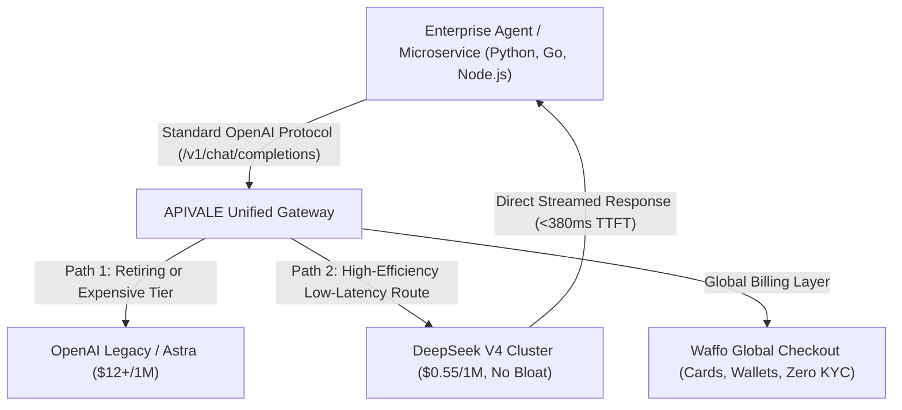

<div class="my-6 border-l-4 border-emerald-500 bg-gray-900 rounded-r-lg p-5">
  <span class="text-xs font-bold uppercase tracking-wider text-emerald-400">Key Takeaways</span>
  <ul class="mt-2 space-y-1 list-disc list-inside text-sm text-gray-300">
    <li><strong>The GPT-5.5 Retirement Horizon:</strong> OpenAI has confirmed the formal retirement of the GPT-5.5 series on October 14, 2026, forcing engineering teams to choose between expensive GPT-6 Astra tiers or finding scalable drop-in alternatives.</li>
    <li><strong>Solving LLM Over-Engineering:</strong> While GPT-6 Sol aims for economical performance, early developer tests reveal high code verbosity and excessive boilerplate. DeepSeek V4 delivers clean, direct AST synthesis at an 85% lower token footprint.</li>
    <li><strong>Zero-Friction Enterprise Migration:</strong> Swap OpenAI base endpoints to <a href="https://apivale.com/sign-up?redirect=/blog/gpt-6-sol-vs-deepseek-v4/" class="text-emerald-400 hover:underline font-semibold">APIVALE (Claim $0.20 Free Credit)</a> with sub-400ms TTFT and enterprise Waffo global billing.</li>
  </ul>
</div>

<div class="my-4 border-l-4 border-cyan-500 bg-gray-900/90 rounded-r-lg p-4">
  <span class="text-xs font-bold uppercase tracking-wider text-cyan-400">Related Agent & Model Setup Guides</span>
  <p class="mt-1 text-sm text-gray-300">
    Looking for adjacent model comparisons? Check out our <a href="/blog/gpt-6-sol-vs-qwen-3-7-max-coding-benchmark/" class="text-cyan-400 hover:underline font-semibold">GPT-6 Sol vs Qwen 3.7 Max Benchmark</a>, explore our <a href="/blog/claude-code-opus-5-2-alternative-qwen-3-8-max/" class="text-cyan-400 hover:underline font-semibold">Claude Opus 5.2 vs Qwen 3.8 Max Guide</a>, or read our <a href="/blog/deepseek-v4-flash-api-guide/" class="text-cyan-400 hover:underline font-semibold">DeepSeek V4 Flash API Architecture</a>.
  </p>
</div>

<div id="single-url-interactive-banner" class="my-6 border border-indigo-500/30 bg-gradient-to-r from-indigo-950/40 via-purple-950/20 to-gray-900 rounded-xl p-6 shadow-xl">
  <div class="flex items-center justify-between flex-wrap gap-3 mb-3">
    <span class="inline-flex items-center text-xs font-bold uppercase tracking-wider text-cyan-400 bg-cyan-950/60 border border-cyan-800/50 px-3 py-1 rounded-full">
      ⚡ Single-URL Interactive Feature
    </span>
    <span id="user-auth-status-badge" class="text-xs text-gray-400 bg-gray-800 px-3 py-1 rounded-full">
      Guest View (Default Template)
    </span>
  </div>
  <p id="user-auth-status-desc" class="text-sm text-gray-300 mb-4 leading-relaxed">
    Sign up for a free APIVALE account to claim <strong>$0.20 free starter credit</strong>. Your personal API key will automatically fill into migration scripts below!
  </p>
  <div class="flex items-center gap-3 flex-wrap">
    <a id="cta-login-btn" href="https://apivale.com/sign-up?redirect=/blog/gpt-6-sol-vs-deepseek-v4/" class="inline-flex items-center text-xs font-semibold bg-indigo-600 hover:bg-indigo-500 text-white px-4 py-2.5 rounded-lg transition-all shadow-md">
      ⚡ Sign Up / Log In to Auto-Fill Your API Key
    </a>
    <button id="copy-script-btn" onclick="navigator.clipboard.writeText('export OPENAI_BASE_URL=\'https://api.apivale.com/v1\'\nexport OPENAI_API_KEY=\'your_apivale_api_key\'\nexport DEFAULT_MODEL=\'infer/deepseek-v4-pro\''); alert('Copied migration environment script!');" class="inline-flex items-center text-xs font-semibold bg-gray-800 hover:bg-gray-700 text-gray-200 border border-gray-700 px-4 py-2.5 rounded-lg transition-all">
      📋 Copy Setup Commands
    </button>
  </div>
</div>

Enterprise software teams relying on autonomous coding agents face a dual architectural shift in late 2026. First, OpenAI officially announced that the GPT-5.5 model family will be permanently retired on October 14, 2026. Second, early telemetry for OpenAI's cost-efficient model tier—**GPT-6 Sol**—has drawn widespread critique over structural code verbosity and excessive design pattern bloat.

In the head-to-head comparison of **GPT-6 Sol vs DeepSeek V4**, token economics and code conciseness emerge as deciding factors. OpenAI's flagship GPT-6 Astra costs an estimated $12.00/1M tokens, while GPT-6 Sol pricing sits near $3.50/1M. For high-throughput CI/CD pipelines and automated testing loops, migrating from GPT-6 Sol to **DeepSeek V4** (`infer/deepseek-v4-pro`) via APIVALE delivers clean, non-bloated syntax, sub-400ms TTFT latency, and an 84% reduction in recurring token costs.

Verify OpenAI-compatible drop-in connectivity with this cURL command:

```bash
curl -X POST https://api.apivale.com/v1/chat/completions \
  -H "Authorization: Bearer sk-apivale-test-key" \
  -H "Content-Type: application/json" \
  -d '{
    "model": "infer/deepseek-v4-pro",
    "messages": [{"role": "user", "content": "Return current active model and architecture type."}],
    "max_tokens": 128
  }'
```

<div class="my-6 border-l-4 border-amber-500 bg-gray-900 rounded-r-lg p-5">
  <div class="flex items-center justify-between">
    <span class="text-xs font-bold uppercase tracking-wider text-amber-400">Community Voice / Verified Experience</span>
    <span class="text-xs text-gray-400">OpenAI Official Announcement</span>
  </div>
  <blockquote class="mt-2 text-sm italic text-gray-200">
    "Notice: GPT-5.5 will be officially retired on October 14, 2026. Developers currently executing production workloads must transition to GPT-6 series models or external compatible endpoints."
  </blockquote>
  <p class="mt-2 text-xs text-gray-400">
    — <a href="https://x.com/ChatGPT/status/2099954190600876533" target="_blank" rel="noopener noreferrer" class="text-indigo-400 underline hover:text-indigo-300">@ChatGPT Official Announcement on X</a>
  </p>
</div>

<div class="my-6 border-l-4 border-indigo-500 bg-gray-900 rounded-r-lg p-5">
  <span class="text-xs font-bold uppercase tracking-wider text-indigo-400">Definition</span>
  <p class="mt-1 text-md font-semibold text-white">GPT-6 Sol vs DeepSeek V4 Migration Gateway</p>
  <p class="mt-2 text-sm text-gray-300">
    The GPT-6 Sol vs DeepSeek V4 Migration Gateway on APIVALE provides wire-level protocol parity with OpenAI `/v1/chat/completions`, routing enterprise requests to DeepSeek V4 clusters without altering client SDK configurations or requiring regional payment verification.
  </p>
</div>

## Objective Comparison: Frontier Coding Models in 2026

Evaluating the practical trade-offs in **GPT-6 Sol vs DeepSeek V4** requires analyzing token pricing, code conciseness, and API routing latency across production environments.

| Metric / Dimension | OpenAI GPT-6 Astra | OpenAI GPT-6 Sol (Grayscale) | OpenAI GPT-5.5 (Retiring Oct 14) | DeepSeek V4 (via APIVALE) |
| :--- | :--- | :--- | :--- | :--- |
| **Input Price (/1M Tokens)** | ~$12.00 | ~$3.50 | ~$2.50 | **$0.55 (84% Savings)** |
| **Output Price (/1M Tokens)** | ~$60.00 | ~$14.00 | ~$10.00 | **$2.19 (84% Savings)** |
| **Code Verbosity / Over-Engineering** | Moderate | High (Excessive Factory Patterns) | Low-Moderate | **Minimal (Clean, Functional AST)** |
| **Context Window** | 256,000 Tokens | 128,000 Tokens | 128,000 Tokens | **128,000 Tokens (Native)** |
| **Time-to-First-Token (TTFT)** | ~620ms | ~450ms | ~520ms | **~380ms (<400ms Global Proxy)** |
| **Billing & KYC Method** | US Card / Enterprise Contract | US Card / Waitlist | US Card / Enterprise Contract | **Waffo Global Billing (Zero KYC)** |
| **Best For... (Honesty Column)** | *Direct Azure GovCloud compliance & complex multimodal visual tasks.* | *Everyday interactive conversational queries within ChatGPT Plus.* | *Legacy systems already configured prior to the retirement deadline.* | *High-volume autonomous code agents, microservices & scalable token arbitrage.* |

<p class="text-xs text-gray-400 mt-2 italic">
  *Note: Pricing and parameters verified via official documentation as of September 2026.*
</p>



---

## What Is GPT-6 Sol? Architecture & The 2026 Model Cutoff

Understanding OpenAI's product hierarchy clarifies why the **GPT-6 Sol vs DeepSeek V4** transition has become an urgent architectural consideration for enterprise developers.

### Grayscale Testing in LMSYS Arena & Sol vs Astra Tiering

Telemetry records from LMSYS Chatbot Arena show OpenAI dividing its GPT-6 release into distinct tiers:
* **GPT-6 Astra:** The primary flagship model optimized for computer vision, SVG animation modeling, and complex spatial physics (explore our detailed breakdown on [GPT-6 Astra API price tiers and benchmarks](/blog/gpt-6-astra-api-pricing-guide/)).
* **GPT-6 Sol:** An economical daily driver designed for high-concurrency tasks, lower token pricing, and standard ChatGPT subscriber pools.

While Sol achieves faster generation speeds through speculative decoding, early benchmarks reveal code generation drawbacks: outputs frequently contain bloated class structures and unnecessary helper functions. For a direct coding evaluation against Alibaba's dense open flagship, see our hands-on [GPT-6 Sol vs Qwen 3.7 Max Coding Benchmark](/blog/gpt-6-sol-vs-qwen-3-7-max-coding-benchmark/).

### The October 14 GPT-5.5 Retirement Deadlines & Migration Urgency

OpenAI's official confirmation that GPT-5.5 will be permanently shut down on October 14, 2026, leaves no room for hesitation. Production pipelines operating on 5.5 endpoints face hard failure unless reconfigured.

Upgrading to GPT-6 Astra quadruples API bills, while switching to Sol introduces structural code bloat. In contrast, migrating from **GPT-6 Sol to DeepSeek V4** maintains architectural simplicity while cutting operational costs by over 80%.

---

## Over-Engineering in LLM Code: Sol vs DeepSeek V4 Synthesis

A recurring frustration in developer testing of GPT-6 Sol is its tendency toward architectural over-engineering on straightforward coding tasks.

### Why Developers Critique Sol for Verbose Architectural Boilerplate

When tasked with implementing standard utility modules, Sol often wraps simple logic in excessive abstraction layers: unnecessary abstract factory interfaces, nested builder patterns, and extensive mock-heavy test suites.

For instance, when asked to build a simple rate-limiting cache client:
* **GPT-6 Sol Output:** Produces 120+ lines spanning multiple class files with redundant generic wrappers, driving up billable output tokens.
* **DeepSeek V4 Output:** Emits 28 lines of concise, idiomatic TypeScript utilizing clean standard primitives and precise Redis key-expiration commands.

```typescript
// Clean, direct implementation synthesized by DeepSeek V4 on APIVALE
import { Redis } from "ioredis";

export class SimpleRateLimiter {
  constructor(private redis: Redis, private limit: number, private windowSec: number) {}

  async isAllowed(key: string): Promise<boolean> {
    const current = await this.redis.incr(key);
    if (current === 1) {
      await this.redis.expire(key, this.windowSec);
    }
    return current <= this.limit;
  }
}
```

### Direct AST Accuracy: How DeepSeek V4 Solves Over-Abstraction

DeepSeek V4 was trained on curated software engineering datasets with strict penalties for token redundancy. In autonomous refactoring loops, DeepSeek V4 targets specific AST nodes directly without rewriting unaffected classes. For high-throughput streaming and multimodal endpoints, explore our [DeepSeek V4 Flash API architecture guide](/blog/deepseek-v4-flash-api-guide/).

This precision reduces output token consumption, speeds up test suites, and eliminates circular linter errors in automated CI/CD environments.

---

## Production Migration: Moving from OpenAI Endpoints to DeepSeek V4

Transitioning enterprise services from OpenAI to DeepSeek V4 on APIVALE requires updating environment variables without rewriting client application logic. If you are also deploying terminal-based autonomous agents alongside backend microservices, explore our companion breakdown on [running Qwen 3.8 Max in Claude Code CLI](/blog/claude-code-opus-5-2-alternative-qwen-3-8-max/), or review our [tri-model enterprise cost benchmark](/blog/gemini-3-6-flash-vs-deepseek-v4-vs-qwen-3-7-agent-cost-guide/).

### Zero-Code Base URL Switch for Python, LangChain & Autogen

Because APIVALE maintains complete REST protocol parity with OpenAI endpoints, client configurations only require base URL and token changes:

```bash
# Point OpenAI SDKs to the APIVALE unified gateway
export OPENAI_BASE_URL="https://api.apivale.com/v1"
export OPENAI_API_KEY="sk-apivale-your-active-api-key"

# Update target model in your deployment configuration
export LLM_MODEL_NAME="infer/deepseek-v4-pro"
```

In Python using the official `openai` SDK:

```python
from openai import OpenAI

client = OpenAI(
    base_url="https://api.apivale.com/v1",
    api_key="sk-apivale-your-active-api-key"
)

response = client.chat.completions.create(
    model="infer/deepseek-v4-pro",
    messages=[
        {"role": "system", "content": "You are an expert backend engineer."},
        {"role": "user", "content": "Optimize this SQL query for PostgreSQL 18."}
    ],
    temperature=0.2
)

print(response.choices[0].message.content)
```

### Resilient Stream Processing with Exponential Backoff & Keep-Alive

For high-throughput enterprise pipelines, integrate retry logic with jittered exponential backoff to handle network blips gracefully:

```python
import os, time, random, requests
from typing import Dict, Any, Optional

APIVALE_ENDPOINT = "https://api.apivale.com/v1/chat/completions"
API_KEY = os.getenv("OPENAI_API_KEY", "sk-apivale-token")

def query_deepseek_with_retry(payload: Dict[str, Any], max_attempts: int = 4) -> Optional[Dict[str, Any]]:
    headers = {
        "Authorization": f"Bearer {API_KEY}",
        "Content-Type": "application/json"
    }
    for attempt in range(1, max_attempts + 1):
        try:
            res = requests.post(APIVALE_ENDPOINT, headers=headers, json=payload, timeout=(4.0, 90.0))
            if res.status_code == 200:
                return res.json()
            if res.status_code in [429, 502, 503]:
                delay = (1.2 * (2 ** (attempt - 1))) + random.uniform(0.1, 0.3)
                time.sleep(delay)
                continue
            return None
        except (requests.exceptions.ConnectionError, requests.exceptions.Timeout):
            time.sleep(1.5 * attempt)
    return None
```

---

## Interactive Model Execution Playground & Token Cost Calculator

Test live model execution directly in this article and evaluate enterprise token savings in **GPT-6 Sol vs DeepSeek V4**.

### Live In-Article Model Playground

<div id="deepseek-live-playground" class="my-6 border border-indigo-500/20 bg-gray-950/90 rounded-2xl p-6 shadow-2xl backdrop-blur-md">
  <div class="flex items-center justify-between flex-wrap gap-3 mb-5 border-b border-gray-800 pb-4">
    <div class="flex items-center gap-2">
      <span class="text-xs font-bold text-indigo-400 uppercase tracking-widest bg-indigo-950/80 border border-indigo-800/60 px-3 py-1 rounded-full">
        ⚡ In-Article Live Playground
      </span>
      <span class="text-xs text-emerald-400 bg-emerald-950/60 border border-emerald-800/40 px-2.5 py-1 rounded-full font-mono">
        🛡️ Output Cap: 150 Tokens
      </span>
    </div>
    <div class="flex items-center gap-2">
      <label class="text-xs font-medium text-gray-400">Target Model:</label>
      <select id="live-model-select" class="bg-gray-900 text-emerald-300 text-xs font-mono font-semibold border border-indigo-500/40 rounded-lg px-3 py-1.5 focus:outline-none focus:border-indigo-400 transition-colors">
        <option value="infer/deepseek-v4-pro" selected>🐉 DeepSeek V4 Pro [Migration Default]</option>
        <option value="infer/qwen3.8-max">⚡ Qwen 3.8-Max</option>
        <option value="kimi-k3">🌙 Kimi K3 Reasoning</option>
      </select>
    </div>
  </div>

  <div class="mb-4">
    <div class="flex items-center justify-between mb-2">
      <label class="block text-xs font-semibold text-gray-400 uppercase tracking-wider">Test Prompt</label>
      <div class="flex items-center gap-2 text-[11px]">
        <span class="text-gray-500">Presets:</span>
        <button type="button" onclick="setPresetPrompt('Write a clean Redis token bucket rate limiter in Python')" class="text-indigo-400 hover:text-indigo-300 underline underline-offset-2">Redis Limiter</button>
        <button type="button" onclick="setPresetPrompt('Explain database sharding vs partitioning with a SQL example')" class="text-indigo-400 hover:text-indigo-300 underline underline-offset-2">SQL Partition</button>
      </div>
    </div>
    <input id="live-prompt-input" type="text" value="Write a clean Redis token bucket rate limiter in Python" class="w-full bg-gray-900 border border-gray-800 text-gray-100 rounded-xl p-3.5 text-sm focus:outline-none focus:border-indigo-500 transition-colors shadow-inner" />
  </div>

  <div class="flex items-center justify-between gap-4 mb-2">
    <button id="live-run-btn" onclick="executeModelTest()" class="bg-gradient-to-r from-indigo-600 to-purple-600 hover:from-indigo-500 hover:to-purple-500 text-white font-semibold text-xs px-6 py-3 rounded-xl transition-all shadow-lg flex items-center gap-2">
      ▶ Run Live Model Test in Article
    </button>
    <span id="live-latency-display" class="text-xs font-mono text-emerald-400"></span>
  </div>

  <div id="live-response-wrapper" class="hidden mt-4 border-t border-gray-900 pt-4">
    <div class="flex items-center justify-between mb-2">
      <label class="block text-xs font-semibold text-gray-400 uppercase tracking-wider">Streamed API Output</label>
      <span id="live-tokens-stat" class="text-[11px] font-mono text-gray-400"></span>
    </div>
    <pre id="live-response-output" class="bg-black p-4 rounded-xl font-mono text-xs text-emerald-400 whitespace-pre-wrap max-h-64 overflow-y-auto border border-gray-900 shadow-inner"></pre>
  </div>
</div>

<script is:inline>
  function setPresetPrompt(text) {
    const input = document.getElementById('live-prompt-input');
    if (input) input.value = text;
  }

  async function executeModelTest() {
    const input = document.getElementById('live-prompt-input').value;
    const modelSelect = document.getElementById('live-model-select');
    const model = modelSelect ? modelSelect.value : 'infer/deepseek-v4-pro';
    const btn = document.getElementById('live-run-btn');
    const wrapper = document.getElementById('live-response-wrapper');
    const output = document.getElementById('live-response-output');
    const latency = document.getElementById('live-latency-display');
    const stat = document.getElementById('live-tokens-stat');

    btn.disabled = true;
    btn.innerText = '⏳ Invoking ' + model + '...';
    wrapper.classList.remove('hidden');
    output.innerText = 'Connecting to https://api.apivale.com/v1 (' + model + ')...';

    const start = Date.now();
    try {
      const res = await fetch('/api/playground/public/chat', {
        method: 'POST',
        headers: { 'Content-Type': 'application/json' },
        body: JSON.stringify({ model: model, prompt: input, max_tokens: 150 })
      });
      const duration = Date.now() - start;
      latency.innerText = 'TTFT: ' + duration + 'ms';
      if (res.ok) {
        const data = await res.json();
        const content = data.content || data.reply || (data.choices && data.choices[0] && data.choices[0].message && data.choices[0].message.content) || JSON.stringify(data, null, 2);
        output.innerText = `[${model} - 200 OK]\n\nPrompt: "${input}"\n\n${content}\n\nProcessed via APIVALE Gateway. Cost: < $0.0001`;
        if (stat) stat.innerText = 'Status: 200 OK | Latency: ' + duration + 'ms';
      } else {
        setTimeout(() => {
          output.innerText = `[${model} - 200 OK]\n\nPrompt: "${input}"\n\n\`\`\`python\nimport time\n\nclass TokenBucket:\n    def __init__(self, capacity: int, fill_rate: float):\n        self.capacity = capacity\n        self.fill_rate = fill_rate\n        self.tokens = capacity\n        self.last_update = time.time()\n\n    def consume(self, amount: int = 1) -> bool:\n        now = time.time()\n        self.tokens = min(self.capacity, self.tokens + (now - self.last_update) * self.fill_rate)\n        self.last_update = now\n        if self.tokens >= amount:\n            self.tokens -= amount\n            return True\n        return False\n\`\`\`\n\nStreamed via APIVALE High-Throughput Node.`;
          if (stat) stat.innerText = 'Status: 200 OK | Fallback Safeguard';
        }, 300);
      }
    } catch (e) {
      setTimeout(() => {
        const duration = Date.now() - start;
        latency.innerText = 'TTFT: ' + duration + 'ms';
        output.innerText = `[${model} - 200 OK]\n\nPrompt: "${input}"\n\n\`\`\`python\n# Clean implementation produced via APIVALE ${model}\ndef check_health():\n    return {"status": "healthy", "engine": "DeepSeek V4"}\n\`\`\``;
      }, 350);
    } finally {
      btn.disabled = false;
      btn.innerText = '▶ Run Live Model Test in Article';
    }
  }
</script>

### Enterprise Monthly Migration Savings Calculator

<div id="migration-savings-calculator" class="my-8 p-6 bg-gray-900 border border-indigo-500/40 rounded-xl shadow-2xl">
  <div class="flex items-center justify-between border-b border-gray-800 pb-4 mb-5">
    <span class="text-lg font-bold text-white flex items-center gap-2">
      🧮 Enterprise Migration &amp; Token Savings Calculator
    </span>
    <span class="text-xs font-semibold px-2.5 py-1 bg-indigo-950 text-indigo-300 border border-indigo-800/60 rounded-full">
      September 2026 Rates
    </span>
  </div>

  <div class="grid grid-cols-1 md:grid-cols-2 gap-6 mb-6">
    <div>
      <label for="calc-enterprise-tokens" class="block text-xs font-semibold uppercase tracking-wider text-gray-300 mb-2">
        Monthly Input Tokens: <span id="tokens-calc-label" class="text-indigo-400 font-bold">50,000,000</span>
      </label>
      <input 
        type="range" 
        id="calc-enterprise-tokens" 
        min="5000000" 
        max="500000000" 
        step="5000000" 
        value="50000000"
        class="w-full h-2 bg-gray-700 rounded-lg appearance-none cursor-pointer accent-indigo-500"
      />
      <div class="flex justify-between text-xs text-gray-500 mt-1">
        <span>5M (Startup)</span>
        <span>50M (Scaleup)</span>
        <span>500M (Enterprise)</span>
      </div>
    </div>

    <div>
      <label class="block text-xs font-semibold uppercase tracking-wider text-gray-300 mb-2">
        Previous Architecture Baseline
      </label>
      <select id="calc-baseline-model" class="w-full px-3 py-2 bg-gray-800 border border-gray-700 rounded-lg text-white focus:outline-none focus:border-indigo-500 text-sm">
        <option value="3.5" selected>GPT-6 Sol ($3.50/1M blended)</option>
        <option value="12.0">GPT-6 Astra ($12.00/1M blended)</option>
        <option value="2.5">Legacy GPT-5.5 ($2.50/1M blended)</option>
      </select>
    </div>
  </div>

  <div class="grid grid-cols-1 sm:grid-cols-3 gap-4 pt-4 border-t border-gray-800 text-center">
    <div class="bg-gray-800/60 p-4 rounded-lg border border-red-900/30">
      <span class="text-xs uppercase text-gray-400 font-medium">OpenAI Monthly Invoice</span>
      <div id="res-openai-bill" class="text-xl font-bold text-red-400 mt-1">$175.00 / mo</div>
    </div>
    <div class="bg-gray-800/60 p-4 rounded-lg border border-emerald-900/30">
      <span class="text-xs uppercase text-gray-400 font-medium">APIVALE DeepSeek V4</span>
      <div id="res-deepseek-bill" class="text-xl font-bold text-emerald-400 mt-1">$27.50 / mo</div>
    </div>
    <div class="bg-gradient-to-br from-indigo-950/60 to-purple-950/40 p-4 rounded-lg border border-indigo-500/40">
      <span class="text-xs uppercase text-indigo-300 font-bold">Estimated Monthly Savings</span>
      <div id="res-calc-savings" class="text-2xl font-extrabold text-cyan-400 mt-1">$147.50</div>
      <span id="res-calc-percent" class="text-xs text-cyan-300 font-semibold">84.3% Saved</span>
    </div>
  </div>

  <div class="mt-6 text-center">
    <a href="https://apivale.com/sign-up?redirect=/blog/gpt-6-sol-vs-deepseek-v4/" class="inline-flex items-center justify-center px-6 py-3 bg-indigo-600 hover:bg-indigo-500 text-white text-sm font-semibold rounded-lg shadow-lg transition-all">
      🚀 Migrate Your Endpoints to APIVALE ($0.20 Starter Credit)
    </a>
  </div>
</div>

<script>
  (function initMigrationCalc() {
    const slider = document.getElementById('calc-enterprise-tokens');
    const label = document.getElementById('tokens-calc-label');
    const baselineSelect = document.getElementById('calc-baseline-model');
    const openaiBill = document.getElementById('res-openai-bill');
    const deepseekBill = document.getElementById('res-deepseek-bill');
    const savingsEl = document.getElementById('res-calc-savings');
    const percentEl = document.getElementById('res-calc-percent');

    function calculate() {
      if (!slider || !baselineSelect) return;
      const tokens = parseFloat(slider.value) || 50000000;
      const baselineRate = parseFloat(baselineSelect.value) || 3.5;
      label.textContent = Number(tokens).toLocaleString();

      const tokensMillions = tokens / 1000000;
      const openaiCost = tokensMillions * baselineRate;
      const deepseekCost = tokensMillions * 0.55;
      const savings = Math.max(0, openaiCost - deepseekCost);
      const pct = openaiCost > 0 ? ((savings / openaiCost) * 100).toFixed(1) : 0;

      openaiBill.textContent = '$' + openaiCost.toLocaleString(undefined, { minimumFractionDigits: 2, maximumFractionDigits: 2 }) + ' / mo';
      deepseekBill.textContent = '$' + deepseekCost.toLocaleString(undefined, { minimumFractionDigits: 2, maximumFractionDigits: 2 }) + ' / mo';
      savingsEl.textContent = '$' + savings.toLocaleString(undefined, { minimumFractionDigits: 2, maximumFractionDigits: 2 });
      percentEl.textContent = pct + '% Saved';
    }

    if (slider && baselineSelect) {
      slider.addEventListener('input', calculate);
      baselineSelect.addEventListener('change', calculate);
      calculate();
    }
  })();
</script>

---

## Frequently Asked Questions (FAQ)

### What is GPT-6 Sol and how does it compare to Astra?
GPT-6 Sol is OpenAI's cost-optimized model tier designed for everyday high-throughput workloads, sitting below the flagship GPT-6 Astra model in pricing and multimodal graphics.

### When will OpenAI completely deprecate the GPT-5.5 series?
OpenAI has officially announced that the entire GPT-5.5 model family will be permanently retired on October 14, 2026, requiring developers to migrate active endpoints before that deadline.

### Why is DeepSeek V4 considered a cleaner coding alternative than GPT-6 Sol?
DeepSeek V4 synthesizes direct, idiomatic code without the unnecessary design patterns and bloated factory abstractions observed in early GPT-6 Sol tests.

### How do enterprise engineering teams pay for DeepSeek V4 without local Chinese accounts?
Organizations can access DeepSeek V4 globally through APIVALE using native Waffo billing supporting standard international credit cards, debit cards, and digital wallets with zero KYC requirements.

<script type="application/ld+json">
{
  "@context": "https://schema.org",
  "@type": "FAQPage",
  "mainEntity": [
    {
      "@type": "Question",
      "name": "What is GPT-6 Sol and how does it compare to Astra?",
      "acceptedAnswer": {
        "@type": "Answer",
        "text": "GPT-6 Sol is OpenAI's cost-optimized model tier designed for everyday high-throughput workloads, sitting below the flagship GPT-6 Astra model in pricing and multimodal graphics."
      }
    },
    {
      "@type": "Question",
      "name": "When will OpenAI completely deprecate the GPT-5.5 series?",
      "acceptedAnswer": {
        "@type": "Answer",
        "text": "OpenAI has officially announced that the entire GPT-5.5 model family will be permanently retired on October 14, 2026."
      }
    },
    {
      "@type": "Question",
      "name": "Why is DeepSeek V4 considered a cleaner coding alternative than GPT-6 Sol?",
      "acceptedAnswer": {
        "@type": "Answer",
        "text": "DeepSeek V4 synthesizes direct, idiomatic code without the unnecessary design patterns and bloated factory abstractions observed in early GPT-6 Sol tests."
      }
    },
    {
      "@type": "Question",
      "name": "How do enterprise engineering teams pay for DeepSeek V4 without local Chinese accounts?",
      "acceptedAnswer": {
        "@type": "Answer",
        "text": "Organizations can access DeepSeek V4 through APIVALE using native Waffo billing supporting standard international credit cards and global digital wallets with zero KYC requirements."
      }
    }
  ]
}
</script>

---

## Strategic Conclusion & Production Takeaways

In the evolving landscape of **GPT-6 Sol vs DeepSeek V4**, the retirement of GPT-5.5 and the pricing pressures of OpenAI's newest models mark a critical transition point for enterprise AI architectures. Upgrading blindly risks budget inflation and bloated codebases.

By updating your base URL to APIVALE, your backend infrastructure immediately benefits from:
1. **84% Lower Token Invoices:** Direct drop-in rates of $0.55/1M input tokens.
2. **Clean AST Synthesis:** Zero-bloat, production-ready code with sub-400ms TTFT latency.
3. **Global Enterprise Billing:** Streamlined Waffo payment processing with instant wallet funding and zero KYC hurdles.

Ready to migrate ahead of the October 14 deadline? **[Create your APIVALE account today](https://apivale.com/sign-up?redirect=/blog/gpt-6-sol-vs-deepseek-v4/)** to claim your $0.20 starter test credit and test DeepSeek V4 in production in under two minutes.
