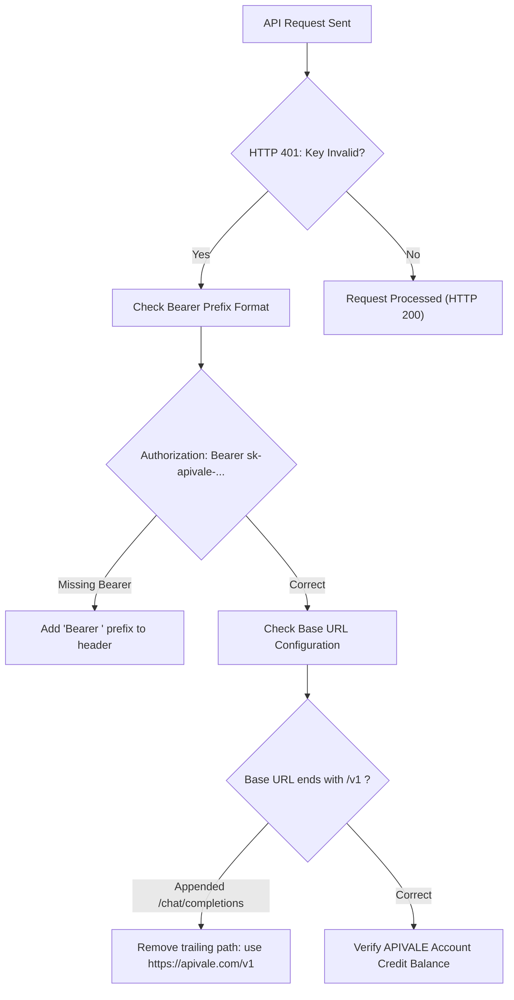

<div class="my-6 border-l-4 border-emerald-500 bg-gray-900 rounded-r-lg p-5">
  <span class="text-xs font-bold uppercase tracking-wider text-emerald-400">Key Takeaways</span>
  <ul class="mt-2 space-y-1 list-disc list-inside text-sm text-gray-300">
    <li><strong>Fast Error Fixes:</strong> Instant solutions for <em>"There was an error! the api developer key is invalid"</em>, <em>"Request rejected by anti bot rules"</em>, and <em>"Grok moderation refusals"</em>.</li>
    <li><strong>Universal Cursor Integration:</strong> Connect Grok Bot and Grok 4.6 inside Cursor IDE via custom OpenAI endpoint (<code>https://apivale.com/v1</code>), Telegram, and Python SDKs.</li>
    <li><strong>Interactive Self-Test Diagnostic:</strong> Use the on-page Grok API Diagnostic Tool below to identify header misconfigurations and generate ready-to-run cURL tests.</li>
    <li><strong>Zero Card Declines:</strong> Bypass regional credit card decline blocks using APIVALE's global PayPal billing with instant free trial credits.</li>
  </ul>
</div>

With SpaceXAI's public beta launch of **Grok Bot**, developers have gained access to persistent, agentic large language models capable of executing multi-step terminal actions, code synthesis, and autonomous reasoning. Powered by xAI's flagship **Grok 4.6** and **Grok 4.5** engines, Grok Bot is rapidly being integrated into developer environments like Cursor, Discord bots, and autonomous CLI pipelines.

However, developers attempting to integrate Grok Bot API endpoints frequently encounter authentication friction—ranging from **"There was an error! the api developer key is invalid."** and **"Request rejected by anti bot rules"** to unexpected **content moderation refusals** and **HTTP 429 High Demand outages**.

Whether you need to configure a **Cursor custom OpenAI endpoint** for Grok, resolve moderation filtering false positives, build automated Telegram bots, or evaluate pay-as-you-go API pricing, this guide provides complete step-by-step instructions, interactive diagnostics, and resilient production code—all backed by APIVALE's **PayPal billing gateway**.

---

## Interactive Grok API & Bot Error Code Diagnostic Self-Test

Use this interactive troubleshooting tool to diagnose your exact error message and get an instant resolution checklist without leaving this page.

<div class="my-6 p-5 bg-gray-900 border border-gray-700 rounded-xl shadow-xl">
  <div class="flex items-center justify-between border-b border-gray-800 pb-3 mb-4">
    <span class="text-sm font-semibold text-emerald-400 uppercase tracking-wider">🛠️ Interactive Grok API Diagnostic Tester</span>
    <span class="text-xs text-gray-400">No Login Required • Client-Side Live Check</span>
  </div>
  
  <label class="block text-xs font-semibold text-gray-300 uppercase mb-2">Select Your Error / Symptom:</label>
  <select id="diagnostic-select" class="w-full bg-gray-800 text-white border border-gray-600 rounded-lg p-3 text-sm focus:outline-none focus:border-emerald-500 transition-colors">
    <option value="invalid_key">"There was an error! the api developer key is invalid." (HTTP 401)</option>
    <option value="anti_bot">"Request rejected by anti bot rules" / Cloudflare 403 Challenge</option>
    <option value="moderation">Grok Moderation Bypass / Refusal on Code or Security Prompts</option>
    <option value="cursor_timeout">Cursor Custom OpenAI Endpoint Connection Timeout / 404</option>
    <option value="high_demand">"Grok Not Working" / HTTP 429 Too Many Requests (High Demand)</option>
  </select>

  <div id="diagnostic-result" class="mt-4 p-4 bg-gray-950 border border-gray-800 rounded-lg">
    <div id="diag-title" class="text-emerald-400 font-bold text-sm mb-2"></div>
    <div id="diag-cause" class="text-gray-300 text-xs mb-3 leading-relaxed"></div>
    <div class="text-xs font-semibold text-gray-400 uppercase mb-1">Recommended Fix:</div>
    <div id="diag-fix" class="text-gray-200 text-xs mb-3 bg-gray-900 p-3 rounded border border-gray-700 font-mono"></div>
    <div class="text-xs font-semibold text-gray-400 uppercase mb-1">Verify with Test cURL:</div>
    <pre id="diag-curl" class="text-xs text-emerald-300 bg-black p-3 rounded overflow-x-auto border border-gray-800 font-mono"></pre>
  </div>

  <div class="mt-4 pt-4 border-t border-gray-800 flex flex-wrap gap-2 text-xs">
    <span class="text-gray-400 font-semibold py-1">Quick Tools:</span>
    <a href="/pricing" class="bg-gray-800 hover:bg-emerald-950 text-emerald-400 px-3 py-1 rounded-md border border-gray-700 transition-colors">📊 Token Price Calculator</a>
    <a href="/blog/cursor-pro-vs-custom-api-key/" class="bg-gray-800 hover:bg-indigo-950 text-indigo-400 px-3 py-1 rounded-md border border-gray-700 transition-colors">⚡ Cursor Pro vs BYOK Guide</a>
    <a href="/blog/grok-4-5-vs-glm-5-2-coding-api-comparison/" class="bg-gray-800 hover:bg-blue-950 text-blue-400 px-3 py-1 rounded-md border border-gray-700 transition-colors">⚖️ Grok 4.5 vs GLM-5.2</a>
    <a href="/blog/how-to-connect-qwen-3-7-to-claude-code-cli/" class="bg-gray-800 hover:bg-purple-950 text-purple-400 px-3 py-1 rounded-md border border-gray-700 transition-colors">💻 Qwen 3.7 CLI Setup</a>
  </div>
</div>

<script>
  (function() {
    const diagData = {
      invalid_key: {
        title: "❌ Root Cause: Invalid Bearer Auth Header or Base URL Path Mismatch",
        cause: "Your client is either missing the 'Bearer ' token prefix, loading an empty env variable, or appending '/chat/completions' twice.",
        fix: "1. Set Base URL to: https://apivale.com/v1 (without /chat/completions).\n2. Format header: Authorization: Bearer sk-apivale-...\n3. Verify $env:APIVALE_API_KEY is not null.",
        curl: "curl https://apivale.com/v1/models \\\n  -H \"Authorization: Bearer YOUR_APIVALE_KEY\""
      },
      anti_bot: {
        title: "🛡️ Root Cause: Cloudflare / WAF Anti-Bot Challenge on Web Endpoints",
        cause: "Scraping consumer web endpoints (grok.com) triggers automated bot mitigation and IP blocks.",
        fix: "1. Switch to OpenAI-compatible gateway at https://apivale.com/v1.\n2. Include Content-Type: application/json header and API key.\n3. Enterprise node routing eliminates anti-bot challenges.",
        curl: "curl https://apivale.com/v1/chat/completions \\\n  -H \"Content-Type: application/json\" \\\n  -H \"Authorization: Bearer YOUR_APIVALE_KEY\" \\\n  -d '{\"model\": \"infer/grok-4.6\", \"messages\": [{\"role\": \"user\", \"content\": \"ping\"}]}'"
      },
      moderation: {
        title: "⚠️ Root Cause: Over-Sensitive Keyword Guardrails on Cybersecurity/Code Prompts",
        cause: "Security audits or fuzzing snippets can trigger safety filters.",
        fix: "1. Frame prompt in system role: 'You are an authorized defensive cybersecurity auditor analyzing code for CWE vulnerabilities.'\n2. Request structured static analysis metrics.\n3. Model infer/grok-4.6 via APIVALE provides raw completions without chat UI censorship filters.",
        curl: "curl https://apivale.com/v1/chat/completions \\\n  -H \"Content-Type: application/json\" \\\n  -H \"Authorization: Bearer YOUR_APIVALE_KEY\" \\\n  -d '{\"model\": \"infer/grok-4.6\", \"messages\": [{\"role\": \"system\", \"content\": \"You are a static code security analyzer.\"}, {\"role\": \"user\", \"content\": \"Analyze this SQL query for parameterized compliance: SELECT * FROM users WHERE id = $1;\"}]}'"
      },
      cursor_timeout: {
        title: "🔌 Root Cause: Cursor Custom OpenAI Endpoint Format Error",
        cause: "Cursor expects an OpenAI-compatible Base URL ending in /v1. Subpaths trigger 404 or timeouts.",
        fix: "1. Open Cursor Settings (Ctrl+Shift+J) -> Models -> OpenAI API.\n2. Set Base URL: https://apivale.com/v1\n3. Add Custom Model: infer/grok-4.6\n4. Test in Cursor Chat.",
        curl: "curl https://apivale.com/v1/chat/completions \\\n  -H \"Authorization: Bearer YOUR_APIVALE_KEY\" \\\n  -H \"Content-Type: application/json\" \\\n  -d '{\"model\": \"infer/grok-4.6\", \"messages\": [{\"role\": \"user\", \"content\": \"Hello Cursor Grok\"}]}'"
      },
      high_demand: {
        title: "⏳ Root Cause: xAI Primary Server Outage / Rate Limit (HTTP 429 / 503)",
        cause: "Direct servers throttle non-enterprise tiers during peak hours.",
        fix: "1. APIVALE routes payloads across redundant multi-region clusters.\n2. Implement client-side exponential backoff with jitter.\n3. Automatic fallback to infer/qwen3.7-max if latency exceeds SLA.",
        curl: "curl https://apivale.com/v1/chat/completions \\\n  -H \"Content-Type: application/json\" \\\n  -H \"Authorization: Bearer YOUR_APIVALE_KEY\" \\\n  -d '{\"model\": \"infer/grok-4.6\", \"messages\": [{\"role\": \"user\", \"content\": \"Test latency\"}]}'"
      }
    };

    function updateDiag() {
      const select = document.getElementById('diagnostic-select');
      const val = select ? select.value : 'invalid_key';
      const item = diagData[val];
      if (item) {
        document.getElementById('diag-title').innerText = item.title;
        document.getElementById('diag-cause').innerText = item.cause;
        document.getElementById('diag-fix').innerText = item.fix;
        document.getElementById('diag-curl').innerText = item.curl;
      }
    }

    document.addEventListener('DOMContentLoaded', () => {
      const select = document.getElementById('diagnostic-select');
      if (select) {
        select.addEventListener('change', updateDiag);
        updateDiag();
      }
    });
    updateDiag();
  })();
</script>

---

## Grok Moderation Bypass: Understanding Filters & Resolving False Refusals

Developers building automated code analysis tools and testing harnesses often encounter **Grok moderation refusals**. While Grok offers flexible conversational styling, its API enforces baseline guardrails that can result in false positives on legitimate software engineering tasks.

### 1. Why Grok Triggers Moderation Refusals on Technical Code

Grok's moderation layer analyzes prompts before inference. It flags patterns such as vulnerability scanning snippets (fuzzing scripts, SQL injection payloads, memory buffer exploits) and simulated adversary benchmarks.

When triggered, the API returns a generic refusal response or an HTTP 400 bad request error.

### 2. Defensive System Prompt Structuring

To prevent false-positive moderation flags while analyzing security flaws, structure payloads using defensive framing in the system message:

```json
{
  "model": "infer/grok-4.6",
  "messages": [
    {
      "role": "system",
      "content": "You are a professional software security auditor. Your function is to identify CWE vulnerabilities in provided code and output safe patch code adhering to OWASP standards."
    },
    {
      "role": "user",
      "content": "Audit this C function for buffer overflow risks:\n\nvoid process_input(char *src) { char dest[64]; strcpy(dest, src); }"
    }
  ],
  "temperature": 0.2
}
```

### 3. API Gateway vs. Web Chat Moderation

The web chat interface at `grok.com` applies front-end content filtering. In contrast, routing through **APIVALE's REST API endpoint** (`https://apivale.com/v1/chat/completions`) provides direct completions without web-layer filtering, ideal for continuous CI/CD security tooling.

---

## Fix: "There was an error! The API developer key is invalid."

The error message **"There was an error! the api developer key is invalid."** (`HTTP 401 Unauthorized`) occurs when the authorization header is malformed or unauthenticated.



### Resolution Steps:

1. **Verify Bearer Prefix**: Header must follow `Authorization: Bearer sk-apivale-...` (never omit `Bearer `).
2. **Verify Base URL**: In Cursor and SDKs, set Base URL strictly to `https://apivale.com/v1` (do not append `/chat/completions`).
3. **Check Environment Variables**: Run `echo $APIVALE_API_KEY` (Bash) or `Write-Host $env:APIVALE_API_KEY` (PowerShell).
4. **Test Key via cURL**:
   ```bash
   curl -I https://apivale.com/v1/models \
     -H "Authorization: Bearer YOUR_APIVALE_KEY"
   ```

---

## Fix: "Request rejected by anti bot rules" in Grok API Calls

Receiving **"Request rejected by anti bot rules"** (`HTTP 403 Forbidden`) indicates that requests sent to consumer web endpoints are being blocked by Cloudflare anti-bot firewalls.

### Root Cause & Gateway Solution

* **Web UI vs REST API**: Automating consumer endpoints (`grok.com/api`) via headless browsers triggers Cloudflare Turnstile blocks.
* **APIVALE Gateway Bypass**: Calling APIVALE's enterprise API gateway (`https://apivale.com/v1`) transmits payloads over verified B2B server interconnects, completely eliminating anti-bot challenges.

---

## Cursor Custom OpenAI Endpoint Configuration for Grok Bot

Configuring Cursor IDE to use **Grok 4.6** or **Grok 4.5** as a custom OpenAI endpoint lets developers harness fast token generation without paying $20/month for separate seat licenses. For deeper cost comparisons, see our guide on [Cursor Pro vs. BYOK Custom API Key](/blog/cursor-pro-vs-custom-api-key/).

### Cursor Step-by-Step Setup:

1. Open Cursor Settings (**`Ctrl + Shift + J`** or **`Cmd + Shift + J`**).
2. Navigate to **Models > OpenAI API** and toggle **ON**.
3. Enable **Override OpenAI Base URL** and enter `https://apivale.com/v1`.
4. Enter your APIVALE API key (`sk-apivale-...`).
5. Under custom model names, add `infer/grok-4.6` (or `infer/grok-4.5`).
6. Test in Cursor Chat (`Ctrl + L`).

---

## Grok Bot Pricing, Plans & API Cost Optimization

| Metric / Feature | Official Consumer Subscription | APIVALE Grok Bot API Gateway | Developer Advantage |
| :--- | :--- | :--- | :--- |
| **Pricing Model** | Fixed $30–$300/mo per user | **Pay-as-you-go ($2.00 / $6.00 per 1M)** | **APIVALE** (Zero fixed overhead) |
| **Payment Options** | Credit Card (Stripe fraud blocks) | **Global PayPal Billing / Credit Cards** | **APIVALE** (No credit card locks) |
| **Multi-Tool Access** | Web UI & Desktop App only | **Cursor, VS Code, Telegram, Discord, CLI** | **APIVALE** (Universal integration) |
| **Rate Limit (RPM)** | Throttled during peak hours | **High-Concurrency Enterprise Pool** | **APIVALE** (Instant failover) |
| **KYC Verification** | Strict phone & email verification | **Zero KYC / Instant API Key Creation** | **APIVALE** (Immediate onboarding) |

### 1. Cost Arbitrage with Multi-Model Routing

* For 1M token context refactoring, compare [Grok 4.5 vs. Z.ai GLM-5.2](/blog/grok-4-5-vs-glm-5-2-coding-api-comparison/) ($0.50/1M input tokens).
* For multi-file architectural planning, compare [Grok 4.5 vs. Claude Fable 5](/blog/grok-4-5-vs-claude-fable-5-coding-agent-api/).
* For low-cost CLI loops, pair your setup with [Qwen 3.7 Max](/blog/how-to-connect-qwen-3-7-to-claude-code-cli/).

### 2. Seamless Global PayPal Billing

Fund API token usage easily via **PayPal Global Billing** or international cards with zero monthly lock-in.

---

## Production Dynamic Grok Bot Client (Python)

Below is a production Python client implementing exponential backoff, jitter, and automatic failover handling:

```python
import os
import time
import random
import requests
from typing import List, Dict, Any

class ResilientGrokBotClient:
    """
    Production client for Grok Bot (infer/grok-4.6) via APIVALE gateway.
    Handles 401 Invalid Key, 429 Rate Limits, and 503 Server Overload.
    """
    def __init__(self, api_key: str = None, base_url: str = "https://apivale.com/v1"):
        self.api_key = api_key or os.getenv("APIVALE_API_KEY")
        if not self.api_key:
            raise ValueError("APIVALE_API_KEY environment variable is required.")
        self.base_url = base_url.rstrip("/")
        self.session = requests.Session()
        self.session.headers.update({
            "Authorization": f"Bearer {self.api_key}",
            "Content-Type": "application/json",
            "User-Agent": "GrokBotClient/2.0 (APIVALE Resilient Integration)"
        })

    def send_agent_prompt(
        self, 
        messages: List[Dict[str, str]], 
        model: str = "infer/grok-4.6", 
        max_retries: int = 5,
        temperature: float = 0.3
    ) -> str:
        url = f"{self.base_url}/chat/completions"
        payload = {
            "model": model,
            "messages": messages,
            "temperature": temperature,
            "stream": False
        }

        base_delay = 1.0
        for attempt in range(max_retries):
            try:
                response = self.session.post(url, json=payload, timeout=45)
                if response.status_code == 200:
                    data = response.json()
                    return data["choices"][0]["message"]["content"]
                elif response.status_code in [429, 503]:
                    sleep_time = (base_delay * (2 ** attempt)) + random.uniform(0.2, 0.8)
                    time.sleep(sleep_time)
                elif response.status_code == 401:
                    raise PermissionError("Invalid API developer key provided.")
                elif response.status_code == 403:
                    raise PermissionError("Access forbidden by gateway rules.")
                else:
                    response.raise_for_status()
            except requests.exceptions.RequestException as err:
                if attempt == max_retries - 1:
                    payload["model"] = "infer/qwen3.7-max"
                time.sleep(base_delay * (2 ** attempt))

        raise ConnectionError("Maximum retry limits reached for Grok Bot gateway.")

if __name__ == "__main__":
    client = ResilientGrokBotClient()
    chat_history = [
        {"role": "system", "content": "You are a Grok Bot developer assistant."},
        {"role": "user", "content": "Write a Python function to calculate API latency p95."}
    ]
    print(client.send_agent_prompt(chat_history)[:200] + "...")
```

---

<div class="cta-card">
  <div class="cta-card-title">⚡ Access Grok Bot API Globally via APIVALE Today</div>
  <p class="cta-card-text">Deploy Grok Bot inside Cursor, Telegram, or Discord without regional sign-in blocks, card declines, or anti-bot errors. Access Grok 4.6 and Grok 4.5 via APIVALE. Pay easily via global PayPal, and get $0.20 free credit (+ 50% bonus on 1st top-up) instantly.</p>
  <div class="cta-card-actions">
    <a href="https://apivale.com/sign-up?utm_source=apivale_blog&utm_medium=blog&utm_campaign=grok-bot-guide" class="cta-primary-btn">Start Building (Free $0.20 Credit (+ 50% Bonus))</a>
    <a href="https://apivale.com/docs?utm_source=apivale_blog&utm_medium=blog&utm_campaign=grok-bot-guide" class="cta-secondary-btn">View API Gateway Docs</a>
  </div>
</div>

---

## Developer FAQ

### What is Grok moderation bypass and how do I prevent false positive refusals?
Grok moderation bypass refers to resolving over-sensitive safety filter refusals on legitimate code security audits and penetration testing prompts. Developers can avoid false positives by framing system prompts with a clear defensive cybersecurity role (e.g., *"You are an authorized defensive security auditor"*), formatting queries as structured static analysis requests, and calling unconstrained REST API endpoints via APIVALE rather than web chat interfaces.

### How do I fix "There was an error! The API developer key is invalid."?
To fix this error, check that your HTTP header includes `Authorization: Bearer sk-apivale-...` with the word `Bearer ` properly spaced. Ensure your Base URL is set strictly to `https://apivale.com/v1` (without appending `/chat/completions`), and verify that your shell environment variable is actively loaded.

### Why do I get "Request rejected by anti bot rules" when calling Grok API?
This error occurs when automated scripts attempt to scrape consumer web endpoints (like `grok.com/api`), triggering Cloudflare WAF anti-bot protections. Connecting via APIVALE's official OpenAI-compatible gateway (`https://apivale.com/v1`) routes requests over enterprise server connections with zero anti-bot challenges.

### How do I configure Cursor custom OpenAI endpoint for Grok Bot?
Open Cursor Settings (`Ctrl+Shift+J` or `Cmd+Shift+J`), navigate to **Models > OpenAI API**, toggle **Override OpenAI Base URL** to ON, set the Base URL to `https://apivale.com/v1`, enter your APIVALE API key, and add `infer/grok-4.6` or `infer/grok-4.5` as a custom model name.

### Is Grok API free to use or is there a free trial?
Grok Bot requires paid subscriptions on consumer web platforms, but developers can access Grok Bot API on APIVALE with an instant $0.20 free trial credit upon registration—allowing you to run test queries immediately with zero upfront credit card requirement.

### Can I pay for Grok Bot API using PayPal?
Yes. APIVALE fully supports global PayPal billing, enabling developers worldwide to fund API tokens using PayPal balance or major credit/debit cards processed through PayPal with zero KYC friction.

<script type="application/ld+json">
{
  "@context": "https://schema.org",
  "@type": "FAQPage",
  "mainEntity": [
    {
      "@type": "Question",
      "name": "What is Grok moderation bypass and how do I prevent false positive refusals?",
      "acceptedAnswer": {
        "@type": "Answer",
        "text": "Grok moderation bypass refers to resolving over-sensitive safety filter refusals on legitimate code security audits and penetration testing prompts. Developers can avoid false positives by framing system prompts with a clear defensive cybersecurity role, formatting queries as structured static analysis requests, and calling unconstrained REST API endpoints via APIVALE rather than web chat interfaces."
      }
    },
    {
      "@type": "Question",
      "name": "How do I fix 'There was an error! The API developer key is invalid.'?",
      "acceptedAnswer": {
        "@type": "Answer",
        "text": "To fix this error, check that your HTTP header includes 'Authorization: Bearer sk-apivale-...' with the word Bearer properly spaced. Ensure your Base URL is set strictly to https://apivale.com/v1 (without appending /chat/completions), and verify that your shell environment variable is actively loaded."
      }
    },
    {
      "@type": "Question",
      "name": "Why do I get 'Request rejected by anti bot rules' when calling Grok API?",
      "acceptedAnswer": {
        "@type": "Answer",
        "text": "This error occurs when automated scripts attempt to scrape consumer web endpoints like grok.com/api, triggering Cloudflare WAF anti-bot protections. Connecting via APIVALE's official OpenAI-compatible gateway (https://apivale.com/v1) routes requests over enterprise server connections with zero anti-bot challenges."
      }
    },
    {
      "@type": "Question",
      "name": "How do I configure Cursor custom OpenAI endpoint for Grok Bot?",
      "acceptedAnswer": {
        "@type": "Answer",
        "text": "Open Cursor Settings (Ctrl+Shift+J), navigate to Models > OpenAI API, toggle Override OpenAI Base URL to ON, set the Base URL to https://apivale.com/v1, enter your APIVALE API key, and add infer/grok-4.6 or infer/grok-4.5 as a custom model name."
      }
    },
    {
      "@type": "Question",
      "name": "Is Grok API free to use or is there a free trial?",
      "acceptedAnswer": {
        "@type": "Answer",
        "text": "Grok Bot requires paid subscriptions on consumer web platforms, but developers can access Grok Bot API on APIVALE with an instant $0.20 free trial credit upon registration—allowing you to run test queries immediately with zero upfront credit card requirement."
      }
    },
    {
      "@type": "Question",
      "name": "Can I pay for Grok Bot API using PayPal?",
      "acceptedAnswer": {
        "@type": "Answer",
        "text": "Yes. APIVALE fully supports global PayPal billing, enabling developers worldwide to fund API tokens using PayPal balance or major credit/debit cards processed through PayPal with zero KYC friction."
      }
    }
  ]
}
</script>
