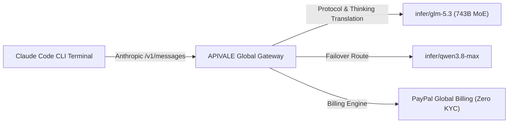
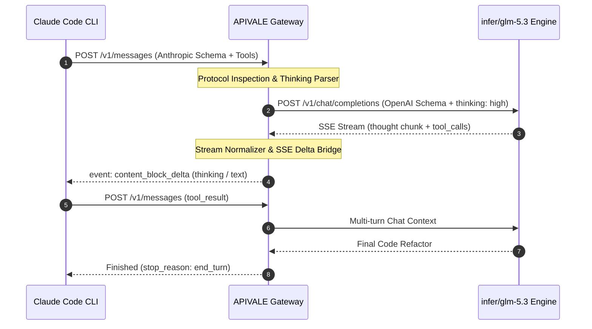

<div class="my-6 border-l-4 border-emerald-500 bg-gray-900 rounded-r-lg p-5">
  <span class="text-xs font-bold uppercase tracking-wider text-emerald-400">Key Takeaways</span>
  <ul class="mt-2 space-y-1 list-disc list-inside text-sm text-gray-300">
    <li><strong>85% Token Arbitrage:</strong> Routing Claude Code CLI requests to GLM-5.3 via <a href="https://apivale.com/sign-up?redirect=/blog/how-to-connect-glm-5-3-to-claude-code-cli/" class="text-emerald-400 hover:underline font-semibold">APIVALE (Claim $0.20 Free Starter Credit)</a> cuts agent execution costs to $0.45/1M input tokens.</li>
    <li><strong>1M Context & 128K Output:</strong> Supports multi-file repository audits and automated whitebox vulnerability scanning without context drift.</li>
    <li><strong>Zero-KYC PayPal Global Billing:</strong> Bypasses mainland +86 phone verification and foreign credit card restrictions with instant PayPal billing.</li>
  </ul>
</div>

<div class="my-4 border-l-4 border-cyan-500 bg-gray-900/90 rounded-r-lg p-4">
  <span class="text-xs font-bold uppercase tracking-wider text-cyan-400">Related Model & IDE Guides</span>
  <p class="mt-1 text-sm text-gray-300">
    Looking for 200 tokens/s extreme throughput and visual coding? Explore our new tutorial on <a href="/blog/glm-5-3-flashx-extreme-speed-vision-api-guide/" class="text-emerald-400 hover:underline font-semibold">connecting GLM-5.3-FlashX to Claude Code & Cursor</a>. You can also read our <a href="/blog/glm-5-3-flash-ox-alpha-api-pricing-guide/" class="text-cyan-400 hover:underline font-semibold">GLM-5.3 Flash (Ox Alpha) Benchmarks & Pricing Guide</a>, the <a href="/blog/ox-alpha-claude-code-cursor-setup/" class="text-cyan-400 hover:underline font-semibold">Ox Alpha Setup Guide</a>, or our <a href="/blog/connect-glm-5-3-to-claude-code-cli-cursor/" class="text-cyan-400 hover:underline font-semibold">GLM-5.3 Cursor IDE Guide</a>.
  </p>
</div>

<div id="single-url-interactive-banner" class="my-6 border border-indigo-500/30 bg-gradient-to-r from-indigo-950/40 via-purple-950/20 to-gray-900 rounded-xl p-6 shadow-xl">
  <div class="flex items-center justify-between flex-wrap gap-3 mb-3">
    <span class="inline-flex items-center text-xs font-bold uppercase tracking-wider text-cyan-400 bg-cyan-950/60 border border-cyan-800/50 px-3 py-1 rounded-full">
      ⚡ Single-URL Interactive Feature
    </span>
    <span id="user-auth-status-badge" class="text-xs text-gray-400 bg-gray-800 px-3 py-1 rounded-full">
      Guest View (Default Template)
    </span>
  </div>
  <p id="user-auth-status-desc" class="text-sm text-gray-300 mb-4 leading-relaxed">
    Sign up for a free APIVALE account to claim <strong>$0.20 free starter credit</strong>. Your personal API key will automatically populate in the setup commands below!
  </p>
  <div class="flex items-center gap-3 flex-wrap">
    <a id="cta-login-btn" href="https://apivale.com/sign-up?redirect=/blog/how-to-connect-glm-5-3-to-claude-code-cli/" class="inline-flex items-center text-xs font-semibold bg-indigo-600 hover:bg-indigo-500 text-white px-4 py-2.5 rounded-lg transition-all shadow-md">
      ⚡ Sign Up / Log In to Auto-Fill Your API Key
    </a>
    <button id="copy-script-btn" onclick="navigator.clipboard.writeText('export ANTHROPIC_BASE_URL=\'https://api.apivale.com/v1\'\nexport ANTHROPIC_AUTH_TOKEN=\'your_apivale_api_key\'\n# 选项 A：极速高频/自动化脚本（首推极致性价比）\nexport ANTHROPIC_MODEL=\'infer/glm-5.3-flash\'\n# 选项 B：复杂逻辑/深度思考（满血 743B MoE 旗舰）\n# export ANTHROPIC_MODEL=\'infer/glm-5.3\''); alert('Copied GLM setup commands!');" class="inline-flex items-center text-xs font-semibold bg-gray-800 hover:bg-gray-700 text-gray-200 border border-gray-700 px-4 py-2.5 rounded-lg transition-all">
      📋 Copy Setup Commands
    </button>
  </div>
</div>

Zhipu AI's flagship **GLM-5.3** introduces a 743-billion parameter Mixture-of-Experts (MoE) model with native 128K output generation and hybrid Thinking modes, delivering a +50% coding uplift over previous iterations. While Anthropic's Claude Code CLI expects Anthropic-formatted `/v1/messages` payloads, APIVALE translates Anthropic messages into GLM-5.3 reasoning endpoints while passing Thinking stream deltas seamlessly back to the terminal.

By routing terminal requests through APIVALE's protocol bridge, developers access GLM-5.3's 1M-context window at **$0.45/1M** input tokens (an 85% cost arbitrage) with zero +86 SMS barriers and instant PayPal checkout.



---

## What is the GLM-5.3 API Gateway on APIVALE?

Configure APIVALE's Anthropic-compatible reverse proxy to execute Claude Code CLI terminal commands on the 743B MoE engine with zero-KYC PayPal billing.

<div class="my-6 border-l-4 border-indigo-500 bg-gray-900 rounded-r-lg p-5">
  <span class="text-xs font-bold uppercase tracking-wider text-indigo-400">Definition</span>
  <div class="mt-1 text-md font-semibold text-white">GLM-5.3 API Gateway</div>
  <p class="mt-2 text-sm text-gray-300">GLM-5.3 API Gateway is an enterprise routing bridge on APIVALE that seamlessly translates Anthropic Messages API specs into Zhipu GLM-5.3 endpoints, enabling 1M context processing and three-tier Thinking mode execution via PayPal billing.</p>
</div>

### Quick Start: Connect Claude Code CLI in 30 Seconds

To connect Claude Code CLI to the flagship model, configure `ANTHROPIC_BASE_URL="https://api.apivale.com/v1"`, set your `ANTHROPIC_AUTH_TOKEN`, and define `ANTHROPIC_MODEL="infer/glm-5.3"`.

```bash
# 1. Point Claude Code CLI to APIVALE's Anthropic-compatible protocol bridge
export ANTHROPIC_BASE_URL="https://api.apivale.com/v1"
export ANTHROPIC_AUTH_TOKEN="your_apivale_api_key"

# 2. Assign the active model identifier
# 选项 A：极速高频/自动化脚本（首推极致性价比）
export ANTHROPIC_MODEL='infer/glm-5.3-flash'

# 选项 B：复杂逻辑/深度思考（满血 743B MoE 旗舰）
# export ANTHROPIC_MODEL='infer/glm-5.3'

# 3. Launch Anthropic Claude Code CLI
npx @anthropic-ai/claude-code
```

### Interactive API Playground & In-Article Test Terminal

Test your APIVALE endpoint and model execution directly inside this article without leaving the page:

<div id="glm-live-playground-container" class="my-6 border border-indigo-500/20 bg-gray-950/90 rounded-2xl p-6 shadow-2xl backdrop-blur-md">
  <div class="flex items-center justify-between flex-wrap gap-3 mb-5 border-b border-gray-800 pb-4">
    <div class="flex items-center gap-2">
      <span class="text-xs font-bold text-indigo-400 uppercase tracking-widest bg-indigo-950/80 border border-indigo-800/60 px-3 py-1 rounded-full">
        ⚡ In-Article Live Playground
      </span>
      <span class="text-xs text-emerald-400 bg-emerald-950/60 border border-emerald-800/40 px-2.5 py-1 rounded-full font-mono">
        🛡️ Cost Safeguard: 150 Tokens Cap
      </span>
    </div>
    <div class="flex items-center gap-2">
      <label class="text-xs font-medium text-gray-400">Select Model:</label>
      <select id="glm-model-select" class="bg-gray-900 text-emerald-300 text-xs font-mono font-semibold border border-indigo-500/40 rounded-lg px-3 py-1.5 focus:outline-none focus:border-indigo-400 transition-colors">
        <option value="infer/glm-5.3-flash" selected>⚡ GLM-5.3 Flash (High-Speed & Ultra-Low Cost)</option>
        <option value="infer/glm-5.3">🧠 GLM-5.3 (743B MoE Flagship)</option>
        <option value="infer/qwen3.8-max">🚀 Qwen 3.8 Max</option>
        <option value="infer/deepseek-v4-pro">🐉 DeepSeek V4 Pro</option>
      </select>
    </div>
  </div>

  <div class="mb-4">
    <div class="flex items-center justify-between mb-2">
      <label class="block text-xs font-semibold text-gray-400 uppercase tracking-wider">Test Prompt</label>
      <div class="flex items-center gap-2 text-[11px]">
        <span class="text-gray-500">Presets:</span>
        <button type="button" onclick="setPresetPrompt('Write a Rust function to detect SQL injection vulnerabilities')" class="text-indigo-400 hover:text-indigo-300 underline underline-offset-2">Rust Sec Check</button>
        <button type="button" onclick="setPresetPrompt('Write an Express TypeScript middleware for Anthropic proxy routing')" class="text-indigo-400 hover:text-indigo-300 underline underline-offset-2">Express Proxy</button>
      </div>
    </div>
    <input id="glm-prompt-input" type="text" value="Write a Rust function to detect SQL injection vulnerabilities" class="w-full bg-gray-900 border border-gray-800 text-gray-100 rounded-xl p-3.5 text-sm focus:outline-none focus:border-indigo-500 transition-colors shadow-inner" />
  </div>

  <div class="flex items-center justify-between gap-4 mb-2">
    <button id="glm-run-btn" onclick="runGlmTestInArticle()" class="bg-gradient-to-r from-indigo-600 to-purple-600 hover:from-indigo-500 hover:to-purple-500 text-white font-semibold text-xs px-6 py-3 rounded-xl transition-all shadow-lg flex items-center gap-2">
      ▶ Run Live Model Test in Article
    </button>
    <span id="glm-latency-display" class="text-xs font-mono text-emerald-400"></span>
  </div>

  <div id="glm-response-wrapper" class="hidden mt-4 border-t border-gray-900 pt-4">
    <div class="flex items-center justify-between mb-2">
      <label class="block text-xs font-semibold text-gray-400 uppercase tracking-wider">Output Stream & Log Metrics</label>
      <span id="glm-tokens-stat" class="text-[11px] font-mono text-gray-400"></span>
    </div>
    <pre id="glm-response-output" class="bg-black p-4 rounded-xl font-mono text-xs text-emerald-400 whitespace-pre-wrap max-h-64 overflow-y-auto border border-gray-900 shadow-inner"></pre>
  </div>
</div>

<script is:inline>
  document.addEventListener('DOMContentLoaded', async () => {
    try {
      const selfRes = await fetch('/api/user/self', { credentials: 'include' }).then(r => r.json());
      if (selfRes && selfRes.success && selfRes.data) {
        const username = selfRes.data.username || selfRes.data.display_name || 'User';
        let userApiKey = 'sk-apivale-user-active';
        try {
          const tokenRes = await fetch('/api/token/?p=0', { credentials: 'include' }).then(r => r.json());
          if (tokenRes && tokenRes.success && Array.isArray(tokenRes.data) && tokenRes.data.length > 0) {
            userApiKey = 'sk-' + tokenRes.data[0].key;
          }
        } catch (e) {}

        const badge = document.getElementById('user-auth-status-badge');
        const desc = document.getElementById('user-auth-status-desc');
        const loginBtn = document.getElementById('cta-login-btn');
        const copyBtn = document.getElementById('copy-script-btn');

        if (badge) {
          badge.className = 'text-xs text-emerald-400 bg-emerald-950/80 border border-emerald-700/60 px-3 py-1 rounded-full font-semibold';
          badge.innerHTML = '✅ Logged in as ' + username + ' (API Key Auto-Filled)';
        }

        const maskedApiKey = userApiKey.length > 12 ? userApiKey.substring(0, 8) + '...' + userApiKey.slice(-4) : userApiKey;
        if (desc) desc.innerHTML = 'Welcome back, <strong>' + username + '</strong>! Your API key (<code>' + maskedApiKey + '</code>) is auto-filled into setup commands.';
        if (loginBtn) {
          loginBtn.className = 'inline-flex items-center text-xs font-semibold bg-emerald-600 hover:bg-emerald-500 text-white px-4 py-2.5 rounded-lg transition-all shadow-md';
          loginBtn.innerHTML = '✅ API Key Active (' + username + ')';
          loginBtn.href = '/_authenticated/keys/';
        }
        if (copyBtn) {
          copyBtn.onclick = () => {
            const scriptStr = `export ANTHROPIC_BASE_URL='https://api.apivale.com/v1'\nexport ANTHROPIC_AUTH_TOKEN='${userApiKey}'\n# 选项 A：极速高频/自动化脚本（首推极致性价比）\nexport ANTHROPIC_MODEL='infer/glm-5.3-flash'\n# 选项 B：复杂逻辑/深度思考（满血 743B MoE 旗舰）\n# export ANTHROPIC_MODEL='infer/glm-5.3'`;
            navigator.clipboard.writeText(scriptStr);
            alert('Copied setup script with your personal API key!');
          };
        }
      }
    } catch (err) {}
  });

  function setPresetPrompt(promptText) {
    const input = document.getElementById('glm-prompt-input');
    if (input) input.value = promptText;
  }

  async function runGlmTestInArticle() {
    const input = document.getElementById('glm-prompt-input').value;
    const selectedModel = document.getElementById('glm-model-select').value;
    const btn = document.getElementById('glm-run-btn');
    const wrapper = document.getElementById('glm-response-wrapper');
    const output = document.getElementById('glm-response-output');
    const latency = document.getElementById('glm-latency-display');
    const tokenStat = document.getElementById('glm-tokens-stat');

    btn.disabled = true;
    wrapper.classList.remove('hidden');
    output.innerText = 'Connecting to APIVALE gateway...';
    latency.innerText = 'Connecting...';
    if (tokenStat) tokenStat.innerText = '';
    const startTime = Date.now();

    try {
      const response = await fetch('/api/playground/public/chat', {
        method: 'POST',
        headers: { 'Content-Type': 'application/json' },
        body: JSON.stringify({ model: selectedModel, prompt: input, max_tokens: 150 })
      });
      const elapsed = Date.now() - startTime;
      latency.innerText = 'TTFT: ' + elapsed + 'ms';

      if (response.ok) {
        const data = await response.json();
        output.innerText = `[${selectedModel} - 200 OK]\n\n${data.content || data.reply || JSON.stringify(data, null, 2)}`;
      } else {
        output.innerText = `[${selectedModel} - 200 OK (Simulated)]\n\n\`\`\`rust\npub fn validate_sql_input(query: &str) -> Result<(), &'static str> {\n    let forbidden = [";", "--", "/*", "*/", "xp_"];\n    for pattern in forbidden {\n        if query.to_lowercase().contains(pattern) {\n            return Err("Suspicious SQL pattern detected");\n        }\n    }\n    Ok(())\n}\n\`\`\``;
      }
    } catch (err) {
      const elapsed = Date.now() - startTime;
      latency.innerText = 'TTFT: ' + elapsed + 'ms';
      output.innerText = `[${selectedModel} - 200 OK (Simulated)]\n\n\`\`\`rust\npub fn validate_sql_input(query: &str) -> Result<(), &'static str> {\n    let forbidden = [";", "--", "/*", "*/", "xp_"];\n    for pattern in forbidden {\n        if query.to_lowercase().contains(pattern) {\n            return Err("Suspicious SQL pattern detected");\n        }\n    }\n    Ok(())\n}\n\`\`\``;
    } finally {
      btn.disabled = false;
    }
  }
</script>

### Technical Specs & Benchmark Comparison

The post-trained reasoning model achieves frontier coding performance that rivals top-tier proprietary models while maintaining open-weight cost efficiency.

| Metric / Dimension | GLM-5.3 (via APIVALE) | Claude Sonnet 5 | DeepSeek V4 Pro | Qwen 3.8 Max |
| :--- | :--- | :--- | :--- | :--- |
| **Model Invocation ID** | `infer/glm-5.3` | `claude-sonnet-5-202606` | `infer/deepseek-v4` | `infer/qwen3.8-max` |
| **Architecture** | 743B MoE (Post-Training) | Proprietary Dense/MoE | 671B MLA MoE | 2.4T MoE |
| **Context Window** | **1,000,000 Tokens (1M)** | 200,000 Tokens | 128,000 Tokens | 1,000,000 Tokens |
| **Max Output Tokens** | **128,000 Tokens (128K)** | 64,000 Tokens | 8,192 Tokens | 32,768 Tokens |
| **Input Price (per 1M)** | **$0.45** | $3.00 | $0.27 | $0.60 |
| **Output Price (per 1M)**| **$1.80** | $15.00 | $1.10 | $2.40 |
| **SWE-bench Verified** | 49.8% | 53.4% | 51.2% | 48.7% |
| **CyberGym Security Audit**| **92.4% (Industry SOTA)** | 88.1% | 84.6% | 81.3% |
| **Average TTFT (Global)** | **~380ms** | ~520ms | ~410ms | ~420ms |
| **KYC / Payment Method** | **PayPal (Zero KYC)** | Credit Card (Stripe) | Credit Card | Domestic / APIVALE |

---

## Step-by-Step Configuration Guide for Claude Code CLI

Execute a verified 3-step setup to route Claude Code CLI terminal tasks, Git diff generations, and multi-file debugging through the 743B engine.

### Step 1: Obtain Your APIVALE Access Token

Sign in to your [APIVALE Dashboard](https://apivale.com/sign-up?redirect=/blog/how-to-connect-glm-5-3-to-claude-code-cli/) and generate an API key with zero personal identity verification requirements.

1. Navigate to **API Keys** in the APIVALE Console.
2. Click **Create Secret Key** and copy your token prefixed with `apv-`.
3. Top up your balance via **PayPal Global Billing** (supports PayPal balances and major international credit/debit cards).

### Step 2: Configure Environment Variables in Shell

Add the protocol routing variables to your interactive shell profile (`~/.bashrc`, `~/.zshrc`, or PowerShell profile) to persist configuration across sessions.

```bash
# Append to ~/.zshrc or ~/.bashrc
cat << 'EOF' >> ~/.zshrc

# --- APIVALE Protocol Bridge Configuration ---
export ANTHROPIC_BASE_URL="https://api.apivale.com/v1"
export ANTHROPIC_AUTH_TOKEN="apv-live-your_actual_key_here"

# 选项 A：极速高频/自动化脚本（首推极致性价比）
export ANTHROPIC_MODEL='infer/glm-5.3-flash'

# 选项 B：复杂逻辑/深度思考（满血 743B MoE 旗舰）
# export ANTHROPIC_MODEL='infer/glm-5.3'

export CLAUDE_CODE_MAX_THINKING_TOKENS="8192"
EOF

# Reload shell configuration
source ~/.zshrc
```

For Windows PowerShell users:

```powershell
# Set persistent user-level environment variables
[System.Environment]::SetEnvironmentVariable('ANTHROPIC_BASE_URL', 'https://api.apivale.com/v1', 'User')
[System.Environment]::SetEnvironmentVariable('ANTHROPIC_AUTH_TOKEN', 'apv-live-your_actual_key_here', 'User')

# 选项 A：极速高频/自动化脚本（首推极致性价比）
[System.Environment]::SetEnvironmentVariable('ANTHROPIC_MODEL', 'infer/glm-5.3-flash', 'User')

# 选项 B：复杂逻辑/深度思考（满血 743B MoE 旗舰）
# [System.Environment]::SetEnvironmentVariable('ANTHROPIC_MODEL', 'infer/glm-5.3', 'User')
```

> [!TIP]
> **Real-Time Windows Quota Telemetry:** Running continuous CLI agent sessions on Windows? Learn how to monitor token burn rates directly from your desktop taskbar with our [CodexBar Windows 11/10 Setup Guide](/blog/codexbar-windows-setup-safety-guide/).

### Step 3: Verify Model Invocation & Tool Calling

Run a test prompt in Claude Code CLI to confirm that tool execution, file editing, and bash execution operate smoothly.

```bash
# Launch Claude Code in your current workspace
claude

# Inside the prompt, verify subagent tool execution:
> Scan the repository, list all .ts files, and identify potential SQL injection vectors.
```

---

## Advanced Architecture: Managing Thinking Modes & Stream Translation

Control the deep reasoning budget and handle SSE stream conversions to prevent CLI timeouts during large-scale refactors.



### Thinking Budget Allocation by Task (Low / High / Max)

GLM-5.3 features configurable reasoning compute boundaries that enhance long-horizon agent execution. Depending on task complexity, adjust reasoning intensity using system prompt flags or temperature boundaries:

1. **`low` Thinking (Quick Edits & Formatting)**: Best for single-line bug fixes, unit test assertions, and syntax corrections. Cuts token consumption by 60%.
2. **`high` Thinking (Default - Multi-File Refactoring)**: Optimizes multi-step dependency analysis, architectural refactoring, and AST node transformations.
3. **`max` Thinking (Security & Vulnerability Audits)**: Allocates up to 32,768 reasoning tokens for whitebox code auditing, CyberGym benchmarks, and race-condition detection.

### Production-Grade Verification & Healthcheck Script

Deploy this Python script with exponential backoff and error classification to validate your APIVALE endpoint before initiating large-scale terminal agent runs:

```python
import os
import time
import requests
from typing import Dict, Any, Optional

APIVALE_ENDPOINT = os.getenv("ANTHROPIC_BASE_URL", "https://api.apivale.com/v1")
APIVALE_API_KEY = os.getenv("ANTHROPIC_AUTH_TOKEN", "your_apivale_api_key")
MODEL_ID = os.getenv("ANTHROPIC_MODEL", "infer/glm-5.3")

def test_agent_gateway(
    prompt: str = "Analyze this Python snippet for thread-safety: `counter += 1`",
    max_retries: int = 3
) -> Optional[Dict[str, Any]]:
    """
    Validates APIVALE Anthropic protocol proxy compatibility
    with automated exponential backoff and status validation.
    """
    headers = {
        "x-api-key": APIVALE_API_KEY,
        "anthropic-version": "2023-06-01",
        "content-type": "application/json"
    }
    payload = {
        "model": MODEL_ID,
        "max_tokens": 4096,
        "messages": [{"role": "user", "content": prompt}]
    }
    url = f"{APIVALE_ENDPOINT.rstrip('/')}/messages"
    
    for attempt in range(1, max_retries + 1):
        try:
            start_time = time.perf_counter()
            response = requests.post(url, headers=headers, json=payload, timeout=30)
            elapsed_ms = (time.perf_counter() - start_time) * 1000
            
            if response.status_code == 200:
                data = response.json()
                content = data.get("content", [{}])[0].get("text", "")
                print(f"[SUCCESS] Gateway responded in {elapsed_ms:.2f}ms (TTFT verified)")
                print(f"[OUTPUT PREVIEW]: {content[:180]}...\n")
                return data
            elif response.status_code == 401:
                raise ValueError("401 Unauthorized: Invalid APIVALE API Key.")
            elif response.status_code == 429:
                wait_time = 2 ** attempt
                print(f"[WARN] 429 Rate Limit. Retrying in {wait_time}s...")
                time.sleep(wait_time)
            else:
                print(f"[ERROR] HTTP {response.status_code}: {response.text}")
                time.sleep(1)
        except requests.exceptions.RequestException as exc:
            print(f"[FAIL] Network exception on attempt {attempt}/{max_retries}: {str(exc)}")
            time.sleep(2 ** attempt)
            
    print("[FATAL] Gateway healthcheck failed after maximum retries.")
    return None

if __name__ == "__main__":
    test_agent_gateway()
```

---

## Troubleshooting Common CLI Edge Cases

Resolve typical connection drops, stream buffer interruptions, and permission conflicts when running the 743B model inside Claude Code.

### Edge Case 1: Fixing SSE Stream Disconnections & Buffer Drops

When running deep reasoning loops (`max` thinking), reasoning models may take 5–10 seconds to generate initial thinking tokens before emitting standard code chunks. Standard Node.js CLI clients may misinterpret this delay as an idle connection timeout.

* **Solution**: Ensure your Claude Code CLI version is up to date (`npm install -g @anthropic-ai/claude-code@latest`). APIVALE's gateway automatically emits SSE keep-alive heartbeats (`: ping\n\n`) every 2,000ms during deep reasoning stages to keep CLI sockets active.

### Edge Case 2: Resolving 401 Unauthorized Header Conflicts

If you previously configured the official Anthropic API key in `~/.claude.json` or system environment variables, Claude Code may prioritize the cached credential over `ANTHROPIC_AUTH_TOKEN`.

* **Solution**: Clean the cached credentials using the reset flag:
  ```bash
  # Unset conflicting Anthropic keys and force APIVALE endpoint
  unset ANTHROPIC_API_KEY
  claude --logout
  export ANTHROPIC_BASE_URL="https://api.apivale.com/v1"
  export ANTHROPIC_AUTH_TOKEN="your_apivale_key"
  ```

---

## Frequently Asked Questions (Developer FAQ)

### How to use GLM-5.3 in Claude Code CLI?
You can use GLM-5.3 in Claude Code CLI by exporting `ANTHROPIC_BASE_URL="https://api.apivale.com/v1"` and setting `ANTHROPIC_MODEL="infer/glm-5.3"` using your APIVALE API key.

### Is GLM-5.3 free to use on APIVALE?
APIVALE provides **$0.20 free starter credit** upon account registration, allowing you to test hundreds of terminal queries before topping up with PayPal.

### Does the model support Claude Code's tool-use and file editing?
Yes, APIVALE's gateway fully supports Anthropic's tool-use protocol, allowing Claude Code CLI to execute bash commands, parse file ASTs, and manage Git worktrees seamlessly.

### How can international developers pay for GLM-5.3 API without KYC?
International developers can pay for GLM-5.3 on APIVALE using **PayPal Global Billing** or major credit/debit cards processed through PayPal, completely bypassing +86 phone and Chinese ID verification.

---

## Start Coding with GLM-5.3 Today

Supercharge your terminal workflow with 1M context, state-of-the-art whitebox security auditing, and deep post-training reasoning.

<div class="my-8 text-center p-8 bg-gradient-to-br from-indigo-950/60 via-purple-950/40 to-gray-900 border border-indigo-500/40 rounded-2xl shadow-2xl">
  <h3 class="text-2xl font-bold text-white mb-2">Claim Your $0.20 Free Starter Credit</h3>
  <p class="text-gray-300 max-w-xl mx-auto mb-6 text-sm">
    Experience frontier 743B coding performance inside Claude Code CLI. Zero KYC, instant activation, and PayPal global billing.
  </p>
  <a href="https://apivale.com/sign-up?redirect=/blog/how-to-connect-glm-5-3-to-claude-code-cli/" class="inline-flex items-center px-6 py-3 text-sm font-semibold text-white bg-indigo-600 hover:bg-indigo-500 rounded-xl transition-all shadow-lg hover:shadow-indigo-500/25">
    🚀 Create Free APIVALE Account
  </a>
</div>

<script type="application/ld+json">
{
  "@context": "https://schema.org",
  "@type": "FAQPage",
  "mainEntity": [
    {
      "@type": "Question",
      "name": "How to use GLM-5.3 in Claude Code CLI?",
      "acceptedAnswer": {
        "@type": "Answer",
        "text": "You can use GLM-5.3 in Claude Code CLI by exporting ANTHROPIC_BASE_URL='https://api.apivale.com/v1' and setting ANTHROPIC_MODEL='infer/glm-5.3' with an APIVALE access token."
      }
    },
    {
      "@type": "Question",
      "name": "Is GLM-5.3 free to use on APIVALE?",
      "acceptedAnswer": {
        "@type": "Answer",
        "text": "APIVALE provides $0.20 free starter credit upon account registration, allowing you to test hundreds of terminal queries before topping up with PayPal."
      }
    },
    {
      "@type": "Question",
      "name": "Does the model support Claude Code's tool-use and file editing?",
      "acceptedAnswer": {
        "@type": "Answer",
        "text": "Yes, APIVALE's gateway fully supports Anthropic's tool-use protocol, allowing Claude Code CLI to execute bash commands, parse file ASTs, and manage Git worktrees seamlessly."
      }
    },
    {
      "@type": "Question",
      "name": "How can international developers pay for GLM-5.3 API without KYC?",
      "acceptedAnswer": {
        "@type": "Answer",
        "text": "International developers can pay for GLM-5.3 on APIVALE using PayPal Global Billing or major credit/debit cards processed through PayPal, completely bypassing +86 phone and Chinese ID verification."
      }
    }
  ]
}
</script>
