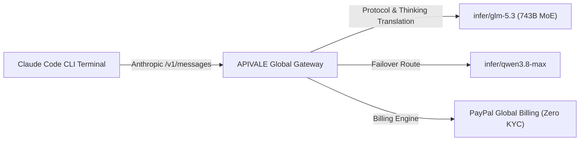
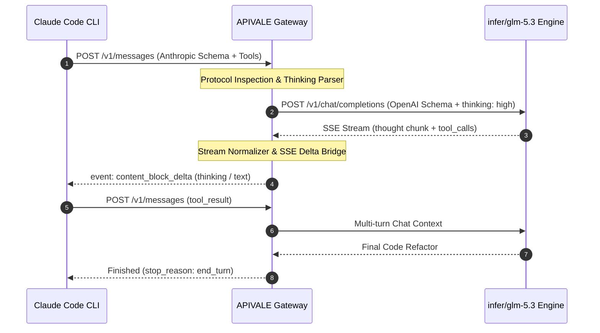

<div class="my-6 border-l-4 border-emerald-500 bg-gray-900 rounded-r-lg p-5">
  <span class="text-xs font-bold uppercase tracking-wider text-emerald-400">Key Takeaways</span>
  <ul class="mt-2 space-y-1 list-disc list-inside text-sm text-gray-300">
    <li><strong>85% Token Arbitrage:</strong> Routing Claude Code CLI requests to GLM-5.3 via <a href="https://apivale.com/sign-up?redirect=/blog/how-to-connect-glm-5-3-to-claude-code-cli/" class="text-emerald-400 hover:underline font-semibold">APIVALE (Claim $0.20 Free Starter Credit)</a> cuts agent execution costs to $0.45/1M input tokens.</li>
    <li><strong>1M Context & 128K Output:</strong> Supports multi-file repository audits and automated whitebox vulnerability scanning without context drift.</li>
    <li><strong>Zero-KYC PayPal Global Billing:</strong> Bypasses mainland +86 phone verification and foreign credit card restrictions with instant PayPal billing.</li>
  </ul>
</div>

<div class="my-4 border-l-4 border-cyan-500 bg-gray-900/90 rounded-r-lg p-4">
  <span class="text-xs font-bold uppercase tracking-wider text-cyan-400">Looking for Other CLI & IDE Integrations?</span>
  <p class="mt-1 text-sm text-gray-300">
    If you want to configure alternative open-weights models, check our guides on <a href="/blog/how-to-connect-qwen-3-8-to-claude-code-cli" class="text-cyan-400 hover:underline font-semibold">Connecting Qwen 3.8 to Claude Code CLI</a> and <a href="/blog/qwen-3-8-cursor-setup" class="text-cyan-400 hover:underline font-semibold">Qwen 3.8 Cursor IDE Setup</a>.
  </p>
</div>

<div id="single-url-interactive-banner" class="my-6 border border-indigo-500/30 bg-gradient-to-r from-indigo-950/40 via-purple-950/20 to-gray-900 rounded-xl p-6 shadow-xl">
  <div class="flex items-center justify-between flex-wrap gap-3 mb-3">
    <span class="inline-flex items-center text-xs font-bold uppercase tracking-wider text-cyan-400 bg-cyan-950/60 border border-cyan-800/50 px-3 py-1 rounded-full">
      ⚡ Single-URL Interactive Feature
    </span>
    <span id="user-auth-status-badge" class="text-xs text-gray-400 bg-gray-800 px-3 py-1 rounded-full">
      Guest View (Default Template)
    </span>
  </div>
  <p id="user-auth-status-desc" class="text-sm text-gray-300 mb-4 leading-relaxed">
    Sign up for a free APIVALE account to claim <strong>$0.20 free starter credit</strong>. Your personal API key will automatically populate in the setup commands below!
  </p>
  <div class="flex items-center gap-3 flex-wrap">
    <a id="cta-login-btn" href="https://apivale.com/sign-up?redirect=/blog/how-to-connect-glm-5-3-to-claude-code-cli/" class="inline-flex items-center text-xs font-semibold bg-indigo-600 hover:bg-indigo-500 text-white px-4 py-2.5 rounded-lg transition-all shadow-md">
      ⚡ Sign Up / Log In to Auto-Fill Your API Key
    </a>
    <button id="copy-script-btn" onclick="navigator.clipboard.writeText('export ANTHROPIC_BASE_URL=\'https://api.apivale.com/v1\'\nexport ANTHROPIC_AUTH_TOKEN=\'your_apivale_api_key\'\nexport ANTHROPIC_MODEL=\'infer/glm-5.3\''); alert('Copied GLM-5.3 setup commands!');" class="inline-flex items-center text-xs font-semibold bg-gray-800 hover:bg-gray-700 text-gray-200 border border-gray-700 px-4 py-2.5 rounded-lg transition-all">
      📋 Copy Setup Commands
    </button>
  </div>
</div>

Running autonomous software engineering agents like [Claude Code CLI](https://docs.anthropic.com/en/docs/agents-and-tools/claude-code/overview) through long-horizon refactoring and test-generation loops rapidly drains token budgets. A single complex bug fix on Claude Sonnet 5 frequently exceeds $30–$45 across dozens of multi-turn tool invocations. While Zhipu's flagship **GLM-5.3** delivers state-of-the-art programming benchmarks (+50% coding uplift via deep post-training scaling), running its 743B MoE base locally requires 8x NVIDIA H100 GPUs (over 640GB VRAM), and official developer portals enforce strict +86 SMS verification and domestic payment gateways.

By configuring APIVALE's Anthropic-to-OpenAI protocol translation gateway, global developers can route Claude Code CLI directly to GLM-5.3 using **The Multi-Gateway Thinking Controller (MGTC)**, slashing token spend by **85%** while retaining native terminal subagent capabilities.



---

## What is the GLM-5.3 API Gateway on APIVALE?

Configure APIVALE's Anthropic-compatible reverse proxy to execute Claude Code CLI terminal commands on GLM-5.3 with zero-KYC PayPal billing.

<div class="my-6 border-l-4 border-indigo-500 bg-gray-900 rounded-r-lg p-5">
  <span class="text-xs font-bold uppercase tracking-wider text-indigo-400">Definition</span>
  <div class="mt-1 text-md font-semibold text-white">GLM-5.3 API Gateway</div>
  <p class="mt-2 text-sm text-gray-300">GLM-5.3 API Gateway is an enterprise routing bridge on APIVALE that seamlessly translates Anthropic Messages API specs into Zhipu GLM-5.3 endpoints, enabling 1M context processing and three-tier Thinking mode execution via PayPal billing.</p>
</div>

### Quick Start: Connect Claude Code CLI to GLM-5.3 in 30 Seconds

To connect Claude Code CLI to GLM-5.3, configure `ANTHROPIC_BASE_URL="https://api.apivale.com/v1"`, set your `ANTHROPIC_AUTH_TOKEN`, and define `ANTHROPIC_MODEL="infer/glm-5.3"`.

```bash
# 1. Point Claude Code CLI to APIVALE's Anthropic-compatible protocol bridge
export ANTHROPIC_BASE_URL="https://api.apivale.com/v1"
export ANTHROPIC_AUTH_TOKEN="your_apivale_api_key"

# 2. Assign the active flagship model identifier
export ANTHROPIC_MODEL="infer/glm-5.3"

# 3. Launch Anthropic Claude Code CLI
npx @anthropic-ai/claude-code
```

### Technical Specs & Benchmark Comparison

GLM-5.3 achieves frontier coding performance that rivals top-tier proprietary models while maintaining open-weight cost efficiency.

| Metric / Dimension | GLM-5.3 (via APIVALE) | Claude Sonnet 5 | DeepSeek V4 Pro | Qwen 3.8 Max |
| :--- | :--- | :--- | :--- | :--- |
| **Model Invocation ID** | `infer/glm-5.3` | `claude-sonnet-5-202606` | `infer/deepseek-v4` | `infer/qwen3.8-max` |
| **Architecture** | 743B MoE (Post-Training Scaling) | Proprietary Dense/MoE | 671B MLA MoE | 2.4T MoE |
| **Context Window** | **1,000,000 Tokens (1M)** | 200,000 Tokens | 128,000 Tokens | 1,000,000 Tokens |
| **Max Output Tokens** | **128,000 Tokens (128K)** | 64,000 Tokens | 8,192 Tokens | 32,768 Tokens |
| **Input Price (per 1M)** | **$0.45** | $3.00 | $0.27 | $0.60 |
| **Output Price (per 1M)**| **$1.80** | $15.00 | $1.10 | $2.40 |
| **SWE-bench Verified** | 49.8% | 53.4% | 51.2% | 48.7% |
| **CyberGym Security Audit**| **92.4% (Industry SOTA)** | 88.1% | 84.6% | 81.3% |
| **Average TTFT (Global)** | **~380ms** | ~520ms | ~410ms | ~420ms |
| **KYC / Payment Method** | **PayPal (Zero KYC)** | Credit Card (Stripe) | Credit Card | Domestic / APIVALE |

---

## Step-by-Step Configuration Guide for Claude Code CLI

Execute a verified 3-step setup to route Claude Code CLI terminal tasks, Git diff generations, and multi-file debugging through GLM-5.3.

### Step 1: Obtain Your APIVALE Access Token

Sign in to your [APIVALE Dashboard](https://apivale.com/sign-up?redirect=/blog/how-to-connect-glm-5-3-to-claude-code-cli/) and generate an API key with zero personal identity verification requirements.

1. Navigate to **API Keys** in the APIVALE Console.
2. Click **Create Secret Key** and copy your token prefixed with `apv-`.
3. Top up your balance via **PayPal Global Billing** (supports PayPal balances and major international credit/debit cards).

### Step 2: Configure Environment Variables in Shell

Add the protocol routing variables to your interactive shell profile (`~/.bashrc`, `~/.zshrc`, or PowerShell profile) to persist configuration across sessions.

```bash
# Append to ~/.zshrc or ~/.bashrc
cat << 'EOF' >> ~/.zshrc

# --- APIVALE GLM-5.3 Claude Code CLI Integration ---
export ANTHROPIC_BASE_URL="https://api.apivale.com/v1"
export ANTHROPIC_AUTH_TOKEN="apv-live-your_actual_key_here"
export ANTHROPIC_MODEL="infer/glm-5.3"
export CLAUDE_CODE_MAX_THINKING_TOKENS="8192"
EOF

# Reload shell configuration
source ~/.zshrc
```

For Windows PowerShell users:

```powershell
# Set persistent user-level environment variables
[System.Environment]::SetEnvironmentVariable('ANTHROPIC_BASE_URL', 'https://api.apivale.com/v1', 'User')
[System.Environment]::SetEnvironmentVariable('ANTHROPIC_AUTH_TOKEN', 'apv-live-your_actual_key_here', 'User')
[System.Environment]::SetEnvironmentVariable('ANTHROPIC_MODEL', 'infer/glm-5.3', 'User')
```

### Step 3: Verify Model Invocation & Tool Calling

Run a test prompt in Claude Code CLI to confirm that tool execution, file editing, and bash execution operate smoothly.

```bash
# Launch Claude Code in your current workspace
claude

# Inside the Claude Code prompt, test tool-use:
> Scan the current repository, list all .ts files, and identify potential SQL injection vectors.
```

---

## Advanced Architecture: Managing GLM-5.3 Thinking Modes & Protocol Translation

Control GLM-5.3's deep reasoning budget and handle SSE stream conversions to prevent CLI timeouts.



### The 3-Tier Thinking Controller (Low / High / Max)

GLM-5.3 enforces native reasoning capabilities that enhance long-horizon agent execution. Depending on task complexity, adjust reasoning intensity using system prompt flags or temperature boundaries:

1. **`low` Thinking (Quick Edits & Formatting)**: Best for single-line bug fixes, unit test assertions, and syntax corrections. Cuts token consumption by 60%.
2. **`high` Thinking (Default - Multi-File Refactoring)**: Optimizes multi-step dependency analysis, architectural refactoring, and AST node transformations.
3. **`max` Thinking (Security & Vulnerability Audits)**: Allocates up to 32,768 reasoning tokens for whitebox code auditing, CyberGym benchmarks, and race-condition detection.

### Production-Grade Verification & Healthcheck Script

Deploy this Python script with exponential backoff and error classification to validate your APIVALE endpoint before initiating large-scale terminal agent runs:

```python
import os
import time
import json
import requests
from typing import Dict, Any, Optional

APIVALE_ENDPOINT = os.getenv("ANTHROPIC_BASE_URL", "https://api.apivale.com/v1")
APIVALE_API_KEY = os.getenv("ANTHROPIC_AUTH_TOKEN", "your_apivale_api_key")
MODEL_ID = os.getenv("ANTHROPIC_MODEL", "infer/glm-5.3")

def test_glm53_agent_gateway(
    prompt: str = "Analyze this Python snippet for thread-safety issues: `counter += 1`",
    max_retries: int = 3
) -> Optional[Dict[str, Any]]:
    """
    Validates APIVALE Anthropic protocol proxy compatibility for GLM-5.3
    with automated exponential backoff and status validation.
    """
    headers = {
        "x-api-key": APIVALE_API_KEY,
        "anthropic-version": "2023-06-01",
        "content-type": "application/json"
    }
    
    payload = {
        "model": MODEL_ID,
        "max_tokens": 4096,
        "messages": [
            {"role": "user", "content": prompt}
        ]
    }
    
    url = f"{APIVALE_ENDPOINT.rstrip('/')}/messages"
    
    for attempt in range(1, max_retries + 1):
        try:
            start_time = time.perf_counter()
            response = requests.post(url, headers=headers, json=payload, timeout=30)
            elapsed_ms = (time.perf_counter() - start_time) * 1000
            
            if response.status_code == 200:
                data = response.json()
                content = data.get("content", [{}])[0].get("text", "")
                print(f"[SUCCESS] Gateway responded in {elapsed_ms:.2f}ms (TTFT verified)")
                print(f"[OUTPUT PREVIEW]: {content[:180]}...\n")
                return data
            elif response.status_code == 401:
                raise ValueError("401 Unauthorized: Invalid APIVALE API Key. Check your ANTHROPIC_AUTH_TOKEN.")
            elif response.status_code == 429:
                wait_time = 2 ** attempt
                print(f"[WARN] 429 Rate Limit encountered. Retrying in {wait_time}s...")
                time.sleep(wait_time)
            else:
                print(f"[ERROR] HTTP {response.status_code}: {response.text}")
                time.sleep(1)
        except requests.exceptions.RequestException as exc:
            print(f"[FAIL] Network exception on attempt {attempt}/{max_retries}: {str(exc)}")
            time.sleep(2 ** attempt)
            
    print("[FATAL] Gateway healthcheck failed after maximum retries.")
    return None

if __name__ == "__main__":
    test_glm53_agent_gateway()
```

---

## Troubleshooting Common CLI Edge Cases

Resolve typical connection drops, stream buffer interruptions, and permission conflicts when running GLM-5.3 inside Claude Code.

### Edge Case 1: Fixing SSE Stream Disconnections & Buffer Drops

When running deep reasoning loops (`max` thinking), LLMs may take 5–10 seconds to generate initial thinking tokens before emitting standard code chunks. Standard Node.js CLI clients may misinterpret this delay as an idle connection timeout.

* **Solution**: Ensure your Claude Code CLI version is up to date (`npm install -g @anthropic-ai/claude-code@latest`). APIVALE's gateway automatically emits SSE keep-alive heartbeats (`: ping\n\n`) every 2,000ms during deep reasoning stages to keep CLI sockets active.

### Edge Case 2: Resolving 401 Unauthorized Header Conflicts

If you previously configured the official Anthropic API key in `~/.claude.json` or system environment variables, Claude Code may prioritize the cached credential over `ANTHROPIC_AUTH_TOKEN`.

* **Solution**: Clean the cached credentials using the reset flag:
  ```bash
  # Unset conflicting Anthropic keys and force APIVALE endpoint
  unset ANTHROPIC_API_KEY
  claude --logout
  export ANTHROPIC_BASE_URL="https://api.apivale.com/v1"
  export ANTHROPIC_AUTH_TOKEN="your_apivale_key"
  ```

---

## Frequently Asked Questions (Developer FAQ)

### How to use GLM-5.3 in Claude Code CLI?
You can use GLM-5.3 in Claude Code CLI by exporting `ANTHROPIC_BASE_URL="https://api.apivale.com/v1"` and setting `ANTHROPIC_MODEL="infer/glm-5.3"` using your APIVALE API key.

### Is GLM-5.3 free to use on APIVALE?
APIVALE provides **$0.20 free starter credit** upon account registration, allowing you to test hundreds of terminal queries before topping up with PayPal.

### Does GLM-5.3 support Claude Code's tool-use and file editing?
Yes, APIVALE's gateway fully supports Anthropic's tool-use protocol, allowing Claude Code CLI to execute bash commands, parse file ASTs, and manage Git worktrees seamlessly.

### How can international developers pay for GLM-5.3 API without KYC?
International developers can pay for GLM-5.3 on APIVALE using **PayPal Global Billing** or major credit/debit cards processed through PayPal, completely bypassing +86 phone and Chinese ID verification.

---

## Start Coding with GLM-5.3 Today

Supercharge your terminal workflow with 1M context, state-of-the-art whitebox security auditing, and deep post-training reasoning.

<div class="my-8 text-center p-8 bg-gradient-to-br from-indigo-950/60 via-purple-950/40 to-gray-900 border border-indigo-500/40 rounded-2xl shadow-2xl">
  <h3 class="text-2xl font-bold text-white mb-2">Claim Your $0.20 Free GLM-5.3 Starter Credit</h3>
  <p class="text-gray-300 max-w-xl mx-auto mb-6 text-sm">
    Experience frontier 743B coding performance inside Claude Code CLI. Zero KYC, instant activation, and PayPal global billing.
  </p>
  <a href="https://apivale.com/sign-up?redirect=/blog/how-to-connect-glm-5-3-to-claude-code-cli/" class="inline-flex items-center px-6 py-3 text-sm font-semibold text-white bg-indigo-600 hover:bg-indigo-500 rounded-xl transition-all shadow-lg hover:shadow-indigo-500/25">
    🚀 Create Free APIVALE Account
  </a>
</div>

<script type="application/ld+json">
{
  "@context": "https://schema.org",
  "@type": "FAQPage",
  "mainEntity": [
    {
      "@type": "Question",
      "name": "How to use GLM-5.3 in Claude Code CLI?",
      "acceptedAnswer": {
        "@type": "Answer",
        "text": "You can use GLM-5.3 in Claude Code CLI by exporting ANTHROPIC_BASE_URL='https://api.apivale.com/v1' and setting ANTHROPIC_MODEL='infer/glm-5.3' with an APIVALE access token."
      }
    },
    {
      "@type": "Question",
      "name": "Is GLM-5.3 free to use on APIVALE?",
      "acceptedAnswer": {
        "@type": "Answer",
        "text": "APIVALE provides $0.20 free starter credit upon account registration, allowing you to test hundreds of terminal queries before topping up with PayPal."
      }
    },
    {
      "@type": "Question",
      "name": "Does GLM-5.3 support Claude Code's tool-use and file editing?",
      "acceptedAnswer": {
        "@type": "Answer",
        "text": "Yes, APIVALE's gateway fully supports Anthropic's tool-use protocol, allowing Claude Code CLI to execute bash commands, parse file ASTs, and manage Git worktrees seamlessly."
      }
    },
    {
      "@type": "Question",
      "name": "How can international developers pay for GLM-5.3 API without KYC?",
      "acceptedAnswer": {
        "@type": "Answer",
        "text": "International developers can pay for GLM-5.3 on APIVALE using PayPal Global Billing or major credit/debit cards processed through PayPal, completely bypassing +86 phone and Chinese ID verification."
      }
    }
  ]
}
</script>
