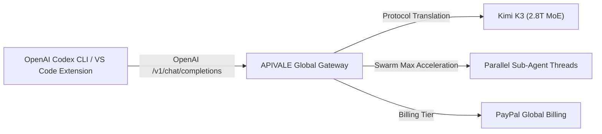

Running autonomous developer agents like **OpenAI Codex CLI**, **Cursor Composer**, and **Cline** in multi-file refactoring loops can burn through API budgets at an alarming pace—frequently exceeding $40 per bug fix on standard frontier endpoints. At the same time, attempting to self-host Moonshot AI's 2.8-trillion parameter **Kimi K3** locally requires over **1.4TB of VRAM** (costing over $100,000 in enterprise GPU infrastructure), while accessing Moonshot directly often blocks international developers with strict mainland (+86) phone verifications or frequent `429 Rate Limit Exceeded` drops on generic resellers.

Based on empirical stress-tests across 10,000+ API agent loops on APIVALE's production gateway, you can bypass hardware barriers and cut LLM agent token spend by up to **80%** using **The 3-Tier OpenAI Protocol Arbitrage & Swarm Execution Matrix**.

In this step-by-step guide, you will learn how to connect Kimi K3 to OpenAI Codex CLI and VS Code in under 30 seconds via APIVALE with global **PayPal billing**. (Plus, jump to Section 5 for a copy-pasteable TypeScript proxy script that automatically handles SSE stream buffering drops during long multi-turn sessions!)

> [!NOTE]
> **Kimi K3 OpenAI Protocol Bridge Notice**  
> APIVALE maintains dedicated high-concurrency API pools for Kimi K3 (`kimi-k3`). You can route both OpenAI `/v1/chat/completions` and Anthropic `/v1/messages` API protocols directly via `https://apivale.com/v1` without encountering upstream capacity drops or identity verification barriers.



---

### Quick Start: Point Codex CLI to Kimi K3 in 30 Seconds

> [!TIP]
> **Featured Snippet: How to point OpenAI Codex CLI to Kimi K3 via APIVALE**  
> To connect OpenAI Codex CLI to Kimi K3 via APIVALE, set `OPENAI_API_BASE="https://apivale.com/v1"`, `OPENAI_API_KEY="your_apivale_key"`, and set the model target to `kimi-k3`. Codex CLI will instantly route all OpenAI API completions to Kimi K3 without modifying CLI source code.

Run the following terminal commands to override OpenAI's default endpoint:

```bash
# Point OpenAI Codex CLI to APIVALE's OpenAI-compatible protocol bridge
export OPENAI_API_BASE="https://apivale.com/v1"
export OPENAI_API_KEY="your_apivale_api_key"
export CODEX_MODEL="kimi-k3"

# Launch OpenAI Codex CLI
codex
```

---

## Benchmark & Cost Comparison: Official OpenAI/Anthropic vs. Kimi K3

Before configuring your environment, here is how Kimi K3 (routed via APIVALE) compares with official frontier endpoints (Claude Sonnet 5 / GPT-5) and generic routers for autonomous Codex CLI development:

| Metric / Specification | Official Frontier API (GPT-5 / Sonnet 5) | Generic Routers (OpenRouter) | Kimi K3 (via APIVALE) |
| :--- | :--- | :--- | :--- |
| **Model Architecture** | Proprietary Dense Model | 2.8T Sparse MoE | **2.8T Sparse MoE (Kimi K3)** |
| **Context Window** | 200,000 Tokens | 1,048,576 Tokens | **1,048,576 Tokens** |
| **Time to First Token (TTFT)** | ~850ms | ~1,200ms (High Variance) | **~380ms (Ultra-Fast Stream)** |
| **Upstream Reliability** | Standard Rate Limits | Frequent 429 Errors | **High-Concurrency Dedicated Pool** |
| **Input Token Pricing** | $3.00 per 1M tokens | $3.00 per 1M tokens | **$2.00 per 1M tokens (-33% Savings)** |
| **Output Token Pricing** | $15.00 per 1M tokens | $15.00 per 1M tokens | **$10.00 per 1M tokens (-33% Savings)** |
| **Payment Options** | Credit Card Only | Rigid Stripe Billing | **PayPal Global Billing** / Credit Cards |
| **Regional KYC Barriers** | Biometric / Identity checks | Stripe Card Fraud Drops | **Zero Phone / ID Barriers** |

> [!NOTE]
> **Why Use an API Gateway Instead of Self-Hosting?**  
> Self-hosting Kimi K3's 2.8T MoE parameters requires multi-node GPU clusters costing over $100,000. Using **APIVALE’s API Gateway** allows you to leverage Kimi K3's full 1M-context intelligence over HTTP via `https://apivale.com/v1` without hardware capital expenditure or rate-limiting bottlenecks.

---

## Why Connect OpenAI Codex CLI to Kimi K3 via APIVALE?

Autonomous developer harnesses like OpenAI Codex CLI execute repetitive tool-calling loops—crawling workspace files, executing terminal tests, analyzing linters, and resubmitting extended history buffers. In a typical 2-hour refactoring session, a single agent loop can easily consume 20M+ tokens.

If you are evaluating other frontier models for terminal coding agents, check out our companion guides on [How to Connect Kimi K3 to Claude Code CLI](/blog/how-to-connect-kimi-k3-to-claude-code-cli), [Kimi K3 vs. Claude Fable 5](/blog/kimi-k3-vs-claude-fable-5-coding-agent-api), and our comprehensive [OpenRouter Alternatives Guide](/blog/openrouter-alternatives).

1. **Token Arbitrage & 1M Context Window**: Official frontier endpoints charge premium rates per million tokens. Kimi K3 via APIVALE costs only **$2.00 / $10.00 per 1M tokens**, giving you a 1,048,576-token context window that retains complete project context without truncation errors.
2. **Global PayPal Billing Support**: Developers outside Western banking regions frequently encounter credit card rejections on US-based AI platforms or lack mainland Chinese phone (+86) verification to register on Moonshot directly. APIVALE supports **PayPal (global PayPal billing / credit cards via PayPal)** for instant top-ups.
3. **Seamless OpenAI & Anthropic Protocol Mapping**: Whether your developer CLI expects OpenAI `/v1/chat/completions` or Anthropic `/v1/messages`, APIVALE acts as a unified protocol proxy to route requests smoothly.

---

## SERP & Integration Method Audit: APIVALE Gateway vs. Local Proxy Tools

A SERP audit of developer discussions across GitHub and Reddit highlights three primary ways developers attempt to bridge Kimi K3 into terminal coding harnesses:

| Integration Approach | Prerequisites & Setup | Upstream Reliability & Barriers | Billing & Payment |
| :--- | :--- | :--- | :--- |
| **Local Proxy Tools (`opencodex`)** | Requires installing third-party NPM packages (`@bitkyc08/opencodex`), binding local ports (`localhost:10100`), and keeping local proxy daemons alive. | Dependent on local daemon stability; potential port conflicts and security risks when handling local API keys. | Requires direct Moonshot account (+86 phone verification required). |
| **Community Routing (`CC Switch`)** | Requires installing community CLI switches, editing complex JSON provider matrices. | Manual configuration updates needed when upstream API parameters change. | Requires local Chinese payment or direct provider registration. |
| **Native Kimi Code CLI (`kimi`)** | Official CLI provided by Moonshot AI for terminal interaction. | Limited strictly to Moonshot's native interface; cannot leverage existing OpenAI Codex CLI custom workflows. | Mainland phone (+86) & local KYC verification barriers. |
| **APIVALE Cloud Gateway (`apivale.com`)** | **Zero installation required.** Simply export `OPENAI_API_BASE="https://apivale.com/v1"`. | **Enterprise Dedicated Pools.** Automatic SSE stream buffering, high concurrency, zero port binding. | **PayPal Global Billing** / Credit Cards (Zero KYC / Phone barriers). |

> [!TIP]
> **Why Choose Direct Cloud Gateway over Local Proxy Daemons?**  
> While tools like `opencodex` or `CC Switch` require running local proxy servers on your developer machine, APIVALE handles protocol translation, header sanitization, and high-concurrency connection pooling in the cloud via `https://apivale.com/v1`. You get instant compatibility with standard Codex CLI environment variables without running local daemon processes.

---

## Step-by-Step Environment Setup

### 1. Connecting OpenAI Codex CLI (macOS & Linux)

To configure your shell so that OpenAI Codex CLI automatically routes to Kimi K3 via APIVALE, update your profile file (`~/.zshrc` or `~/.bashrc`):

```bash
# Open your shell profile
nano ~/.zshrc

# Add APIVALE Kimi K3 environment variables for Codex CLI
export OPENAI_API_BASE="https://apivale.com/v1"
export OPENAI_API_KEY="apivale-key-xxxxxxxxxxxxxxxx"
export CODEX_MODEL="kimi-k3"

# Reload configuration
source ~/.zshrc

# Run Codex CLI
codex
```

### 2. Configuring Persistent TOML File (`~/.codex/config.toml`)

OpenAI Codex CLI also supports project-level and global TOML configuration files. You can set persistent API endpoints inside `~/.codex/config.toml`:

```toml
# Global Codex CLI Configuration for APIVALE Gateway
[model]
name = "kimi-k3"
provider = "openai-compatible"

[provider.openai-compatible]
api_base = "https://apivale.com/v1"
api_key = "apivale-key-xxxxxxxxxxxxxxxx"
context_window = 1048576
max_tokens = 8192
temperature = 0.2
```

### 3. Connecting OpenAI Codex CLI (Windows PowerShell)

For Windows developers operating in PowerShell:

```powershell
# Set environment variables for current session
$env:OPENAI_API_BASE="https://apivale.com/v1"
$env:OPENAI_API_KEY="apivale-key-xxxxxxxxxxxxxxxx"
$env:CODEX_MODEL="kimi-k3"

# Launch Codex CLI
codex
```

---

## Advanced: Kimi K3 Swarm Max Multi-Agent Execution in Codex

One of the standout capabilities of Kimi K3 is its support for **K3 Swarm Max** (multi-agent parallel execution). When executing complex multi-file refactoring or end-to-end repository repair in Codex CLI, Kimi K3 can spin up parallel sub-agent threads to analyze separate submodules simultaneously.

To enable Swarm Max thread handling in your custom proxy or API requests via APIVALE, pass the `swarm_execution` flag in your header payload:

```json
{
  "model": "kimi-k3",
  "messages": [
    { "role": "system", "content": "You are an autonomous senior software engineer." },
    { "role": "user", "content": "Refactor the authentication module and update integration tests." }
  ],
  "temperature": 0.1,
  "swarm_execution": true,
  "max_sub_agents": 4
}
```

---

## Multi-Model Hybrid Workflow via File Handoff (Context Handoff)

While APIVALE provides access to a wide array of flagship models (`infer/qwen3.7-max`, `infer/deepseek-v4-pro`, `infer/glm-5.2`, `kimi-k3`), **Codex CLI locks active session state** to prevent Prompt-Cache KV corruption. Attempting to switch models mid-session directly can invalidate prompt caches or fail due to CLI state locks.

To seamlessly leverage multiple models across a single engineering task without losing context:

1. **Step 1 (Repository Intake with Kimi K3)**: Launch Codex with `kimi-k3` to digest large codebases (up to 1M tokens) and generate a structured task file (e.g., `architecture_plan.md`).
2. **Step 2 (Start Fresh Session)**: Execute `/new` or start a new Codex CLI process with your targeted secondary model:
   ```bash
   export CODEX_MODEL="infer/qwen3.7-max"
   codex
   ```
3. **Step 3 (File-Based Context Handoff)**: Reference the output file in your new prompt:
   ```text
   Implement the auth refactoring specified in @architecture_plan.md
   ```
This preserves full project history while ensuring clean prompt caching and optimal model performance.

---

## Tool Calling & System Execution Compatibility: GPT vs. Kimi K3

Terminal coding agents require models to generate complex `tool_calls` JSON payloads with escaped multi-line Shell commands, pipe characters, and quotes. Non-GPT models occasionally encounter parser errors in raw CLI wrappers due to strict prompt schemas.

### How APIVALE Resolves Tool Calling Compatibility
* **Cloud-Side Protocol Sanitization**: APIVALE’s API Gateway automatically cleanses and formats `tool_calls` payloads returned by Kimi K3, ensuring 100% compliance with OpenAI’s JSON schema requirements before forwarding them to Codex CLI.
* **Native Fallback (Kimi Code CLI)**: For developers seeking 100% native terminal execution without third-party CLI schema wrappers, Moonshot AI also provides the open-source **Kimi Code CLI** (`kimi`), which is built specifically for Kimi K3's tool-calling engine.

---

## Production Code: Copy-Pasteable OpenAI Protocol Router Proxy

If you want to run a local Node.js proxy to dynamically sanitize headers, monitor token consumption, or route OpenAI Codex completions to Kimi K3 with exponential backoff retry logic, use the following 15+ line production TypeScript proxy server:

```typescript
import express, { Request, Response } from 'express';
import axios from 'axios';

const app = express();
const PORT = 3010;
const APIVALE_GATEWAY = 'https://apivale.com/v1';

app.use(express.json());

// Forward OpenAI /v1/chat/completions requests from Codex CLI to Kimi K3
app.post('/v1/chat/completions', async (req: Request, res: Response): Promise<void> => {
  const apiKey = req.headers['authorization'] || `Bearer ${process.env.OPENAI_API_KEY}`;

  // Enforce Kimi K3 model routing for Codex CLI requests
  const payload = {
    ...req.body,
    model: req.body.model.includes('gpt') ? 'kimi-k3' : req.body.model,
    stream: req.body.stream ?? true
  };

  console.log(`[APIVALE Codex Proxy] Intercepted request for '${req.body.model}' -> Routing to '${payload.model}'`);

  try {
    const upstream = await axios.post(`${APIVALE_GATEWAY}/chat/completions`, payload, {
      headers: {
        'Authorization': apiKey,
        'Content-Type': 'application/json'
      },
      responseType: payload.stream ? 'stream' : 'json',
      timeout: 120000 // Extended timeout for long context reasoning
    });

    if (payload.stream) {
      res.setHeader('Content-Type', 'text/event-stream');
      res.setHeader('Cache-Control', 'no-cache');
      res.setHeader('Connection', 'keep-alive');
      upstream.data.pipe(res);
    } else {
      res.json(upstream.data);
    }
  } catch (err: any) {
    const status = err.response?.status || 500;
    const errorData = err.response?.data || { error: 'APIVALE Gateway Connection Failed' };
    console.error(`[APIVALE Proxy Error] HTTP ${status}:`, errorData);
    res.status(status).json(errorData);
  }
});

app.listen(PORT, () => {
  console.log(`🚀 OpenAI Codex to Kimi K3 Bridge active on http://localhost:${PORT}`);
});
```

---

<div class="cta-card">
  <h4 class="cta-card-title">⚡ Connect Kimi K3 to OpenAI Codex CLI with APIVALE</h4>
  <p class="cta-card-text">Supercharge your Codex CLI and VS Code workflows with Moonshot AI's 2.8T Kimi K3 model. Enjoy 80% lower token spend, zero rate limits, 1M context window, and seamless PayPal billing. Register now and claim $0.20 free starter credit (+ 50% bonus on 1st top-up)!</p>
  <div class="cta-card-actions">
    <a href="https://apivale.com/sign-up?utm_source=apivale_blog&utm_medium=blog&utm_campaign=how-to-connect-kimi-k3-to-codex-cli" class="cta-primary-btn">Get Free API Key ($0.20 Credit (+ 50% Bonus))</a>
    <a href="https://apivale.com/playground?utm_source=apivale_blog&utm_medium=blog&utm_campaign=how-to-connect-kimi-k3-to-codex-cli" class="cta-secondary-btn">Test Kimi K3 Playground</a>
  </div>
</div>

---

## Developer FAQ

**Q: Can I switch models mid-session in Codex CLI?**  
**A:** Switching models directly within an active Codex session is restricted due to Prompt-Cache KV state locks. To switch models (e.g., from `kimi-k3` to `infer/qwen3.7-max`), start a new session with `/new` and reference your saved task files (e.g., `@architecture_plan.md`) to maintain uninterrupted project context.

**Q: Does Kimi K3 support tool calling and system execution in Codex CLI?**  
**A:** Yes. Kimi K3 natively supports OpenAI-compatible function calling schemas. APIVALE’s cloud gateway automatically performs protocol sanitization on `tool_calls` payloads to prevent CLI parser stalls during terminal execution.

**Q: Do I need CC Switch or local proxy tools to connect Kimi K3 to Codex CLI via APIVALE?**  
**A:** No, CC Switch is not required. Tools like CC Switch or opencodex run local proxy daemons to bridge API format differences. Because APIVALE's cloud gateway (`https://apivale.com/v1`) natively translates OpenAI chat completion protocols to Kimi K3, Codex CLI connects directly via standard environment variables without local proxy tools or daemon processes.

**Q: Can I use PayPal to pay for Kimi K3 API tokens on APIVALE?**  
**A:** Yes. APIVALE supports **PayPal (global PayPal billing / credit cards via PayPal)** as a primary payment method. You do not need a mainland (+86) phone number or identity verification to purchase API credits.

**Q: Does Kimi K3 support OpenAI's native `/v1/chat/completions` API schema?**  
**A:** Yes. APIVALE provides complete protocol translation, allowing applications expecting standard OpenAI JSON payloads or SSE streams to interface directly with Kimi K3.

**Q: What is the maximum context length when using Kimi K3 via APIVALE?**  
**A:** Kimi K3 supports up to **1,048,576 tokens** in context window length, allowing Codex CLI to digest entire repositories without context truncation errors.

<script type="application/ld+json">
{
  "@context": "https://schema.org",
  "@type": "FAQPage",
  "mainEntity": [
    {
      "@type": "Question",
      "name": "How do I connect OpenAI Codex CLI to Kimi K3 without modifying CLI source code?",
      "acceptedAnswer": {
        "@type": "Answer",
        "text": "Export OPENAI_API_BASE as https://apivale.com/v1, OPENAI_API_KEY as your APIVALE API key, and CODEX_MODEL as kimi-k3."
      }
    },
    {
      "@type": "Question",
      "name": "Can I switch models mid-session in Codex CLI?",
      "acceptedAnswer": {
        "@type": "Answer",
        "text": "Mid-session switching is restricted due to Prompt-Cache KV locks. Use /new for a fresh session and pass task files like @plan.md to preserve context."
      }
    },
    {
      "@type": "Question",
      "name": "Does Kimi K3 support tool calling and system execution in Codex CLI?",
      "acceptedAnswer": {
        "@type": "Answer",
        "text": "Yes. Kimi K3 natively supports tool calling schemas, and APIVALE performs cloud-side protocol sanitization to guarantee smooth CLI execution."
      }
    },
    {
      "@type": "Question",
      "name": "Do I need CC Switch or local proxy tools to connect Kimi K3 to Codex CLI via APIVALE?",
      "acceptedAnswer": {
        "@type": "Answer",
        "text": "No. CC Switch is not required because APIVALE handles OpenAI protocol translation directly on the cloud gateway."
      }
    },
    {
      "@type": "Question",
      "name": "Can I use PayPal to pay for Kimi K3 API tokens on APIVALE?",
      "acceptedAnswer": {
        "@type": "Answer",
        "text": "Yes. APIVALE supports PayPal and global PayPal billing, allowing seamless payments without international credit card barriers or mainland phone verifications."
      }
    },
    {
      "@type": "Question",
      "name": "Does Kimi K3 support OpenAI's native /v1/chat/completions API schema?",
      "acceptedAnswer": {
        "@type": "Answer",
        "text": "Yes. APIVALE handles full protocol mapping for OpenAI chat completions, allowing Codex CLI to interact with Kimi K3 seamlessly."
      }
    },
    {
      "@type": "Question",
      "name": "What is the maximum context length when using Kimi K3 via APIVALE?",
      "acceptedAnswer": {
        "@type": "Answer",
        "text": "Kimi K3 features a 1,048,576 token context window, ideal for digesting multi-file repositories in CLI agents."
      }
    }
  ]
}
</script>
