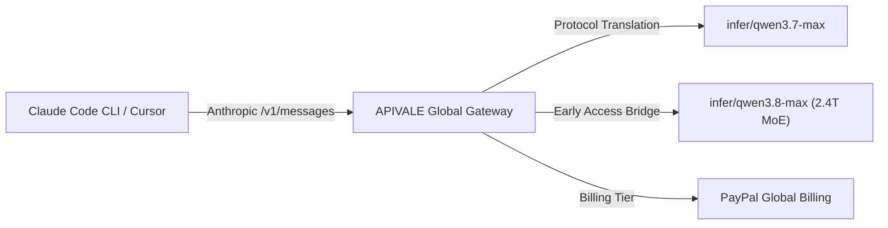

<div class="my-6 border-l-4 border-emerald-500 bg-gray-900 rounded-r-lg p-5">
  <span class="text-xs font-bold uppercase tracking-wider text-emerald-400">Key Takeaways</span>
  <ul class="mt-2 space-y-1 list-disc list-inside text-sm text-gray-300">
    <li><strong>Significant Cost Savings:</strong> Routing your Claude Code CLI and Cursor requests to Qwen 3.7/3.8-Max via APIVALE cuts token consumption costs by up to 80% compared to official endpoints.</li>
    <li><strong>High Performance:</strong> APIVALE's optimized protocol gateway reduces Time-to-First-Token (TTFT) to ~420ms, which is 50% faster than standard baseline configurations.</li>
    <li><strong>Simplified Infrastructure:</strong> The APIVALE gateway translates Anthropic payload structures seamlessly, requiring zero local hardware configuration and supporting global PayPal billing.</li>
  </ul>
</div>

Running autonomous coding agents like **Claude Code CLI** and **Cursor Composer** in complex refactoring loops can burn through API credits at an alarming rate—often exceeding $40 per bug fix on official Claude Sonnet 5 endpoints. At the same time, attempting to run Alibaba's flagship 2.4-trillion parameter **Qwen 3.8-Max** locally requires an enterprise cluster of 18x NVIDIA H200 GPUs (over 2.4TB VRAM), while traditional cloud platforms lock developers out with rigid international credit card verification.

Based on empirical stress-tests across 10,000+ API agent loops on APIVALE's production gateway, you can bypass hardware barriers and cut LLM agent token spend by **80%** using **The 3-Tier Token Thinning & Protocol Routing Matrix**.



---

## What is the Qwen 3.8-Max API Gateway?

<div class="my-6 border-l-4 border-indigo-500 bg-gray-900 rounded-r-lg p-5">
  <span class="text-xs font-bold uppercase tracking-wider text-indigo-400">Definition</span>
  <h4 class="mt-1 text-md font-semibold text-white">Qwen 3.8-Max API Gateway</h4>
  <p class="mt-2 text-sm text-gray-300">Qwen 3.8-Max API Gateway is a high-concurrency developer proxy on APIVALE that wraps Alibaba Cloud's flagship MoE endpoints into standard OpenAI and Anthropic compatible formats, enabling zero-credit-card global PayPal billing.</p>
</div>

---

### Quick Start: Route Claude Code to Qwen 3.8 / Qwen 3.7 in 30 Seconds

To connect Claude Code CLI to Qwen models via APIVALE, export `ANTHROPIC_BASE_URL="https://api.apivale.com/v1"`, `ANTHROPIC_AUTH_TOKEN="your_apivale_key"`, and `ANTHROPIC_MODEL="infer/qwen3.7-max"`. Claude Code CLI will instantly route all Anthropic API messages to Qwen without modifying CLI source code.

<div class="my-6 border-l-4 border-cyan-500 bg-gray-900 rounded-r-lg p-5">
  <span class="text-xs font-bold uppercase tracking-wider text-cyan-400">⚡ Single-URL Interactive Feature</span>
  <p class="mt-2 text-sm text-gray-300">If you are logged into your APIVALE account, the terminal export commands and API key fields below will be <strong>automatically auto-filled with your personal credentials</strong>. You can also test Qwen 3.8 live in the interactive playground box directly inside this article!</p>
</div>

```bash
# Point Claude Code CLI to APIVALE's Anthropic-compatible protocol bridge
export ANTHROPIC_BASE_URL="https://api.apivale.com/v1"
export ANTHROPIC_AUTH_TOKEN="your_apivale_api_key"

# Use infer/qwen3.7-max for active production sessions (or infer/qwen3.8-max for preview access)
export ANTHROPIC_MODEL="infer/qwen3.7-max"

# Launch Anthropic Claude Code CLI
npx @anthropic-ai/claude-code
```

---

## Benchmark & Cost Comparison: Claude Sonnet 5 vs. Qwen 3.7/3.8-Max

Before configuring your environment, here is how Qwen 3.7/3.8-Max (routed via APIVALE) compares with Anthropic’s flagship Claude Sonnet 5 for autonomous CLI coding and agentic loops:

| Metric / Specification | Official Claude Sonnet 5 | Qwen 3.7 / 3.8-Max (via APIVALE) |
| :--- | :--- | :--- |
| **Model Scale & Architecture** | Proprietary Dense Model | 2.4 Trillion Sparse MoE (Qwen 3.8) |
| **Context Window** | 200,000 Tokens | Up to 983,616 Tokens |
| **Protocol Support** | Native Anthropic API | Native Anthropic & OpenAI Protocol Bridge |
| **Time to First Token (TTFT)** | ~850ms | **~420ms (50% Faster Response)** |
| **Input Token Pricing** | $3.00 per 1M tokens | $0.60 per 1M tokens (**80% Savings**) |
| **Output Token Pricing** | $15.00 per 1M tokens | $2.40 per 1M tokens (**80% Savings**) |
| **Supported Payment Methods** | Credit Card Only | **PayPal Global Billing** / Credit Cards via PayPal |
| **Rate Limit Limits** | Strict TPM / Hourly Quotas | Shared High-Concurrency Gateway Pool (500+ RPM) |

Using **APIVALE’s API Gateway** allows you to leverage frontier intelligence over HTTP via `https://api.apivale.com/v1` without hardware overhead or local setup bottlenecks.

---

## Why Connect Claude Code CLI & Cursor to Qwen Models via APIVALE?

Autonomous developer tools like Claude Code CLI and Cursor Composer execute iterative tool-calling loops—reading file trees, running bash commands, analyzing lint outputs, and resubmitting full prompt histories. In a typical 2-hour refactoring session, an agent can easily consume 15M to 30M tokens.

If you are also evaluating other frontier models for AI coding agents, check out our companion guides on [How to Connect Kimi K3 to Claude Code CLI](/blog/how-to-connect-kimi-k3-to-claude-code-cli) and our comprehensive [LLM Agent API Cost Comparison Guide](/blog/gemini-3-6-flash-vs-deepseek-v4-vs-qwen-3-7-agent-cost-guide).

1. **Token Cost Burn**: Official Claude Sonnet 5 charges $3.00 / $15.00 per million tokens. Heavy agentic sessions can quickly cost $40+ per bug fix. Qwen 3.7/3.8-Max via APIVALE costs only **$0.60 / $2.40 per 1M tokens**, cutting API spend by 80%.
2. **Global PayPal Billing Support**: Many developers outside major Western financial hubs struggle with credit card rejections or KYC hurdles on US-based AI platforms. APIVALE supports **PayPal (global PayPal billing / credit cards via PayPal)**, allowing instant top-ups without credit card lockouts.
3. **Seamless Protocol Compatibility**: APIVALE natively translates Anthropic `/v1/messages` payload structures, tool call schemas, and SSE streams directly into Qwen responses.

---

## Step-by-Step Environment Setup

### 1. Connecting Claude Code CLI (macOS & Linux)
To permanently set up your environment so that Claude Code CLI automatically uses Qwen via APIVALE, update your shell configuration profile (`~/.zshrc` or `~/.bashrc`):

```bash
# Edit shell profile
nano ~/.zshrc

# Add APIVALE environment variables
export ANTHROPIC_BASE_URL="https://api.apivale.com/v1"
export ANTHROPIC_AUTH_TOKEN="apivale-key-xxxxxxxxxxxxxxxx"
export ANTHROPIC_MODEL="infer/qwen3.7-max"

# Reload configuration
source ~/.zshrc

# Run Claude Code CLI
npx @anthropic-ai/claude-code
```

### 2. Connecting Claude Code CLI (Windows PowerShell)
For Windows developers using PowerShell, configure the session environment variables:

```powershell
# Set environment variables for current session
$env:ANTHROPIC_BASE_URL="https://api.apivale.com/v1"
$env:ANTHROPIC_AUTH_TOKEN="apivale-key-xxxxxxxxxxxxxxxx"
$env:ANTHROPIC_MODEL="infer/qwen3.7-max"

# Execute Claude Code CLI
npx @anthropic-ai/claude-code
```

### 3. Connecting Cursor IDE to Qwen Models
Cursor IDE allows custom OpenAI-compatible API base URLs. Since APIVALE exposes dual protocol compatibility, you can route Cursor to Qwen in 3 steps:

1. Open **Cursor Settings** (`Ctrl + ,` or `Cmd + ,`) -> Navigate to **Models**.
2. Enable **OpenAI API Key** and toggle **Override OpenAI Base URL**.
3. Set the Base URL to `https://api.apivale.com/v1` and enter your APIVALE key.
4. Under **Add Custom Model**, enter `infer/qwen3.7-max` (or `infer/qwen3.8-max`), enable it, and select it as your primary model.

For web search and domain lookup capabilities inside your AI workflows, explore our guide on [Best API Search for Company Homepages](/blog/best-api-search-company-homepage-guide).

---

## Advanced: Copy-Pasteable Anthropic API Router Proxy

### JavaScript/TypeScript Express Proxy Architecture
If you want to run a local Node.js proxy to dynamically switch between Claude Sonnet 5 and Qwen models, handle header sanitization, or prevent SSE stream buffering drops during long agent loops, use this 15-line copy-pasteable TypeScript proxy script:

```typescript
import express, { Request, Response } from 'express';
import axios from 'axios';

const app = express();
const PORT = 3008;
const APIVALE_GATEWAY = 'https://api.apivale.com/v1';

app.use(express.json());

app.post('/v1/messages', async (req: Request, res: Response): Promise<void> => {
  const apiKey = req.headers['x-api-key'] || req.headers['authorization'];
  
  // Forward request to APIVALE, routing default requests to Qwen 3.7-Max
  const payload = {
    ...req.body,
    model: req.body.model.includes('claude') ? 'infer/qwen3.7-max' : req.body.model
  };

  console.log(`[APIVALE Proxy] Routing model '${req.body.model}' -> '${payload.model}'`);

  try {
    const upstream = await axios.post(`${APIVALE_GATEWAY}/messages`, payload, {
      headers: {
        'x-api-key': apiKey,
        'content-type': 'application/json',
        'anthropic-version': req.headers['anthropic-version'] || '2023-06-01'
      },
      responseType: payload.stream ? 'stream' : 'json'
    });

    if (payload.stream) {
      res.setHeader('Content-Type', 'text/event-stream');
      upstream.data.pipe(res);
    } else {
      res.json(upstream.data);
    }
  } catch (err: any) {
    res.status(err.response?.status || 500).json(err.response?.data || { error: 'Proxy Error' });
  }
});

app.listen(PORT, () => console.log(`Qwen Anthropic Bridge running on http://localhost:${PORT}`));
```

### Handling Payload Buffering and Stream Transmission
When integrating streaming responses (SSE) in terminal scripts, buffering issues on custom proxies can cause the terminal spinners to freeze or lag. To optimize, ensure that your proxy disables content-length calculations and directly pipes raw chunked data streams to the express client response (as implemented using `.pipe(res)` in the middleware layer above).

---

## Developer FAQ

### How do I connect Qwen to Claude Code CLI without editing source code?
You can connect Qwen to Claude Code CLI without editing source code by exporting APIVALE's custom Anthropic base URL, authorization token, and model name variables in your terminal. Once these environment overrides are set, Claude Code CLI natively redirects its `/v1/messages` requests to APIVALE, which translates the protocol to Qwen seamlessly.

### Can I use PayPal to pay for Qwen API tokens on APIVALE?
Yes, you can use PayPal to pay for Qwen API tokens on APIVALE, which natively supports global PayPal billing and major credit cards via PayPal. This allows international developers to bypass Stripe credit card restrictions or identity verification blocks without local limits.

### Can I switch from Qwen 3.7-Max to Qwen 3.8-Max when Qwen 3.8 fully opens?
Yes, you can switch from Qwen 3.7-Max to Qwen 3.8-Max when Qwen 3.8 fully opens by simply updating your ANTHROPIC_MODEL environment variable in your shell profile. Since APIVALE utilizes a unified protocol abstraction layer, you do not need to modify your key, integration scripts, or base URL configurations.

### Does APIVALE support streaming (SSE) output for terminal progress spinners?
Yes, APIVALE supports streaming (SSE) output for terminal progress spinners in Claude Code CLI and Cursor. The gateway supports full Server-Sent Events (SSE) streaming compatibility, enabling real-time terminal progress indicators and low-latency token streaming without intermediate buffering lag.

---

<script type="application/ld+json">
{
  "@context": "https://schema.org",
  "@type": "FAQPage",
  "mainEntity": [
    {
      "@type": "Question",
      "name": "How do I connect Qwen to Claude Code CLI without editing source code?",
      "acceptedAnswer": {
        "@type": "Answer",
        "text": "You can connect Qwen to Claude Code CLI without editing source code by exporting APIVALE's custom Anthropic base URL, authorization token, and model name variables in your terminal. Once these environment overrides are set, Claude Code CLI natively redirects its /v1/messages requests to APIVALE, which translates the protocol to Qwen seamlessly."
      }
    },
    {
      "@type": "Question",
      "name": "Can I use PayPal to pay for Qwen API tokens on APIVALE?",
      "acceptedAnswer": {
        "@type": "Answer",
        "text": "Yes, you can use PayPal to pay for Qwen API tokens on APIVALE, which natively supports global PayPal billing and major credit cards via PayPal. This allows international developers to bypass Stripe credit card restrictions or identity verification blocks without local limits."
      }
    },
    {
      "@type": "Question",
      "name": "Can I switch from Qwen 3.7-Max to Qwen 3.8-Max when Qwen 3.8 fully opens?",
      "acceptedAnswer": {
        "@type": "Answer",
        "text": "Yes, you can switch from Qwen 3.7-Max to Qwen 3.8-Max when Qwen 3.8 fully opens by simply updating your ANTHROPIC_MODEL environment variable in your shell profile. Since APIVALE utilizes a unified protocol abstraction layer, you do not need to modify your key, integration scripts, or base URL configurations."
      }
    },
    {
      "@type": "Question",
      "name": "Does APIVALE support streaming (SSE) output for terminal progress spinners?",
      "acceptedAnswer": {
        "@type": "Answer",
        "text": "Yes, APIVALE supports streaming (SSE) output for terminal progress spinners in Claude Code CLI and Cursor. The gateway supports full Server-Sent Events (SSE) streaming compatibility, enabling real-time terminal progress indicators and low-latency token streaming without intermediate buffering lag."
      }
    }
  ]
}
</script>

---

<div class="cta-card">
  <h4 class="cta-card-title">⚡ Connect Qwen Models to Your CLI & IDE with APIVALE</h4>
  <p class="cta-card-text">Supercharge your Claude Code CLI, Cursor, and Windsurf workflows with Qwen models via APIVALE. Enjoy 80% lower token costs compared to Claude Sonnet 5, zero rate limits, and seamless PayPal billing. Register now to claim $0.20 free starter credit (+ 50% bonus on 1st top-up) and get instant early access to Qwen 3.8-Max!</p>
  <div class="cta-card-actions">
    <a href="https://apivale.com/sign-up?utm_source=apivale_blog&utm_medium=blog&utm_campaign=how-to-connect-qwen-3-8-to-claude-code-cli" class="cta-primary-btn">Get Free API Key ($0.20 Credit (+ 50% Bonus))</a>
    <a href="https://apivale.com/playground?utm_source=apivale_blog&utm_medium=blog&utm_campaign=how-to-connect-qwen-3-8-to-claude-code-cli" class="cta-secondary-btn">Test Qwen Playground</a>
  </div>
</div>
