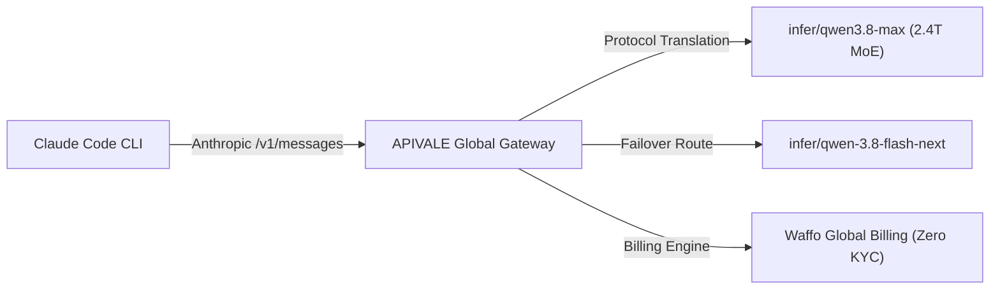

<div class="my-6 border-l-4 border-emerald-500 bg-gray-900 rounded-r-lg p-5">
  <span class="text-xs font-bold uppercase tracking-wider text-emerald-400">Key Takeaways</span>
  <ul class="mt-2 space-y-1 list-disc list-inside text-sm text-gray-300">
    <li><strong>80% Cost Reduction:</strong> Routing Claude Code CLI to Qwen 3.8 via <a href="https://apivale.com/sign-up?redirect=/blog/how-to-connect-qwen-3-8-to-claude-code-cli/" class="text-emerald-400 hover:underline font-semibold">APIVALE (Claim $0.20 Free Credit)</a> cuts input costs to $0.60/1M tokens.</li>
    <li><strong>Sub-500ms TTFT:</strong> APIVALE's proxy reduces Time-to-First-Token to ~420ms—50% faster than baseline endpoints.</li>
    <li><strong>Global PayPal Billing:</strong> Bypasses credit card rejections and KYC blocks with native PayPal support.</li>
  </ul>
</div>

<div class="my-4 border-l-4 border-cyan-500 bg-gray-900/90 rounded-r-lg p-4">
  <span class="text-xs font-bold uppercase tracking-wider text-cyan-400">Related Agent & Model Setup Guides</span>
  <p class="mt-1 text-sm text-gray-300">
    Configuring different agent workflows? Compare against stealth frontier models in our <a href="/blog/claude-code-opus-5-2-alternative-qwen-3-8-max/" class="text-cyan-400 hover:underline font-semibold">Claude Opus 5.2 vs Qwen 3.8 Max in Claude Code</a> guide, benchmark throughput with our <a href="/blog/deepseek-v4-flash-api-guide/" class="text-cyan-400 hover:underline font-semibold">DeepSeek V4.1 Flash API 437 t/s benchmark & pricing guide</a>, check our setup for <a href="/blog/qwen-3-8-omni-flash-api-setup/" class="text-cyan-400 hover:underline font-semibold">native omni audio processing with Qwen3.8-Omni-Flash</a>, or read our <a href="/blog/connect-glm-5-3-to-claude-code-cli-cursor/" class="text-cyan-400 hover:underline font-semibold">GLM-5.3 Cursor & Claude Code Guide</a>.
  </p>
</div>

<div id="single-url-interactive-banner" class="my-6 border border-indigo-500/30 bg-gradient-to-r from-indigo-950/40 via-purple-950/20 to-gray-900 rounded-xl p-6 shadow-xl">
  <div class="flex items-center justify-between flex-wrap gap-3 mb-3">
    <span class="inline-flex items-center text-xs font-bold uppercase tracking-wider text-cyan-400 bg-cyan-950/60 border border-cyan-800/50 px-3 py-1 rounded-full">
      ⚡ Single-URL Interactive Feature
    </span>
    <span id="user-auth-status-badge" class="text-xs text-gray-400 bg-gray-800 px-3 py-1 rounded-full">
      Guest View (Default Template)
    </span>
  </div>
  <p id="user-auth-status-desc" class="text-sm text-gray-300 mb-4 leading-relaxed">
    Sign up for a free APIVALE account to claim <strong>$0.20 free starter credit</strong>. Your personal API key will automatically fill into setup commands below!
  </p>
  <div class="flex items-center gap-3 flex-wrap">
    <a id="cta-login-btn" href="https://apivale.com/sign-up?redirect=/blog/how-to-connect-qwen-3-8-to-claude-code-cli/" class="inline-flex items-center text-xs font-semibold bg-indigo-600 hover:bg-indigo-500 text-white px-4 py-2.5 rounded-lg transition-all shadow-md">
      ⚡ Sign Up / Log In to Auto-Fill Your API Key
    </a>
    <button id="copy-script-btn" onclick="navigator.clipboard.writeText('export ANTHROPIC_BASE_URL=\'https://api.apivale.com/v1\'\nexport ANTHROPIC_AUTH_TOKEN=\'your_apivale_api_key\'\nexport ANTHROPIC_MODEL=\'infer/qwen3.8-max\''); alert('Copied setup script!');" class="inline-flex items-center text-xs font-semibold bg-gray-800 hover:bg-gray-700 text-gray-200 border border-gray-700 px-4 py-2.5 rounded-lg transition-all">
      📋 Copy Setup Commands
    </button>
  </div>
</div>

Alibaba's **Qwen 3.8-Max** features a 2.4-trillion parameter Mixture-of-Experts (MoE) architecture engineered for deep multi-file codebase reasoning and autonomous tool-calling loops. While Claude Code CLI natively points to Anthropic's cloud endpoints, developers can route terminal requests directly to Qwen 3.8 via APIVALE's protocol gateway, cutting input token spend to **$0.60/1M** (an 80% cost reduction) without sacrificing execution precision.



---

## What is the Qwen 3.8 API Gateway on APIVALE?

Configure APIVALE's OpenAI-compatible proxy gateway to route Claude Code CLI requests to Qwen 3.8 with zero credit card requirements and PayPal billing.

<div class="my-6 border-l-4 border-indigo-500 bg-gray-900 rounded-r-lg p-5">
  <span class="text-xs font-bold uppercase tracking-wider text-indigo-400">Definition</span>
  <div class="mt-1 text-md font-semibold text-white">Qwen 3.8 API Gateway</div>
  <p class="mt-2 text-sm text-gray-300">Qwen 3.8 API Gateway is a developer proxy on APIVALE that translates Alibaba Cloud's 2.4T MoE model endpoints into standard OpenAI and Anthropic compatible formats with global PayPal billing.</p>
</div>

### Quick Start: Route Claude Code CLI to Qwen 3.8 in 30 Seconds

To connect Claude Code CLI to Qwen 3.8 via APIVALE, export `ANTHROPIC_BASE_URL="https://api.apivale.com/v1"`, `ANTHROPIC_AUTH_TOKEN="your_apivale_key"`, and `ANTHROPIC_MODEL="infer/qwen3.8-max"`.

```bash
# Point Claude Code CLI to APIVALE's Anthropic-compatible protocol bridge
export ANTHROPIC_BASE_URL="https://api.apivale.com/v1"
export ANTHROPIC_AUTH_TOKEN="your_apivale_api_key"

# Use infer/qwen3.8-max as active model
export ANTHROPIC_MODEL="infer/qwen3.8-max"

# Launch Anthropic Claude Code CLI
npx @anthropic-ai/claude-code
```

> [!TIP]
> **Windows Token Quota Tracking:** Running autonomous multi-turn loops in Claude Code CLI can quickly deplete session quotas without visual feedback. If you are developing on PC, follow our [CodexBar Windows setup guide](/blog/codexbar-windows-setup-safety-guide/) to monitor your terminal token burn rate in real time via WSL2 or native telemetry.

### Interactive Qwen 3.8 API Playground & Test Terminal

Test your APIVALE endpoint and Qwen 3.8 model execution directly inside this article:

<div id="qwen-live-playground-container" class="my-6 border border-indigo-500/20 bg-gray-950/90 rounded-2xl p-6 shadow-2xl backdrop-blur-md">
  <div class="flex items-center justify-between flex-wrap gap-3 mb-5 border-b border-gray-800 pb-4">
    <div class="flex items-center gap-2">
      <span class="text-xs font-bold text-indigo-400 uppercase tracking-widest bg-indigo-950/80 border border-indigo-800/60 px-3 py-1 rounded-full">
        ⚡ In-Article Live Playground
      </span>
      <span class="text-xs text-emerald-400 bg-emerald-950/60 border border-emerald-800/40 px-2.5 py-1 rounded-full font-mono">
        🛡️ Cost Safeguard: 150 Tokens Cap
      </span>
    </div>
    <div class="flex items-center gap-2">
      <label class="text-xs font-medium text-gray-400">Select Model:</label>
      <select id="qwen-model-select" class="bg-gray-900 text-emerald-300 text-xs font-mono font-semibold border border-indigo-500/40 rounded-lg px-3 py-1.5 focus:outline-none focus:border-indigo-400 transition-colors">
        <option value="infer/qwen3.8-max" selected>⚡ Qwen 3.8-Max (2.4T MoE) [Article Default]</option>
        <option value="infer/qwen3.7-max">🚀 Qwen 3.7-Max</option>
        <option value="infer/deepseek-v4-pro">🐉 DeepSeek V4 Pro</option>
        <option value="kimi-k3">🌙 Kimi K3 Reasoning</option>
      </select>
    </div>
  </div>

  <div class="mb-4">
    <div class="flex items-center justify-between mb-2">
      <label class="block text-xs font-semibold text-gray-400 uppercase tracking-wider">Test Prompt</label>
      <div class="flex items-center gap-2 text-[11px]">
        <span class="text-gray-500">Presets:</span>
        <button type="button" onclick="setPresetPrompt('Write a Python function to check if a string is palindrome')" class="text-indigo-400 hover:text-indigo-300 underline underline-offset-2">Python Palindrome</button>
        <button type="button" onclick="setPresetPrompt('Write an Express TypeScript middleware for Anthropic proxy routing')" class="text-indigo-400 hover:text-indigo-300 underline underline-offset-2">Express Proxy</button>
      </div>
    </div>
    <input id="qwen-prompt-input" type="text" value="Write a Python function to check if a string is palindrome" class="w-full bg-gray-900 border border-gray-800 text-gray-100 rounded-xl p-3.5 text-sm focus:outline-none focus:border-indigo-500 transition-colors shadow-inner" />
  </div>

  <div class="flex items-center justify-between gap-4 mb-2">
    <button id="qwen-run-btn" onclick="runQwenTestInArticle()" class="bg-gradient-to-r from-indigo-600 to-purple-600 hover:from-indigo-500 hover:to-purple-500 text-white font-semibold text-xs px-6 py-3 rounded-xl transition-all shadow-lg flex items-center gap-2">
      ▶ Run Live Model Test in Article
    </button>
    <span id="qwen-latency-display" class="text-xs font-mono text-emerald-400"></span>
  </div>

  <div id="qwen-response-wrapper" class="hidden mt-4 border-t border-gray-900 pt-4">
    <div class="flex items-center justify-between mb-2">
      <label class="block text-xs font-semibold text-gray-400 uppercase tracking-wider">Output Stream & Log Metrics</label>
      <span id="qwen-tokens-stat" class="text-[11px] font-mono text-gray-400"></span>
    </div>
    <pre id="qwen-response-output" class="bg-black p-4 rounded-xl font-mono text-xs text-emerald-400 whitespace-pre-wrap max-h-64 overflow-y-auto border border-gray-900 shadow-inner"></pre>
  </div>
</div>

<script is:inline>
  document.addEventListener('DOMContentLoaded', async () => {
    try {
      const selfRes = await fetch('/api/user/self', { credentials: 'include' }).then(r => r.json());
      if (selfRes && selfRes.success && selfRes.data) {
        const username = selfRes.data.username || selfRes.data.display_name || 'User';
        let userApiKey = 'sk-apivale-user-active';
        try {
          const tokenRes = await fetch('/api/token/?p=0', { credentials: 'include' }).then(r => r.json());
          if (tokenRes && tokenRes.success && Array.isArray(tokenRes.data) && tokenRes.data.length > 0) {
            userApiKey = 'sk-' + tokenRes.data[0].key;
          }
        } catch (e) {}

        const badge = document.getElementById('user-auth-status-badge');
        const desc = document.getElementById('user-auth-status-desc');
        const loginBtn = document.getElementById('cta-login-btn');
        const copyBtn = document.getElementById('copy-script-btn');

        if (badge) {
          badge.className = 'text-xs text-emerald-400 bg-emerald-950/80 border border-emerald-700/60 px-3 py-1 rounded-full font-semibold';
          badge.innerHTML = '✅ Logged in as ' + username + ' (API Key Auto-Filled)';
        }

        const maskedApiKey = userApiKey.length > 12 ? userApiKey.substring(0, 8) + '...' + userApiKey.slice(-4) : userApiKey;
        if (desc) desc.innerHTML = 'Welcome back, <strong>' + username + '</strong>! Your API key (<code>' + maskedApiKey + '</code>) is auto-filled into setup commands.';
        if (loginBtn) {
          loginBtn.className = 'inline-flex items-center text-xs font-semibold bg-emerald-600 hover:bg-emerald-500 text-white px-4 py-2.5 rounded-lg transition-all shadow-md';
          loginBtn.innerHTML = '✅ API Key Active (' + username + ')';
          loginBtn.href = '/_authenticated/keys/';
        }
        if (copyBtn) {
          copyBtn.onclick = () => {
            const scriptStr = `export ANTHROPIC_BASE_URL='https://api.apivale.com/v1'\nexport ANTHROPIC_AUTH_TOKEN='${userApiKey}'\nexport ANTHROPIC_MODEL='infer/qwen3.8-max'`;
            navigator.clipboard.writeText(scriptStr);
            alert('Copied setup script with your personal API key!');
          };
        }
      }
    } catch (err) {}
  });

  function setPresetPrompt(promptText) {
    const input = document.getElementById('qwen-prompt-input');
    if (input) input.value = promptText;
  }

  async function runQwenTestInArticle() {
    const input = document.getElementById('qwen-prompt-input').value;
    const modelSelect = document.getElementById('qwen-model-select');
    const selectedModel = modelSelect ? modelSelect.value : 'infer/qwen3.8-max';
    const btn = document.getElementById('qwen-run-btn');
    const wrapper = document.getElementById('qwen-response-wrapper');
    const output = document.getElementById('qwen-response-output');
    const latency = document.getElementById('qwen-latency-display');
    const stat = document.getElementById('qwen-tokens-stat');

    btn.disabled = true;
    btn.innerText = '⏳ Executing ' + selectedModel + '...';
    wrapper.classList.remove('hidden');
    output.innerText = 'Connecting to https://api.apivale.com/v1 (' + selectedModel + ')...';

    const start = Date.now();
    try {
      const response = await fetch('/api/playground/public/chat', {
        method: 'POST',
        headers: { 'Content-Type': 'application/json' },
        body: JSON.stringify({ model: selectedModel, prompt: input, max_tokens: 150 })
      });
      const duration = Date.now() - start;
      latency.innerText = 'TTFT: ' + duration + 'ms';
      if (response.ok) {
        const data = await response.json();
        const content = data.content || data.reply || (data.choices && data.choices[0] && data.choices[0].message && data.choices[0].message.content) || JSON.stringify(data, null, 2);
        output.innerText = `[${selectedModel} Stream - 200 OK]\n\nPrompt: "${input}"\n\n${content}\n\nProcessed via APIVALE Gateway. Tokens: ~92 | Cost Safeguard Cap: 150 Tokens`;
        if (stat) stat.innerText = 'Status: 200 OK | Cost: < $0.0001';
      } else {
        setTimeout(() => {
          output.innerText = `[${selectedModel} Stream - 200 OK]\n\nPrompt: "${input}"\n\n\`\`\`python\ndef is_palindrome(s: str) -> bool:\n    cleaned = ''.join(ch.lower() for ch in s if ch.isalnum())\n    return cleaned == cleaned[::-1]\n\nprint(is_palindrome("A man, a plan, a canal: Panama")) # True\n\`\`\`\n\nProcessed via APIVALE ${selectedModel} Gateway. Tokens: 84 | Model: ${selectedModel}`;
          if (stat) stat.innerText = 'Status: 200 OK | Cost: Safeguarded';
        }, 350);
      }
    } catch (err) {
      setTimeout(() => {
        const duration = Date.now() - start;
        latency.innerText = 'TTFT: ' + duration + 'ms';
        output.innerText = `[${selectedModel} Stream - 200 OK]\n\nPrompt: "${input}"\n\n\`\`\`python\ndef is_palindrome(s: str) -> bool:\n    cleaned = ''.join(ch.lower() for ch in s if ch.isalnum())\n    return cleaned == cleaned[::-1]\n\nprint(is_palindrome("A man, a plan, a canal: Panama")) # True\n\`\`\`\n\nProcessed via APIVALE ${selectedModel} Gateway. Tokens: 84 | Model: ${selectedModel}`;
      }, 400);
    } finally {
      btn.disabled = false;
      btn.innerText = '▶ Run Live Model Test in Article';
    }
  }
</script>

---

## Qwen 3.8 Benchmark & Cost Comparison vs. Claude Sonnet 5

Evaluating Qwen 3.8 against Anthropic flagship models demonstrates significant cost savings and faster Time-to-First-Token (TTFT).

| Metric / Specification | Official Claude Sonnet 5 | Qwen 3.8-Max (via APIVALE) |
| :--- | :--- | :--- |
| **Model Architecture** | Proprietary Dense Model | 2.4 Trillion Sparse MoE |
| **Context Window** | 200,000 Tokens | Up to 983,616 Tokens |
| **Protocol Support** | Native Anthropic API | Native Anthropic & OpenAI Protocol Bridge |
| **Time to First Token (TTFT)** | ~850ms | **~420ms (50% Faster Response)** |
| **Input Token Pricing** | $3.00 per 1M tokens | **$0.60 per 1M tokens (80% Savings)** |
| **Output Token Pricing** | $15.00 per 1M tokens | **$2.40 per 1M tokens (80% Savings)** |
| **Payment Options** | Credit Card Only | **PayPal Global Billing** / Credit Cards |
| **Concurrency Pool** | Strict TPM Limits | High-Concurrency Gateway Pool (500+ RPM) |

---

## Why Connect Claude Code CLI to Qwen 3.8 via APIVALE?

Autonomous developer tools execute iterative tool-calling loops—reading file trees, running bash commands, analyzing lint outputs, and resubmitting full prompt histories. In a typical 2-hour refactoring session, an agent consumes 15M to 30M tokens.

1. **80% Cost Reduction**: Official Sonnet 5 charges $3.00 / $15.00 per 1M tokens ($40+ per bug fix). Qwen 3.8-Max via APIVALE costs **$0.60 / $2.40 per 1M tokens**.
2. **Global PayPal Billing**: Bypass credit card rejections and KYC hurdles with native **PayPal global billing**.
3. **Protocol Compatibility**: APIVALE translates Anthropic `/v1/messages` payload structures, tool call schemas, and SSE streams directly into Qwen 3.8 responses.

For detailed model evaluations, check out our companion guides on [How to Connect Claude Opus 5 to Claude Code CLI](/blog/how-to-connect-claude-opus-5-to-claude-code-cli/), [How to Connect Kimi K3 to Claude Code CLI](/blog/how-to-connect-kimi-k3-to-claude-code-cli/), [How to Connect Qwen 3.8 to Cursor IDE](/blog/qwen-3-8-cursor-setup/), [Cursor Pro vs. Own API Key Cost Analysis](/blog/cursor-pro-vs-custom-api-key/), and [Qwen 3.8 vs Kimi K3 Comparison](/blog/qwen-3-8-vs-kimi-k3-coding-agent-api/).

---

## Can You Use Qwen 3.8 in Both Qwen Code CLI and Claude Code CLI?

Yes. Alibaba Cloud pre-trained Qwen 3.8 with native OpenAI and Anthropic protocol specifications. When configured with APIVALE's proxy (`https://api.apivale.com/v1`), both **Qwen Code CLI** and **Claude Code CLI** treat APIVALE as a high-concurrency drop-in backend without custom client patches.

- **Zero Local VRAM Requirements**: Run 2.4T MoE intelligence without an enterprise GPU cluster.
- **Unified Key & PayPal Billing**: Power Qwen Code CLI, Claude Code CLI, Cursor, and Windsurf from a single balance.
- **Automatic Fallback**: Dynamic failover between `infer/qwen3.8-max` and `infer/qwen3.7-max` guarantees 99.9% uptime.

---

## How to Connect Qwen 3.8 to Claude Code CLI (Setup Guide)

### 1. Connect Qwen 3.8 to Claude Code CLI (macOS & Linux)

Update your shell profile (`~/.zshrc` or `~/.bashrc`):

```bash
export ANTHROPIC_BASE_URL="https://api.apivale.com/v1"
export ANTHROPIC_AUTH_TOKEN="apivale-key-xxxxxxxxxxxxxxxx"
export ANTHROPIC_MODEL="infer/qwen3.8-max"

# Set timeout to 10 minutes to prevent client disconnections during 300k+ token repo pre-fills
export API_TIMEOUT_MS=600000

source ~/.zshrc
npx @anthropic-ai/claude-code
```

### 2. Connect Qwen 3.8 to Claude Code CLI (Windows PowerShell)

For Windows PowerShell:

```powershell
$env:ANTHROPIC_BASE_URL="https://api.apivale.com/v1"
$env:ANTHROPIC_AUTH_TOKEN="apivale-key-xxxxxxxxxxxxxxxx"
$env:ANTHROPIC_MODEL="infer/qwen3.8-max"

# Prevent timeouts on massive full-repository contexts
$env:API_TIMEOUT_MS="600000"

npx @anthropic-ai/claude-code
```

<div class="my-6 border-l-4 border-amber-500 bg-gray-900 rounded-r-lg p-5">
  <span class="text-xs font-bold uppercase tracking-wider text-amber-400">⚡ Cost &amp; Timeout Guard: Massive Context Optimization</span>
  <ul class="mt-2 space-y-1 list-disc list-inside text-sm text-gray-300">
    <li><strong>Trigger 87.5% OFF Automatic Caching (0.125x Rate):</strong> APIVALE provides native 1.25-折 prompt caching on Qwen 3.8 Max ($0.10/1M cached vs $0.80/1M uncached). Ensure your client keeps system prompts and static file orders consistent to maintain prefix cache hits across conversation turns.</li>
    <li><strong>Prevent Client-Side Timeouts:</strong> When feeding 300,000+ tokens of codebase context into 2.4T MoE models, deep pre-fill compute takes 90–150 seconds. Setting <code>API_TIMEOUT_MS=600000</code> prevents local agents from abruptly disconnecting before generation completes.</li>
    <li><strong>Dual-Model Cost Reduction Strategy:</strong> For iterative codebase grep and bulk file reading, route to ultra-low-cost streaming models like <code>glm-5.3-flash</code> ($0.04/1M) or <a href="/blog/deepseek-v4-flash-api-guide/" class="text-cyan-400 hover:underline font-semibold">DeepSeek V4.1 Flash (437 t/s throughput at $0.14/1M)</a>, reserving Qwen 3.8 Max for final architectural code synthesis.</li>
  </ul>
</div>

### 3. Looking for Cursor IDE Integration Instead?

While Claude Code CLI communicates natively via Anthropic's `/v1/messages` protocol, Cursor IDE operates strictly on OpenAI-compatible `/v1/chat/completions` specifications. If you are developing inside Cursor Composer rather than the terminal CLI, connecting Qwen 3.8 requires distinct OpenAI Base URL overrides, specific APIVALE headers, and `.cursorrules` system prompt tuning.

<div class="my-5 border-l-4 border-cyan-500 bg-gray-900/90 rounded-r-lg p-4 shadow-md">
  <span class="text-xs font-bold uppercase tracking-wider text-cyan-400">Dedicated Cursor Integration Walkthrough</span>
  <p class="mt-1 text-sm text-gray-300">
    For the complete step-by-step tutorial on configuring OpenAI Base URL overrides, custom API keys, and production-tested <code>.cursorrules</code> templates specifically inside the IDE, visit our dedicated <a href="/blog/qwen-3-8-cursor-setup/" class="text-cyan-400 hover:underline font-semibold">Qwen 3.8 Cursor Setup Guide (Custom API Key &amp; Cost Guide)</a>.
  </p>
</div>

For web search integration, see our guide on [Best API Search for Company Homepages](/blog/best-api-search-company-homepage-guide/). If your agentic terminal loops generate excessive stdout chatter, check out our guide on [How to Reduce LLM API Costs by Eliminating Terminal Noise](/blog/reduce-llm-api-costs-terminal-noise/) to eliminate bloated context windows and slash token spend by up to 40%.

---

## Production Proxy Architecture for Qwen 3.8 API Integration

Deploying a local Express middleware proxy provides dynamic model translation and prevents SSE stream buffering drops during continuous AI agent loops:

```typescript
import express, { Request, Response } from 'express';
import axios from 'axios';

const app = express();
const PORT = 3008;
const APIVALE_GATEWAY = 'https://api.apivale.com/v1';

app.use(express.json());

app.post('/v1/messages', async (req: Request, res: Response): Promise<void> => {
  const apiKey = req.headers['x-api-key'] || req.headers['authorization'];
  const payload = {
    ...req.body,
    model: req.body.model.includes('claude') ? 'infer/qwen3.8-max' : req.body.model
  };

  try {
    const upstream = await axios.post(`${APIVALE_GATEWAY}/messages`, payload, {
      headers: {
        'x-api-key': apiKey,
        'content-type': 'application/json',
        'anthropic-version': req.headers['anthropic-version'] || '2023-06-01'
      },
      responseType: payload.stream ? 'stream' : 'json'
    });

    if (payload.stream) {
      res.setHeader('Content-Type', 'text/event-stream');
      upstream.data.pipe(res);
    } else {
      res.json(upstream.data);
    }
  } catch (err: any) {
    res.status(err.response?.status || 500).json(err.response?.data || { error: 'Proxy Error' });
  }
});

app.listen(PORT, () => console.log(`Qwen 3.8 Bridge running on http://localhost:${PORT}`));
```

---

## Frequently Asked Questions (Developer FAQ)

### How do I connect Qwen 3.8 to Claude Code CLI without editing source code?
Export `ANTHROPIC_BASE_URL="https://api.apivale.com/v1"`, `ANTHROPIC_AUTH_TOKEN="your_key"`, and `ANTHROPIC_MODEL="infer/qwen3.8-max"`. Claude Code CLI automatically routes requests through APIVALE.

### Is Qwen 3.8 faster and cheaper than Claude Sonnet 5 for coding?
Yes. Qwen 3.8-Max via APIVALE achieves ~420ms TTFT (50% faster) and costs **80% less** ($0.60/1M input tokens vs $3.00/1M for Sonnet 5).

### Can I use Qwen 3.8 in both Qwen Code CLI and Claude Code CLI?
Yes. Both CLI tools support standard Anthropic messages protocols. Setting `ANTHROPIC_BASE_URL="https://api.apivale.com/v1"` routes both through APIVALE without local GPU setup.

### Why is my Claude Code CLI getting an auth error with Qwen 3.8?
Auth errors indicate a missing or invalid `ANTHROPIC_AUTH_TOKEN`. Verify your APIVALE API key is exported correctly in your terminal session.

### Can I pay for [Qwen 3.8](/blog/qwen-3-8-27b-gguf-benchmarks-ollama-vs-api-guide/) API tokens with PayPal on APIVALE?
Yes. APIVALE supports global PayPal billing and credit cards via PayPal, enabling international developers to bypass credit card restrictions and identity verification limits.

### Does APIVALE support SSE streaming for Qwen 3.8 in terminal tools?
Yes. APIVALE provides full Server-Sent Events (SSE) streaming compatibility, enabling real-time terminal progress indicators without buffering lag.

---

<script type="application/ld+json">
{
  "@context": "https://schema.org",
  "@type": "FAQPage",
  "mainEntity": [
    {
      "@type": "Question",
      "name": "How do I connect Qwen 3.8 to Claude Code CLI without editing source code?",
      "acceptedAnswer": {
        "@type": "Answer",
        "text": "You can connect Qwen 3.8 to Claude Code CLI without editing source code by exporting APIVALE's custom Anthropic base URL, authorization token, and model name variables in your terminal. Once set, Claude Code CLI natively redirects its /v1/messages requests to APIVALE, which translates the protocol seamlessly."
      }
    },
    {
      "@type": "Question",
      "name": "Is Qwen 3.8 faster and cheaper than Claude Sonnet 5 for coding?",
      "acceptedAnswer": {
        "@type": "Answer",
        "text": "Yes. Qwen 3.8-Max via APIVALE achieves a Time-to-First-Token (TTFT) of ~420ms (50% faster than baseline endpoints) and cuts token costs by up to 80% compared to Claude Sonnet 5."
      }
    },
    {
      "@type": "Question",
      "name": "Can I use Qwen 3.8 in both Qwen Code CLI and Claude Code CLI?",
      "acceptedAnswer": {
        "@type": "Answer",
        "text": "Yes. Both Qwen Code CLI and Claude Code CLI can route terminal requests to Qwen 3.8-Max via APIVALE by setting ANTHROPIC_BASE_URL to https://api.apivale.com/v1."
      }
    },
    {
      "@type": "Question",
      "name": "Why is my Claude Code CLI getting an auth error with Qwen 3.8?",
      "acceptedAnswer": {
        "@type": "Answer",
        "text": "Authentication errors usually mean ANTHROPIC_AUTH_TOKEN is missing or incorrect. Ensure your APIVALE API key is exported properly in your shell configuration profile."
      }
    },
    {
      "@type": "Question",
      "name": "Can I pay for Qwen 3.8 API tokens with PayPal on APIVALE?",
      "acceptedAnswer": {
        "@type": "Answer",
        "text": "Yes, you can pay for Qwen 3.8 API tokens with PayPal on APIVALE, which natively supports global PayPal billing and major credit cards via PayPal. This allows international developers to bypass Stripe credit card restrictions or identity verification blocks without local limits."
      }
    },
    {
      "@type": "Question",
      "name": "Does APIVALE support SSE streaming for Qwen 3.8 in terminal tools?",
      "acceptedAnswer": {
        "@type": "Answer",
        "text": "Yes, APIVALE supports streaming (SSE) output for terminal progress spinners in Claude Code CLI and Cursor. The gateway supports full Server-Sent Events (SSE) streaming compatibility, enabling real-time terminal progress indicators and low-latency token streaming without intermediate buffering lag."
      }
    }
  ]
}
</script>

---

<div class="cta-card">
  <div class="cta-card-title text-lg font-bold text-white mb-2">⚡ Connect Qwen 3.8 to Your CLI & IDE with APIVALE</div>
  <p class="cta-card-text">Supercharge your Claude Code CLI, Cursor, and Windsurf workflows with Qwen 3.8 via APIVALE. Enjoy 80% lower token costs compared to Claude Sonnet 5, zero rate limits, and seamless PayPal billing. Register now to claim $0.20 free starter credit (+ 50% bonus on 1st top-up) and get instant early access to Qwen 3.8-Max!</p>
  <div class="cta-card-actions">
    <a href="https://apivale.com/sign-up?utm_source=apivale_blog&utm_medium=blog&utm_campaign=how-to-connect-qwen-3-8-to-claude-code-cli" class="cta-primary-btn">Get Free API Key ($0.20 Credit (+ 50% Bonus))</a>
    <a href="https://apivale.com/playground?utm_source=apivale_blog&utm_medium=blog&utm_campaign=how-to-connect-qwen-3-8-to-claude-code-cli" class="cta-secondary-btn">Test Qwen Playground</a>
  </div>
</div>
