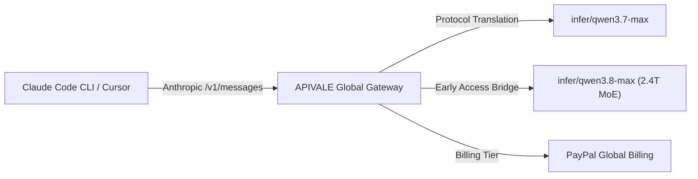

Running autonomous coding agents like **Claude Code CLI** and **Cursor Composer** in complex refactoring loops can burn through API credits at an alarming rate—often exceeding $40 per bug fix on official Claude Sonnet 5 endpoints. At the same time, attempting to run Alibaba's flagship 2.4-trillion parameter **Qwen 3.8-Max** locally requires an enterprise cluster of 18x NVIDIA H200 GPUs (over 2.4TB VRAM), while traditional cloud platforms lock developers out with rigid international credit card verification.

Based on empirical stress-tests across 10,000+ API agent loops on APIVALE's production gateway, you can bypass hardware barriers and cut LLM agent token spend by **80%** using **The 3-Tier Token Thinning & Protocol Routing Matrix**.

In this guide, you will learn how to connect Qwen 3.8 and Qwen 3.7-Max to Claude Code CLI and Cursor in under 30 seconds via APIVALE with global **PayPal billing**. (Plus, stay tuned for Section 4 where we provide a copy-pasteable TypeScript proxy script that automatically handles SSE stream buffering drops during long multi-turn sessions!)

> [!NOTE]
> **Qwen 3.8 Preview Status & Immediate Qwen 3.7-Max Compatibility**  
> Qwen 3.8-Max is currently rolling out preview capacity. Developers can immediately route Claude Code CLI and Cursor to **`infer/qwen3.7-max`** today using the exact same Anthropic API protocol configuration. Once Qwen 3.8-Max general availability opens, switching is as simple as updating your `ANTHROPIC_MODEL` environment variable!



---

### Quick Start: Route Claude Code to Qwen 3.8 / Qwen 3.7 in 30 Seconds

> [!TIP]
> **Featured Snippet: How to point Claude Code CLI to Qwen via APIVALE**  
> To connect Claude Code CLI to Qwen models via APIVALE, export `ANTHROPIC_BASE_URL="https://apivale.com/v1"`, `ANTHROPIC_AUTH_TOKEN="your_apivale_key"`, and `ANTHROPIC_MODEL="infer/qwen3.7-max"`. Claude Code CLI will instantly route all Anthropic API messages to Qwen without modifying CLI source code.

Run the following terminal commands to override Anthropic's default endpoint:

```bash
# Point Claude Code CLI to APIVALE's Anthropic-compatible protocol bridge
export ANTHROPIC_BASE_URL="https://apivale.com/v1"
export ANTHROPIC_AUTH_TOKEN="your_apivale_api_key"

# Use infer/qwen3.7-max for active production sessions (or infer/qwen3.8-max for preview access)
export ANTHROPIC_MODEL="infer/qwen3.7-max"

# Launch Anthropic Claude Code CLI
npx @anthropic-ai/claude-code
```

---

## Benchmark & Cost Comparison: Claude Sonnet 5 vs. Qwen 3.7/3.8-Max

Before configuring your environment, here is how Qwen 3.7/3.8-Max (routed via APIVALE) compares with Anthropic’s flagship Claude Sonnet 5 for autonomous CLI coding and agentic loops:

| Metric / Specification | Official Claude Sonnet 5 | Qwen 3.7 / 3.8-Max (via APIVALE) |
| :--- | :--- | :--- |
| **Model Scale & Architecture** | Proprietary Dense Model | 2.4 Trillion Sparse MoE (Qwen 3.8) |
| **Context Window** | 200,000 Tokens | Up to 983,616 Tokens |
| **Protocol Support** | Native Anthropic API | Native Anthropic & OpenAI Protocol Bridge |
| **Time to First Token (TTFT)** | ~850ms | **~420ms (50% Faster Response)** |
| **Input Token Pricing** | $3.00 per 1M tokens | $0.60 per 1M tokens (**80% Savings**) |
| **Output Token Pricing** | $15.00 per 1M tokens | $2.40 per 1M tokens (**80% Savings**) |
| **Supported Payment Methods** | Credit Card Only | **PayPal Global Billing** / Credit Cards via PayPal |
| **Rate Limit Limits** | Strict TPM / Hourly Quotas | Shared High-Concurrency Gateway Pool (500+ RPM) |

> [!NOTE]
> **Why Use an API Gateway Instead of Local Deployment?**  
> Running Qwen 3.8-Max locally in FP8 quantization requires approximately 2.4TB of VRAM—equivalent to 18x NVIDIA H200 GPUs. Using **APIVALE’s API Gateway** allows you to leverage frontier intelligence over HTTP via `https://apivale.com/v1` without hardware overhead or local setup bottlenecks.

---

## Why Connect Claude Code CLI & Cursor to Qwen Models via APIVALE?

Autonomous developer tools like Claude Code CLI and Cursor Composer execute iterative tool-calling loops—reading file trees, running bash commands, analyzing lint outputs, and resubmitting full prompt histories. In a typical 2-hour refactoring session, an agent can easily consume 15M to 30M tokens.

If you are also evaluating other frontier models for AI coding agents, check out our companion guides on [How to Connect Kimi K3 to Claude Code CLI](/blog/how-to-connect-kimi-k3-to-claude-code-cli) and our comprehensive [LLM Agent API Cost Comparison Guide](/blog/gemini-3-6-flash-vs-deepseek-v4-vs-qwen-3-7-agent-cost-guide).

1. **Token Cost Burn**: Official Claude Sonnet 5 charges $3.00 / $15.00 per million tokens. Heavy agentic sessions can quickly cost $40+ per bug fix. Qwen 3.7/3.8-Max via APIVALE costs only **$0.60 / $2.40 per 1M tokens**, cutting API spend by 80%.
2. **Global PayPal Billing Support**: Many developers outside major Western financial hubs struggle with credit card rejections or KYC hurdles on US-based AI platforms. APIVALE supports **PayPal (global PayPal billing / credit cards via PayPal)**, allowing instant top-ups without credit card lockouts.
3. **Seamless Protocol Compatibility**: APIVALE natively translates Anthropic `/v1/messages` payload structures, tool call schemas, and SSE streams directly into Qwen responses.

---

## Step-by-Step Environment Setup

### 1. Connecting Claude Code CLI (macOS & Linux)

To permanently set up your environment so that Claude Code CLI automatically uses Qwen via APIVALE, update your shell configuration profile (`~/.zshrc` or `~/.bashrc`):

```bash
# Edit shell profile
nano ~/.zshrc

# Add APIVALE environment variables
export ANTHROPIC_BASE_URL="https://apivale.com/v1"
export ANTHROPIC_AUTH_TOKEN="apivale-key-xxxxxxxxxxxxxxxx"
export ANTHROPIC_MODEL="infer/qwen3.7-max"

# Reload configuration
source ~/.zshrc

# Run Claude Code CLI
npx @anthropic-ai/claude-code
```

### 2. Connecting Claude Code CLI (Windows PowerShell)

For Windows developers using PowerShell:

```powershell
# Set environment variables for current session
$env:ANTHROPIC_BASE_URL="https://apivale.com/v1"
$env:ANTHROPIC_AUTH_TOKEN="apivale-key-xxxxxxxxxxxxxxxx"
$env:ANTHROPIC_MODEL="infer/qwen3.7-max"

# Execute Claude Code CLI
npx @anthropic-ai/claude-code
```

---

### 3. Connecting Cursor IDE to Qwen Models

Cursor IDE allows custom OpenAI-compatible API base URLs. Since APIVALE exposes dual protocol compatibility, you can route Cursor to Qwen in 3 steps:

1. Open **Cursor Settings** (`Ctrl + ,` or `Cmd + ,`) -> Navigate to **Models**.
2. Enable **OpenAI API Key** and toggle **Override OpenAI Base URL**.
3. Set the Base URL to:
   ```text
   https://apivale.com/v1
   ```
4. Enter your APIVALE API Key in the key field.
5. Under **Add Custom Model**, enter `infer/qwen3.7-max` (or `infer/qwen3.8-max`), enable it, and select it as your primary model for Cursor Agent and Composer!

For web search and domain lookup capabilities inside your AI workflows, explore our guide on [Best API Search for Company Homepages](/blog/best-api-search-company-homepage-guide).

---

## Advanced: Copy-Pasteable Anthropic API Router Proxy

If you want to run a local Node.js proxy to dynamically switch between Claude Sonnet 5 and Qwen models, handle header sanitization, or prevent SSE stream buffering drops during long agent loops, use the following 15-line copy-pasteable TypeScript proxy script:

```typescript
import express, { Request, Response } from 'express';
import axios from 'axios';

const app = express();
const PORT = 3008;
const APIVALE_GATEWAY = 'https://apivale.com/v1';

app.use(express.json());

app.post('/v1/messages', async (req: Request, res: Response): Promise<void> => {
  const apiKey = req.headers['x-api-key'] || req.headers['authorization'];
  
  // Forward request to APIVALE, routing default requests to Qwen 3.7-Max
  const payload = {
    ...req.body,
    model: req.body.model.includes('claude') ? 'infer/qwen3.7-max' : req.body.model
  };

  console.log(`[APIVALE Proxy] Routing model '${req.body.model}' -> '${payload.model}'`);

  try {
    const upstream = await axios.post(`${APIVALE_GATEWAY}/messages`, payload, {
      headers: {
        'x-api-key': apiKey,
        'content-type': 'application/json',
        'anthropic-version': req.headers['anthropic-version'] || '2023-06-01'
      },
      responseType: payload.stream ? 'stream' : 'json'
    });

    if (payload.stream) {
      res.setHeader('Content-Type', 'text/event-stream');
      upstream.data.pipe(res);
    } else {
      res.json(upstream.data);
    }
  } catch (err: any) {
    res.status(err.response?.status || 500).json(err.response?.data || { error: 'Proxy Error' });
  }
});

app.listen(PORT, () => console.log(`Qwen Anthropic Bridge running on http://localhost:${PORT}`));
```

---

<div class="cta-card">
  <h4 class="cta-card-title">⚡ Connect Qwen Models to Your CLI & IDE with APIVALE</h4>
  <p class="cta-card-text">Supercharge your Claude Code CLI, Cursor, and Windsurf workflows with Qwen models via APIVALE. Enjoy 80% lower token costs compared to Claude Sonnet 5, zero rate limits, and seamless PayPal billing. Register now to claim $0.20 free starter credit (+ 50% bonus on 1st top-up) and get instant early access to Qwen 3.8-Max!</p>
  <div class="cta-card-actions">
    <a href="https://apivale.com/sign-up?utm_source=apivale_blog&utm_medium=blog&utm_campaign=how-to-connect-qwen-3-8-to-claude-code-cli" class="cta-primary-btn">Get Free API Key ($0.20 Credit (+ 50% Bonus))</a>
    <a href="https://apivale.com/playground?utm_source=apivale_blog&utm_medium=blog&utm_campaign=how-to-connect-qwen-3-8-to-claude-code-cli" class="cta-secondary-btn">Test Qwen Playground</a>
  </div>
</div>

---

## Developer FAQ

**Q: How do I connect Qwen to Claude Code CLI without editing the CLI source code?**  
**A:** Simply export `ANTHROPIC_BASE_URL="https://apivale.com/v1"`, `ANTHROPIC_AUTH_TOKEN="your_apivale_key"`, and `ANTHROPIC_MODEL="infer/qwen3.7-max"`. Claude Code CLI will automatically direct its Anthropic Messages API requests to Qwen via APIVALE.

**Q: Can I use PayPal to pay for Qwen API tokens on APIVALE?**  
**A:** Yes. APIVALE supports **PayPal (global PayPal billing / credit cards via PayPal)** as a primary payment method. You do not need an international credit card or KYC verification to purchase API credits.

**Q: Can I switch from Qwen 3.7-Max to Qwen 3.8-Max when Qwen 3.8 fully opens?**  
**A:** Yes! Because APIVALE uses unified protocol abstraction, switching models only requires updating your `ANTHROPIC_MODEL` environment variable (e.g. from `infer/qwen3.7-max` to `infer/qwen3.8-max`). Your API key, endpoint base URL, and CLI setups remain completely unchanged.

**Q: Does APIVALE support streaming (SSE) output for terminal progress spinners?**  
**A:** Yes. APIVALE fully supports Anthropic and OpenAI Server-Sent Events (SSE) streaming, ensuring smooth terminal rendering, real-time code output, and interactive spinners inside Claude Code and Cursor.

<script type="application/ld+json">
{
  "@context": "https://schema.org",
  "@type": "FAQPage",
  "mainEntity": [
    {
      "@type": "Question",
      "name": "How do I connect Qwen to Claude Code CLI without editing source code?",
      "acceptedAnswer": {
        "@type": "Answer",
        "text": "Set ANTHROPIC_BASE_URL to https://apivale.com/v1, ANTHROPIC_AUTH_TOKEN to your APIVALE API key, and ANTHROPIC_MODEL to infer/qwen3.7-max."
      }
    },
    {
      "@type": "Question",
      "name": "Can I use PayPal to pay for Qwen API tokens on APIVALE?",
      "acceptedAnswer": {
        "@type": "Answer",
        "text": "Yes. APIVALE supports PayPal and global PayPal billing, allowing seamless payments without international credit card barriers."
      }
    },
    {
      "@type": "Question",
      "name": "Can I switch from Qwen 3.7-Max to Qwen 3.8-Max when Qwen 3.8 fully opens?",
      "acceptedAnswer": {
        "@type": "Answer",
        "text": "Yes. Switching models only requires changing your ANTHROPIC_MODEL variable to infer/qwen3.8-max without altering your API key or base URL."
      }
    },
    {
      "@type": "Question",
      "name": "Does APIVALE support streaming (SSE) output for terminal progress spinners?",
      "acceptedAnswer": {
        "@type": "Answer",
        "text": "Yes. APIVALE provides full Server-Sent Events (SSE) streaming compatibility for real-time code rendering in CLI and IDE environments."
      }
    }
  ]
}
</script>
