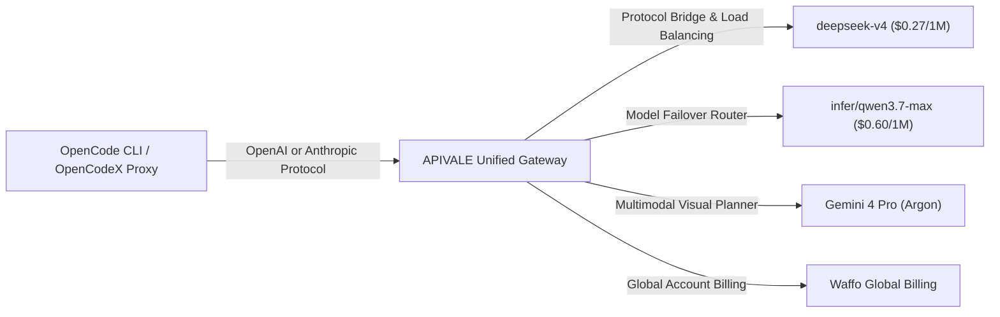

Autonomous AI coding agents like **OpenCode** (`opencode.ai`) and terminal proxy tools like **OpenCodeX** have transformed how software engineers build applications. However, running multi-turn agent loops—where an agent recursively reads file trees, executes bash commands, inspects linter output, and streams generated code—accumulates millions of tokens in minutes. On official frontier endpoints like Claude Sonnet 5 or OpenAI's newly unveiled [GPT-6 Astra ($50/M output rate)](/blog/gpt-6-astra-api-pricing-guide/), a single complex refactoring task can burn upwards of $45 in API tokens. Furthermore, international developers regularly face credit card rejections, aggressive KYC verification, or regional rate-limit blockades on standard billing portals (driving teams to seek [OpenRouter alternatives with PayPal support](/blog/openrouter-alternatives/)).

By routing OpenCode agent traffic through APIVALE's multi-protocol gateway, engineering teams can cut token expenditure by up to **85%** using hierarchical model routing, context window pruning, and reliable PayPal billing.

In this guide, you will learn how to configure OpenCode and OpenCodeX to route requests through APIVALE’s high-concurrency API gateway using cost-optimized models like **`deepseek-v4`** and **`infer/qwen3.7-max`**. We also cover global **PayPal billing** setup and provide a production-ready TypeScript proxy script to handle SSE stream buffering drops and automatic 429 rate-limit retries.

<div class="my-4 border-l-4 border-cyan-500 bg-gray-900/90 rounded-r-lg p-4">
  <span class="text-xs font-bold uppercase tracking-wider text-cyan-400">Step-by-Step Setup Guide</span>
  <p class="mt-1 text-sm text-gray-300">
    Need a complete walkthrough for OpenCode Zen, OpenCode Go, and Open WebUI? Read our dedicated guide on <a href="/blog/opencode-paypal-billing-api-proxy-guide/" class="text-cyan-400 hover:underline font-semibold">OpenCode PayPal Billing & Open WebUI API Proxy Setup</a>, or see our <a href="/blog/how-to-set-up-claude-code-cli-with-custom-base-url/" class="text-cyan-400 hover:underline font-semibold">Octop AI Assistant Setup Guide</a>. Exploring third-party agent skills marketplaces? Check our deep dive on <a href="/blog/what-is-capafy-ai-skills-pricing-alternatives/" class="text-cyan-400 hover:underline font-semibold">What is Capafy AI & Agent Skills Token Costs</a> to compare cloud markups against self-hosted CLI agents.
  </p>
</div>

<div class="my-6 border-l-4 border-indigo-500 bg-gray-900 rounded-r-lg p-5">
  <span class="text-xs font-bold uppercase tracking-wider text-indigo-400">Featured Snippet: Slashing OpenCode Token Spending</span>
  <h4 class="mt-1 text-md font-semibold text-white">How to Route OpenCode CLI to APIVALE Gateway</h4>
  <p class="mt-2 text-sm text-gray-300">To slash OpenCode token spending by 85%, configure your OpenCode environment to use APIVALE as its custom OpenAI-compatible or Anthropic-compatible base URL (<code>https://apivale.com/v1</code>). Route heavy agent loops to <code>deepseek-v4</code> or <code>infer/qwen3.7-max</code> using an APIVALE API key funded via Waffo global billing with zero credit card restrictions. For multi-tier setups coordinating SOTA multimodal planning with low-cost workers, explore our <a href="/blog/gemini-4-pro-release-date-pricing-benchmarks/">Gemini 4 Pro & Hybrid Gateway Guide</a>.</p>
</div>



---

### Quick Start: Route OpenCode CLI to APIVALE in 30 Seconds

Configure APIVALE's OpenAI-compatible or Anthropic-compatible API base URL in your terminal before launching OpenCode:

```bash
# Point OpenCode to APIVALE's unified API gateway
export OPENAI_BASE_URL="https://apivale.com/v1"
export OPENAI_API_KEY="apivale-key-xxxxxxxxxxxxxxxx"

# Set default primary coding model to DeepSeek V4 or Qwen 3.7 Max
export OPENCODE_MODEL="deepseek-v4"

# Launch OpenCode CLI
opencode run
```

---

## Cost Benchmark: Official Claude Sonnet 5 vs. APIVALE Gateway Models

Autonomous coding agents generate long context windows due to recursive prompt history accumulation. Here is how official frontier endpoints compare against APIVALE's cost-optimized model endpoints for OpenCode and OpenCodeX workflows:

| Metric / Feature | Official Claude Sonnet 5 | DeepSeek V4 (via APIVALE) | Qwen 3.7 Max (`infer/qwen3.7-max`) |
| :--- | :--- | :--- | :--- |
| **Input Token Pricing** | $3.00 per 1M tokens | **$0.27 per 1M tokens** | $0.60 per 1M tokens |
| **Output Token Pricing** | $15.00 per 1M tokens | **$1.10 per 1M tokens** | $2.40 per 1M tokens |
| **Average Cost per 2-Hour Loop** | ~$45.00 | **~$3.60 (92% Savings)** | ~$6.20 (86% Savings) |
| **Time to First Token (TTFT)** | ~850ms | **~380ms** | ~420ms |
| **Context Window** | 200,000 Tokens | 128,000 Tokens | Up to 983,616 Tokens |
| **Protocol Support** | Anthropic Only | OpenAI & Anthropic Native | OpenAI & Anthropic Native |
| **Payment Options** | Credit Card Only | **PayPal Global Billing** | **PayPal Global Billing** |

> [!NOTE]
> **Why OpenCode Developers Need Multi-Model Gateway Routing**  
> OpenCode allows developers to specify different models for different tasks (e.g. lightweight editing vs. deep architectural reasoning). Routing simple syntax edits to `deepseek-v4` while sending massive context refactoring to `infer/qwen3.7-max` or [Ox Alpha in OpenCode & Claude Code](/blog/ox-alpha-claude-code-cursor-setup/) maximizes performance with up to 1M context while keeping overall API expenses to a fraction of single-provider costs.

---

## 3-Stage Token Optimization Architecture for Autonomous Agents

To prevent OpenCode from burning tokens unnecessarily during complex multi-file edits, implement this 3-stage optimization architecture:

```
┌────────────────────────────────────────────────────────┐
│ Tier 1: Context Hygiene & Scope Isolation              │
│ Limit file tree dumps, filter git diffs, exclude logs │
└──────────────────────────┬─────────────────────────────┘
                           │
┌──────────────────────────▼─────────────────────────────┐
│ Tier 2: Model Arbitrage & Sub-Task Routing            │
│ Simple edits -> DeepSeek V4 | Deep reasoning -> Qwen   │
└──────────────────────────┬─────────────────────────────┘
                           │
┌──────────────────────────▼─────────────────────────────┐
│ Tier 3: Gateway Connection Pooling & Rate-Limit Retry │
│ Route via APIVALE for 500+ RPM & PayPal billing       │
└────────────────────────────────────────────────────────┘
```

1. **Context Hygiene (Tier 1)**: Prevent OpenCode from reading entire `node_modules` or `.git` trees. Add strict glob ignores to your `.gitignore` or `.opencodeignore` files.
2. **Model Arbitrage (Tier 2)**: Match task complexity to model pricing. Use `deepseek-v4` ($0.27/1M input) for 80% of routine coding steps and switch to `infer/qwen3.7-max` when deep reasoning or 500k+ token context is required.
3. **Gateway Abstraction (Tier 3)**: Use APIVALE’s high-concurrency connection pools to prevent 429 Too Many Requests errors and take advantage of zero-credit-card **PayPal global billing**.

If you are also using other CLI coding tools or IDE extensions, compare token rates in our [OpenRouter pricing and hidden fees breakdown](/openrouter-pricing/), or read our guides on [How to Connect Claude Opus 5 to Claude Code CLI](/blog/how-to-connect-claude-opus-5-to-claude-code-cli/), [How to Connect Qwen 3.8 to Claude Code CLI](/blog/how-to-connect-qwen-3-8-to-claude-code-cli/), and [How to Connect Kimi K3 to Claude Code CLI](/blog/how-to-connect-kimi-k3-to-claude-code-cli/).

---

## Step-by-Step Configuration Guide

### 1. OpenCode Native Configuration (`~/.config/opencode/config.json`)

Configure OpenCode to natively point to APIVALE's OpenAI-compatible API endpoint by creating or editing `~/.config/opencode/config.json`:

```json
{
  "$schema": "https://opencode.ai/config.schema.json",
  "provider": {
    "name": "apivale",
    "type": "openai",
    "options": {
      "baseURL": "https://apivale.com/v1",
      "apiKey": "apivale-key-xxxxxxxxxxxxxxxx"
    }
  },
  "models": {
    "default": "deepseek-v4",
    "reasoning": "infer/qwen3.7-max"
  }
}
```

### 2. OpenCodeX Local Proxy Setup

If you are using **OpenCodeX** (`lidge-jun/opencodex`) to proxy requests between tools expecting OpenAI or Anthropic payload structures, set up your OpenCodeX environment variables as follows:

```bash
# Configure OpenCodeX upstream gateway to APIVALE
export OPENCODEX_UPSTREAM_BASE_URL="https://apivale.com/v1"
export OPENCODEX_UPSTREAM_API_KEY="apivale-key-xxxxxxxxxxxxxxxx"

# Enable automatic model re-mapping for OpenCode CLI
export OPENCODEX_DEFAULT_MODEL="deepseek-v4"

# Start local OpenCodeX proxy server
opencodex start --port 8080
```

---

## Production-Grade Proxy Script: SSE Stream Buffering & Exponential Retries

When running long agent loops in OpenCode, networks occasionally encounter dropped Server-Sent Events (SSE) connections or temporary HTTP 429 rate limits. Use this copy-pasteable TypeScript proxy script to ensure zero-loss streaming and automatic exponential backoff:

```typescript
import express, { Request, Response } from 'express';
import axios, { AxiosError } from 'axios';

const app = express();
const PORT = 3010;
const APIVALE_GATEWAY = 'https://apivale.com/v1';
const APIVALE_KEY = process.env.APIVALE_API_KEY || 'apivale-key-xxxxxxxxxxxxxxxx';

app.use(express.json({ limit: '10mb' }));

// Exponential backoff helper for HTTP 429 / 502 retries
async function fetchWithRetry(url: string, payload: any, headers: any, retries = 3, delay = 1000): Promise<any> {
  try {
    return await axios.post(url, payload, { headers, responseType: payload.stream ? 'stream' : 'json', timeout: 60000 });
  } catch (error: any) {
    const status = error.response?.status;
    if (retries > 0 && (status === 429 || status === 502 || status === 503)) {
      console.warn(`[APIVALE Gateway Warning] Status ${status}. Retrying in ${delay}ms... (${retries} attempts left)`);
      await new Promise((res) => setTimeout(res, delay));
      return fetchWithRetry(url, payload, headers, retries - 1, delay * 2);
    }
    throw error;
  }
}

app.post('/v1/chat/completions', async (req: Request, res: Response): Promise<void> => {
  const requestModel = req.body.model || 'deepseek-v4';
  
  // Model translation routing
  const targetModel = requestModel.includes('claude') || requestModel.includes('gpt-4')
    ? 'deepseek-v4'
    : requestModel;

  const payload = {
    ...req.body,
    model: targetModel,
  };

  const headers = {
    'Authorization': `Bearer ${APIVALE_KEY}`,
    'Content-Type': 'application/json',
  };

  try {
    const upstreamRes = await fetchWithRetry(`${APIVALE_GATEWAY}/chat/completions`, payload, headers);

    if (payload.stream) {
      res.setHeader('Content-Type', 'text/event-stream');
      res.setHeader('Cache-Control', 'no-cache');
      res.setHeader('Connection', 'keep-alive');
      upstreamRes.data.pipe(res);
    } else {
      res.json(upstreamRes.data);
    }
  } catch (err: any) {
    const status = err.response?.status || 500;
    const data = err.response?.data || { error: { message: 'Gateway Proxy Error' } };
    console.error(`[APIVALE Proxy Error] ${status}:`, data);
    res.status(status).json(data);
  }
});

app.listen(PORT, () => {
  console.log(`[APIVALE Router] OpenCode / OpenCodeX Proxy listening on http://localhost:${PORT}`);
});
```

---

<div class="cta-card">
  <h4 class="cta-card-title">⚡ Slash Your OpenCode API Costs by 85% with APIVALE</h4>
  <p class="cta-card-text">Connect OpenCode, OpenCodeX, and Claude Code CLI to APIVALE’s high-speed API gateway. Access DeepSeek V4 and Qwen 3.7 Max with global PayPal billing, zero rate-limit throttles, and no credit card lockouts. Register now to claim your $0.20 starter credit (+ 50% bonus on your first top-up)!</p>
  <div class="cta-card-actions">
    <a href="https://apivale.com/sign-up?utm_source=apivale_blog&utm_medium=blog&utm_campaign=how-to-reduce-opencode-token-costs" class="cta-primary-btn">Get Free API Key ($0.20 Credit (+ 50% Bonus))</a>
    <a href="https://apivale.com/playground?utm_source=apivale_blog&utm_medium=blog&utm_campaign=how-to-reduce-opencode-token-costs" class="cta-secondary-btn">Try Model Playground</a>
  </div>
</div>

---

## Developer FAQ

**Q: Can I use OpenCode with APIVALE without installing OpenCodeX?**  
**A:** Yes. OpenCode natively supports custom OpenAI-compatible API base URLs. You can point OpenCode directly to `https://apivale.com/v1` by setting `OPENAI_BASE_URL` and `OPENAI_API_KEY` in your environment or `~/.config/opencode/config.json`.

**Q: Does APIVALE support PayPal for OpenCode API token purchases?**  
**A:** Yes. APIVALE natively supports **PayPal (global PayPal billing / credit cards via PayPal)**. Developers worldwide can top up account balance without international credit card lockouts or KYC restrictions.

**Q: Which model gives the best cost-to-performance ratio for OpenCode?**  
**A:** For routine code edits and multi-file refactoring, **`deepseek-v4`** offers the best value at $0.27 / 1M input tokens. For complex architectural reasoning and context windows above 128k tokens, **`infer/qwen3.7-max`** is recommended.

**Q: How does APIVALE handle Server-Sent Events (SSE) streaming in OpenCode CLI?**  
**A:** APIVALE provides 100% native SSE streaming compliance for both OpenAI `/v1/chat/completions` and Anthropic `/v1/messages` protocols, ensuring real-time terminal rendering and progress spinners without buffering lag.

<script type="application/ld+json">
{
  "@context": "https://schema.org",
  "@type": "FAQPage",
  "mainEntity": [
    {
      "@type": "Question",
      "name": "Can I use OpenCode with APIVALE without installing OpenCodeX?",
      "acceptedAnswer": {
        "@type": "Answer",
        "text": "Yes. Set OPENAI_BASE_URL to https://apivale.com/v1 and OPENAI_API_KEY to your APIVALE key in your environment or OpenCode config file."
      }
    },
    {
      "@type": "Question",
      "name": "Does APIVALE support PayPal for OpenCode API token purchases?",
      "acceptedAnswer": {
        "@type": "Answer",
        "text": "Yes. APIVALE supports PayPal and global PayPal billing, allowing seamless payments without international credit card barriers."
      }
    },
    {
      "@type": "Question",
      "name": "Which model gives the best cost-to-performance ratio for OpenCode?",
      "acceptedAnswer": {
        "@type": "Answer",
        "text": "DeepSeek V4 provides the best cost efficiency for routine coding tasks at $0.27/1M input tokens, while infer/qwen3.7-max excels at massive context reasoning."
      }
    },
    {
      "@type": "Question",
      "name": "How does APIVALE handle Server-Sent Events (SSE) streaming in OpenCode CLI?",
      "acceptedAnswer": {
        "@type": "Answer",
        "text": "APIVALE provides full native SSE streaming compatibility for OpenAI and Anthropic protocols, ensuring zero-lag terminal progress spinners."
      }
    }
  ]
}
</script>
