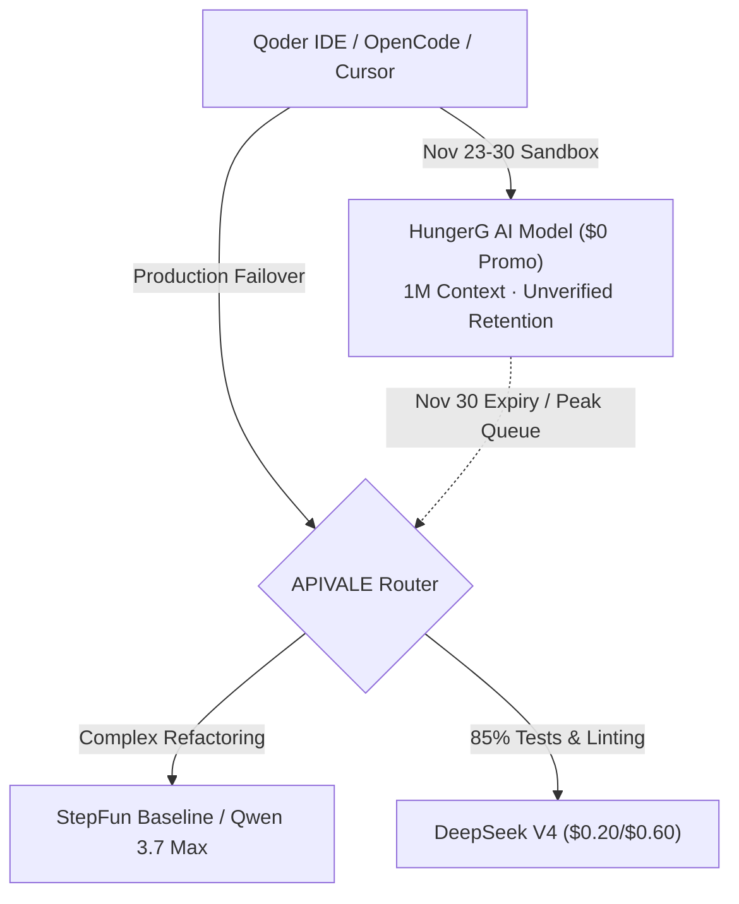

<div class="my-8 rounded-xl border border-primary/20 bg-primary/5 p-6 backdrop-blur-sm">
  <div class="flex items-center gap-2 text-primary font-semibold text-lg mb-2">
    <span>Technical Summary: HungerG AI Model &amp; Stealth Trial Reality</span>
  </div>
  <p class="text-base text-gray-200 leading-relaxed m-0">
    <strong>HungerG AI model</strong> is an anonymous stealth coding checkpoint—unrelated to the Hunger Games franchise—launched November 23, 2026 on Qoder IDE and OpenCode Go with a 1M context window, 64K output ceiling, and text, image, and video inputs. While Qoder lists its creator as classified through November 30, OpenCode catalog diffs and rare-token probes link this model to <strong>StepFun's Step 5 Preview</strong> architecture. Because promotional access excludes Teams plans, omits retention SLAs, and expires November 30, engineers pair sandbox testing with APIVALE's gateway and PayPal Instant Checkout.
  </p>
</div>

Developers investigating **HungerG AI model** across GitHub, Reddit, and terminal forums are tracking the viral stealth LLM that surged across Qoder and OpenCode on November 23, 2026. Free through November 30 (UTC+8), this unannounced coding release pairs a 1M context window with multimodal inspection and ~148 tokens/second throughput with reasoning enabled.

Yet building production tooling directly on an unnamed preview creates operational risk. Without published benchmarks, post-promo pricing, or enforceable data-retention SLAs, teams need a resilient failover path before the seven-day trial expires.



## HungerG AI Model Origin: Qoder, OpenCode & Step 5 Clues

On November 23, 2026 at 16:16 UTC, Qoder unveiled the **HungerG AI** stealth test with a public guessing challenge: free calls for individual accounts through November 30, zero credit burn even at Max thinking intensity, and an undisclosed creator. Eleven hours later at 03:03 UTC on November 24, OpenCode enabled the same endpoint for OpenCode Go subscribers.

Because Alibaba owns Qoder—and ran an earlier stealth drop called QoDuck before revealing [Qwen4-Max benchmarks and API access](/blog/qwen-4-max-benchmark-api-reddit/)—early threads assumed this newcomer was another Qwen build. Technical forensics surfaced three stronger attribution clues pointing toward StepFun's sparse MoE family:

* **OpenCode Catalog Byte-Match**: A brief `hungerg-free` entry in OpenCode's registry listed 1,000,000 input tokens, 65,536 output tokens, and eight image and video containers matching `step-5-preview` byte for byte.
* **Special Token 128013 Artifact**: Running a 98-line rare-token probe against **HungerG AI**, AI Tracker Bot observed `</tool_calls>`—mapped to special token `128013` in StepFun's vocabulary, absent from DeepSeek and Qwen4 Flash.
* **Terser Reasoning Traces**: Compared with September's StepFun preview, the stealth build emits shorter reasoning blocks and faster self-correction loops, indicating a newer checkpoint.

## HungerG AI Model Benchmarks, Speed & StepFun Baseline

No lab has published official SWE-bench or LiveCodeBench scorecards for **HungerG AI model**. Independent runs comparing it against [GPT-6.2 Sol coding differences](/blog/gpt-6-2-sol-api-pricing-benchmarks/) showed close parity on 3D WebGL scenes and 24-record financial dashboards, though both left minor undo-state flaws under long prompts. The table below benchmarks the stealth preview against StepFun's published baseline and stable production endpoints:

| Model / Endpoint | Context / Output | Speed | Input / Output (Million Tokens) | Retention SLA | Best For (Objective Fit) |
| :--- | :--- | :--- | :--- | :--- | :--- |
| **HungerG AI Model** | 1M / 64K | ~148 tok/s | **$0** *(Through Nov 30)* | Retention unlisted | **7-day demos & prototyping** |
| **StepFun Step 5 Preview** | 1M / 64K | ~88 tok/s | $1 / $3 | Published API terms | **Verified StepFun baseline** |
| **GPT-6.2 Sol** | 1.1M / 128K | ~92 tok/s | $2 / $10 | Enterprise API SLA | **Concise single-file diffs** |
| **Qwen 3.7 Max** | 1M / 64K | ~210 tok/s | **$0.25 / $0.80** | **Zero retention** | **Daily repo refactoring** |
| **DeepSeek V4** | 1M / 64K | ~430 tok/s | **$0.20 / $0.60** | **Zero retention** | **Tests & failover loops** |

*Note: Promotional specs reflect Qoder and OpenCode notices as of November 25, 2026; baseline specs reflect vendor documentation.*

### Speed, Thinking Modes & Retention Trade-Offs

Qoder exposes four thinking tiers (`Low`, `Medium`, `High`, `Max`) at zero credit multiplier during the trial, while restricting access to desktop IDE surfaces and excluding JetBrains, CLI, Cloud Agents, and Teams plans. Because Teams workspaces cannot select it—and OpenCode's catalog review flagged a missing retention row—engineers should treat the promotional tier like ad-supported sandboxes in our [Freebuff AI coding review](/blog/freebuff-ai-coding-review/): avoid pasting proprietary repositories or secrets until an operator publishes a DPA.

## HungerG AI Model Reddit Consensus: Speed & Queue Reality

Developer threads on `r/opencode` and forensics from [OrcaRouter's stealth investigation](https://www.orcarouter.ai/blog/hungerg-stealth-model-leak) highlight both strong throughput and practical trial boundaries:

<div class="my-8 rounded-xl border border-amber-500/30 bg-amber-500/5 p-6 backdrop-blur-sm">
  <div class="flex items-center gap-2 text-amber-400 font-semibold text-lg mb-3">
    <span>Verified Developer Voices: r/opencode &amp; Catalog Forensics</span>
  </div>
  <blockquote class="border-l-4 border-amber-400 pl-4 my-3 italic text-gray-300">
    "HungerG AI hits roughly 148 tokens per second even with reasoning turned on, keeps thinking concise, parses dense infographics cleanly, and handled 350K-token local coding sessions in OpenCode without derailing."
  </blockquote>
  <blockquote class="border-l-4 border-amber-400 pl-4 my-3 italic text-gray-300">
    "OpenCode states no training on prompts, yet the data-retention row remains blank because the upstream operator is unknown. Treat the trial as a sandbox, not a confidential workspace."
  </blockquote>
  <div class="text-xs text-gray-400 mt-2">
    — Compiled from <a href="https://www.reddit.com/r/opencode/comments/1y449xz/hungerg_stealth_model_is_free_for_opencode_go/" target="_blank" rel="noopener noreferrer" class="text-amber-300 hover:underline">r/opencode community reports</a> and <a href="https://docs.qoder.com/events/hungerg-free" target="_blank" rel="noopener noreferrer" class="text-amber-300 hover:underline">Qoder event documentation</a> (November 2026).
  </div>
</div>

Peak-hour queuing adds another limit: free accounts yield priority to paid tiers and hit daily fair-use caps until midnight reset.

## Global API Access & Post-Trial Failover on APIVALE

Once the promo closes November 30, production coding loops need stable endpoints instead of +86 SMS checks or foreign card declines. Single-vendor plans also throttle burst concurrency.

APIVALE unifies frontier reasoning and auxiliary workhorse tiers behind one OpenAI- and Anthropic-compatible router. Teams pay via **PayPal Instant Checkout**, international cards, or Alipay with **0% FX fees**, zero KYC, zero data retention, and a **$0.20 free trial**.

## Interactive Cost Simulator: HungerG AI Model vs Production API

Model your monthly spend after the November 30 promotional window expires, comparing single-endpoint rates against an 85% workhorse offloading pipeline:

<div class="my-8 rounded-xl border border-primary/20 bg-card p-6 shadow-lg">
  <div class="flex items-center justify-between border-b border-border pb-4 mb-6">
    <div>
      <div class="font-bold text-lg text-white">Post-Trial Token Cost Simulator</div>
      <div class="text-xs text-gray-400">75% input / 25% output mix with 85% workhorse routing</div>
    </div>
    <span class="rounded bg-primary/20 px-2.5 py-1 text-xs font-semibold text-primary">Live Estimator</span>
  </div>

  <div class="grid grid-cols-1 md:grid-cols-2 gap-6 mb-6">
    <div>
      <label for="hg-tokens" class="block text-sm font-medium text-gray-300 mb-2">
        Monthly Volume: <span id="hg-token-val" class="text-primary font-bold">25M Tokens</span>
      </label>
      <input type="range" id="hg-tokens" min="5" max="100" step="5" value="25" class="w-full h-2 bg-gray-700 rounded-lg appearance-none cursor-pointer accent-primary" />
    </div>

    <div>
      <label for="hg-model" class="block text-sm font-medium text-gray-300 mb-2">Post-Promo Target Endpoint</label>
      <select id="hg-model" class="w-full rounded-lg border border-border bg-gray-800 px-3 py-2 text-sm text-gray-200 focus:border-primary focus:outline-none">
        <option value="step5" selected>StepFun Baseline ($1 in / $3 out)</option>
        <option value="sol">GPT-6.2 Sol ($2 in / $10 out)</option>
        <option value="opus">Frontier Specialist ($4 in / $20 out)</option>
      </select>
    </div>
  </div>

  <div class="grid grid-cols-1 md:grid-cols-3 gap-4 pt-4 border-t border-border">
    <div class="rounded-lg bg-gray-900/60 p-4 text-center border border-gray-800">
      <div class="text-xs text-gray-400 mb-1">Single-Model Spend</div>
      <div id="hg-pure-cost" class="text-2xl font-bold text-red-400">$37.50</div>
    </div>
    <div class="rounded-lg bg-gray-900/60 p-4 text-center border border-gray-800">
      <div class="text-xs text-gray-400 mb-1">APIVALE Hybrid Spend</div>
      <div id="hg-hybrid-cost" class="text-2xl font-bold text-green-400">$13.86</div>
    </div>
    <div class="rounded-lg bg-primary/10 p-4 text-center border border-primary/30">
      <div class="text-xs text-primary mb-1">Monthly Savings</div>
      <div id="hg-savings-pct" class="text-2xl font-extrabold text-primary">63.0%</div>
      <div id="hg-savings-amt" class="text-xs text-gray-300 mt-1">Save $23.64 / Month</div>
    </div>
  </div>

  <div class="mt-6 flex justify-end">
    <button type="button" id="hg-calc-btn" class="rounded-lg bg-primary px-4 py-2 text-xs font-semibold text-white shadow-md hover:bg-primary/90 transition-colors">
      Recalculate Savings
    </button>
  </div>
</div>

<script>
  (function() {
    const slider = document.getElementById('hg-tokens');
    const valEl = document.getElementById('hg-token-val');
    const selectEl = document.getElementById('hg-model');
    const pureEl = document.getElementById('hg-pure-cost');
    const hybridEl = document.getElementById('hg-hybrid-cost');
    const pctEl = document.getElementById('hg-savings-pct');
    const amtEl = document.getElementById('hg-savings-amt');
    const btn = document.getElementById('hg-calc-btn');

    function updateCalc() {
      const vol = parseFloat(slider.value);
      valEl.textContent = vol + 'M Tokens';
      const inM = vol * 0.75;
      const outM = vol * 0.25;

      let rateIn = 1.0, rateOut = 2.7;
      if (selectEl.value === 'sol') { rateIn = 2.0; rateOut = 10.0; }
      else if (selectEl.value === 'opus') { rateIn = 4.0; rateOut = 20.0; }

      const pure = (inM * rateIn) + (outM * rateOut);
      const hybridFrontier = ((inM * 0.15) * rateIn) + ((outM * 0.15) * rateOut);
      const hybridWork = ((inM * 0.85) * 0.25) + ((outM * 0.85) * 0.80);
      const totalHybrid = hybridFrontier + hybridWork;
      const saved = pure - totalHybrid;

      pureEl.textContent = '$' + pure.toFixed(2);
      hybridEl.textContent = '$' + totalHybrid.toFixed(2);
      pctEl.textContent = ((saved / pure) * 100).toFixed(1) + '%';
      amtEl.textContent = 'Save $' + saved.toFixed(2) + ' / Month';
    }

    slider.addEventListener('input', updateCalc);
    selectEl.addEventListener('change', updateCalc);
    btn.addEventListener('click', updateCalc);
    updateCalc();
  })();
</script>

## Production Setup: OpenCode & Resilient Gateway Failover

Never hardcode a temporary stealth alias into CI/CD pipelines. Use this Python wrapper to route planning while failing over automatically on `429` or `503` timeouts:

```python
import os, httpx
from openai import OpenAI

client = OpenAI(api_key=os.environ.get("APIVALE_API_KEY"), base_url="https://apivel.com/v1")

def run_agent_task(prompt: str, tier: str = "workhorse") -> str:
    routes = {
        "frontier": ("step-5-preview", "infer/qwen3.7-max"),
        "workhorse": ("infer/qwen3.7-max", "infer/deepseek-v4"),
    }
    primary, fallback = routes.get(tier, routes["workhorse"])
    try:
        res = client.chat.completions.create(model=primary, messages=[{"role":"user","content":prompt}], timeout=90.0)
        return res.choices[0].message.content
    except (httpx.TimeoutException, httpx.HTTPStatusError):
        res = client.chat.completions.create(model=fallback, messages=[{"role":"user","content":prompt}], timeout=60.0)
        return res.choices[0].message.content
```

For OpenCode or Claude Code CLI, point your environment variables to our unified endpoint:

```bash
export OPENAI_BASE_URL="https://apivel.com/v1"
export OPENAI_API_KEY="sk-apivel-key"
export OPENCODE_MODEL="infer/qwen3.7-max"
```

## HungerG AI Model Frequently Asked Questions

### What Is HungerG AI Model?

**HungerG AI model** is an anonymous stealth coding checkpoint launched November 23, 2026 on Qoder and OpenCode Go. It offers a 1,000,000-token context window, 65,536-token output ceiling, and multimodal text, image, and video inputs, distinct from the Hunger Games franchise.

### Who Built HungerG and Is It StepFun Step 5?

No lab has claimed ownership. However, OpenCode catalog diffs matched `step-5-preview` specs byte for byte, and a rare-token probe emitted StepFun special token `128013` (`</tool_calls>`), pointing toward an updated StepFun checkpoint.

### Where Can I Use HungerG Free (Qoder vs OpenCode)?

Individual Qoder International accounts (excluding Teams, Enterprise, and CLI) can select it at zero credits through November 30, 2026 (UTC+8). OpenCode also enabled promotional access for OpenCode Go subscribers.

### How Do I Run Coding Agents After the HungerG Trial Ends?

Route OpenCode, Cursor, or Claude Code CLI through our unified gateway using PayPal, major cards, zero KYC, and a **$0.20 free trial** with workhorse failover.

<script type="application/ld+json">
{
  "@context": "https://schema.org",
  "@type": "TechArticle",
  "headline": "HungerG AI Model: Qoder, OpenCode, Step 5 Clues & API Guide",
  "description": "Explore HungerG AI model: Qoder and OpenCode Go free trial specs, Step 5 tokenizer clues, 1M context, privacy gaps, and APIVALE two-tier routing.",
  "author": {
    "@type": "Person",
    "name": "Kenji Tanaka",
    "jobTitle": "AI Developer Relations & Infrastructure Engineer",
    "worksFor": {
      "@type": "Organization",
      "name": "APIVALE"
    }
  },
  "publisher": {
    "@type": "Organization",
    "name": "APIVALE",
    "url": "https://apivel.com"
  },
  "datePublished": "2026-11-25",
  "mainEntityOfPage": "https://apivel.com/blog/hungerg-ai-model-qoder-opencode-api/"
}
</script>

<script type="application/ld+json">
{
  "@context": "https://schema.org",
  "@type": "FAQPage",
  "mainEntity": [
    {
      "@type": "Question",
      "name": "What Is HungerG AI Model?",
      "acceptedAnswer": {
        "@type": "Answer",
        "text": "HungerG AI model is an anonymous stealth coding checkpoint launched November 23, 2026 on Qoder and OpenCode Go. It offers a 1,000,000-token context window, 65,536-token output ceiling, and multimodal text, image, and video inputs."
      }
    },
    {
      "@type": "Question",
      "name": "Who Built HungerG and Is It StepFun Step 5?",
      "acceptedAnswer": {
        "@type": "Answer",
        "text": "No lab has officially claimed HungerG. However, OpenCode catalog diffs matched step-5-preview specifications byte for byte, and a rare-token probe emitted StepFun special token 128013 (</tool_calls>), pointing toward a newer StepFun checkpoint."
      }
    },
    {
      "@type": "Question",
      "name": "Where Can I Use HungerG Free (Qoder vs OpenCode)?",
      "acceptedAnswer": {
        "@type": "Answer",
        "text": "Individual Qoder International accounts (excluding Teams, Enterprise, and CLI) can call HungerG at zero credits through November 30, 2026 (UTC+8). OpenCode also enabled promotional access for OpenCode Go subscribers."
      }
    },
    {
      "@type": "Question",
      "name": "How Do I Run Coding Agents After the HungerG Trial Ends?",
      "acceptedAnswer": {
        "@type": "Answer",
        "text": "Route OpenCode, Cursor, or Claude Code CLI through APIVALE's OpenAI- and Anthropic-compatible gateway (https://apivel.com/v1) with pay-as-you-go failover, PayPal Instant Checkout, global credit cards, zero KYC, and a $0.20 free trial."
      }
    }
  ]
}
</script>

<div class="cta-card">
  <div class="my-10 p-8 rounded-2xl bg-gradient-to-br from-slate-900 via-primary/10 to-slate-900 border border-primary/30 text-center shadow-2xl backdrop-blur-md">
    <div class="inline-flex items-center gap-2 px-3 py-1 rounded-full bg-primary/10 border border-primary/30 text-primary text-xs font-mono mb-4">
      <span>⚡ Unified AI Gateway</span>
    </div>
    <div class="text-2xl font-extrabold text-white tracking-tight mb-3">Deploy Coding Agents Beyond Stealth Trials With Zero KYC</div>
    <p class="text-sm text-gray-300 max-w-xl mx-auto leading-relaxed mb-6">
      Avoid expiring promo windows and unverified retention terms. Connect OpenCode, Cursor, and Claude Code with failover across StepFun baselines, <strong>Qwen 3.7 Max</strong>, and <strong>DeepSeek V4</strong>.
    </p>
    <div class="flex flex-wrap justify-center gap-4 text-xs text-gray-400 mb-6">
      <span><strong class="text-white">+50% First Deposit Bonus:</strong> $5→$7.50, $29→$43.50, $99→$148.50</span>
      <span><strong class="text-white">$29 Developer Pack:</strong> 56% OFF, 40M Tokens, Never Expires</span>
      <span><strong class="text-white">$0.20 Free Trial:</strong> Zero KYC</span>
    </div>
    <div class="flex flex-col sm:flex-row justify-center gap-4 mb-6">
      <a rel="nofollow" href="/pricing?redirect=/blog/hungerg-ai-model-qoder-opencode-api" class="inline-flex items-center justify-center rounded-xl bg-primary px-6 py-3 text-sm font-semibold text-white shadow-lg shadow-primary/25 hover:bg-primary/90 transition-all text-center">
        View Gateway Pricing
      </a>
      <a rel="nofollow" href="/sign-up?redirect=/blog/hungerg-ai-model-qoder-opencode-api" class="inline-flex items-center justify-center rounded-xl border border-border bg-gray-800/80 px-6 py-3 text-sm font-semibold text-gray-200 hover:bg-gray-700/80 transition-all text-center">
        Claim $0.20 Free Credit
      </a>
    </div>
    <div class="pt-4 border-t border-gray-800/80 flex flex-wrap items-center justify-center gap-4 text-xs text-gray-400">
      <div><strong>PayPal Instant Checkout</strong> • Global Cards • Alipay • 0% FX Fees</div>
    </div>
  </div>
</div>
