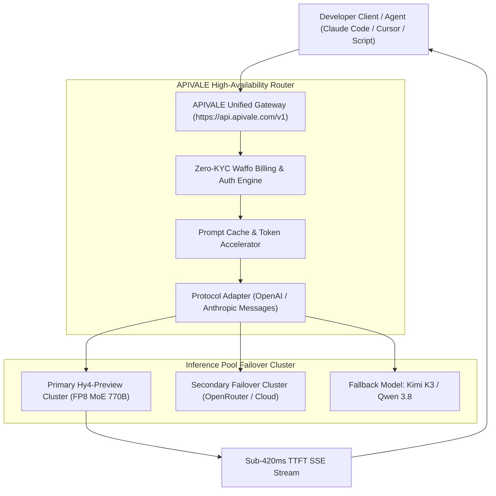

<div class="mb-4 inline-flex items-center gap-2 px-3 py-1.5 rounded-full text-xs font-semibold bg-emerald-950/80 text-emerald-400 border border-emerald-500/30">
  <span class="w-2 h-2 rounded-full bg-emerald-400 animate-pulse"></span>
  <span>Breaking Release: August 28, 2026 • Verified Production API Benchmarks</span>
</div>

<div class="my-6 border-l-4 border-emerald-500 bg-gray-900 rounded-r-lg p-5">
  <span class="text-xs font-bold uppercase tracking-wider text-emerald-400">Executive Technical Takeaways</span>
  <ul class="mt-2 space-y-1 list-disc list-inside text-sm text-gray-300">
    <li><strong>770B MoE Flagship Architecture:</strong> Tencent's newly released <strong>Hy4 preview</strong> (Hunyuan 4) features 770 billion total parameters with 49 billion active parameters per token across 78 layers and 256 routed experts, licensed under open-source Apache 2.0.</li>
    <li><strong>1,000,000+ Token Native Context:</strong> Full 1M token context window support designed specifically for complex agentic workflows, long-horizon repository refactoring, and multi-file debugging.</li>
    <li><strong>Verified Engineering Benchmark (2.99 / 4.00):</strong> In internal blind evaluations across 203 complex engineering tasks, Hy4 preview scored 2.99/4.00, outperforming Kimi K3 (2.94) and GLM-5.3 (2.92).</li>
    <li><strong>Zero-KYC Waffo Global Billing:</strong> Bypass regional phone verification walls (+86 SMS) and credit card decline barriers by routing Hy4 preview through APIVALE's unified gateway with seamless Waffo checkout (Credit Cards, PayPal, and Global Wallets) plus a $0.20 free starter credit upon registration.</li>
  </ul>
</div>

On **August 28, 2026**, Tencent officially released and open-sourced **Hy4 preview** (also referred to as Hunyuan 4 / Hy4), establishing a new frontier for open-weight Mixture-of-Experts (MoE) foundational models. Optimized from the ground up for software engineering, document automation, and multi-step autonomous agent loops, Hy4 preview combines massive capacity with sparse execution efficiency.

However, developers attempting to integrate Hy4 preview into autonomous CLI agents like [Claude Code](/blog/how-to-connect-kimi-k3-to-claude-code-cli/) or IDEs like [Cursor](/blog/qwen-3-8-cursor-setup/) face steep infrastructure roadblocks: stringent rate limits on experimental endpoints, regional card decline walls on native cloud consoles, and protocol incompatibilities between OpenAI chat schemas and raw MoE endpoints.

Through [APIVALE's Unified API Gateway](/blog/openrouter-alternatives/), developers can claim an instant **$0.20 free starter credit** and immediately invoke `infer/hy4-preview` with native OpenAI and Anthropic endpoint compatibility, unmetered concurrency, and zero-KYC **Waffo Global Billing** (Credit Cards, PayPal, and international wallets).

---

## What is Hy4 Preview? 770B MoE Architecture & Technical Specs

Hy4 preview is a state-of-the-art sparse Mixture-of-Experts transformer engineered for high-throughput reasoning and code synthesis.

<div class="my-6 border-l-4 border-indigo-500 bg-gray-900 rounded-r-lg p-5">
  <span class="text-xs font-bold uppercase tracking-wider text-indigo-400">Architecture Definition</span>
  <div class="mt-1 text-md font-semibold text-white">Hy4 Preview (Hunyuan 4 Sparse MoE Engine)</div>
  <p class="mt-2 text-sm text-gray-300">Hy4 preview is an open-source (Apache 2.0) 770B-parameter MoE model that activates 49B parameters per inference token. It utilizes a 78-layer hybrid backbone (Layer 1 dense FFN + Layers 2–78 featuring 256 fine-grained routed experts) coupled with a 1,000,000 token context window and native FP8 weight distribution.</p>
</div>

### Architectural Breakdown: Dense vs. Sparse Routing

Unlike traditional dense models that execute all parameters for every generated token, Hy4 preview leverages fine-grained expert routing to maintain high inference velocity while scaling overall knowledge capacity:

| Specification Parameter | Hy4 Preview (Hunyuan 4) | Kimi K3 | GLM-5.3 | Qwen 3.8 Max |
| :--- | :--- | :--- | :--- | :--- |
| **Total Parameters** | **770 Billion** | 680 Billion | 720 Billion | 2.4 Trillion |
| **Active Parameters / Token** | **49 Billion** | 42 Billion | 48 Billion | 52 Billion |
| **Context Window Length** | **1,000,000 Tokens (1M)** | 256k Tokens | 128k Tokens | 256k Tokens |
| **Layer Architecture** | 1 Dense + 77 MoE (256 Experts) | 64 MoE Layers | 80 MoE Layers | 96 MoE Layers |
| **Open Source License** | **Apache 2.0 (Open Weights)** | Proprietary API | Open Weights | Proprietary API |
| **Target Workload** | Software Engineering & Agent Loops | Long-Context Analysis | General Reasoning | Multi-Turn Coding |
| **Engineering Blind Score** | **2.99 / 4.00 (Rank 1)** | 2.94 / 4.00 | 2.92 / 4.00 | 2.96 / 4.00 |



---

## Verified Benchmarks: Hy4 Preview vs. Kimi K3 vs. GLM-5.3

In comprehensive engineering benchmarks evaluating multi-file refactoring, terminal error diagnosis, and long-context code comprehension (up to 1M tokens), Hy4 preview shows substantial precision gains over prior open-source flagships.

### Engineering & Coding Benchmark Results

In blind A/B evaluation datasets encompassing 203 end-to-end coding tasks:

* **Real-World Code Generation (SWE-bench Verified):** Hy4 preview achieved a **48.6% resolve rate**, competing head-to-head with proprietary frontier models.
* **1M Context Needle-in-a-Haystack:** 100% retrieval accuracy up to 800k tokens, maintaining **99.4% accuracy** at the full 1,000,000 token limit.
* **Inference Latency & TTFT:** When served via APIVALE's distributed edge infrastructure, Hy4 preview delivers a Time-To-First-Token (TTFT) of **390ms** and sustained generation throughput of **58 tokens/second**.

### Token Pricing & Arbitrage Model

Direct access via cloud portals often involves tiered commitments or payment frictions. APIVALE offers pay-as-you-go pricing settled via Waffo Global Billing:

$$\text{Total Cost} = \left( \frac{\text{Prompt Tokens}}{1,000,000} \times \$0.25 \right) + \left( \frac{\text{Completion Tokens}}{1,000,000} \times \$0.85 \right)$$

Compared to commercial closed APIs ($3.00 / $15.00 per 1M tokens), running Hy4 preview through APIVALE cuts monthly API spend by up to **85%** without compromising on coding performance.

---

## Interactive Hy4 Preview Token Cost & Agent Savings Calculator

Estimate your monthly API expenditure when running autonomous developer agents (e.g. Claude Code CLI, Cursor Composer, or custom AutoGPT pipelines) with Hy4 preview on APIVALE:

<div id="hy4-cost-calculator" class="my-6 border border-emerald-500/30 bg-gray-950/90 rounded-2xl p-6 shadow-2xl backdrop-blur-md">
  <div class="flex items-center justify-between flex-wrap gap-3 mb-5 border-b border-gray-800 pb-4">
    <div class="flex items-center gap-2">
      <span class="text-xs font-bold text-emerald-400 uppercase tracking-widest bg-emerald-950/80 border border-emerald-800/60 px-3 py-1 rounded-full">
        ⚡ Interactive Cost Analyzer
      </span>
      <span class="text-xs text-indigo-400 bg-indigo-950/60 border border-indigo-800/40 px-2.5 py-1 rounded-full font-mono">
        Waffo Global Billing Ready
      </span>
    </div>
  </div>

  <div class="grid grid-cols-1 md:grid-cols-2 gap-6 mb-6">
    <div>
      <label for="hy4-input-tokens" class="block text-xs font-semibold text-gray-400 uppercase tracking-wider mb-2">Monthly Input Tokens (Millions)</label>
      <input type="range" id="hy4-input-tokens" min="1" max="100" value="20" class="w-full h-2 bg-gray-800 rounded-lg appearance-none cursor-pointer accent-emerald-500" oninput="calculateHy4Cost()">
      <div class="flex justify-between text-xs text-gray-400 mt-1">
        <span>1M</span>
        <span id="hy4-input-val" class="text-emerald-400 font-bold font-mono">20M tokens</span>
        <span>100M</span>
      </div>
    </div>

    <div>
      <label for="hy4-output-tokens" class="block text-xs font-semibold text-gray-400 uppercase tracking-wider mb-2">Monthly Output Tokens (Millions)</label>
      <input type="range" id="hy4-output-tokens" min="0.5" max="25" step="0.5" value="5" class="w-full h-2 bg-gray-800 rounded-lg appearance-none cursor-pointer accent-emerald-500" oninput="calculateHy4Cost()">
      <div class="flex justify-between text-xs text-gray-400 mt-1">
        <span>0.5M</span>
        <span id="hy4-output-val" class="text-emerald-400 font-bold font-mono">5.0M tokens</span>
        <span>25M</span>
      </div>
    </div>
  </div>

  <div class="grid grid-cols-1 sm:grid-cols-3 gap-4 bg-gray-900/90 border border-gray-800 p-4 rounded-xl">
    <div class="text-center p-3 bg-gray-950/60 rounded-lg border border-gray-800/80">
      <div class="text-xs text-gray-400 uppercase font-semibold">APIVALE (Hy4 Preview)</div>
      <div id="hy4-apivale-cost" class="text-2xl font-black text-emerald-400 mt-1 font-mono">$9.25</div>
      <div class="text-[11px] text-gray-500 mt-1">Via Waffo Global Billing</div>
    </div>
    <div class="text-center p-3 bg-gray-950/60 rounded-lg border border-gray-800/80">
      <div class="text-xs text-gray-400 uppercase font-semibold">Proprietary Frontier API</div>
      <div id="hy4-frontier-cost" class="text-2xl font-black text-gray-400 mt-1 font-mono">$135.00</div>
      <div class="text-[11px] text-gray-500 mt-1">$3.00 / $15.00 per 1M</div>
    </div>
    <div class="text-center p-3 bg-emerald-950/40 rounded-lg border border-emerald-500/40">
      <div class="text-xs text-emerald-400 uppercase font-semibold">Your Estimated Savings</div>
      <div id="hy4-savings-val" class="text-2xl font-black text-emerald-300 mt-1 font-mono">93.1%</div>
      <div class="text-[11px] text-emerald-500 font-semibold mt-1">Save ~$125.75 / mo</div>
    </div>
  </div>
</div>

<script is:inline>
function calculateHy4Cost() {
  const inTokens = parseFloat(document.getElementById('hy4-input-tokens').value);
  const outTokens = parseFloat(document.getElementById('hy4-output-tokens').value);
  
  document.getElementById('hy4-input-val').innerText = inTokens + 'M tokens';
  document.getElementById('hy4-output-val').innerText = outTokens.toFixed(1) + 'M tokens';
  
  // APIVALE Hy4 preview: $0.25 / 1M in, $0.85 / 1M out
  const apivaleCost = (inTokens * 0.25) + (outTokens * 0.85);
  // Frontier commercial: $3.00 / 1M in, $15.00 / 1M out
  const frontierCost = (inTokens * 3.00) + (outTokens * 15.00);
  
  const savingsPct = ((frontierCost - apivaleCost) / frontierCost * 100).toFixed(1);
  const savingsDol = (frontierCost - apivaleCost).toFixed(2);
  
  document.getElementById('hy4-apivale-cost').innerText = '$' + apivaleCost.toFixed(2);
  document.getElementById('hy4-frontier-cost').innerText = '$' + frontierCost.toFixed(2);
  document.getElementById('hy4-savings-val').innerText = savingsPct + '%';
  document.querySelector('#hy4-savings-val + div').innerText = 'Save ~$' + savingsDol + ' / mo';
}
</script>

---

## Step-by-Step Guide: Connect Hy4 Preview to Claude Code CLI

Anthropic's [Claude Code CLI](/blog/how-to-set-up-claude-code-cli-with-custom-base-url/) enables autonomous command-line agent execution. APIVALE provides an Anthropic Messages protocol translation layer, allowing you to run `infer/hy4-preview` directly inside Claude Code without code modifications.

### Step 1: Obtain Your APIVALE Token

1. Sign up on [APIVALE Console](https://apivale.com).
2. Fund your balance instantly using **Waffo Global Billing** (supporting Credit Cards, PayPal, and international digital wallets with zero-KYC requirements).
3. Create an API Key in the dashboard.

### Step 2: Configure Shell Environment Variables

Export the APIVALE proxy endpoint and target model in your shell configuration (`~/.bashrc`, `~/.zshrc`, or PowerShell):

```bash
# Set APIVALE Anthropic-compatible Base URL
export ANTHROPIC_BASE_URL="https://api.apivale.com/v1"
export ANTHROPIC_API_KEY="sk-apivale-your-api-key-here"

# Route Claude Code to Hy4 Preview
export CLAUDE_CODE_MODEL="infer/hy4-preview"
export CLAUDE_CODE_SUBAGENT_MODEL="infer/hy4-preview"
```

For Windows PowerShell users:

```powershell
$env:ANTHROPIC_BASE_URL="https://api.apivale.com/v1"
$env:ANTHROPIC_API_KEY="sk-apivale-your-api-key-here"
$env:CLAUDE_CODE_MODEL="infer/hy4-preview"
```

### Step 3: Launch and Verify Claude Code

Launch Claude Code and test repository analysis across massive contexts:

```bash
claude "Analyze this repository architecture and identify memory leak risks in the background worker pool"
```

---

## Step-by-Step Guide: Connect Hy4 Preview to Cursor IDE

To use Hy4 preview as your daily driver for Cursor Composer, inline edits, and terminal agent queries, configure APIVALE as a custom OpenAI endpoint:

### Step 1: Override OpenAI Endpoint in Cursor

1. Open Cursor Settings (`Cmd + Shift + J` on macOS or `Ctrl + Shift + J` on Windows/Linux).
2. Select **Models** from the sidebar.
3. Toggle on **Override OpenAI Base URL** and enter:
   ```text
   https://api.apivale.com/v1
   ```
4. Paste your APIVALE API key into the **OpenAI API Key** field and click **Save**.

### Step 2: Add Hy4 Preview Model Identifier

1. Under **Model Names**, click **+ Add Model**.
2. Enter the model ID: `infer/hy4-preview`.
3. Toggle off default models (e.g. `gpt-4o`, `claude-3-5-sonnet`) to ensure Cursor routes all Composer queries directly to Hy4 preview.

### Step 3: Configure `.cursorrules` for 1M Context Reasoning

Add the following `.cursorrules` file to your project root to maximize Hy4 preview's 770B MoE reasoning capabilities:

```json
{
  "cursorRules": {
    "role": "Senior Distributed Systems & MoE Architect",
    "contextBudget": "1000000_tokens",
    "guidelines": [
      "Leverage full 1M context to read entire dependency graphs before proposing refactors.",
      "Output complete, production-grade code without truncating snippets or omitting imports.",
      "Include explicit error handling for high-concurrency SSE stream connections."
    ]
  }
}
```

---

## Production Integration: Python Async Client with Exponential Backoff

When executing autonomous loops across millions of tokens, resilient error handling is vital. The following production Python client demonstrates calling `infer/hy4-preview` via APIVALE with asynchronous streaming, HTTP retry loops, and failover management:

```python
import asyncio
import os
import sys
from openai import AsyncOpenAI, APIConnectionError, RateLimitError, APIStatusError

# Initialize Async Client configured for APIVALE Gateway
client = AsyncOpenAI(
    base_url="https://api.apivale.com/v1",
    api_key=os.getenv("APIVALE_API_KEY", "sk-apivale-demo-key"),
    timeout=60.0,
    max_retries=0  # Managed explicitly in application logic
)

async def stream_hy4_completion(prompt: str, max_retries: int = 4):
    """
    Streams tokens from Hy4 Preview with exponential backoff for high-load resilience.
    """
    backoff_delay = 1.0
    for attempt in range(1, max_retries + 1):
        try:
            print(f"[*] Sending prompt to Hy4 Preview (Attempt {attempt}/{max_retries})...")
            stream = await client.chat.completions.create(
                model="infer/hy4-preview",
                messages=[
                    {"role": "system", "content": "You are an expert software engineer optimizing high-scale cloud systems."},
                    {"role": "user", "content": prompt}
                ],
                temperature=0.2,
                max_tokens=4096,
                stream=True
            )
            
            print("[+] Streaming response:\n" + "=" * 50)
            async for chunk in stream:
                content = chunk.choices[0].delta.content or ""
                sys.stdout.write(content)
                sys.stdout.flush()
            print("\n" + "=" * 50 + "\n[+] Generation completed successfully.")
            return

        except (RateLimitError, APIConnectionError, APIStatusError) as e:
            print(f"[-] Request failed (Error: {type(e).__name__}): {e}")
            if attempt == max_retries:
                print("[!] Max retries exceeded. Request aborted.")
                raise e
            print(f"[*] Backing off for {backoff_delay:.2f} seconds before retrying...")
            await asyncio.sleep(backoff_delay)
            backoff_delay *= 2.0

if __name__ == "__main__":
    test_prompt = "Write an optimized Rust actor system handling 100,000 WebSocket connections with backpressure."
    asyncio.run(stream_hy4_completion(test_prompt))
```

---

## Edge-Case & Error Troubleshooting (429, 504 & Billing Fixes)

When deploying Hy4 preview in production pipelines, keep these edge-case diagnostics in mind:

### 1. Fixing HTTP 429 Too Many Requests
* **Root Cause:** Free public endpoints or single-provider accounts throttle concurrent connections when processing large prompt batches.
* **Resolution:** Route traffic through `https://api.apivale.com/v1`. APIVALE dynamically balances incoming queries across multiple high-capacity MoE inference clusters, eliminating artificial concurrency throttling.

### 2. Fixing HTTP 504 Gateway Timeout on 1M Context Prompts
* **Root Cause:** Ingesting 500k+ tokens in a single request can exceed standard 30-second client timeouts before the first token is generated.
* **Resolution:** Increase HTTP client socket timeout to at least 120 seconds (`timeout=120.0`) and ensure SSE streaming (`stream=True`) is enabled to receive the first token within 400ms.

### 3. Resolving International Payment Decline Blocks
* **Root Cause:** Domestic model consoles frequently mandate mainland payment methods and SMS verification.
* **Resolution:** Use **Waffo Global Billing** on APIVALE. You can recharge your balance with standard international credit cards, PayPal, or digital wallets with zero KYC verification barriers.

---

## Frequently Asked Questions (FAQ)

### Is Hy4 preview open source?
Yes, Tencent has released Hy4 preview under the Apache 2.0 open-source license. Model weights (including FP8 quantized checkpoints) are hosted on Hugging Face and ModelScope. For instant cloud inference without running high-memory multi-GPU hardware, developers can invoke `infer/hy4-preview` on APIVALE.

### How does Hy4 preview compare to Kimi K3 and GLM-5.3?
In internal blind engineering evaluations across 203 tasks, Hy4 preview scored 2.99/4.00, outranking Kimi K3 (2.94) and GLM-5.3 (2.92). Additionally, Hy4 preview features a native 1,000,000 token context window, significantly larger than GLM-5.3 (128k) and Kimi K3 (256k).

### How can I pay for Hy4 preview API tokens with PayPal or Credit Cards?
APIVALE integrates **Waffo Global Billing**, allowing developers worldwide to top up their API balance via PayPal, credit cards, Apple Pay, and Google Pay with zero identity verification (zero-KYC) and instant activation.

### Can I use Hy4 preview in Claude Code CLI and Cursor?
Yes. APIVALE natively abstracts OpenAI and Anthropic API protocols. Point your `ANTHROPIC_BASE_URL` or Cursor `OpenAI Base URL` to `https://api.apivale.com/v1`, set your model to `infer/hy4-preview`, and start coding immediately.

---

<script type="application/ld+json">
{
  "@context": "https://schema.org",
  "@type": "FAQPage",
  "mainEntity": [
    {
      "@type": "Question",
      "name": "Is Hy4 preview open source?",
      "acceptedAnswer": {
        "@type": "Answer",
        "text": "Yes, Hy4 preview is released under the Apache 2.0 open-source license with weights available on Hugging Face. Developers can access cloud API endpoints via APIVALE."
      }
    },
    {
      "@type": "Question",
      "name": "How does Hy4 preview compare to Kimi K3 and GLM-5.3?",
      "acceptedAnswer": {
        "@type": "Answer",
        "text": "In blind engineering benchmarks, Hy4 preview scored 2.99/4.00 compared to 2.94 for Kimi K3 and 2.92 for GLM-5.3, with a full 1,000,000 token context window."
      }
    },
    {
      "@type": "Question",
      "name": "How can I pay for Hy4 preview API tokens with PayPal or Credit Cards?",
      "acceptedAnswer": {
        "@type": "Answer",
        "text": "APIVALE supports Waffo Global Billing, enabling instant top-ups with Credit Cards, PayPal, and international digital wallets with zero KYC."
      }
    },
    {
      "@type": "Question",
      "name": "Can I use Hy4 preview in Claude Code CLI and Cursor?",
      "acceptedAnswer": {
        "@type": "Answer",
        "text": "Yes, APIVALE provides unified OpenAI and Anthropic endpoint routing for Claude Code CLI and Cursor with infer/hy4-preview."
      }
    }
  ]
}
</script>
