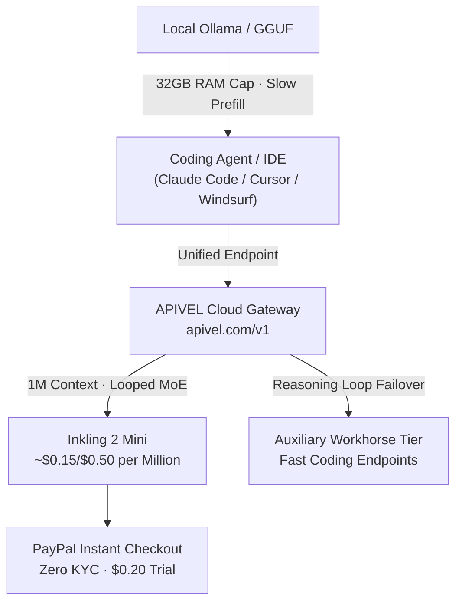

<div class="my-6 border-l-4 border-indigo-500 bg-gray-900 rounded-r-lg p-5">
  <span class="text-xs font-bold uppercase tracking-wider text-indigo-400">Definition & Key Takeaways</span>
  <div class="mt-1 text-md font-semibold text-white">Inkling 2 Mini Looped MoE & API Overview</div>
  <p class="mt-2 text-sm text-gray-300"><strong>Inkling 2 Mini</strong> is an Apache 2.0 open-weight multimodal model from Thinking Machines Lab featuring 26.4B total MoE parameters (3.4B base / 5.4B effective active), a 24-layer Looped Transformer (48 logical layers), and a 1M-token context window. Developers can run quantized GGUF weights locally via Ollama or route production coding agents through <a rel="nofollow" href="https://apivel.com/sign-up?preset=inkling-2-mini&redirect=%2Fdashboard%3Fquickstart%3Dtrue&from_blog=inkling-2-mini-benchmarks-pricing-api" class="text-indigo-400 hover:underline font-semibold">APIVEL</a> with zero KYC and a $0.20 starter credit.</p>
</div>

When Thinking Machines Lab shipped **Inkling 2 Mini** in November 2026, it immediately split opinions across `r/LocalLLaMA` and coding-agent circles. On paper, a 26.4B sparse MoE with a 1M-token context window sounds like frontier reasoning for consumer hardware. In day-to-day engineering, though, two bottlenecks show up fast: aggressive local quantization degrades multi-file edits at long context, and free serverless tiers clamp context at 64K under tight rate limits.

This engineering breakdown covers **Inkling 2 Mini** architecture, verified **Inkling 2 Mini benchmarks** against **Qwen 3.8**, local Ollama/GGUF vs. cloud API trade-offs, and a production Python failover setup.



---

## 1. Inkling 2 Mini Size and Looped Transformer Architecture

Unlike standard feed-forward models that scale raw parameter counts, Thinking Machines' model achieves reasoning depth through **weight-tied recurrent execution**:

* **Parameter Size:** 26.4B total parameters in a sparse Mixture-of-Experts layout, activating **3.4B parameters per base pass** (~5.4B effective active parameters after looping).
* **Looped Layers:** It contains 24 physical decoder layers where the middle 12 layers execute three consecutive loops per token, simulating a 48-layer reasoning stack without bloating its memory footprint.
* **Multimodal & MTP:** It handles text and image inputs natively, ships under Apache 2.0, and supports Multi-Token Prediction (MTP) drafts for high-speed decoding on Apple Silicon MLX and vLLM.

While **Inkling 2 Small** targets larger workstation clusters, **Inkling 2 Mini** is sized around ~20GB in mixed precision—small enough for 32GB unified-memory laptops in 4-bit GGUF, yet fast enough to serve serverless cloud APIs at **$0.075–$0.15 input** and **$0.30–$0.50 output** per million tokens (with cached prefill dropping to **$0.015**).

---

## 2. Inkling 2 Mini Benchmarks vs the 27B Dense Baseline

Independent telemetry from Artificial Analysis and coding harnesses shows **Inkling 2 Mini benchmarks** running neck-and-neck overall with Alibaba's 27B dense baseline, while splitting sharply on agentic workloads:

| Model Checkpoint | Architecture & Active | Context Window | AA Intelligence Index | DeepSWE v1.1 | Terminal-Bench 2.1 | Cloud API (In / Out) | Best For (Objective Fit) |
| :--- | :--- | :--- | :--- | :--- | :--- | :--- | :--- |
| **Inkling 2 Mini** | **26.4B Looped MoE (~5.4B)** | **1,000,000** | **20.1** | **48.2%** | 71.6% | **$0.15 / $0.50** | **High-speed SWE patches & long-repo RAG** |
| **Qwen 3.8 27B** | 27B Dense | 262K (1M ext.) | 20.1 | 42.2% | **73.0%** | ~$0.25 / $0.75 | Predictable bash & terminal execution |
| **DeepSeek V4** | Sparse MoE | 128,000 | — | ~68.0% | — | $0.20 / $0.60 | Reliable multi-turn agent fallback |
| **Qwen 3.7 Max** | Frontier MoE | 128,000 | — | ~71.2% | — | $0.25 / $0.80 | Complex refactoring & tool stability |

In **Inkling 2 Mini benchmarks**, the looped MoE architecture leads on repository-level SWE patching (48.2% vs 42.2%) while consuming roughly one-fifth of the active compute per token. Meanwhile, the dense 27B baseline holds a slight edge on terminal shell execution (73.0% vs 71.6%).

*Data verified November 27, 2026 via Artificial Analysis and Thinking Machines telemetry. For developers comparing broader open-weight roadmaps, check our [Qwen 4 release and 27B roadmap](/blog/qwen-4-release-date-api-roadmap/) and [DeepSeek V4.1 Flash API guide](/blog/deepseek-v4-1-flash-1017-api-setup/).*

---

## 3. Inkling 2 Mini Reddit Reviews: Reasoning Loops and Local Traps

Vendor benchmark cards rarely capture how an agent behaves halfway through a messy multi-file refactor. Hands-on reports from Reddit point to two real friction points:

<div class="my-6 rounded-lg border border-gray-800 bg-gray-950 p-5">
  <div class="flex items-center justify-between border-b border-gray-800 pb-3">
    <span class="text-xs font-bold uppercase tracking-wider text-amber-400">Primary-Source Community Voices (Reddit)</span>
    <span class="rounded bg-amber-950 px-2 py-0.5 text-xs font-semibold text-amber-300 border border-amber-800">Verified Feedback</span>
  </div>
  <div class="mt-4 space-y-3 text-sm text-gray-300">
    <p><strong>1. Agent Tool-Call Loops:</strong> Across <a href="https://www.reddit.com/r/LocalLLaMA/" class="text-amber-400 hover:underline" target="_blank" rel="noopener">Reddit r/LocalLLaMA</a> evaluations of Inkling-2-Mini inside agent harnesses, developers report that high <code>reasoning_effort</code> can trigger repetitive <em>"think &gt; tool &gt; think"</em> cycles where the model argues with itself and stalls without manual interruption.</p>
    <p><strong>2. Quantization &amp; Overthinking Trade-offs:</strong> Local Mac and GPU testers note that while <code>ollama run inkling-2-mini</code> and Unsloth GGUF builds run fast on 32GB rigs, aggressive 3-bit quants (<code>IQ3_XXS</code>) degrade strict JSON tool schemas, prompting community variants like <em>Inkling 2 Mini Fast</em> to curb verbose internal monologues.</p>
  </div>
</div>

---

## 4. Inkling 2 Mini OpenRouter, Ollama, and Gateway Economics

Developers typically evaluate three ways to run **Inkling 2 Mini**:

1. **Local Ollama / Unsloth GGUF / MLX:** Zero per-token fee, great for offline privacy, but 1M-context KV caches quickly exceed 32GB unified memory, and 4-bit quantization weakens complex tool-calling.
2. **Native Tinker & OpenRouter Endpoints:** Tinker's free tier caps context at 64K with tight rate limits, while aggregator wrappers like OpenRouter often trigger international card declines or KYC hurdles. (Compare aggregator routing trade-offs in our [FreeLLMAPI alternatives review](/blog/freellmapi-claude-code-review-alternatives/).)
3. **APIVEL Unified Cloud Gateway:** Exposes OpenAI- and Anthropic-compatible routing with **PayPal Instant Checkout**, global cards, zero KYC, and automatic failover to auxiliary workhorse endpoints when a reasoning loop stalls.

---

## 5. Interactive Inkling 2 Mini Cost & Deployment Simulator

Estimate your monthly inference spend across local hardware, native serverless tiers, and APIVEL hybrid routing:

<div class="my-6 rounded-xl border border-indigo-700 bg-slate-900 p-5">
  <div class="text-base font-bold text-white mb-1">Inkling 2 Mini Cost &amp; Deployment Calculator</div>
  <p class="text-xs text-gray-400 mb-4">Adjust monthly volume and routing tier to compare real-world developer spend.</p>
  <div class="grid grid-cols-1 md:grid-cols-2 gap-4 mb-4">
    <div>
      <label for="inkTierSelect" class="block text-xs font-semibold text-gray-400 uppercase tracking-wider mb-1">Execution Tier</label>
      <select id="inkTierSelect" class="w-full bg-slate-800 border border-slate-700 rounded-lg px-3 py-2 text-sm text-white focus:outline-none focus:border-indigo-500">
        <option value="apivel">APIVEL Unified Gateway ($0.15 in / $0.50 out)</option>
        <option value="tinker">Native Tinker Platform ($0.15 in / $0.50 out)</option>
        <option value="qwen38">Dense 27B Cloud Baseline ($0.25 in / $0.75 out)</option>
        <option value="ollama">Local Ollama / GGUF (32GB Mac / GPU)</option>
      </select>
    </div>
    <div>
      <label for="inkTokensInput" class="block text-xs font-semibold text-gray-400 uppercase tracking-wider mb-1">Monthly Input+Output Tokens</label>
      <input type="number" id="inkTokensInput" value="10000000" step="1000000" class="w-full bg-slate-800 border border-slate-700 rounded-lg px-3 py-2 text-sm text-white focus:outline-none focus:border-indigo-500" />
    </div>
  </div>
  <div class="grid grid-cols-1 md:grid-cols-3 gap-3 p-4 rounded-xl bg-slate-950 border border-slate-800 mb-3">
    <div>
      <div class="text-xs text-gray-400 uppercase tracking-wider">Estimated Spend</div>
      <div id="inkCostOut" class="text-xl font-bold text-emerald-400">$2.90 USD</div>
    </div>
    <div>
      <div class="text-xs text-gray-400 uppercase tracking-wider">Context Ceiling</div>
      <div id="inkCtxOut" class="text-sm font-semibold text-indigo-300 mt-1">Full 1M Context</div>
    </div>
    <div>
      <div class="text-xs text-gray-400 uppercase tracking-wider">Billing &amp; Limits</div>
      <div id="inkBillOut" class="text-sm font-semibold text-gray-200 mt-1">PayPal • Zero KYC</div>
    </div>
  </div>
  <button type="button" id="inkResetBtn" class="px-3 py-1.5 rounded-lg bg-indigo-600 hover:bg-indigo-500 text-xs font-semibold text-white transition">Reset to 10M Baseline</button>
</div>

<script is:inline>
  document.addEventListener('DOMContentLoaded', () => {
    const tierEl = document.getElementById('inkTierSelect');
    const tokEl = document.getElementById('inkTokensInput');
    const costEl = document.getElementById('inkCostOut');
    const ctxEl = document.getElementById('inkCtxOut');
    const billEl = document.getElementById('inkBillOut');
    const resetEl = document.getElementById('inkResetBtn');

    function updateInkCalc() {
      if (!tierEl || !tokEl || !costEl || !ctxEl || !billEl) return;
      const tier = tierEl.value;
      const tokens = Math.max(0, parseFloat(tokEl.value) || 0);
      const m = tokens / 1000000;
      if (tier === 'apivel') {
        costEl.textContent = '$' + (m * 0.29).toFixed(2) + ' USD';
        ctxEl.textContent = 'Full 1M Context';
        billEl.textContent = 'PayPal • Zero KYC';
      } else if (tier === 'tinker') {
        costEl.textContent = '$' + (m * 0.29).toFixed(2) + ' USD';
        ctxEl.textContent = '64K on Free Tier';
        billEl.textContent = 'Card Required';
      } else if (tier === 'qwen38') {
        costEl.textContent = '$' + (m * 0.45).toFixed(2) + ' USD';
        ctxEl.textContent = '262K Native';
        billEl.textContent = 'Cloud API';
      } else {
        costEl.textContent = '$0.00 (Hardware)';
        ctxEl.textContent = '~32K-64K Practical';
        billEl.textContent = '32GB+ RAM Required';
      }
    }

    if (tierEl) tierEl.addEventListener('change', updateInkCalc);
    if (tokEl) tokEl.addEventListener('input', updateInkCalc);
    if (resetEl && tokEl) {
      resetEl.addEventListener('click', () => {
        tokEl.value = '10000000';
        updateInkCalc();
      });
    }
    updateInkCalc();
  });
</script>

---

## 6. Production API Setup with Reasoning Failover

To avoid infinite thinking loops in CI or IDE agents, cap `max_tokens` and attach an automatic fallback to an auxiliary workhorse tier via our unified gateway (`apivel.com/v1`):

```python
import os
from openai import OpenAI

client = OpenAI(
    base_url="https://apivel.com/v1",
    api_key=os.environ["APIVEL_API_KEY"],
    timeout=45.0,
)

def run_agent_step(prompt: str) -> str:
    try:
        res = client.chat.completions.create(
            model="thinkingmachines/inkling-2-mini",
            messages=[{"role": "user", "content": prompt}],
            extra_body={"reasoning_effort": "medium"},
            max_tokens=4096,
        )
        return res.choices[0].message.content or ""
    except Exception:
        # Failover to auxiliary workhorse tier on loop timeout
        fallback = client.chat.completions.create(
            model="infer/qwen3.7-max",
            messages=[{"role": "user", "content": prompt}],
            max_tokens=4096,
        )
        return fallback.choices[0].message.content or ""
```

---

## Inkling 2 Mini Frequently Asked Questions

### What Is Inkling 2 Mini and Its Parameter Size?

**Inkling 2 Mini** is a 26.4B-parameter sparse MoE vision-language model from Thinking Machines Lab under Apache 2.0. It activates 3.4B parameters per base pass (~5.4B effective via 3x looped middle layers) and supports a 1M-token context window.

### Can Inkling 2 Mini Run Locally on Ollama or GGUF?

Yes. Quantized GGUF and MLX builds run via `ollama run inkling-2-mini`, LM Studio, and Unsloth on 32GB Macs or 24GB GPUs. However, long-context KV caches and strict tool schemas perform more reliably on cloud endpoints.

### How Does Inkling 2 Mini Compare to Qwen 3.8 27B?

Both tie at 20.1 on the Artificial Analysis Intelligence Index. **Inkling 2 Mini** leads on DeepSWE v1.1 (48.2% vs 42.2%) with a 1M native context and lower active compute, while the dense 27B baseline edges ahead on Terminal-Bench 2.1 (73.0% vs 71.6%).

### How Do I Access Inkling 2 Mini API Without Rate Limits?

Route OpenAI-compatible requests through APIVEL (`apivel.com/v1`) to bypass 64K free-tier caps and card declines, using **PayPal Instant Checkout**, global cards, and a starter trial balance with no KYC. For multi-turn coding agents, pairing this looped MoE with automatic workhorse failover prevents reasoning timeouts on long refactors.

<div class="cta-card">
  <div class="my-8 rounded-2xl p-6 bg-gradient-to-br from-indigo-950 to-gray-900 border border-indigo-700">
    <div class="cta-title text-xl font-bold text-white mb-2">Run Inkling 2 Mini &amp; Failover Agents on APIVEL</div>
    <p class="text-gray-300 text-sm mb-4">
      Skip 64K free-tier caps, local VRAM bottlenecks, and card rejections. Connect Claude Code, Cursor, or Python pipelines in 60 seconds with PayPal Instant Checkout and zero KYC.
    </p>
    <div class="cta-badge-grid">
      <div class="cta-badge">🎁 +50% First Deposit Bonus ($5 → $7.50, $29 → $43.50)</div>
      <div class="cta-badge">🚀 $29 Pack: 40M Tokens (56% OFF, Never Expires)</div>
      <div class="cta-badge">💳 Instant PayPal Checkout • Zero KYC • $0.20 Free Trial</div>
    </div>
    <div class="cta-button-group">
      <a rel="nofollow" href="https://apivel.com/sign-up?preset=inkling-2-mini&redirect=%2Fdashboard%3Fquickstart%3Dtrue&from_blog=inkling-2-mini-benchmarks-pricing-api" class="cta-btn cta-btn-primary">Claim $0.20 Free Trial (No Card Needed) →</a>
      <a rel="nofollow" href="https://apivel.com/pricing?from_blog=inkling-2-mini-benchmarks-pricing-api" class="cta-btn cta-btn-secondary">View +50% Deposit Bonus &amp; Rates →</a>
    </div>
  </div>
</div>

<script type="application/ld+json">
{
  "@context": "https://schema.org",
  "@type": "FAQPage",
  "mainEntity": [
    {
      "@type": "Question",
      "name": "What Is Inkling 2 Mini and Its Parameter Size?",
      "acceptedAnswer": {
        "@type": "Answer",
        "text": "Inkling 2 Mini is a 26.4B-parameter sparse MoE vision-language model from Thinking Machines Lab under Apache 2.0. It activates 3.4B parameters per base pass (~5.4B effective via 3x looped middle layers) and supports a 1M-token context window."
      }
    },
    {
      "@type": "Question",
      "name": "Can Inkling 2 Mini Run Locally on Ollama or GGUF?",
      "acceptedAnswer": {
        "@type": "Answer",
        "text": "Yes. Quantized GGUF and MLX builds run via ollama run inkling-2-mini, LM Studio, and Unsloth on 32GB Macs or 24GB GPUs. However, long-context KV caches and strict tool schemas perform more reliably on cloud endpoints."
      }
    },
    {
      "@type": "Question",
      "name": "How Does Inkling 2 Mini Compare to Qwen 3.8 27B?",
      "acceptedAnswer": {
        "@type": "Answer",
        "text": "Both tie at 20.1 on the Artificial Analysis Intelligence Index. Inkling 2 Mini leads on DeepSWE v1.1 (48.2% vs 42.2%) with a 1M native context and lower active compute, while Qwen 3.8 27B edges ahead on Terminal-Bench 2.1 (73.0% vs 71.6%)."
      }
    },
    {
      "@type": "Question",
      "name": "How Do I Access Inkling 2 Mini API Without Rate Limits?",
      "acceptedAnswer": {
        "@type": "Answer",
        "text": "Route OpenAI-compatible requests through APIVEL (apivel.com/v1) to bypass 64K free-tier caps and card declines, using PayPal Instant Checkout, global cards, and a starter trial balance with zero KYC."
      }
    }
  ]
}
</script>
