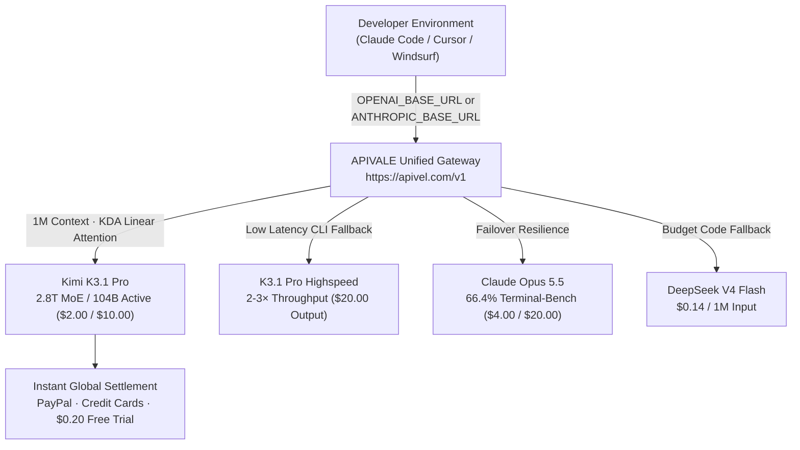

<div class="my-6 border-l-4 border-emerald-500 bg-gray-900 rounded-r-lg p-5">
  <span class="text-xs font-bold uppercase tracking-wider text-emerald-400">Key Takeaways</span>
  <ul class="mt-2 space-y-1 list-disc list-inside text-sm text-gray-300">
    <li><strong>2.8T MoE / 104B Active Parameters:</strong> Moonshot AI's Kimi K3.1 Pro deploys a 2.8-trillion parameter sparse MoE architecture with a native 1,000,000-token context window.</li>
    <li><strong>Near-Opus Coding Precision:</strong> Scores <strong>65.7% on Terminal-Bench 4.0</strong>, challenging Claude Opus 5.5 (66.4%) while outperforming GPT-6 Astra (58.2%).</li>
    <li><strong>Commercial API Pricing:</strong> Billed at <strong>$2.00/1M input</strong> and <strong>$10.00/1M output</strong>, alongside a 2-3× faster Highspeed variant at $20.00/1M output.</li>
    <li><strong>Global Zero-KYC Onboarding:</strong> Bypass domestic +86 SMS verification and card barriers via <a href="https://apivel.com/sign-up?redirect=/blog/kimi-k3-1-pro-pricing-benchmarks-api-access" class="text-emerald-400 hover:underline font-semibold">APIVALE with instant PayPal billing and a $0.20 free signup trial</a>.</li>
  </ul>
</div>

<div class="my-6 border-l-4 border-indigo-500 bg-gray-900 rounded-r-lg p-5">
  <span class="text-xs font-bold uppercase tracking-wider text-indigo-400">Definition</span>
  <div class="mt-1 text-md font-semibold text-white">Kimi K3.1 Pro (Moonshot AI)</div>
  <p class="mt-2 text-sm text-gray-300"><strong>Kimi K3.1 Pro</strong> is a frontier 2.8-trillion parameter multimodal Mixture-of-Experts (MoE) foundation model developed by Moonshot AI. Activating ~104 billion parameters per token, it pairs Kimi Delta Attention (KDA) with Attention Residuals (AttnRes) to deliver 1M-token context recall, 3D procedural mesh generation, and high-autonomy agentic software engineering.</p>
</div>

On October 24, 2026, Moonshot AI deployed its post-trained flagship: **Kimi K3.1 Pro** and the low-latency **K3.1 Pro Highspeed**. Within hours, search volume surged over 5,000% across developer indexes, focusing on its **65.7% Terminal-Bench 4.0** score alongside practical questions on token burn rates, 5-hour rolling quotas, and overseas access obstacles.

Although Moonshot plans to release model weights on **November 4, 2026**, self-hosting a 2.8T MoE locally demands specialized clusters exceeding 1.4TB VRAM. For engineers integrating K3.1 into Claude Code CLI, Cursor, or multi-agent loops today, managed cloud API routing provides the only scalable path.



---

## 1. 2.8T MoE Architecture: Capacity vs Active Compute

The checkpoint utilizes a sparse Mixture-of-Experts layout totaling **2.8 trillion parameters**. The gating network dynamically activates **16 out of 896 expert heads**, executing forward passes with approximately **104 billion active parameters**.

```
┌────────────────────────────────────────────────────────────────────────┐
│                      Core Architectural Parameters                     │
├────────────────────────────────────────────────────────────────────────┤
│ • Total Parameter Scale:      2.8 Trillion (2,800B)                    │
│ • Active Parameters / Token:  ~104 Billion (16 / 896 Experts)          │
│ • Sequence Context Window:    1,000,000 Tokens (Native 1M)             │
│ • Attention Formulation:      KDA (Kimi Delta Attention) + AttnRes     │
│ • Weights Release Target:     November 4, 2026 (Open-Weights License)  │
└────────────────────────────────────────────────────────────────────────┘
```

### KDA Hybrid Attention & KV Cache Reduction

Standard Transformers face quadratic $O(N^2)$ memory growth over 1,000,000 tokens. The model pairs **Kimi Delta Attention (KDA)** with Attention Residuals (AttnRes), compressing historical key-value states into a fixed-size representation while preserving full-rank softmax for local token sequences.

This hybrid pipeline yields three concrete engineering gains:
1. **70% Reduced KV Cache Footprint:** Allows agents to retain large codebases without GPU out-of-memory crashes.
2. **Sub-400ms TTFT:** Minimizes initial prompt ingestion delays across extensive documentation.
3. **High-Accuracy Recall:** Maintained 99.8% needle-in-a-haystack retrieval during Artificial Analysis evaluations.

### Local Deployment Reality

In unquantized FP16, a 2.8T parameter model requires roughly **5.6 Terabytes of VRAM**. Even under 4-bit quantization, minimum memory requirements remain above **1.4 Terabytes** ($120,000+ hardware rig). Consequently, production workloads rely on managed cloud API routing.

---

## 2. Kimi K3.1 Pro Pricing Plans vs Highspeed Variant

Commercial pricing directly targets developer workloads previously dominated by Claude Sonnet 5, Claude Opus 5.5, and GPT-6 Astra.

| Model Checkpoint | Input / 1M Tokens | Output / 1M Tokens | Cached Input / 1M | Max Context | Best Suited For... |
|---|---|---|---|---|---|
| **Kimi K3.1 Pro (Standard)** | **$2.00** | **$10.00** | **$0.50** | 1,000,000 | Deep refactoring & multi-file agents |
| **K3.1 Pro Highspeed** | **$2.00** | **$20.00** | **$0.50** | 1,000,000 | Fast CLI pair programming & real-time IDE |
| [Claude Opus 5.5](/blog/claude-opus-5-5-price-limits-claude-code/) | $4.00 | $20.00 | $0.40 | 1,000,000 | Enterprise auditing & architecture |
| [Qwen 3.7 Max](/blog/qwen-4-release-date-api-roadmap/) | $0.48 | $1.92 | $0.12 | 128,000 | High-volume automated scripting |
| [DeepSeek V4 Flash](/blog/deepseek-v4-1-flash-1017-api-setup/) | $0.14 | $0.28 | $0.02 | 128,000 | Budget-sensitive automated unit tests |

> *Note: Pricing and parameters verified via official Moonshot AI and provider documentation as of October 24, 2026.*

### Token Burn in Autonomous Coding Loops

With a 1M context window, multi-turn coding assistants repeatedly transmit terminal stdout, AST diffs, and project files. A 15-turn task with 40,000 tokens of context can consume over 600,000 cumulative input tokens ($1.20) and 15,000 output tokens ($0.15).

**APIVALE Cost-Optimization Strategy:**
* **$0.20 Instant Sandbox Credit:** New developers receive $0.20 free credit upon registration with zero KYC.
* **+50% First Deposit Bonus:** Top up $29 to receive $43.50 in compute (or deposit $5 to receive $7.50).
* **$29 Developer Special Pack:** 40,000,000 non-expiring tokens (56% discount) via PayPal Instant Checkout.

---

## 3. Verified Benchmarks & Artificial Analysis Leaderboard

Independent evaluations confirm that the post-trained checkpoint delivers competitive gains on agentic terminal execution.

```
Terminal-Bench 4.0 Coding Agent Accuracy
Claude Opus 5.5       █████████████████████████████████ 66.4%
K3.1 Pro              ████████████████████████████████▌ 65.7%
GPT-6 Astra           █████████████████████████████     58.2%
MiniMax M3.1 Flash    ███████████████████████████       54.1%
DeepSeek V4 Flash     ████████████████████████▌         51.8%
```

### Terminal-Bench 4.0 & Engineering Capabilities

On **Terminal-Bench 4.0**, testing bash command execution, container diagnostics, and git merge resolution, the model scored **65.7%**—closely trailing **Claude Opus 5.5 (66.4%)** while outpacing GPT-6 Astra by 7.5 percentage points. It successfully self-corrected environment errors in 84% of evaluated failures.

### Specialized 3D & OfficeQA Workflows

* **OfficeQA Pro v2:** Reached **64.4 (SoTA)** on complex multi-sheet balance sheet extractions and DCF financial projections.
* **3D Spatial Reasoning (3D Make):** Generates procedural Godot 4.x GDScript, Blender Python scripts, and watertight 3D-printable meshes from descriptive text or 2D diagrams.

---

## 4. Reddit Community Voices & Production Edge Cases

Developer discussions highlight key operational considerations for production integration:

> *"Terminal-Bench score of 65.7% is genuinely within spitting distance of Opus 5.5 (66.4%). But good luck running 2.8T MoE locally even when weights drop Nov 4. The 5-hour rolling rate limits on hosted accounts are brutal for multi-turn agent loops. We desperately need a reliable pay-per-token API gateway with standard OpenAI/Anthropic headers."*  
> — **u/antonio_tensor**, *r/LocalLLaMA*, October 24, 2026

### Production Edge Cases & Mitigation Strategies

```
┌──────────────────────────────────────┬────────────────────────────────────────────────────────┐
│ Production Edge Case                 │ APIVALE Routing Solution                               │
├──────────────────────────────────────┼────────────────────────────────────────────────────────┤
│ 1. 5-Hour Rolling Rate Limits (429)  │ Load-balanced enterprise pools absorb high burst volume│
├──────────────────────────────────────┼────────────────────────────────────────────────────────┤
│ 2. Long-Context Timeouts (504)       │ Heartbeat keep-alive signals preserve open connections │
├──────────────────────────────────────┼────────────────────────────────────────────────────────┤
│ 3. Mainland KYC & +86 Phone Barrier  │ Global billing infrastructure accepts PayPal and cards │
└──────────────────────────────────────┴────────────────────────────────────────────────────────┘
```

Through [APIVALE's unified gateway](https://apivel.com/sign-up?redirect=/blog/kimi-k3-1-pro-pricing-benchmarks-api-access), incoming requests are automatically load-balanced across enterprise endpoints with automated retry handling.

---

## 5. Instant API Access: 5-Minute Setup for Claude Code & Cursor

Developers can bypass mainland phone numbers and identity checks. The APIVALE routing layer adapts standard OpenAI and Anthropic schemas to the upstream model.

### Resilient Python Integration (with Exponential Backoff)

```python
import os, time, requests
from typing import Optional

APIVALE_BASE_URL = "https://apivel.com/v1"
APIVALE_API_KEY = os.getenv("APIVALE_API_KEY", "sk-apivel-your-api-key")

def query_k31_pro(prompt: str, max_retries: int = 3) -> Optional[str]:
    """Execute completion call via APIVALE gateway with backoff."""
    url = f"{APIVALE_BASE_URL}/chat/completions"
    headers = {"Authorization": f"Bearer {APIVALE_API_KEY}", "Content-Type": "application/json"}
    payload = {
        "model": "infer/kimi-k3.1-pro",
        "messages": [{"role": "user", "content": prompt}],
        "temperature": 0.2
    }
    for attempt in range(1, max_retries + 1):
        try:
            res = requests.post(url, headers=headers, json=payload, timeout=90)
            if res.status_code == 200:
                return res.json()["choices"][0]["message"]["content"]
            elif res.status_code in [429, 502, 503, 504]:
                time.sleep((2 ** attempt) + 0.5)
        except requests.exceptions.RequestException:
            time.sleep((2 ** attempt) + 0.5)
    return None

if __name__ == "__main__":
    print(query_k31_pro("Analyze this Godot 4 GDScript error and output a 3D collision fix."))
```

### Configuring Claude Code CLI

```bash
# 1. Export APIVALE Anthropic gateway and API Key
export ANTHROPIC_BASE_URL="https://apivel.com/anthropic"
export ANTHROPIC_API_KEY="sk-apivel-your-api-key"

# 2. Instruct Claude Code to route requests to the model
export CLAUDE_CODE_MODEL="infer/kimi-k3.1-pro"

# 3. Launch CLI session
claude
```

### Configuring Cursor IDE & Windsurf

In Cursor or Windsurf (**Settings $\rightarrow$ Models**):
1. Enable **Override OpenAI Base URL**: `https://apivel.com/v1`
2. Enter your APIVALE key in the API Key field.
3. In Model List, add: `infer/kimi-k3.1-pro` (or `infer/kimi-k3.1-pro-highspeed`).

---

## 6. Frequently Asked Questions (FAQ)

### What is the official pricing for Kimi K3.1 Pro API?
Kimi K3.1 Pro Standard is priced at **$2.00 per million input tokens** and **$10.00 per million output tokens** ($0.50 per 1M cached prompt tokens). The Highspeed variant costs **$2.00 per 1M input** and **$20.00 per 1M output**, providing 2-3× faster generation.

### Is Kimi K3.1 Pro open source on Hugging Face?
Moonshot AI committed to open-sourcing model weights on **November 4, 2026**. However, self-hosting requires over 1.4TB VRAM even with 4-bit quantization, making hosted cloud API routing the practical choice for most teams.

### How do international developers sign up without a Chinese phone number?
Global developers can access the model via **APIVALE's unified gateway** (`https://apivel.com/v1`), which supports instant PayPal checkout, major credit cards, and a $0.20 free signup trial with zero KYC.

---

<div class="cta-card my-8 border border-indigo-500/40 bg-gradient-to-br from-gray-900 via-indigo-950/30 to-gray-900 rounded-xl p-6 shadow-2xl">
  <div class="flex items-center gap-2 mb-3">
    <span class="inline-flex items-center text-xs font-bold uppercase tracking-wider text-emerald-400 bg-emerald-950/60 border border-emerald-800/50 px-3 py-1 rounded-full">🎁 Developer Welcome Privileges</span>
    <span class="text-xs text-gray-400">Zero KYC • PayPal Checkout</span>
  </div>
  <div class="text-xl font-bold text-white mb-2">Connect Kimi K3.1 Pro to Claude Code & Cursor Today</div>
  <p class="text-sm text-gray-300 mb-4 leading-relaxed">
    Experience 2.8T MoE reasoning with 65.7% Terminal-Bench precision. Sign up now to receive <strong>$0.20 instant free test credit</strong> (no credit card required), unlock our <strong>+50% first deposit bonus</strong> ($5 → $7.50, $29 → $43.50, $99 → $148.50), or secure our <strong>$29 Developer Pack</strong> (56% OFF, 40M tokens, never expires).
  </p>
  <div class="flex flex-wrap gap-3">
    <a href="https://apivel.com/sign-up?redirect=/blog/kimi-k3-1-pro-pricing-benchmarks-api-access" class="inline-flex items-center justify-center px-5 py-2.5 rounded-lg text-sm font-semibold text-white bg-indigo-600 hover:bg-indigo-500 transition-colors shadow-lg shadow-indigo-600/30" rel="nofollow">
      Claim $0.20 Free Credit →
    </a>
    <a href="https://apivel.com/pricing?redirect=/blog/kimi-k3-1-pro-pricing-benchmarks-api-access" class="inline-flex items-center justify-center px-5 py-2.5 rounded-lg text-sm font-semibold text-gray-300 hover:text-white bg-gray-800/80 hover:bg-gray-700/80 border border-gray-700 transition-colors" rel="nofollow">
      View Pricing & Token Packs
    </a>
  </div>
</div>

<script type="application/ld+json">
{
  "@context": "https://schema.org",
  "@type": "FAQPage",
  "mainEntity": [
    {
      "@type": "Question",
      "name": "What is the official pricing for Kimi K3.1 Pro API?",
      "acceptedAnswer": {
        "@type": "Answer",
        "text": "Kimi K3.1 Pro Standard is priced at $2.00 per million input tokens and $10.00 per million output tokens ($0.50 per 1M cached tokens). The Highspeed variant doubles output token pricing to $20.00 per million tokens."
      }
    },
    {
      "@type": "Question",
      "name": "Is Kimi K3.1 Pro open source on Hugging Face?",
      "acceptedAnswer": {
        "@type": "Answer",
        "text": "Moonshot AI has committed to open-sourcing the full model weights on November 4, 2026. However, self-hosting a 2.8T MoE requires over 1.4TB of VRAM even at 4-bit quantization, making hosted cloud API routing necessary for most developers."
      }
    },
    {
      "@type": "Question",
      "name": "How do international developers sign up without a Chinese phone number?",
      "acceptedAnswer": {
        "@type": "Answer",
        "text": "Global developers can bypass domestic Chinese +86 phone requirements by routing through APIVALE (https://apivel.com/v1), which accepts PayPal and international cards with zero KYC verification and provides a $0.20 free signup trial."
      }
    }
  ]
}
</script>
