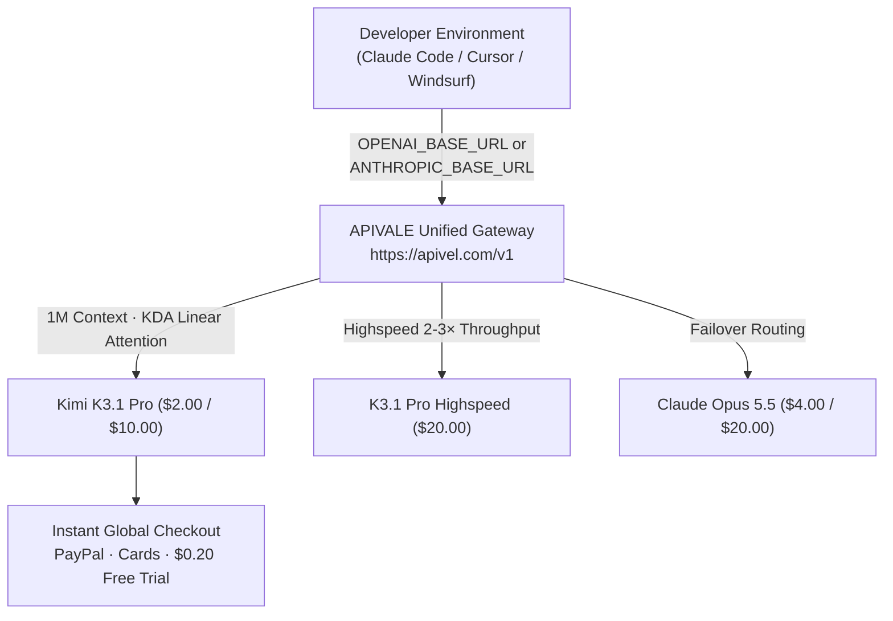

<div class="my-6 border-l-4 border-emerald-500 bg-gray-900 rounded-r-lg p-5">
  <span class="text-xs font-bold uppercase tracking-wider text-emerald-400">Key Takeaways</span>
  <ul class="mt-2 space-y-1 list-disc list-inside text-sm text-gray-300">
    <li><strong>2.8T MoE Backbone:</strong> Kimi K3.1 Pro deploys a 2.8T MoE architecture (~104B active) with a native 1,000,000-token window.</li>
    <li><strong>Near-Opus Precision:</strong> Scores <strong>65.7% on Terminal-Bench 4.0</strong>, challenging closed frontier models and beating GPT-6 Astra (58.2%).</li>
    <li><strong>Commercial Token Rates:</strong> Priced at <strong>$2.00/1M input</strong> and <strong>$10.00/1M output</strong>, with a low-latency Highspeed variant ($20.00/1M output).</li>
    <li><strong>Global Zero-KYC Access:</strong> Bypass mainland +86 phone and card checks via <a href="https://apivel.com/sign-up?redirect=/blog/kimi-k3-1-pro-pricing-benchmarks-api-access" class="text-emerald-400 hover:underline font-semibold">APIVALE with instant PayPal billing and a $0.20 free trial</a>.</li>
  </ul>
</div>

<div class="my-6 border-l-4 border-indigo-500 bg-gray-900 rounded-r-lg p-5">
  <span class="text-xs font-bold uppercase tracking-wider text-indigo-400">Definition</span>
  <div class="mt-1 text-md font-semibold text-white">Kimi K3.1 Pro (Moonshot AI)</div>
  <p class="mt-2 text-sm text-gray-300"><strong>Kimi K3.1 Pro</strong> is Moonshot AI's 2.8-trillion parameter multimodal Mixture-of-Experts foundation model. Activating ~104B parameters per token, it pairs KDA hybrid linear attention with Attention Residuals for 1M context recall, 3D mesh creation, and autonomous agent loops.</p>
</div>

On October 24, 2026, Moonshot AI launched **Kimi K3.1 Pro** and **K3.1 Pro Highspeed**. Developer search queries spiked over 5,000% around its **65.7% Terminal-Bench 4.0** score, while raising practical questions on pricing, 5-hour rolling quotas, and overseas access obstacles.

Although open weights are slated for **November 4, 2026**, self-hosting a 2.8T MoE demands >1.4TB VRAM ($120k+ hardware). For engineers using Claude Code CLI, Cursor, or agent workflows today, managed API routing provides the only production path.



---

## 1. 2.8T MoE Architecture: Capacity vs Active Compute

The checkpoint uses a sparse Mixture-of-Experts design of **2.8 trillion total parameters**, dynamically activating **16 of 896 expert heads** (~104 billion active parameters) per token.

### KDA Hybrid Attention & KV Cache Reduction

Transformers face quadratic memory growth over 1,000,000 tokens. KDA (Kimi Delta Attention) compresses past KV states into a fixed-size matrix while preserving full-rank attention locally:
* **70% Smaller KV Cache:** Multi-agent workflows retain large repositories without GPU memory exhaustion.
* **Sub-400ms TTFT:** Minimizes initial prompt ingestion latency across massive codebases.
* **99.8% Needle Recall:** Verified retrieval consistency across all context depths during Artificial Analysis testing.

In FP16, loading 2.8T parameters requires ~5.6TB VRAM; even 4-bit quantization demands >1.4TB. Production workloads rely on cloud API endpoints.

---

## 2. Kimi K3.1 Pro Pricing Plans vs Highspeed Variant

Commercial pricing competes directly with frontier developer tiers:

| Model Checkpoint | Input / 1M | Output / 1M | Cached Input / 1M | Max Context | Best Suited For... |
|---|---|---|---|---|---|
| **Kimi K3.1 Pro (Standard)** | **$2.00** | **$10.00** | **$0.50** | 1,000,000 | Deep refactoring & multi-file agents |
| **K3.1 Pro Highspeed** | **$2.00** | **$20.00** | **$0.50** | 1,000,000 | Interactive CLI coding & real-time IDE |
| [Claude Opus 5.5](/blog/claude-opus-5-5-price-limits-claude-code/) | $4.00 | $20.00 | $0.40 | 1,000,000 | Enterprise auditing & architecture |
| [GPT-6.1 Terra](/blog/openai-6-1-terra-vs-sol-benchmark-pricing/) | $1.00 | $5.00 | $0.25 | 1,100,000 | High-speed GUI & computer-use automation |
| [Qwen 3.7 Max](/blog/qwen-4-release-date-api-roadmap/) | $0.48 | $1.92 | $0.12 | 128,000 | High-volume batch automation |
| [DeepSeek V4 Flash](/blog/deepseek-v4-1-flash-1017-api-setup/) | $0.14 | $0.28 | $0.02 | 128,000 | Budget-sensitive automated unit tests |

> *Note: Pricing and parameters verified via official documentation as of October 24, 2026.*

### Token Burn in Autonomous Coding Loops

With a 1M window, coding tools resend file trees and AST diffs. A 15-turn task with 40k tokens context generates ~600k input tokens ($1.20) and 15k output tokens ($0.15).

**APIVALE Cost-Optimization Strategy:**
* **$0.20 Instant Sandbox Credit:** Test prompts upon registration with zero KYC or credit card required.
* **+50% First Deposit Bonus:** Deposit $29 to receive $43.50 in compute (or deposit $5 to receive $7.50).
* **$29 Developer Special Pack:** 40,000,000 non-expiring tokens (56% discount) via PayPal Instant Checkout.

---

## 3. Verified Benchmarks & Artificial Analysis Leaderboard

Independent evaluations confirm competitive performance in autonomous software engineering:

* **Terminal-Bench 4.0:** Achieves **65.7%**, closely trailing [Claude Opus 5.5](/blog/claude-opus-5-5-price-limits-claude-code/) (66.4%) while outperforming GPT-6 Astra (58.2%). It resolved environment errors in 84% of evaluated test cases.
* **OfficeQA Pro v2:** Reached **64.4 (SoTA)** on multi-sheet financial modeling and cross-document validation.
* **3D Spatial Reasoning (3D Make):** Generates procedural Godot 4.x GDScript, Blender Python pipelines, and watertight 3D meshes from text prompts.

---

## 4. Reddit Community Voices & Production Edge Cases

Developer discussions highlight key operational considerations:

> *"Terminal-Bench score of 65.7% is genuinely within spitting distance of Opus 5.5 (66.4%). But running 2.8T MoE locally is impossible even when weights drop Nov 4. The 5-hour rolling rate limits on hosted accounts are brutal for multi-turn agent loops. We need a reliable pay-per-token API gateway with standard OpenAI/Anthropic headers."*  
> — **u/antonio_tensor**, *r/LocalLLaMA*, October 24, 2026

### Production Edge Cases & Mitigation Strategies

* **5-Hour Rolling Limits (429):** APIVALE load-balances requests across enterprise capacity pools to prevent agent loop freezes.
* **Long-Context Timeouts (504):** Built-in heartbeat pulses maintain connection stability during complex inter-token reasoning.
* **Mainland KYC & +86 Phone Barriers:** Global billing accepts PayPal and credit cards with zero domestic identity verification.

---

## 5. Instant API Access: 5-Minute Setup for Claude Code & Cursor

Developers access endpoints without mainland Chinese credentials via APIVALE's unified protocol layer.

### Resilient Python Integration (with Exponential Backoff)

```python
import os, time, requests
from typing import Optional

APIVALE_BASE_URL = "https://apivel.com/v1"
APIVALE_API_KEY = os.getenv("APIVALE_API_KEY", "sk-apivel-your-api-key")

def query_k31_pro(prompt: str, max_retries: int = 3) -> Optional[str]:
    url = f"{APIVALE_BASE_URL}/chat/completions"
    headers = {"Authorization": f"Bearer {APIVALE_API_KEY}", "Content-Type": "application/json"}
    payload = {"model": "infer/kimi-k3.1-pro", "messages": [{"role": "user", "content": prompt}], "temperature": 0.2}
    for attempt in range(1, max_retries + 1):
        try:
            res = requests.post(url, headers=headers, json=payload, timeout=90)
            if res.status_code == 200:
                return res.json()["choices"][0]["message"]["content"]
            elif res.status_code in [429, 502, 503, 504]:
                time.sleep((2 ** attempt) + 0.5)
        except requests.exceptions.RequestException:
            time.sleep((2 ** attempt) + 0.5)
    return None

if __name__ == "__main__":
    print(query_k31_pro("Analyze this Godot 4 GDScript error and output a fix."))
```

### Configuring Claude Code CLI

```bash
# Export APIVALE Anthropic gateway and API Key
export ANTHROPIC_BASE_URL="https://apivel.com/anthropic"
export ANTHROPIC_API_KEY="sk-apivel-your-api-key"
export CLAUDE_CODE_MODEL="infer/kimi-k3.1-pro"

claude
```

### Configuring Cursor IDE & Windsurf

In Cursor or Windsurf (**Settings $\rightarrow$ Models**):
1. Enable **Override OpenAI Base URL**: `https://apivel.com/v1`
2. Enter your APIVALE key in the API Key field.
3. In Model List, add: `infer/kimi-k3.1-pro` (or `infer/kimi-k3.1-pro-highspeed`).

---

## 6. Frequently Asked Questions (FAQ)

### What is the official pricing for Kimi K3.1 Pro API?
Standard endpoints cost **$2.00/1M input** and **$10.00/1M output** ($0.50/1M cached prompt tokens). The Highspeed variant costs **$2.00/1M input** and **$20.00/1M output** for 2-3× faster generation.

### Is Kimi K3.1 Pro open source on Hugging Face?
Weights drop on **November 4, 2026**. However, self-hosting requires >1.4TB VRAM, making hosted cloud API routing the practical choice for most teams.

### How do international developers sign up without a Chinese phone number?
Global developers access endpoints via **APIVALE's unified gateway** (`https://apivel.com/v1`) using instant PayPal checkout, major cards, and a $0.20 free signup trial with zero KYC.

---

<div class="cta-card my-8 border border-indigo-500/40 bg-gradient-to-br from-gray-900 via-indigo-950/30 to-gray-900 rounded-xl p-6 shadow-2xl">
  <div class="flex items-center gap-2 mb-3">
    <span class="inline-flex items-center text-xs font-bold uppercase tracking-wider text-emerald-400 bg-emerald-950/60 border border-emerald-800/50 px-3 py-1 rounded-full">🎁 Developer Welcome Privileges</span>
    <span class="text-xs text-gray-400">Zero KYC • PayPal Checkout</span>
  </div>
  <div class="text-xl font-bold text-white mb-2">Connect Kimi K3.1 Pro to Claude Code & Cursor Today</div>
  <p class="text-sm text-gray-300 mb-4 leading-relaxed">
    Experience 2.8T MoE reasoning with 65.7% Terminal-Bench precision. Sign up now to receive <strong>$0.20 instant free test credit</strong> (no credit card required), unlock our <strong>+50% first deposit bonus</strong> ($5 → $7.50, $29 → $43.50, $99 → $148.50), or secure our <strong>$29 Developer Pack</strong> (56% OFF, 40M tokens, never expires).
  </p>
  <div class="flex flex-wrap gap-3">
    <a href="https://apivel.com/sign-up?redirect=/blog/kimi-k3-1-pro-pricing-benchmarks-api-access" class="inline-flex items-center justify-center px-5 py-2.5 rounded-lg text-sm font-semibold text-white bg-indigo-600 hover:bg-indigo-500 transition-colors shadow-lg shadow-indigo-600/30" rel="nofollow">
      Claim $0.20 Free Credit →
    </a>
    <a href="https://apivel.com/pricing?redirect=/blog/kimi-k3-1-pro-pricing-benchmarks-api-access" class="inline-flex items-center justify-center px-5 py-2.5 rounded-lg text-sm font-semibold text-gray-300 hover:text-white bg-gray-800/80 hover:bg-gray-700/80 border border-gray-700 transition-colors" rel="nofollow">
      View Pricing & Token Packs
    </a>
  </div>
</div>

<script type="application/ld+json">
{
  "@context": "https://schema.org",
  "@type": "FAQPage",
  "mainEntity": [
    {
      "@type": "Question",
      "name": "What is the official pricing for Kimi K3.1 Pro API?",
      "acceptedAnswer": {
        "@type": "Answer",
        "text": "Kimi K3.1 Pro Standard is priced at $2.00 per million input tokens and $10.00 per million output tokens ($0.50 per 1M cached tokens). The Highspeed variant doubles output token pricing to $20.00 per million tokens."
      }
    },
    {
      "@type": "Question",
      "name": "Is Kimi K3.1 Pro open source on Hugging Face?",
      "acceptedAnswer": {
        "@type": "Answer",
        "text": "Moonshot AI has committed to open-sourcing the full model weights on November 4, 2026. However, self-hosting a 2.8T MoE requires over 1.4TB of VRAM even at 4-bit quantization, making hosted cloud API routing necessary for most developers."
      }
    },
    {
      "@type": "Question",
      "name": "How do international developers sign up without a Chinese phone number?",
      "acceptedAnswer": {
        "@type": "Answer",
        "text": "Global developers can bypass domestic Chinese +86 phone requirements by routing through APIVALE (https://apivel.com/v1), which accepts PayPal and international cards with zero KYC verification and provides a $0.20 free signup trial."
      }
    }
  ]
}
</script>
