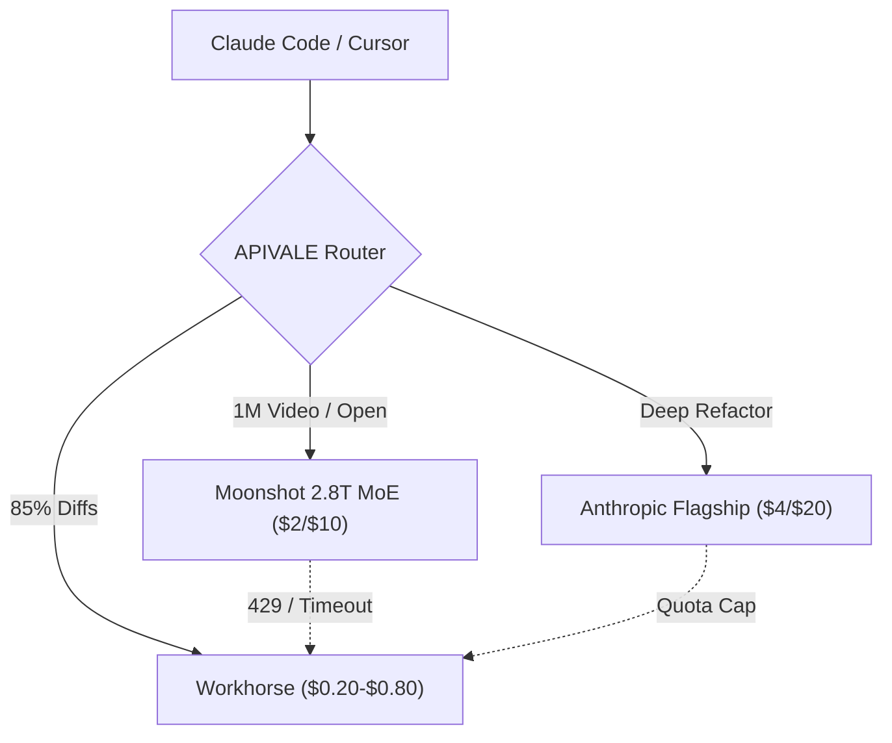

<div class="my-8 rounded-xl border border-primary/20 bg-primary/5 p-6 backdrop-blur-sm">
  <div class="flex items-center gap-2 text-primary font-semibold text-lg mb-2">
    <span>Technical Summary: Kimi K3.1 vs Claude Opus 5.5 AI Models</span>
  </div>
  <p class="text-base text-gray-200 leading-relaxed m-0">
    Comparing <strong>Kimi K3.1 vs Claude Opus 5.5</strong> pits Moonshot AI's open-weight 2.8T sparse MoE model against Anthropic's proprietary coding specialist. Moonshot's flagship activates 104B parameters with Kimi Delta Attention across a 1,048,576-token window, scoring 65.7% on Terminal-Bench 4.0 and 51.7% on SWE-Marathon v1.1 at $2/$10 per million tokens—half Anthropic's $4/$20 rate card. Anthropic leads Terminal-Bench 4.0 (66.4%) and multi-file refactoring, though mandatory adaptive thinking exhausts five-hour quotas. Routing both AI models through APIVALE's two-tier gateway—offloading 85% of routine diffs to workhorse endpoints—prevents 429 lockouts and cuts spend up to 88% via PayPal Instant Checkout.
  </p>
</div>

Choosing between **Kimi K3.1 vs Claude Opus 5.5** directly impacts teams running Claude Code CLI, Cursor, and Windsurf in production. Both frontier AI models target million-token repositories and long-horizon agents, yet their architectures, weight availability, and token economics produce sharply different monthly bills.

Released October 24, 2026 with public Hugging Face checkpoints following November 4, Moonshot's sparse Mixture-of-Experts model challenged proprietary pricing head-on. Anthropic's September 2026 flagship counters with tight harness integration and deterministic multi-file execution.



## Kimi K3.1 vs Claude Opus 5.5 Architecture: 2.8T MoE vs Adaptive Thinking

How each lab structures long-horizon reasoning explains why these models diverge in latency and memory footprint:

* **2.8T Sparse MoE & Kimi Delta Attention (Moonshot AI)**: Detailed in our [Kimi K3.1 Pro Pricing & API Guide](/blog/kimi-k3-1-pro-pricing-benchmarks-api-access/) and [GLM 5.4 vs Kimi K3 Comparison](/blog/glm-5-4-vs-kimi-k3-benchmarks/), Moonshot's checkpoint spans 2.8T total weights while activating 16 of 896 experts (~104B active) per token. Kimi Delta Attention (KDA) and Attention Residuals shrink KV cache memory ~70% across 1,048,576 tokens, enabling native text, image, and video ingestion.
* **Dense Frontier & Mandatory Adaptive Thinking (Anthropic)**: Analyzed in our [Claude Opus 5.5 Pricing & Limits Guide](/blog/claude-opus-5-5-price-limits-claude-code/), [Claude Opus 5.5 vs Claude Sonnet 5.5 Benchmarks](/blog/claude-opus-5-5-vs-claude-sonnet-5-5-benchmarks/), and [GPT-6.2 Astra vs Opus 5.5 Differences](/blog/gpt-6-2-astra-vs-opus-5-5-differences/), Anthropic pairs a 1M context window (128K output) with non-disableable adaptive thinking. Controlled via effort parameters (`low` to `max`), the proprietary specialist audits git history and verifies failing builds autonomously.

## Kimi K3.1 vs Claude Opus 5.5 Benchmarks: Coding Scores & API Pricing

The matrix below compares verified coding benchmarks, open-weight distribution, context windows, and token pricing alongside secondary execution endpoints:

| Specification | Moonshot Flagship | Anthropic Flagship | Alibaba Qwen 3.7 Max | DeepSeek V4 |
| :--- | :--- | :--- | :--- | :--- |
| **Architecture** | 2.8T MoE (104B Active) | Proprietary + Adaptive | Hybrid MoE | Multi-Head Latent MoE |
| **Weights** | **Open Weights** (MXFP4) | Closed API Only | Cloud Tier | Open Weights |
| **Context (In/Out)** | **1,048,576 / 1,048,576** | 1,000,000 / 128,000 | 1,000,000 / 64,000 | 1,000,000 / 64,000 |
| **Modalities** | **Text + Image + Video** | Text + Image | Omni / Text | Text / Vision |
| **Input / Million** | **$2.00** *(Cached $0.50)* | **$4.00** *(Cached $0.20)* | **$0.25 (94% OFF)** | **$0.20 (95% OFF)** |
| **Output / Million** | **$10.00** *($20 Highspeed)* | **$20.00** *(Standard)* | **$0.80 (96% OFF)** | **$0.60 (97% OFF)** |
| **Terminal-Bench 4.0** | 65.7% | **66.4%** | — | — |
| **SWE-Marathon v1.1** | **51.7%** | 46.3% | — | — |
| **Best For** | **Half-price API & video** | **Multi-file reliability** | **High-volume PR triage** | **Unit test suites** |

*Note: Metrics verified via official technical cards and Artificial Analysis (November 2026).*

### Terminal-Bench 4.0, SWE-Marathon & Real Cost Math

Headline scores sit near parity: Anthropic edges ahead on Terminal-Bench 4.0 (**66.4%** vs **65.7%**) and CursorBench, whereas Moonshot leads long-horizon **SWE-Marathon v1.1 (51.7% vs 46.3%)**, **DeepSWE v1.1 (75.5%)**, and **OfficeQA Pro v2 (64.4 SoTA)**.

Moonshot halves unit token rates ($2/$10 versus $4/$20). However, total agent invoices depend on reasoning verbosity: extended chain-of-thought loops on Moonshot's Pro tier can narrow savings unless teams tune effort down, enable prompt caching, or route routine boilerplate edits to secondary workhorse models. For multi-turn IDE workflows, capping context bloat and enforcing strict request timeouts prevents runaway token bills across both endpoints.

## Kimi K3.1 vs Claude Opus 5.5 Reddit Consensus: Quotas & Verbose Reasoning

Developer discussions across `r/ClaudeCode` and `r/LocalLLaMA` highlight operational caveats masked by leaderboards:

<div class="my-8 rounded-xl border border-amber-500/30 bg-amber-500/5 p-6 backdrop-blur-sm">
  <div class="flex items-center gap-2 text-amber-400 font-semibold text-lg mb-3">
    <span>Verified Developer Voices: r/ClaudeCode & r/LocalLLaMA Telemetry</span>
  </div>
  <blockquote class="border-l-4 border-amber-400 pl-4 my-3 italic text-gray-300">
    "Anthropic's flagship remains unmatched inside Claude Code for multi-file migrations, but adaptive thinking cannot be turned off. High effort inflates hidden reasoning tokens and trips five-hour session limits mid-sprint."
  </blockquote>
  <blockquote class="border-l-4 border-amber-400 pl-4 my-3 italic text-gray-300">
    "Moonshot shipping 2.8T open weights on Hugging Face is huge, yet MXFP4 quantization still demands over 1.4 TB VRAM. Hosted tiers burn budgets fast on verbose chain-of-thought turns unless effort is capped."
  </blockquote>
  <div class="text-xs text-gray-400 mt-2">
    — Synthesized from <a href="https://www.reddit.com/r/ClaudeCode/" target="_blank" rel="noopener noreferrer" class="text-amber-300 hover:underline">r/ClaudeCode</a> and <a href="https://www.reddit.com/r/LocalLLaMA/" target="_blank" rel="noopener noreferrer" class="text-amber-300 hover:underline">r/LocalLLaMA</a> threads (November 2026).
  </div>
</div>

Teams prevent surprise lockouts and runaway completion bills by enabling prompt caching ($0.20–$0.50 per million cached input), capping `max_tokens` per tool turn, configuring 90-second gateway timeouts for deep reasoning loops, and failing over automatically across upstream capacity pools whenever either vendor throttles concurrent agent traffic.

## Global API Access & Billing: OpenRouter vs APIVALE

Direct vendor billing creates cross-border friction: Moonshot requires `+86` SMS verification and declines many foreign cards, Anthropic enforces strict five-hour rolling caps, and OpenRouter adds platform markups with regional payment blocks. APIVALE unifies both engines behind one OpenAI- and Anthropic-compatible gateway (`apivel.com/v1`) via **PayPal Instant Checkout**, Visa/MasterCard/Amex, and Alipay with **0% FX fees**, zero KYC, and a **$0.20 free trial**.

## Interactive Cost Calculator: Kimi K3.1 vs Claude Opus 5.5

Compare monthly token spend under 100% frontier usage versus a two-tier pipeline offloading 85% of routine tasks:

<div class="my-8 rounded-xl border border-primary/20 bg-card p-6 shadow-lg">
  <div class="flex items-center justify-between border-b border-border pb-4 mb-6">
    <div>
      <div class="font-bold text-lg text-white">Hybrid Token Cost Calculator</div>
      <div class="text-xs text-gray-400">75% input / 25% output mix with 85% workhorse offloading</div>
    </div>
    <span class="rounded bg-primary/20 px-2.5 py-1 text-xs font-semibold text-primary">Live Estimator</span>
  </div>

  <div class="grid grid-cols-1 md:grid-cols-2 gap-6 mb-6">
    <div>
      <label for="ko-tokens" class="block text-sm font-medium text-gray-300 mb-2">
        Monthly Volume: <span id="ko-token-val" class="text-primary font-bold">25M Tokens</span>
      </label>
      <input type="range" id="ko-tokens" min="5" max="100" step="5" value="25" class="w-full h-2 bg-gray-700 rounded-lg appearance-none cursor-pointer accent-primary" />
    </div>

    <div>
      <label for="ko-model" class="block text-sm font-medium text-gray-300 mb-2">Primary Frontier Tier</label>
      <select id="ko-model" class="w-full rounded-lg border border-border bg-gray-800 px-3 py-2 text-sm text-gray-200 focus:border-primary focus:outline-none">
        <option value="kimi-pro" selected>Kimi K3.1 Pro ($2 in / $10 out)</option>
        <option value="kimi-fast">Kimi K3.1 Highspeed ($2 in / $20 out)</option>
        <option value="opus">Claude Opus 5.5 ($4 in / $20 out)</option>
      </select>
    </div>
  </div>

  <div class="grid grid-cols-1 md:grid-cols-3 gap-4 pt-4 border-t border-border">
    <div class="rounded-lg bg-gray-900/60 p-4 text-center border border-gray-800">
      <div class="text-xs text-gray-400 mb-1">100% Frontier Spend</div>
      <div id="ko-pure-cost" class="text-2xl font-bold text-red-400">$100.00</div>
    </div>
    <div class="rounded-lg bg-gray-900/60 p-4 text-center border border-gray-800">
      <div class="text-xs text-gray-400 mb-1">Two-Tier Spend</div>
      <div id="ko-hybrid-cost" class="text-2xl font-bold text-green-400">$23.24</div>
    </div>
    <div class="rounded-lg bg-primary/10 p-4 text-center border border-primary/30">
      <div class="text-xs text-primary mb-1">Monthly Savings</div>
      <div id="ko-savings-pct" class="text-2xl font-extrabold text-primary">76.8%</div>
      <div id="ko-savings-amt" class="text-xs text-gray-300 mt-1">Save $76.76 / Month</div>
    </div>
  </div>

  <div class="mt-6 flex justify-end">
    <button type="button" id="ko-calc-btn" class="rounded-lg bg-primary px-4 py-2 text-xs font-semibold text-white shadow-md hover:bg-primary/90 transition-colors">
      Recalculate Savings
    </button>
  </div>
</div>

<script>
  (function() {
    const slider = document.getElementById('ko-tokens');
    const valEl = document.getElementById('ko-token-val');
    const selectEl = document.getElementById('ko-model');
    const pureEl = document.getElementById('ko-pure-cost');
    const hybridEl = document.getElementById('ko-hybrid-cost');
    const pctEl = document.getElementById('ko-savings-pct');
    const amtEl = document.getElementById('ko-savings-amt');
    const btn = document.getElementById('ko-calc-btn');

    function updateCalc() {
      const vol = parseFloat(slider.value);
      valEl.textContent = vol + 'M Tokens';
      const inM = vol * 0.75;
      const outM = vol * 0.25;

      let rateIn = 2.0, rateOut = 10.0;
      if (selectEl.value === 'kimi-fast') { rateIn = 2.0; rateOut = 20.0; }
      else if (selectEl.value === 'opus') { rateIn = 4.0; rateOut = 20.0; }

      const pure = (inM * rateIn) + (outM * rateOut);
      const hybridFrontier = ((inM * 0.15) * rateIn) + ((outM * 0.15) * rateOut);
      const hybridWork = ((inM * 0.85) * 0.25) + ((outM * 0.85) * 0.80);
      const totalHybrid = hybridFrontier + hybridWork;
      const saved = pure - totalHybrid;

      pureEl.textContent = '$' + pure.toFixed(2);
      hybridEl.textContent = '$' + totalHybrid.toFixed(2);
      pctEl.textContent = ((saved / pure) * 100).toFixed(1) + '%';
      amtEl.textContent = 'Save $' + saved.toFixed(2) + ' / Month';
    }

    slider.addEventListener('input', updateCalc);
    selectEl.addEventListener('change', updateCalc);
    btn.addEventListener('click', updateCalc);
    updateCalc();
  })();
</script>

## Production Setup: Kimi K3.1 vs Claude Opus 5.5 Routing Client

This Python client routes tasks across both frontier endpoints with automatic workhorse failover:

```python
import os, httpx
from openai import OpenAI

client = OpenAI(api_key=os.environ.get("APIVALE_API_KEY"), base_url="https://apivel.com/v1")

def route_coding(prompt: str, mode: str = "long_repo") -> str:
    routes = {
        "long_repo": ("infer/kimi-k3.1-pro", "claude-opus-5-5"),
        "refactor": ("claude-opus-5-5", "infer/kimi-k3.1-pro"),
        "routine": ("infer/qwen3.7-max", "infer/deepseek-v4"),
    }
    primary, fallback = routes.get(mode, routes["routine"])
    try:
        r = client.chat.completions.create(model=primary, messages=[{"role":"user","content":prompt}], timeout=90.0)
        return r.choices[0].message.content
    except (httpx.TimeoutException, httpx.HTTPStatusError):
        r = client.chat.completions.create(model=fallback, messages=[{"role":"user","content":prompt}], timeout=60.0)
        return r.choices[0].message.content
```

For Claude Code CLI or Cursor, export gateway variables:

```bash
export ANTHROPIC_BASE_URL="https://apivel.com/v1"
export ANTHROPIC_API_KEY="sk-apivel-key"
export CLAUDE_CODE_MODEL="infer/kimi-k3.1-pro"
```

## Kimi K3.1 vs Claude Opus 5.5 Frequently Asked Questions

### Is Kimi K3.1 Cheaper Than Claude Opus 5.5 API Pricing?

Yes. Moonshot charges $2.00 input and $10.00 output per million tokens ($20.00 Highspeed), cutting Anthropic's $4.00/$20.00 rate card in half. Offloading 85% of routine tasks reduces spend by up to 88%.

### Is Kimi K3.1 or Claude Opus 5.5 Better for Terminal Coding?

Anthropic's flagship holds a slight edge on Terminal-Bench 4.0 (66.4% vs 65.7%) and multi-file reliability. Moonshot leads on SWE-Marathon v1.1 (51.7% vs 46.3%), native video input, and 1,048,576-token recall.

### Is Kimi K3.1 Pro Open Source on Hugging Face?

Yes. Moonshot published open weights for its 2.8T MoE checkpoint on Hugging Face (~1.56 TB MXFP4). Because self-hosting needs >1.4 TB VRAM, most teams use cloud API endpoints.

### How Do I Access Kimi K3.1 and Claude Opus 5.5 Without Quota Locks?

Route requests through our unified gateway (`apivel.com/v1`), supporting OpenAI and Anthropic SDKs with pay-as-you-go failover, **PayPal Instant Checkout**, global cards, zero KYC, and a **$0.20 free trial**.

<script type="application/ld+json">
{
  "@context": "https://schema.org",
  "@type": "TechArticle",
  "headline": "Kimi K3.1 vs Claude Opus 5.5: Pro Benchmarks, Open Weights & API Pricing",
  "description": "Compare Kimi K3.1 vs Claude Opus 5.5 AI models: 2.8T MoE vs adaptive thinking, Terminal-Bench scores, open weights, API pricing, and routing on APIVALE.",
  "author": {
    "@type": "Person",
    "name": "Priya Sharma",
    "jobTitle": "AI Performance & Distributed Computing Engineer",
    "worksFor": {
      "@type": "Organization",
      "name": "APIVALE"
    }
  },
  "publisher": {
    "@type": "Organization",
    "name": "APIVALE",
    "url": "https://apivel.com"
  },
  "datePublished": "2026-11-25",
  "mainEntityOfPage": "https://apivel.com/blog/kimi-k3-1-vs-claude-opus-5-5-benchmarks/"
}
</script>

<script type="application/ld+json">
{
  "@context": "https://schema.org",
  "@type": "FAQPage",
  "mainEntity": [
    {
      "@type": "Question",
      "name": "Is Kimi K3.1 Cheaper Than Claude Opus 5.5 API Pricing?",
      "acceptedAnswer": {
        "@type": "Answer",
        "text": "Yes. Kimi K3.1 Pro costs $2.00 input and $10.00 output per million tokens ($20.00 output for Highspeed), half of Claude Opus 5.5's $4.00/$20.00 rate card. Two-tier routing cuts monthly spend by up to 88%."
      }
    },
    {
      "@type": "Question",
      "name": "Is Kimi K3.1 or Claude Opus 5.5 Better for Terminal Coding?",
      "acceptedAnswer": {
        "@type": "Answer",
        "text": "Claude Opus 5.5 edges ahead on Terminal-Bench 4.0 (66.4% vs 65.7%) and multi-file Claude Code reliability, while Kimi K3.1 Pro leads on SWE-Marathon v1.1 (51.7% vs 46.3%), native video input, and 1,048,576-token recall."
      }
    },
    {
      "@type": "Question",
      "name": "Is Kimi K3.1 Pro Open Source on Hugging Face?",
      "acceptedAnswer": {
        "@type": "Answer",
        "text": "Yes. Moonshot AI released open weights for its 2.8T MoE Kimi K3.1 Pro checkpoint on Hugging Face (~1.56 TB in MXFP4 format). Self-hosting requires over 1.4 TB VRAM, making cloud API endpoints practical for production teams."
      }
    },
    {
      "@type": "Question",
      "name": "How Do I Access Kimi K3.1 and Claude Opus 5.5 Without Quota Locks?",
      "acceptedAnswer": {
        "@type": "Answer",
        "text": "Route both models through APIVALE's OpenAI- and Anthropic-compatible gateway (https://apivel.com/v1) with pay-as-you-go failover, PayPal Instant Checkout, global credit cards, zero KYC, and a $0.20 free trial."
      }
    }
  ]
}
</script>

<div class="cta-card">
  <div class="my-10 p-8 rounded-2xl bg-gradient-to-br from-slate-900 via-primary/10 to-slate-900 border border-primary/30 text-center shadow-2xl backdrop-blur-md">
    <div class="inline-flex items-center gap-2 px-3 py-1 rounded-full bg-primary/10 border border-primary/30 text-primary text-xs font-mono mb-4">
      <span>⚡ Unified AI Gateway</span>
    </div>
    <div class="text-2xl font-extrabold text-white tracking-tight mb-3">Route Kimi K3.1 & Claude Opus 5.5 With Zero KYC</div>
    <p class="text-sm text-gray-300 max-w-xl mx-auto leading-relaxed mb-6">
      Skip +86 phone locks and five-hour quota caps. Connect Claude Code and Cursor with failover across Moonshot's 2.8T MoE, Anthropic's flagship, <strong>Qwen 3.7 Max</strong>, and <strong>DeepSeek V4</strong>.
    </p>
    <div class="flex flex-wrap justify-center gap-4 text-xs text-gray-400 mb-6">
      <span><strong class="text-white">+50% First Deposit Bonus:</strong> $5→$7.50, $29→$43.50, $99→$148.50</span>
      <span><strong class="text-white">$29 Developer Pack:</strong> 56% OFF, 40M Tokens, Never Expires</span>
      <span><strong class="text-white">$0.20 Free Trial:</strong> Zero KYC</span>
    </div>
    <div class="flex flex-col sm:flex-row justify-center gap-4 mb-6">
      <a rel="nofollow" href="/pricing?redirect=/blog/kimi-k3-1-vs-claude-opus-5-5-benchmarks" class="inline-flex items-center justify-center rounded-xl bg-primary px-6 py-3 text-sm font-semibold text-white shadow-lg shadow-primary/25 hover:bg-primary/90 transition-all text-center">
        View Gateway Pricing
      </a>
      <a rel="nofollow" href="/sign-up?redirect=/blog/kimi-k3-1-vs-claude-opus-5-5-benchmarks" class="inline-flex items-center justify-center rounded-xl border border-border bg-gray-800/80 px-6 py-3 text-sm font-semibold text-gray-200 hover:bg-gray-700/80 transition-all text-center">
        Claim $0.20 Free Credit
      </a>
    </div>
    <div class="pt-4 border-t border-gray-800/80 flex flex-wrap items-center justify-center gap-4 text-xs text-gray-400">
      <div><strong>PayPal Instant Checkout</strong> • Global Cards • Alipay • 0% FX Fees</div>
    </div>
  </div>
</div>
