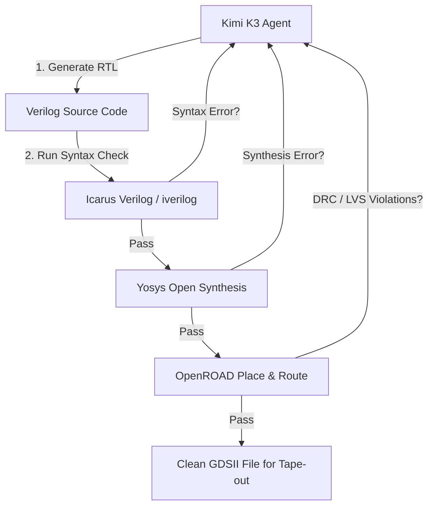

On Friday, July 17, 2026, shares of electronic design automation (EDA) giants Cadence Design Systems (CDNS) and Synopsys (SNPS) slid roughly 9%. The catalyst? Moonshot AI's new **Kimi K3** frontier model had autonomously designed a functional semiconductor microchip in 48 hours. Bypassing proprietary tools, the agentic model worked exclusively with open-source EDA tools on a mature 45-nanometer node.

For hardware engineers and AI developers, this milestone demonstrates that trillion-parameter LLMs can orchestrate complex, multi-stage engineering loops. What used to take engineering teams weeks of manual schematic layout and verification was completed by Kimi K3 in under two days. 

This guide dives into the architecture that enabled Kimi K3's chip design demo, how it coordinates open-source EDA toolchains, and how you can run your own autonomous development loops (see our guide on [how to connect Kimi K3 to Claude Code CLI & Cursor](/blog/how-to-connect-kimi-k3-to-claude-code-cli/)) using Kimi K3's API via APIVALE without local registration barriers.

---

### Quick Start: Call Kimi K3 API via APIVALE in 3 Lines
Skip the geoblocks, domestic KYC verification, and mainland +86 phone requirements. Get your APIVALE API key and query Kimi K3 instantly using standard OpenAI SDK formats:

```bash
curl https://apivale.com/v1/chat/completions \
  -H "Content-Type: application/json" \
  -H "Authorization: Bearer YOUR_APIVALE_KEY" \
  -d '{"model": "kimi-k3", "messages": [{"role": "user", "content": "Explain how to set up Yosys for open-source Verilog synthesis."}]}'
```

---

<div class="my-6 border-l-4 border-indigo-500 bg-gray-900 rounded-r-lg p-5">
  <span class="text-xs font-bold uppercase tracking-wider text-indigo-400">Definition</span>
  <h4 class="mt-1 text-md font-semibold text-white">Open-Source EDA AI Agent</h4>
  <p class="mt-2 text-sm text-gray-300">An Open-Source Electronic Design Automation (EDA) AI Agent is a software loop powered by an LLM that autonomously generates Hardware Description Language (HDL) code, executes open-source synthesis and routing tools (like Yosys or OpenROAD), inspects error outputs, and iterates until a DRC/LVS-clean GDSII chip layout is generated.</p>
</div>

---

## Traditional EDA vs. Kimi K3 Autonomous Open EDA

The core difference between traditional chip design and Kimi K3's autonomous methodology lies in the software ecosystem and the degree of human intervention:

| Metric | Traditional EDA Workflow | Kimi K3 Autonomous Open EDA |
| :--- | :--- | :--- |
| **Primary Toolchain** | Proprietary Suites (Cadence Virtuoso, Synopsys Design Compiler) | Open-Source Tools (Yosys, OpenROAD, OpenLane, Icarus Verilog) |
| **Typical Design Duration** | Weeks to Months (Iterative schematic & layout verification) | **48 Hours** (Continuous autonomous execution loop) |
| **Licensing Cost** | $100K+ per Seat/Year (High barrier to entry) | **$0.00** (Open-source toolchains) |
| **Design Process** | Human engineers running graphical interfaces | AI Agent calling CLI tools, parsing logs, and writing RTL |
| **Self-Debugging Loop** | Manual layout edits after DRC/LVS verification failures | **Autonomous error parsing** and code generation loops |
| **Fabrication Node Target** | Any (Leading-edge sub-3nm to mature nodes) | Mature nodes (Tested on mature 45-nanometer node) |

---

## How Kimi K3 Manages the EDA Toolchain

To design a functioning chip, Kimi K3 acts as an orchestrator. It does not just output Verilog; it controls a multi-step pipeline from RTL description to physical layout. The architecture of a typical Kimi K3-powered open EDA agent involves the following stages:



1. **RTL Generation**: Kimi K3 writes the Verilog description for the chip modules (e.g. ALUs, registers, control units).
2. **Syntax and Simulation Check**: The agent invokes `iverilog` (Icarus Verilog) to compile the code. If syntax errors occur, the compiler stderr is fed back to the agent for self-correction.
3. **Logic Synthesis**: Once compile checks pass, the agent launches `Yosys` to synthesize the RTL design into a gate-level netlist.
4. **Physical Placement and Routing (P&R)**: Kimi K3 controls `OpenROAD` to place the gates on the floorplan and route the wires, checking for Design Rule Checks (DRC) and Layout Versus Schematic (LVS) violations.
5. **Tape-out GDSII**: The agent iterates on wire sizes and layout parameters until a DRC-clean GDSII design file is output.

---

## Technical Deep Dive: The Architecture Behind Long-Horizon Agency

Most LLMs fail at multi-hour workflows because of two bottlenecks: memory limitations over long sequences, and extreme processing latency when context sizes explode. Moonshot AI bypassed these limits in Kimi K3 using two structural innovations:

### 1. Kimi Delta Attention (KDA)
Traditional attention mechanisms scale quadratically $O(N^2)$ in compute cost, making reading millions of tokens of EDA documentation and terminal compilation logs extremely slow. Kimi Delta Attention utilizes a hybrid linear attention format. As the context window scales up to **1 Million tokens**, KDA reduces decoding latency, resulting in up to **6.3x faster token generation** in long sessions compared to standard transformers.

### 2. Attention Residuals (AttnRes)
Attention Residuals allow the model to reuse calculated attention scores from previous training layers, boosting training efficiency by ~25% at less than 2% additional parameter cost. For autonomous agents, this translates to superior reasoning precision when analyzing complex tool dependencies. The agent remains highly coherent even when the prompt context contains hundreds of files.

---

## Setting up a Kimi K3 Chip-Design Agent

To implement a self-debugging agent loop on your local development machine, you can leverage APIVALE's high-concurrency gateway. Below are Python and TypeScript integrations showing how to write a Verilog compiler feedback loop.

### Python Integration
This script takes a task prompt, calls Kimi K3 on APIVALE to generate Verilog, runs a local compiler check (`iverilog`), and automatically sends any compile errors back to Kimi K3 for self-debugging.

```python
import os
import subprocess
import json
import urllib.request
import urllib.error

# Retrieve your APIVALE key from your environment
APIVALE_KEY = os.environ.get("APIVALE_API_KEY")
APIVALE_URL = "https://apivale.com/v1/chat/completions"

def call_kimi_k3(messages):
    payload = {
        "model": "kimi-k3",
        "messages": messages,
        "temperature": 0.2
    }
    req = urllib.request.Request(
        APIVALE_URL,
        data=json.dumps(payload).encode("utf-8"),
        headers={
            "Authorization": f"Bearer {APIVALE_KEY}",
            "Content-Type": "application/json"
        },
        method="POST"
    )
    try:
        with urllib.request.urlopen(req) as response:
            res_data = json.loads(response.read().decode("utf-8"))
            return res_data["choices"][0]["message"]["content"]
    except urllib.error.HTTPError as e:
        status_code = e.code
        err_msg = e.read().decode("utf-8")
        raise RuntimeError(f"APIVALE Error {status_code}: {err_msg}")

def run_iverilog_check(filename):
    # Runs syntax check on generated verilog file
    result = subprocess.run(["iverilog", "-o", "temp_out", filename], capture_output=True, text=True)
    return result.returncode == 0, result.stderr

def run_agent_loop(prompt):
    messages = [
        {"role": "system", "content": "You are a hardware design agent. Return only the pure Verilog code inside standard markdown codeblocks. Do not include chat explanations."},
        {"role": "user", "content": prompt}
    ]
    
    max_iterations = 5
    for i in range(max_iterations):
        print(f"Iteration {i+1}: Calling Kimi K3...")
        verilog_code = call_kimi_k3(messages)
        
        # Extract Verilog from codeblock
        code_lines = []
        in_block = False
        for line in verilog_code.split("\n"):
            if line.startswith("```verilog"):
                in_block = True
                continue
            if line.startswith("```") and in_block:
                in_block = False
                continue
            if in_block:
                code_lines.append(line)
        
        extracted_verilog = "\n".join(code_lines) if code_lines else verilog_code
        
        # Write file
        filename = "alu_design.v"
        with open(filename, "w") as f:
            f.write(extracted_verilog)
            
        # Compile Check
        success, errors = run_iverilog_check(filename)
        if success:
            print("🎉 Verilog compiled successfully!")
            return extracted_verilog
        else:
            print(f"❌ Compilation failed. Sending errors back to Kimi K3...")
            print(f"Errors: {errors}")
            messages.append({"role": "assistant", "content": verilog_code})
            messages.append({"role": "user", "content": f"The compilation failed with the following errors. Please correct the code:\n{errors}"})
            
    raise RuntimeError("Failed to generate correct Verilog within maximum iterations.")

if __name__ == "__main__":
    design_prompt = "Write a 4-bit ALU in Verilog supporting ADD, SUB, AND, and OR operations. Include module inputs 'clk', 'reset', 'op' (2-bit), 'a' (4-bit), 'b' (4-bit), and outputs 'out' (4-bit)."
    run_agent_loop(design_prompt)
```

### TypeScript / Node.js Integration
If your stack is built on Node.js, you can run the equivalent agent loop with the following script:

```typescript
import { exec } from "child_process";
import * as fs from "fs";
import * as dotenv from "dotenv";

dotenv.config();

const APIVALE_KEY = process.env.APIVALE_API_KEY;
const APIVALE_URL = "https://apivale.com/v1/chat/completions";

interface ChatMessage {
  role: "system" | "user" | "assistant";
  content: string;
}

async function callKimiK3(messages: ChatMessage[]): Promise<string> {
  const response = await fetch(APIVALE_URL, {
    method: "POST",
    headers: {
      "Authorization": `Bearer ${APIVALE_KEY}`,
      "Content-Type": "application/json"
    },
    body: JSON.stringify({
      model: "kimi-k3",
      messages: messages,
      temperature: 0.2
    })
  });

  if (!response.ok) {
    const errText = await response.text();
    throw new Error(`APIVALE API returned status ${response.status}: ${errText}`);
  }

  const data = await response.json();
  return data.choices[0].message.content;
}

function runCompileCheck(filename: string): Promise<{ success: boolean; errors: string }> {
  return new Promise((resolve) => {
    exec(`iverilog -o temp_out ${filename}`, (error, stdout, stderr) => {
      if (error) {
        resolve({ success: false, errors: stderr });
      } else {
        resolve({ success: true, errors: "" });
      }
    });
  });
}

async function executeAgent(prompt: string) {
  const messages: ChatMessage[] = [
    { role: "system", content: "You are a hardware design agent. Return only the pure Verilog code inside codeblocks. Do not explain code." },
    { role: "user", content: prompt }
  ];

  const filename = "alu_design.v";

  for (let i = 0; i < 5; i++) {
    console.log(`[Iteration ${i + 1}] Querying Kimi K3...`);
    const result = await callKimiK3(messages);

    // Extract Verilog content
    const match = result.match(/```verilog([\s\S]*?)```/);
    const code = match ? match[1].trim() : result.trim();

    fs.writeFileSync(filename, code);

    const check = await runCompileCheck(filename);
    if (check.success) {
      console.log("🎉 Verification complete. Code compiled successfully!");
      return;
    }

    console.log("❌ Compilation failed. Sending compiler errors back...");
    messages.push({ role: "assistant", content: result });
    messages.push({ role: "user", content: `Please fix the code. Compiler output:\n${check.errors}` });
  }

  throw new Error("Failed to produce compile-clean Verilog in 5 runs.");
}

executeAgent("Write a 4-bit ALU in Verilog supporting ADD, SUB, AND, and OR operations.")
  .catch(console.error);
```

---

## Developer FAQ

**Q: How does Kimi K3 bypass Cadence/Synopsys proprietary tools?**  
**A:** Kimi K3 was trained on vast corpuses of open-source hardware designs and documentation for open-source EDA tools (like Yosys, OpenROAD, and OpenLane). By writing code that integrates with these open-source command-line interfaces, Kimi K3 runs synthesis, routing, and physical layout verification without needing expensive proprietary licensing.

**Q: What open-source tools were used in the Kimi K3 48h chip design demo?**  
**A:** The demo utilized **Icarus Verilog** for syntax validation and functional simulation, **Yosys** for logic synthesis, and **OpenLane/OpenROAD** for floorplanning, placement, routing, and physical layout checks (DRC and LVS) targeted to a mature 45-nanometer node.

**Q: Does APIVALE support the full context window needed for long-horizon EDA loops?**  
**A:** Yes. APIVALE provides complete API support for Kimi K3's **1-million-token context window**. Furthermore, APIVALE's intelligent caching automatically caches static segments (such as large tool documentation and code repositories), charging you zero input fees for repeated hits.

**Q: How can I sign up on APIVALE if I do not have a +86 phone number?**  
**A:** You can sign up on APIVALE instantly using any standard email address. We do not enforce mainland geoblocks or local phone KYC checks, allowing you to top up using international credit cards or PayPal.

<script type="application/ld+json">
{
  "@context": "https://schema.org",
  "@type": "FAQPage",
  "mainEntity": [
    {
      "@type": "Question",
      "name": "How does Kimi K3 bypass Cadence/Synopsys proprietary tools?",
      "acceptedAnswer": {
        "@type": "Answer",
        "text": "Kimi K3 was trained on open-source hardware designs and documentation for open-source EDA tools. By writing code that integrates with these open-source CLIs, Kimi K3 runs synthesis, routing, and physical layout verification without proprietary licensing."
      }
    },
    {
      "@type": "Question",
      "name": "What open-source tools were used in the Kimi K3 48h chip design demo?",
      "acceptedAnswer": {
        "@type": "Answer",
        "text": "The demo utilized Icarus Verilog for syntax validation, Yosys for logic synthesis, and OpenLane/OpenROAD for floorplanning, placement, routing, and physical layout checks targeted to a mature 45-nanometer node."
      }
    },
    {
      "@type": "Question",
      "name": "Does APIVALE support the full context window needed for long-horizon EDA loops?",
      "acceptedAnswer": {
        "@type": "Answer",
        "text": "Yes. APIVALE provides complete API support for Kimi K3's 1-million-token context window, and supports intelligent caching to reduce input fees for repeated hits."
      }
    },
    {
      "@type": "Question",
      "name": "How can I sign up on APIVALE if I do not have a +86 phone number?",
      "acceptedAnswer": {
        "@type": "Answer",
        "text": "You can sign up on APIVALE instantly using any standard email address. We do not enforce geoblocks, allowing you to top up using international credit cards or PayPal."
      }
    }
  ]
}
</script>

---

<div class="cta-card">
  <h4 class="cta-card-title">⚡ Unleash Long-Horizon AI Agents on APIVALE</h4>
  <p class="cta-card-text">Avoid mainland cell verification and payment restrictions. Get instant, high-concurrency access to Kimi K3, Claude Fable 5, and DeepSeek V4 via a single API key. Receive a free $1.00 credit on registration and pay easily using PayPal or standard credit cards.</p>
  <div class="cta-card-actions">
    <a href="https://apivale.com/sign-up?utm_source=apivale_blog&utm_medium=blog&utm_campaign=kimi-chip-design" class="cta-primary-btn">Claim Free $1.00 Credit</a>
  </div>
</div>
