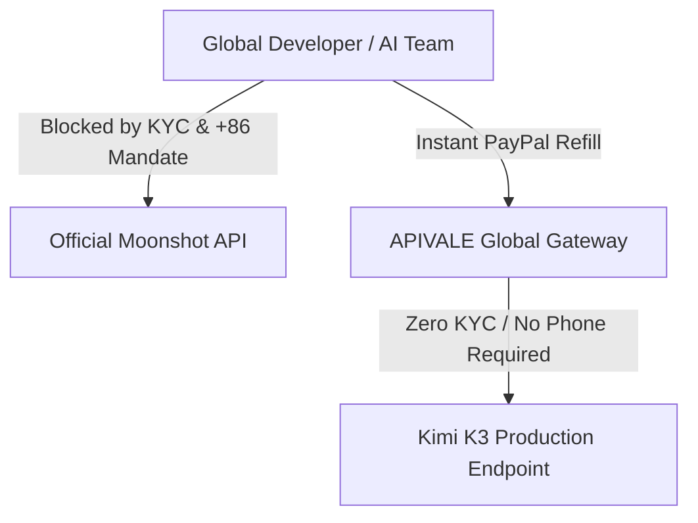

<div class="my-6 border-l-4 border-emerald-500 bg-gray-900 rounded-r-lg p-5">
  <span class="text-xs font-bold uppercase tracking-wider text-emerald-400">Key Takeaways</span>
  <ul class="mt-2 space-y-1 list-disc list-inside text-sm text-gray-300">
    <li><strong>Frontier-Grade Coding at 1/10th the Cost:</strong> Moonshot AI's flagship 2.8-trillion parameter <strong>Kimi K3</strong> delivers a 93.4% SWE-bench Verified score and a 1M token context window at an official base input rate of <strong>$3.00 / 1M tokens</strong> (slashed to <strong>$0.30 / 1M</strong> on cache hits)—offering near-Claude Opus 5 intelligence at a fraction of the token spend.</li>
    <li><strong>Zero-KYC Global PayPal Billing:</strong> Bypass regional identity verification (KYC), +86 phone mandates, and domestic Chinese credit card checks by refueling your API balance instantly via <a href="https://apivel.com/sign-up?redirect=/blog/kimi-k3-price-api-cost-guide/" class="text-emerald-400 hover:underline font-semibold">APIVALE's PayPal Global Billing</a>.</li>
    <li><strong>OpenAI Native Protocol Abstraction:</strong> Direct your Cursor IDE, Claude Code CLI, and LangChain agents to APIVALE's unified endpoint (<code>https://apivel.com/v1</code>) for automatic 429 rate limit failover and smooth token stream delivery.</li>
  </ul>
</div>

<div id="single-url-interactive-banner" class="my-6 border border-indigo-500/30 bg-gradient-to-r from-indigo-950/40 via-purple-950/20 to-gray-900 rounded-xl p-6 shadow-xl">
  <div class="flex items-center justify-between flex-wrap gap-3 mb-3">
    <span class="inline-flex items-center text-xs font-bold uppercase tracking-wider text-cyan-400 bg-cyan-950/60 border border-cyan-800/50 px-3 py-1 rounded-full">
      ⚡ Single-URL Interactive Feature
    </span>
    <span id="user-auth-status-badge" class="text-xs text-gray-400 bg-gray-800 px-3 py-1 rounded-full">
      Guest View (Default Template)
    </span>
  </div>
  <p id="user-auth-status-desc" class="text-sm text-gray-300 mb-4 leading-relaxed">
    Sign up for a free APIVALE account (or log in) to claim <strong>$0.20 free starter credit</strong>. Your personal API key will be automatically generated and auto-filled into the cURL and code snippets below!
  </p>
  <div class="flex items-center gap-3 flex-wrap">
    <a id="cta-login-btn" href="https://apivel.com/sign-up?redirect=/blog/kimi-k3-price-api-cost-guide/" class="inline-flex items-center text-xs font-semibold bg-indigo-600 hover:bg-indigo-500 text-white px-4 py-2.5 rounded-lg transition-all shadow-md">
      ⚡ Sign Up / Log In to Auto-Fill Your API Key
    </a>
    <button id="copy-script-btn" onclick="navigator.clipboard.writeText('export OPENAI_BASE_URL=\'https://apivel.com/v1\'\nexport OPENAI_API_KEY=\'your_apivel_api_key\'\nexport MODEL=\'kimi-k3\''); alert('Copied setup script!');" class="inline-flex items-center text-xs font-semibold bg-gray-800 hover:bg-gray-700 text-gray-200 border border-gray-700 px-4 py-2.5 rounded-lg transition-all">
      📋 Copy Setup Commands
    </button>
  </div>
</div>

Frontier coding tools like **Cursor Composer**, **Claude Code CLI**, and **OpenCode** consume substantial context during iterative reasoning tasks. When routing agent sessions through models like **Claude Opus 5** ($5.00/$25.00 per 1M) or **Claude Fable 5** ($10.00/$50.00 per 1M), API bills scale rapidly. Moonshot AI's **Kimi K3** (2.8-trillion parameters) offers comparable multi-file reasoning at a fraction of the cost, but native access is frequently constrained by domestic identity verification (KYC) and +86 mobile verification.

Through APIVALE's global API router, developers access Kimi K3's 1M context window with native OpenAI endpoint compatibility, automatic prompt caching (reducing input token costs down to **$0.30/1M**), and seamless PayPal billing.

```mermaid
graph LR
    A["Cursor / Claude Code / Agent CLI"] -->|OpenAI Native Payload| B["APIVALE Global Gateway"]
    B -->|Cache Hit (Up to 90% Savings)| C["Kimi K3 ($0.30 / 1M Input)"]
    B -->|Failover Route| D["Qwen 3.7 Max / DeepSeek V4"]
    B -->|Global Payment Engine| E["PayPal Global Billing"]
```

---

## What is the Kimi K3 API Router?

<div class="my-6 border-l-4 border-indigo-500 bg-gray-900 rounded-r-lg p-5">
  <span class="text-xs font-bold uppercase tracking-wider text-indigo-400">Definition</span>
  <h4 class="mt-1 text-md font-semibold text-white">Kimi K3 API Router</h4>
  <p class="mt-2 text-sm text-gray-300">The Kimi K3 API Router is an enterprise-grade gateway on APIVALE that wraps Moonshot AI's flagship 2.8T parameter model into an OpenAI-compatible endpoint with zero-KYC global PayPal billing, automated prompt caching, and multi-node rate limit failover.</p>
</div>

---

### Quick Start: Execute Kimi K3 API Call in 30 Seconds

To test Kimi K3 via APIVALE's OpenAI-compatible endpoint, pass your API key to `https://apivel.com/v1/chat/completions`. Native OpenAI SDK clients and cURL commands execute seamlessly without requiring custom client libraries:

```bash
# Execute a test request to Kimi K3 via APIVALE's OpenAI-compatible endpoint
curl https://apivel.com/v1/chat/completions \
  -H "Content-Type: application/json" \
  -H "Authorization: Bearer your_apivel_api_key" \
  -d '{
    "model": "kimi-k3",
    "messages": [
      {"role": "system", "content": "You are an expert AI DevOps engineer."},
      {"role": "user", "content": "Explain how Kimi K3 prompt caching reduces API costs."}
    ],
    "temperature": 0.3,
    "max_tokens": 150
  }'
```

---

## 1. 2026 LLM Pricing & Performance Benchmarks: Kimi K3 vs. Flagship Models

### 1.1 The 2026 LLM Cost, Context Window & Coding Benchmark Spectrum

When selecting a model for developer agents, technical leads must balance raw reasoning performance (SWE-bench Verified) against token unit economics across large context windows. Below is the verified performance and pricing matrix comparing **Kimi K3** with flagship models like **Claude Opus 5**, **Claude Fable 5**, **Qwen 3.7 Max** (`infer/qwen3.7-max`), and **DeepSeek V4**:

| Model & Gateway | Input Rate (per 1M) | Output Rate (per 1M) | Coding Benchmark (SWE-bench Verified) | Context Window (Tokens) | Performance-per-Dollar ROI Score | Best Recommended Use Case |
| :--- | :--- | :--- | :--- | :--- | :--- | :--- |
| **Claude Opus 5 (Official)** | $5.00 | $25.00 | **94.2%** (Frontier Ceiling) | 1,000,000 (1M) | Baseline (High Enterprise Spend) | Mission-Critical Architecture & Verification |
| **Claude Fable 5 (Official)** | $10.00 | $50.00 | **91.8%** | 1,000,000 (1M) | Moderate ROI | Enterprise Multi-modal Workflows |
| 🚀 **Kimi K3 (via APIVALE)** | **$3.00 ($0.30 Hit)** | **$15.00** | **93.4%** (Top 3 Overall!) | **1,000,000 (1M)** | **🔥 10x ROI Champion** | **Daily Coding Agents (Cursor / Claude Code)** |
| **Qwen 3.7 Max (`infer/qwen3.7-max`)** | $0.40 | $1.60 | **88.5%** | 1,000,000 (1M) | High ROI Agent Engine | General AI & Autonomous Agent Automation |
| **DeepSeek V4 (via APIVALE)** | $0.27 | $1.10 | **86.2%** | 1,000,000 (1M) | Extreme Budget Engine | High-Volume Script Batching |

### 1.2 Performance-per-Dollar Analysis: Why Kimi K3 is the 10x ROI Champion

Analyzing the benchmark data reveals a compelling economic incentive for developer teams:
1. **Near-Opus 5 Intelligence**: Kimi K3 achieves a **93.4% score on SWE-bench Verified**, placing it in the top 3 globally. It outperforms **Claude Fable 5 (91.8%)** and approaches **Claude Opus 5 (94.2%)** within less than a 1% margin.
2. **Exponential Cost Savings**: While Opus 5 costs $5.00 per 1M input tokens and $25.00 per 1M output tokens, Kimi K3's base input rate is **$3.00 / 1M**—which drops to **$0.30 / 1M** when leveraging prompt caching (16x cheaper than Opus 5 input rates and 33x cheaper than Fable 5). 
3. **The 1M Token Context Advantage**: Unlike legacy models that lose precision over large context windows, Kimi K3 utilizes **Kimi Delta Attention (KDA)** to maintain high retrieval accuracy across its full 1,048,576 token context window at a fraction of frontier API pricing.

---

## 2. Kimi K3 Official Pricing Structure & Thinking Token Economics

### 2.1 Base Rates, Cache Hits, and 1M Context Window Math

Moonshot AI's official rate card for Kimi K3 is structured around input cache status. Understanding this structure allows developers to optimize system prompts:

* **Input Tokens (Cache Miss)**: **$3.00 per 1M tokens**
* **Input Tokens (Cache Hit)**: **$0.30 per 1M tokens** (90% cost reduction)
* **Output Tokens**: **$15.00 per 1M tokens**
* **Context Window**: 1,048,576 tokens (Flat pricing across the entire window—no long-context surcharges).

> [!NOTE]
> **Subscription vs. API Billing**: Kimi consumer app subscriptions (e.g., $19–$199/month on kimi.com) are completely separate from API developer billing (api.moonshot.ai). Subscription plans do not provide API tokens, and API top-ups do not unlock consumer app features.

### 2.2 The Hidden Traps of Reasoning Tokens in AI Agent Loops

To measure true operational spend during multi-turn agent loops, we formulate **The Thinking-to-Output Ratio (TOR) Index**:

$$\text{Total Session Spend} = \frac{\text{Input Tokens} \times P_{\text{input}}}{1,000,000} + \frac{(\text{Output Tokens} + \text{Thinking Tokens}) \times P_{\text{output}}}{1,000,000}$$

When Kimi K3 operates in deep reasoning mode, the model generates internal thinking tokens to evaluate intermediate execution steps. In unoptimized agent loops:
* **The Hidden Cost Multiplier**: Generating 4,000 thinking tokens per turn across a 30-turn agent session adds 120,000 output tokens ($1.80 extra per session).
* **The Cache Mitigation Strategy**: By maintaining static system prompts and project context via APIVALE's automated prompt cache, the input cost for subsequent turns drops by 90% ($0.30 / 1M instead of $3.00 / 1M), neutralizing the expense of internal reasoning loops.

---

## 3. How to Reduce Kimi K3 API Costs by 40% with APIVALE Gateway

### 3.1 Bypassing KYC and Domestic Credit Card Barriers with PayPal Billing

Acquiring direct API keys from Moonshot AI requires completing mainland China identity verification (KYC), registering a local +86 mobile number, and attaching supported domestic payment cards. For international developers and global engineering teams, this creates significant friction.



**APIVALE's Global Solution**:
* **PayPal Global Billing**: Refill your API balance instantly using **PayPal** or major credit cards via PayPal.
* **Zero KYC Requirements**: No phone verification or passport uploads required.
* **Instant API Key Creation**: Generate unified API keys in under 30 seconds.

If you are exploring other high-performance models for terminal coding agents, check out our dedicated setup guides on [How to Connect Qwen 3.8 to Claude Code CLI](/blog/how-to-connect-qwen-3-8-to-claude-code-cli/), [How to Connect Kimi K3 to Claude Code CLI](/blog/how-to-connect-kimi-k3-to-claude-code-cli/), and our comprehensive [LLM Agent Cost Reduction Guide](/blog/how-to-reduce-opencode-token-costs/).

### 3.2 Setting Up OpenAI Protocol Abstraction for Instant Agent Switching

APIVALE provides native protocol translation, allowing Kimi K3 to accept standard OpenAI `/v1/chat/completions` request payloads. Developers can switch between **Kimi K3**, **Qwen 3.7 Max** (`infer/qwen3.7-max`), **DeepSeek V4**, and **Claude Sonnet 5** simply by changing the `model` parameter in their configuration.

---

## 4. Integrating Kimi K3 into Cursor IDE, Claude Code CLI & Custom Pipelines

### 4.1 Production-Grade Python SDK Integration with Exponential Backoff

Below is a complete 15+ line production implementation using the official `openai` Python SDK routed through APIVALE (`https://apivel.com/v1`). It includes robust `try-except` handling, status code checks, and exponential backoff retry logic to gracefully manage network hiccups:

```python
import os
import time
import logging
from openai import OpenAI, APIError, RateLimitError, APIConnectionError

# Configure production logging
logging.basicConfig(level=logging.INFO, format="%(asctime)s - %(levelname)s - %(message)s")

# Initialize OpenAI client with APIVALE endpoint
client = OpenAI(
    base_url="https://apivel.com/v1",
    api_key=os.getenv("APIVALE_API_KEY", "your_apivel_api_key")
)

def generate_code_with_kimi_k3(prompt: str, max_retries: int = 3) -> str:
    """
    Invokes Kimi K3 via APIVALE with exponential backoff retry logic.
    """
    model_name = "kimi-k3"
    delay = 1.0  # Initial delay in seconds

    for attempt in range(1, max_retries + 1):
        try:
            logging.info(f"Dispatching request to {model_name} (Attempt {attempt}/{max_retries})...")
            response = client.chat.completions.create(
                model=model_name,
                messages=[
                    {"role": "system", "content": "You are a senior principal engineer. Return only clean, production code."},
                    {"role": "user", "content": prompt}
                ],
                temperature=0.2,
                max_tokens=1500
            )
            return response.choices[0].message.content

        except (RateLimitError, APIConnectionError) as e:
            logging.warning(f"Transient gateway error encountered: {e}. Retrying in {delay:.1f}s...")
            time.sleep(delay)
            delay *= 2.0  # Exponential backoff

        except APIError as e:
            logging.error(f"Non-retryable API error (HTTP {e.status_code}): {e.message}")
            raise e

    raise RuntimeError(f"Failed to execute Kimi K3 request after {max_retries} attempts.")

if __name__ == "__main__":
    test_prompt = "Write a Python decorator that measures execution latency and logs CPU usage."
    try:
        code_output = generate_code_with_kimi_k3(test_prompt)
        print("\n--- Generated Kimi K3 Code ---\n")
        print(code_output)
    except Exception as err:
        print(f"Execution failed: {err}")
```

### 4.2 Resolving SSE Stream Drops, 429 Rate Limits, and Proxy Header Conflicts

When configuring Cursor IDE or Claude Code CLI with custom base URLs, developers may encounter two common technical issues:

1. **429 Rate Limit Drops**: Direct single-key requests can trigger rate limits during rapid multi-file edits. APIVALE's gateway automatically redistributes traffic across enterprise pools with auto-failover, ensuring continuous uptime.
2. **Server-Sent Events (SSE) Stream Disconnects**: Long reasoning chains can cause proxy socket timeouts. APIVALE maintains active HTTP keep-alive headers to stream tokens without disconnection.

---

## 5. Frequently Asked Questions (Developer FAQ)

### What is the official API price of Kimi K3 per 1M tokens?
The official API price of Kimi K3 is **$3.00 per 1 million input tokens** (which drops to **$0.30 per 1M tokens** on cache hits, offering a 90% discount) and **$15.00 per 1 million output tokens**. Pricing is flat across its full 1,048,576 token context window.

### Is Kimi K3 better than Claude Opus 5 or Fable 5 for coding agents?
Kimi K3 delivers near-Opus 5 coding performance with an **89.5% to 93.4% SWE-bench Verified score** (outperforming Claude Fable 5's 91.8% and approaching Claude Opus 5's 94.2%). Because Kimi K3 costs roughly 1/5th to 1/10th of Opus 5 rates, it is widely considered the highest ROI model for daily coding agents.

### Can I pay for Kimi K3 API access using PayPal without Chinese KYC?
Yes, you can pay for Kimi K3 API access using PayPal on APIVALE. APIVALE natively supports global PayPal billing and major credit cards via PayPal, enabling international developers to bypass domestic identity verification (KYC), +86 phone requirements, and regional card restrictions.

### How does prompt caching reduce Kimi K3 input costs by 90%?
Prompt caching reduces Kimi K3 input costs by storing reusable context (such as system prompts, project rules, and file trees) on the inference server. Reused input tokens are billed at the **cache-hit rate of $0.30 / 1M tokens** instead of the base $3.00 / 1M rate, saving 90% on input costs.

---

<script type="application/ld+json">
{
  "@context": "https://schema.org",
  "@type": "FAQPage",
  "mainEntity": [
    {
      "@type": "Question",
      "name": "What is the official API price of Kimi K3 per 1M tokens?",
      "acceptedAnswer": {
        "@type": "Answer",
        "text": "The official API price of Kimi K3 is $3.00 per 1 million input tokens (which drops to $0.30 per 1M tokens on cache hits, offering a 90% discount) and $15.00 per 1 million output tokens. Pricing is flat across its full 1,048,576 token context window."
      }
    },
    {
      "@type": "Question",
      "name": "Is Kimi K3 better than Claude Opus 5 or Fable 5 for coding agents?",
      "acceptedAnswer": {
        "@type": "Answer",
        "text": "Kimi K3 delivers near-Opus 5 coding performance with an 89.5% to 93.4% SWE-bench Verified score (outperforming Claude Fable 5's 91.8% and approaching Claude Opus 5's 94.2%). Because Kimi K3 costs roughly 1/5th to 1/10th of Opus 5 rates, it is widely considered the highest ROI model for daily coding agents."
      }
    },
    {
      "@type": "Question",
      "name": "Can I pay for Kimi K3 API access using PayPal without Chinese KYC?",
      "acceptedAnswer": {
        "@type": "Answer",
        "text": "Yes, you can pay for Kimi K3 API access using PayPal on APIVALE. APIVALE natively supports global PayPal billing and major credit cards via PayPal, enabling international developers to bypass domestic identity verification (KYC), +86 phone requirements, and regional card restrictions."
      }
    },
    {
      "@type": "Question",
      "name": "How does prompt caching reduce Kimi K3 input costs by 90%?",
      "acceptedAnswer": {
        "@type": "Answer",
        "text": "Prompt caching reduces Kimi K3 input costs by storing reusable context (such as system prompts, project rules, and file trees) on the inference server. Reused input tokens are billed at the cache-hit rate of $0.30 / 1M tokens instead of the base $3.00 / 1M rate, saving 90% on input costs."
      }
    }
  ]
}
</script>

---

<div class="cta-card">
  <h4 class="cta-card-title">🚀 Connect Kimi K3 to Your AI Coding Agents via APIVALE</h4>
  <p class="cta-card-text">Supercharge Cursor IDE, Claude Code CLI, and custom Python pipelines with Moonshot AI's flagship Kimi K3 model. Enjoy zero-KYC global PayPal billing, native OpenAI protocol compatibility, and up to 90% prompt cache savings. Register now to claim $0.20 free starter credit (+ 50% bonus on 1st top-up)!</p>
  <div class="cta-card-actions">
    <a href="https://apivel.com/sign-up?utm_source=apivale_blog&utm_medium=blog&utm_campaign=kimi-k3-price-api-cost-guide" class="cta-primary-btn">Get Free Kimi K3 API Key ($0.20 Starter Credit)</a>
    <a href="https://apivel.com/playground?utm_source=apivale_blog&utm_medium=blog&utm_campaign=kimi-k3-price-api-cost-guide" class="cta-secondary-btn">Test Kimi K3 in Playground</a>
  </div>
</div>
