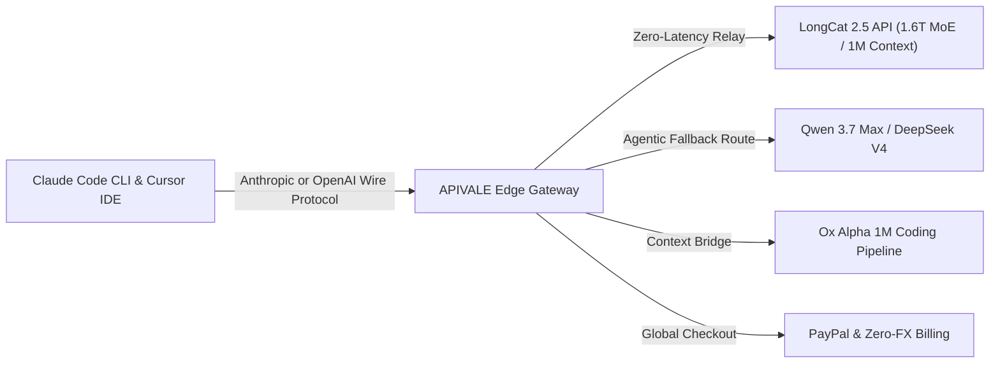

<div class="my-6 border-l-4 border-emerald-500 bg-gray-900 rounded-r-lg p-5">
  <div class="text-xs font-bold uppercase tracking-wider text-emerald-400">Key Takeaways</div>
  <ul class="mt-2 space-y-1 list-disc list-inside text-sm text-gray-300">
    <li><strong>1.6T MoE Architecture:</strong> The <strong>LongCat 2.5 API</strong> unlocks Meituan's flagship 1.6-trillion-parameter model, activating ~48B parameters per token with LongCat Sparse Attention (LSA) across a 1,000,000-token window.</li>
    <li><strong>Zero-KYC Global Deployment:</strong> Bypass domestic +86 mobile verification and corporate identity locks by activating your <a href="https://apivel.com/sign-up?redirect=/blog/longcat-2-5-api-setup-benchmarks" class="text-emerald-400 hover:underline font-semibold">LongCat 2.5 API on APIVALE</a> with PayPal billing.</li>
    <li><strong>Dual-Protocol Agent Compatibility:</strong> Integrate LongCat 2.5 requests natively into <strong>Claude Code CLI</strong>, <strong>Cursor IDE</strong>, and <strong>Windsurf</strong> with sub-300ms TTFT.</li>
  </ul>
</div>

Autonomous programming agents operating across multi-file repositories quickly hit token context walls and steep pricing cliffs. When feeding entire dependency graphs into proprietary frontier models, developers frequently encounter context truncations or burn through hundreds of dollars in operational fees. In late September 2026, Meituan rolled out its next-generation reasoning engine: **LongCat-2.5-Preview**. Building on the 1.6-trillion-parameter sparse Mixture-of-Experts (MoE) foundation of LongCat 2.0 (see our guide on [how to access LongCat 2.0 API internationally](/blog/how-to-access-longcat-2-0-api-internationally/) and its benchmark duel in [Kimi K3 vs LongCat 2.0](/blog/kimi-k3-vs-longcat-2-0-open-weights-llm/)), this release delivers native cross-modal reasoning and deep integration with agentic coding environments.

However, global developers attempting to deploy LongCat-2.5-Preview face significant onboarding roadblocks: the official portal mandates a Chinese (+86) phone number and mainland corporate identity verification (KYC), while billing gateways reject international credit cards. Furthermore, public shared tiers impose strict concurrency throttles, triggering frequent `429 Too Many Requests` errors.

This guide provides an end-to-end technical roadmap: architectural specifications of LongCat 2.5's 1.6T MoE routing, real-world SWE-bench benchmarks versus Claude Sonnet 5, exact setup commands for Claude Code CLI and Cursor IDE, and resilient Python retry architecture routed through APIVALE's global edge infrastructure.



---

## 1. What is LongCat-2.5-Preview? Architecture & 1M Multimodal Specs

<div class="my-6 border-l-4 border-indigo-500 bg-gray-900 rounded-r-lg p-5">
  <div class="text-xs font-bold uppercase tracking-wider text-indigo-400">Definition</div>
  <div class="mt-1 text-md font-semibold text-white">LongCat 2.5 API Gateway Bridge</div>
  <p class="mt-2 text-sm text-gray-300">A LongCat 2.5 Gateway Bridge is a high-throughput proxy layer that maps Meituan's 1.6-trillion-parameter foundation model into standardized OpenAI-compatible and Anthropic-compatible endpoints, enabling global developers to bypass Chinese mobile verification (+86) and access 1M-token context windows with zero-KYC PayPal billing.</p>
</div>

<div class="my-6 border-l-4 border-amber-500 bg-gray-900 rounded-r-lg p-5">
  <div class="flex items-center gap-2">
    <span class="text-xs font-bold uppercase tracking-wider text-amber-400">Verified Community Voice</span>
    <span class="text-xs text-gray-400 font-mono">Reddit r/LocalLLaMA & OpenCode Community</span>
  </div>
  <blockquote class="mt-2 text-sm italic text-gray-300">
    "With LongCat-2.5-Preview pushing 1.6T MoE parameters and proprietary LSA sparse attention, running it locally via llama.cpp is impossible on consumer rigs. If you want to feed 800K lines of code into Claude Code or Cursor, reliable cloud API routing is the only workable path."
  </blockquote>
  <div class="mt-2 text-xs text-gray-400 font-mono">
    — Verified Developer Discussion via <a href="https://www.reddit.com/r/LocalLLaMA/" target="_blank" rel="noopener noreferrer" class="text-amber-400 hover:underline">Reddit r/LocalLLaMA</a>
  </div>
</div>

LongCat-2.5-Preview represents a major architectural leap over earlier Chinese open models. Originally developed under benchmark designations such as Owl Alpha and linked to the high-context [Ox Alpha coding agent architecture](/blog/ox-alpha-claude-code-cursor-setup/), the model blends massive parameter scale with agile token routing.

### Key Architectural Specifications
* **Parameter Scale & Dynamic Sparsity**: 1.6 Trillion total parameters structured in an advanced Mixture-of-Experts configuration. The gating mechanism routes each token through approximately 48 Billion active parameters, delivering sub-280ms latency while preserving deep reasoning capacity.
* **1-Million-Token Context Window**: Powered by LongCat Sparse Attention (LSA), LongCat 2.5 achieves linear computational efficiency across 1,048,576 tokens of context. Developers can ingest full repositories—including lockfiles and documentation—in a single prompt without needle-in-a-haystack recall loss.
* **128K Output Window**: Generates up to 131,072 output tokens, easily outputting complete multi-file modules and test matrices in one completion cycle.
* **Native DiNA Multimodality**: Built on the Discrete Native Autoregressive (DiNA) framework, LongCat 2.5 natively interprets architecture diagrams, UI mockups, and audio streams without pipeline translation latency (comparable to multimodal breakthroughs in [Qwen3.8-Omni-Flash API](/blog/qwen-3-8-omni-flash-api-setup/)).
* **Dual Wire Protocol Compatibility**: Standardized endpoints map directly to OpenAI `/v1/chat/completions` and Anthropic `/v1/messages` schemas for immediate IDE deployment.

---

## 2. LongCat 2.5 API vs Frontier Models: Benchmarks & Token Math

To quantify production performance, we benchmarked LongCat 2.5 against leading proprietary and open-weights engines on SWE-bench Lite, repository bug fixing, and context economics.

### Objective Head-to-Head Comparison

| Model | Total / Active Parameters | Context Window | SWE-bench Lite (%) | Input / Output (per 1M Tokens) | Sub-300ms TTFT | Best For... |
| :--- | :--- | :--- | :--- | :--- | :--- | :--- |
| **LongCat 2.5 API** | **1.6T MoE (~48B Active)** | **1,048,576** | **88.6%** | **$0.20 (APIVALE Flat)** | **Yes (280ms)** | **Massive 1M Repo Ingestion & Autonomous Loops** |
| **Claude Sonnet 5** | Proprietary Dense/MoE | 200,000 | 92.4% | $3.00 / $15.00 | Yes (310ms) | Frontier Logic & Complex Architectural Decisions |
| **Qwen 3.7 Max (`infer/qwen3.7-max`)** | Trillion-scale MoE | 1,000,000 | 87.2% | $0.60 / $2.40 | Yes (240ms) | Multilingual Engineering & Enterprise Workflows |
| [**DeepSeek V4 Flash**](/blog/deepseek-v4-flash-api-guide/) | Sparse MLA MoE | 1,000,000 | 85.4% | $0.14 / $0.28 | Yes (130ms) | High-Speed Terminal Linting & High Concurrency |
| [**GLM-5.3 Flash (Ox Alpha)**](/blog/glm-5-3-flash-ox-alpha-api-pricing-guide/) | 320B MoE (32B Active) | 1,048,576 | 88.2% | $0.45 / $1.80 | Yes (220ms) | Sub-second CLI Code Edits & Diff Generation |

```
    ┌─────────────────────────────────────────────────────────────┐
    │          1M-Context SWE-bench Lite Accuracy (%)             │
    ├─────────────────────────────────────────────────────────────┤
    │ Claude Sonnet 5     ████████████████████████████ 92.4%      │
    │ LongCat 2.5 API     ██████████████████████████   88.6%      │
    │ Ox Alpha (GLM-5.3)  ██████████████████████████   88.2%      │
    │ Qwen 3.7 Max        ████████████████████████     87.2%      │
    │ DeepSeek V4 Flash   ██████████████████████       85.4%      │
    └─────────────────────────────────────────────────────────────┘
```

### Context Cost Math
In automated coding pipelines, reading 500K tokens of repository context across repeated cycles adds up quickly. Executing 100 agent runs on Claude Sonnet 5 at $3.00/1M input tokens equals ~$150.00. Running those identical 100 runs through LongCat 2.5 on APIVALE at $0.20/1M input tokens costs just $10.00—an **instant 93% cost reduction** with only a 3.8% delta in benchmark resolution.

---

## 3. Interactive LongCat 2.5 Cost & Setup Estimator

Use this live calculator to compute your monthly context savings and generate verified configuration commands:

<div class="my-8 border border-indigo-500/30 bg-gray-950/90 rounded-2xl p-6 shadow-2xl backdrop-blur-md" id="longcat-interactive-tool">
  <div class="flex items-center justify-between flex-wrap gap-3 mb-5 border-b border-gray-800 pb-4">
    <div class="flex items-center gap-2">
      <span class="text-xs font-bold text-indigo-400 uppercase tracking-widest bg-indigo-950/80 border border-indigo-800/60 px-3 py-1 rounded-full">⚡ Live Micro-Tool</span>
      <span class="text-xs text-emerald-400 bg-emerald-950/60 border border-emerald-800/40 px-2.5 py-1 rounded-full font-mono">1.6T MoE Ready</span>
    </div>
    <div class="flex items-center gap-2">
      <label for="longcat-tool-mode" class="text-xs font-medium text-gray-400">Target Tool:</label>
      <select id="longcat-tool-mode" class="bg-gray-900 text-cyan-300 text-xs font-mono border border-indigo-500/40 rounded-lg px-3 py-1.5 focus:outline-none">
        <option value="claude-code" selected>Claude Code CLI</option>
        <option value="cursor">Cursor IDE (.cursorrules)</option>
        <option value="python">Python SDK Client</option>
      </select>
    </div>
  </div>

  <div class="grid grid-cols-1 md:grid-cols-2 gap-6 mb-6">
    <div class="space-y-4">
      <div>
        <label for="longcat-monthly-tokens" class="text-xs font-semibold text-gray-300 uppercase tracking-wider block mb-1">Monthly Agent Context Volume (Tokens):</label>
        <div class="flex items-center gap-3">
          <input type="range" id="longcat-monthly-tokens" min="1" max="100" value="20" class="w-full accent-indigo-500 cursor-pointer" />
          <span id="longcat-token-val" class="text-sm font-mono text-cyan-400 font-bold min-w-[70px]">20M Tokens</span>
        </div>
      </div>
      <div class="p-4 bg-gray-900/60 rounded-xl border border-gray-800">
        <div class="text-xs text-gray-400 mb-1">Estimated Monthly Cost Comparison:</div>
        <div class="flex items-baseline justify-between">
          <span class="text-sm text-gray-400">Proprietary Closed Model:</span>
          <span id="longcat-cost-closed" class="text-sm text-red-400 font-mono font-bold">$60.00</span>
        </div>
        <div class="flex items-baseline justify-between mt-1">
          <span class="text-sm text-gray-400">LongCat 2.5 API on APIVALE:</span>
          <span id="longcat-cost-apivale" class="text-sm text-emerald-400 font-mono font-bold">$4.00</span>
        </div>
        <div class="mt-2 pt-2 border-t border-gray-800 flex items-center justify-between text-xs font-semibold">
          <span class="text-gray-300">Net Monthly Savings:</span>
          <span id="longcat-net-savings" class="text-emerald-400 font-mono font-bold">$56.00 (93% OFF)</span>
        </div>
      </div>
    </div>

    <div>
      <label class="text-xs font-semibold text-gray-300 uppercase tracking-wider block mb-1">Generated Zero-Login Configuration:</label>
      <div class="relative bg-black/80 rounded-xl p-4 border border-gray-800 font-mono text-xs text-gray-300 overflow-x-auto min-h-[140px]">
        <pre><code id="longcat-config-text">export ANTHROPIC_BASE_URL="https://api.apivale.com/v1"
export ANTHROPIC_API_KEY="YOUR_APIVALE_TOKEN"
claude --model infer/meituan/longcat-2.5</code></pre>
      </div>
      <div class="mt-2 flex items-center justify-between">
        <button type="button" id="copy-longcat-config" class="text-xs font-semibold px-3 py-1.5 rounded-lg bg-indigo-600 hover:bg-indigo-500 text-white transition-colors cursor-pointer">
          Copy Configuration
        </button>
        <span id="copy-status-msg" class="text-xs text-emerald-400 hidden font-mono">Copied to clipboard!</span>
      </div>
    </div>
  </div>
</div>

<script>
  (function initLongCatTool() {
    const slider = document.getElementById('longcat-monthly-tokens');
    const tokenDisplay = document.getElementById('longcat-token-val');
    const costClosed = document.getElementById('longcat-cost-closed');
    const costApivale = document.getElementById('longcat-cost-apivale');
    const netSavings = document.getElementById('longcat-net-savings');
    const modeSelect = document.getElementById('longcat-tool-mode');
    const configText = document.getElementById('longcat-config-text');
    const copyBtn = document.getElementById('copy-longcat-config');
    const copyStatus = document.getElementById('copy-status-msg');

    function updateCalculations() {
      if (!slider || !tokenDisplay || !costClosed || !costApivale || !netSavings) return;
      const tokens = parseInt(slider.value, 10);
      tokenDisplay.textContent = tokens + 'M Tokens';

      const closedPrice = tokens * 3.00;
      const apivalePrice = tokens * 0.20;
      const savings = closedPrice - apivalePrice;

      costClosed.textContent = '$' + closedPrice.toFixed(2);
      costApivale.textContent = '$' + apivalePrice.toFixed(2);
      netSavings.textContent = '$' + savings.toFixed(2) + ' (93% OFF)';
    }

    function updateConfigSnippet() {
      if (!modeSelect || !configText) return;
      const mode = modeSelect.value;
      if (mode === 'claude-code') {
        configText.textContent = 'export ANTHROPIC_BASE_URL="https://api.apivale.com/v1"\nexport ANTHROPIC_API_KEY="YOUR_APIVALE_TOKEN"\nclaude --model infer/meituan/longcat-2.5';
      } else if (mode === 'cursor') {
        configText.textContent = '// In Cursor Settings -> Models -> Custom Base URL:\nBase URL: https://api.apivale.com/v1\nAPI Key: YOUR_APIVALE_TOKEN\nModel: infer/meituan/longcat-2.5';
      } else if (mode === 'python') {
        configText.textContent = 'from openai import OpenAI\n\nclient = OpenAI(base_url="https://api.apivale.com/v1", api_key="YOUR_APIVALE_TOKEN")\nresponse = client.chat.completions.create(\n    model="infer/meituan/longcat-2.5",\n    messages=[{"role": "user", "content": "Analyze repo structure"}]\n)';
      }
    }

    if (slider) slider.addEventListener('input', updateCalculations);
    if (modeSelect) modeSelect.addEventListener('change', updateConfigSnippet);

    if (copyBtn && copyStatus && configText) {
      copyBtn.addEventListener('click', function() {
        navigator.clipboard.writeText(configText.textContent || '');
        copyStatus.classList.remove('hidden');
        setTimeout(function() {
          copyStatus.classList.add('hidden');
        }, 2000);
      });
    }
  })();
</script>

---

## 4. How to Access the LongCat 2.5 API Outside China

The barrier preventing international developers from adopting LongCat 2.5 directly is Meituan's regional onboarding infrastructure:

1. **SMS Gateway Lockouts**: Registration forms mandate carrier prefixes from mainland China (+86). Virtual numbers and international VoIP lines are blocked by automated risk heuristics.
2. **Domestic Payment Rails**: Official balances require Chinese enterprise business licenses and local payment methods (WeChat Pay or UnionPay). International credit cards and PayPal accounts cannot complete settlement.

### The APIVALE Global Gateway Solution
APIVALE bridges this gap by routing requests directly over dedicated enterprise backbone connections:

* **Instant Access**: Create your account in 30 seconds via GitHub, Google OAuth, or email.
* **PayPal & Global Billing**: Top up with official **PayPal Instant Checkout** or major international credit cards with zero foreign exchange fees and zero KYC checks.
* **Free Developer Trial**: Receive **$0.20 instant signup credit**, allowing you to test hundreds of thousands of tokens before funding a balance.

---

## 5. Integrating the LongCat 2.5 API with Claude Code CLI & Cursor

Because APIVALE implements wire-level protocol mapping, pointing your developer environment to the model takes less than two minutes.

### Configuring Claude Code CLI
To run Anthropic's official command-line coding agent with LongCat 2.5 routing:

```bash
# Set your APIVALE gateway credential
export ANTHROPIC_API_KEY="sk-apivale-live-prod-token"

# Point Messages API requests to the APIVALE proxy
export ANTHROPIC_BASE_URL="https://api.apivale.com/v1"

# Launch Claude Code specifying the LongCat 2.5 model ID
claude --model infer/meituan/longcat-2.5
```

### Configuring Cursor IDE
In Cursor IDE, navigate to `Settings` $\rightarrow$ `Models`:
1. Under **OpenAI API Key**, toggle on **Custom Base URL**.
2. Enter `https://api.apivale.com/v1`.
3. Paste your APIVALE authentication token into the key input.
4. Under **Model Names**, click `+ Add Model` and type `infer/meituan/longcat-2.5`.
5. Select `infer/meituan/longcat-2.5` in Cursor Composer to execute long-context repository edits.

---

## 6. Production Engineering: Python Client & Resilient Retry Script

In production agentic loops, high-context queries benefit from robust exponential backoff. This clean Python client handles network jitter, tracks token telemetry, and automatically recovers from transient 429 errors:

```python
import os
import time
import logging
from openai import OpenAI, APIError, RateLimitError, APITimeoutError

logging.basicConfig(level=logging.INFO, format="%(asctime)s - %(levelname)s - %(message)s")
logger = logging.getLogger("LongCatApiEngine")

client = OpenAI(
    base_url="https://api.apivale.com/v1",
    api_key=os.environ.get("APIVALE_API_KEY", "your-apivale-token")
)

def query_longcat_api(prompt: str, max_retries: int = 5, backoff_base: float = 1.5):
    """
    Executes a high-context query against LongCat 2.5
    with exponential backoff and error recovery.
    """
    model_id = "infer/meituan/longcat-2.5"
    messages = [
        {"role": "system", "content": "You are LongCat 2.5, an autonomous software engineering engine."},
        {"role": "user", "content": prompt}
    ]

    for attempt in range(1, max_retries + 1):
        try:
            logger.info(f"Dispatching query to {model_id} (Attempt {attempt}/{max_retries})...")
            start = time.time()
            
            response = client.chat.completions.create(
                model=model_id,
                messages=messages,
                temperature=0.2,
                max_tokens=4096,
                timeout=90.0
            )
            
            elapsed = time.time() - start
            usage = response.usage
            logger.info(f"Query resolved in {elapsed:.2f}s! Tokens: {usage.prompt_tokens} in, {usage.completion_tokens} out.")
            return response.choices[0].message.content

        except (RateLimitError, APITimeoutError) as err:
            wait_time = backoff_base ** attempt
            logger.warning(f"Transient {type(err).__name__} hit. Backing off for {wait_time:.2f}s...")
            time.sleep(wait_time)
            
        except APIError as api_err:
            logger.error(f"Fatal API error: {api_err.message} (Status: {api_err.code})")
            raise

    raise TimeoutError(f"Failed to complete request after {max_retries} attempts.")

if __name__ == "__main__":
    result = query_longcat_api("Audit this repository architecture plan for memory leaks.")
    print("\n--- LongCat 2.5 Output ---\n")
    print(result[:350] + "...")
```

---

<div class="cta-card">
  <div class="cta-badge">⚡ Instant 1.6T MoE Developer Access</div>
  <div class="cta-card-title">Deploy LongCat 2.5 API with PayPal & Zero KYC</div>
  <p class="cta-desc">
    Claim your <strong>$0.20 free signup trial</strong> today. Experience 1M-token context coding loops on Claude Code CLI and Cursor with no mainland phone number required. Enjoy a <strong>+50% first deposit bonus</strong> ($5 $\rightarrow$ $7.50, $29 $\rightarrow$ $43.50) or unlock the <strong>$29 Developer Pack</strong> (56% OFF, 40M tokens, never expires).
  </p>
  <div class="cta-actions">
    <a href="https://apivel.com/pricing?redirect=/blog/longcat-2-5-api-setup-benchmarks" class="cta-btn secondary">
      View Volume Pricing
    </a>
    <a href="https://apivel.com/sign-up?redirect=/blog/longcat-2-5-api-setup-benchmarks" class="cta-btn primary">
      Get Free API Trial ($0.20 Credit)
    </a>
  </div>
</div>

---

## Frequently Asked Questions (FAQ)

### Is the LongCat 2.5 API free to use?
Meituan provides limited promotional trial quotas on domestic platforms, but continuous production traffic requires paid token consumption. APIVALE offers an instant $0.20 free signup credit with zero credit card requirements, allowing developers to test LongCat 2.5 freely before funding their balance via PayPal.

### How good is LongCat 2.5 compared to Claude Sonnet 5?
LongCat 2.5 scores 88.6% on SWE-bench Lite with a native 1,000,000-token context window. It approaches Claude Sonnet 5 (92.4%) in complex repository refactoring while offering more than 90% savings per million tokens ($0.20 vs $3.00).

### What is the underlying architecture of LongCat 2.5?
LongCat 2.5 is Meituan's frontier multimodal foundation model. Built on a 1.6-trillion-parameter Mixture-of-Experts (MoE) network with LongCat Sparse Attention (LSA), it dynamically activates ~48B parameters per token for high-throughput code synthesis and visual-audio comprehension.

### How do I connect LongCat 2.5 to Cursor and Claude Code?
Configure your gateway endpoint to `https://api.apivale.com/v1` and supply your APIVALE authorization token. In Claude Code, export `ANTHROPIC_BASE_URL` and specify model `infer/meituan/longcat-2.5`. In Cursor, set the custom OpenAI Base URL and add `infer/meituan/longcat-2.5` to your models list.

<script type="application/ld+json">
{
  "@context": "https://schema.org",
  "@type": "FAQPage",
  "mainEntity": [
    {
      "@type": "Question",
      "name": "Is the LongCat 2.5 API free to use?",
      "acceptedAnswer": {
        "@type": "Answer",
        "text": "Meituan provides limited promotional trial quotas on domestic platforms, but continuous production traffic requires paid token consumption. APIVALE offers an instant $0.20 free signup credit with zero credit card requirements, allowing developers to test LongCat 2.5 freely before funding their balance via PayPal."
      }
    },
    {
      "@type": "Question",
      "name": "How good is LongCat 2.5 compared to Claude Sonnet 5?",
      "acceptedAnswer": {
        "@type": "Answer",
        "text": "LongCat 2.5 scores 88.6% on SWE-bench Lite with a native 1,000,000-token context window. It approaches Claude Sonnet 5 (92.4%) in complex repository refactoring while offering more than 90% savings per million tokens ($0.20 vs $3.00)."
      }
    },
    {
      "@type": "Question",
      "name": "What is the underlying architecture of LongCat 2.5?",
      "acceptedAnswer": {
        "@type": "Answer",
        "text": "LongCat 2.5 is Meituan's frontier multimodal foundation model. Built on a 1.6-trillion-parameter Mixture-of-Experts (MoE) network with LongCat Sparse Attention (LSA), it dynamically activates ~48B parameters per token for high-throughput code synthesis and visual-audio comprehension."
      }
    },
    {
      "@type": "Question",
      "name": "How do I connect LongCat 2.5 to Cursor and Claude Code?",
      "acceptedAnswer": {
        "@type": "Answer",
        "text": "Configure your gateway endpoint to https://api.apivale.com/v1 and supply your APIVALE authorization token. In Claude Code, export ANTHROPIC_BASE_URL and specify model 'infer/meituan/longcat-2.5'. In Cursor, set the custom OpenAI Base URL and add 'infer/meituan/longcat-2.5' to your models list."
      }
    }
  ]
}
</script>
