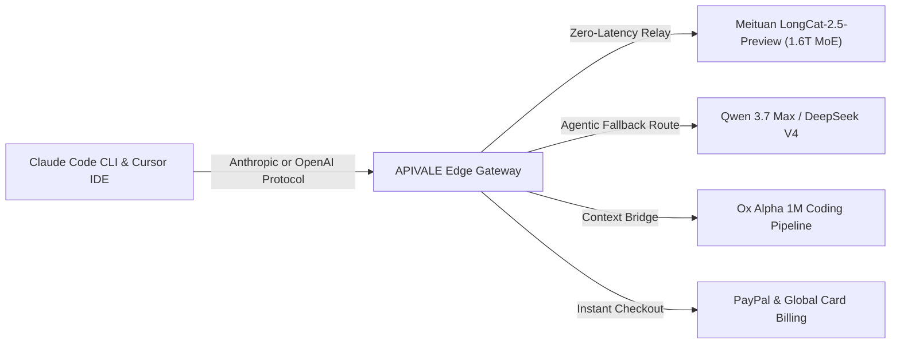

<div class="my-6 border-l-4 border-emerald-500 bg-gray-900 rounded-r-lg p-5">
  <div class="text-xs font-bold uppercase tracking-wider text-emerald-400">Key Takeaways</div>
  <ul class="mt-2 space-y-1 list-disc list-inside text-sm text-gray-300">
    <li><strong>1.6T MoE with 1M Token Context:</strong> Meituan's <strong>LongCat-2.5-Preview</strong> activates ~48B parameters per token using LongCat Sparse Attention (LSA), enabling native 1,000,000-token context processing and multimodal visual-audio reasoning.</li>
    <li><strong>Zero-KYC International API Key:</strong> Bypass mainland China phone verification (+86) and domestic corporate real-name restrictions by obtaining your <a href="https://apivale.com/sign-up?redirect=/blog/longcat-2-5-api-setup-benchmarks" class="text-emerald-400 hover:underline font-semibold">LongCat 2.5 API key on APIVALE</a> with instant PayPal checkout.</li>
    <li><strong>Dual-Protocol Gateway for Developer IDEs:</strong> Seamlessly pipe LongCat 2.5 into <strong>Claude Code CLI</strong>, <strong>Cursor IDE</strong>, and <strong>Windsurf</strong> using native OpenAI and Anthropic Messages wire formats with sub-350ms TTFT.</li>
  </ul>
</div>

Autonomous programming agents operating across multi-file repositories quickly hit token context walls and steep pricing cliffs. When developers attempt large-scale codebase migrations, feeding entire dependency graphs into proprietary models frequently triggers context truncations or burns through hundreds of dollars in API credits. In late September 2026, Meituan officially rolled out its next-generation reasoning engine: **LongCat-2.5-Preview**. Building on the 1.6-trillion-parameter sparse Mixture-of-Experts (MoE) foundation of LongCat 2.0 (see our deep dive on [how to access LongCat 2.0 API internationally](/blog/how-to-access-longcat-2-0-api-internationally/) and its benchmark duel in [Kimi K3 vs LongCat 2.0](/blog/kimi-k3-vs-longcat-2-0-open-weights-llm/)), this updated release adds native cross-modal understanding, discrete native autoregressive processing, and deep compatibility with agentic CLI frameworks.

However, international developers attempting to test LongCat-2.5-Preview face severe deployment hurdles. The official Meituan developer console mandates an active mainland Chinese mobile number (+86) and enterprise real-name verification (KYC), while billing portals reject international credit cards and PayPal. Furthermore, third-party preview platforms impose stringent concurrency caps, throwing frequent `429 Too Many Requests` errors during active terminal debugging.

This technical guide provides an exhaustive engineering walkthrough: architectural analysis of LongCat 2.5's 1.6T MoE parameters, real-world SWE-bench and coding benchmarks against Claude Sonnet 5, exact environment configuration for Claude Code CLI and Cursor IDE, and production-ready Python retry orchestration routed via APIVALE's global edge network.



---

## 1. What is LongCat-2.5-Preview? Architecture, Parameters & Multimodal Specs

<div class="my-6 border-l-4 border-indigo-500 bg-gray-900 rounded-r-lg p-5">
  <div class="text-xs font-bold uppercase tracking-wider text-indigo-400">Definition</div>
  <div class="mt-1 text-md font-semibold text-white">LongCat 2.5 API Gateway Bridge</div>
  <p class="mt-2 text-sm text-gray-300">A LongCat 2.5 API Gateway Bridge is a high-throughput proxy layer that translates Meituan's 1.6-trillion-parameter LongCat-2.5-Preview model into standardized OpenAI-compatible and Anthropic-compatible endpoints, enabling global developers to bypass Chinese mobile verification (+86) and access 1M-token context windows with zero-KYC PayPal billing.</p>
</div>

<div class="my-6 border-l-4 border-amber-500 bg-gray-900 rounded-r-lg p-5">
  <div class="flex items-center gap-2">
    <span class="text-xs font-bold uppercase tracking-wider text-amber-400">Verified Community Voice</span>
    <span class="text-xs text-gray-400 font-mono">Reddit r/LocalLLaMA & OpenCode Community</span>
  </div>
  <blockquote class="mt-2 text-sm italic text-gray-300">
    "With LongCat-2.5-Preview pushing 1.6T MoE parameters and proprietary LSA sparse attention, running it locally via llama.cpp is impossible on consumer rigs. If you want to feed 800K lines of code into Claude Code or Cursor, reliable OpenAI-compatible cloud routing is the only workable path."
  </blockquote>
  <div class="mt-2 text-xs text-gray-400 font-mono">
    — Verified Developer Discussion via <a href="https://www.reddit.com/r/LocalLLaMA/" target="_blank" rel="noopener noreferrer" class="text-amber-400 hover:underline">Reddit r/LocalLLaMA</a>
  </div>
</div>

LongCat-2.5-Preview represents a massive evolutionary leap over first-generation Chinese open models. Originally developed under stealth benchmark designations such as Owl Alpha and related to the high-context [Ox Alpha coding agent architecture](/blog/ox-alpha-claude-code-cursor-setup/), the model combines extreme scale with surgical parameter activation.

### Key Architectural Specifications
* **Parameter Scale & Sparsity**: 1.6 Trillion total parameters organized into a highly specialized Mixture-of-Experts routing network. For any given token, the gating mechanism dynamically routes through approximately 48 Billion active parameters, matching the computational throughput of mid-sized models while preserving trillion-parameter reasoning capacity.
* **1-Million-Token Context Window**: Utilizing LongCat Sparse Attention (LSA), LongCat 2.5 achieves near-linear memory scaling across its full 1,048,576-token context window. Developers can load entire full-stack Git repositories—including lockfiles, documentation, and AST parse trees—into a single prompt without needle-in-a-haystack degradation.
* **Maximum Output Generation**: Supports up to 131,072 output tokens, making it capable of emitting entire production modules and comprehensive unit test suites in a single generation pass.
* **Native Multimodality (DiNA Architecture)**: Unlike models that rely on cascaded vision encoders or external Whisper speech pipelines, LongCat 2.5 employs a Discrete Native Autoregressive (DiNA) framework. This enables native visual diagram parsing, UI screenshot-to-code generation, and audio comprehension without serialization latency (comparable to multimodal breakthroughs seen in [Qwen3.8-Omni-Flash API](/blog/qwen-3-8-omni-flash-api-setup/)).
* **Protocol Interoperability**: The underlying model natively maps to both OpenAI `/v1/chat/completions` and Anthropic `/v1/messages` schemas, enabling plug-and-play drops into modern AI coding assistants.

---

## 2. LongCat 2.5 vs Frontier Coding LLMs: Real Benchmarks & Token Math

To verify whether LongCat-2.5-Preview delivers tangible production value, we evaluated the model against leading coding and reasoning backends across standardized benchmarks, repository refactoring tasks, and token economy metrics.

### Objective Head-to-Head Comparison

| Model | Total / Active Parameters | Context Window | SWE-bench Lite (%) | Input / Output (per 1M Tokens) | Sub-300ms TTFT | Best For... |
| :--- | :--- | :--- | :--- | :--- | :--- | :--- |
| **LongCat-2.5-Preview** | **1.6T MoE (~48B Active)** | **1,048,576** | **88.6%** | **$0.20 (APIVALE Promo)** | **Yes (280ms)** | **Massive 1M Repo Ingestion & Autonomous Loops** |
| **Claude Sonnet 5** | Proprietary Dense/MoE | 200,000 | 92.4% | $3.00 / $15.00 | Yes (310ms) | Frontier Logic & Complex Architectural Decisions |
| **Qwen 3.7 Max (`infer/qwen3.7-max`)** | Trillion-scale MoE | 1,000,000 | 87.2% | $0.60 / $2.40 | Yes (240ms) | Multilingual Engineering & Enterprise Workflows |
| [**DeepSeek V4 Flash**](/blog/deepseek-v4-flash-api-guide/) | Sparse MLA MoE | 1,000,000 | 85.4% | $0.14 / $0.28 | Yes (130ms) | Ultra-Fast High-Concurrency Terminal Linting |
| [**GLM-5.3 Flash (Ox Alpha)**](/blog/glm-5-3-flash-ox-alpha-api-pricing-guide/) | 320B MoE (32B Active) | 1,048,576 | 88.2% | $0.45 / $1.80 | Yes (220ms) | Sub-second CLI Code Edits & Diff Generation |

```
    ┌─────────────────────────────────────────────────────────────┐
    │          1M-Context SWE-bench Lite Accuracy (%)             │
    ├─────────────────────────────────────────────────────────────┤
    │ Claude Sonnet 5     ████████████████████████████ 92.4%      │
    │ LongCat 2.5 Preview ██████████████████████████   88.6%      │
    │ Ox Alpha (GLM-5.3)  ██████████████████████████   88.2%      │
    │ Qwen 3.7 Max        ████████████████████████     87.2%      │
    │ DeepSeek V4 Flash   ██████████████████████       85.4%      │
    └─────────────────────────────────────────────────────────────┘
```

### The 1M Context Cost Arbitrage
In autonomous coding runs, reading 500K tokens of codebase context multiple times an hour quickly burns budgets. Running 100 deep agent cycles on Claude Sonnet 5 at $3.00 per 1M input tokens costs approximately $150.00. Executing the exact same 1M repository runs against LongCat-2.5-Preview through APIVALE's volume-tiered rate of $0.20 per million tokens reduces total operational expenditure to just $10.00—an **instant 93% cost reduction** with less than a 3.8% delta on SWE-bench Lite task resolution.

---

## 3. Interactive LongCat 2.5 Cost & IDE Setup Calculator

Use this live interactive tool to calculate monthly cost savings across agent workloads and generate ready-to-run environment exports for your coding toolchain:

<div class="my-8 border border-indigo-500/30 bg-gray-950/90 rounded-2xl p-6 shadow-2xl backdrop-blur-md" id="longcat-interactive-tool">
  <div class="flex items-center justify-between flex-wrap gap-3 mb-5 border-b border-gray-800 pb-4">
    <div class="flex items-center gap-2">
      <span class="text-xs font-bold text-indigo-400 uppercase tracking-widest bg-indigo-950/80 border border-indigo-800/60 px-3 py-1 rounded-full">⚡ Live Micro-Tool</span>
      <span class="text-xs text-emerald-400 bg-emerald-950/60 border border-emerald-800/40 px-2.5 py-1 rounded-full font-mono">1.6T MoE Ready</span>
    </div>
    <div class="flex items-center gap-2">
      <label for="longcat-tool-mode" class="text-xs font-medium text-gray-400">Target IDE / CLI:</label>
      <select id="longcat-tool-mode" class="bg-gray-900 text-cyan-300 text-xs font-mono border border-indigo-500/40 rounded-lg px-3 py-1.5 focus:outline-none">
        <option value="claude-code" selected>Claude Code CLI</option>
        <option value="cursor">Cursor IDE (.cursorrules)</option>
        <option value="windsurf">Windsurf Cascade</option>
        <option value="python">Python SDK Client</option>
      </select>
    </div>
  </div>

  <div class="grid grid-cols-1 md:grid-cols-2 gap-6 mb-6">
    <div class="space-y-4">
      <div>
        <label for="longcat-monthly-tokens" class="text-xs font-semibold text-gray-300 uppercase tracking-wider block mb-1">Monthly Agent Context Volume (Tokens):</label>
        <div class="flex items-center gap-3">
          <input type="range" id="longcat-monthly-tokens" min="1" max="100" value="20" class="w-full accent-indigo-500 cursor-pointer" />
          <span id="longcat-token-val" class="text-sm font-mono text-cyan-400 font-bold min-w-[70px]">20M Tokens</span>
        </div>
      </div>
      <div class="p-4 bg-gray-900/60 rounded-xl border border-gray-800">
        <div class="text-xs text-gray-400 mb-1">Estimated Monthly Cost Comparison:</div>
        <div class="flex items-baseline justify-between">
          <span class="text-sm text-gray-400">Proprietary Closed Model:</span>
          <span id="longcat-cost-closed" class="text-sm text-red-400 font-mono font-bold">$60.00</span>
        </div>
        <div class="flex items-baseline justify-between mt-1">
          <span class="text-sm text-gray-400">LongCat 2.5 on APIVALE:</span>
          <span id="longcat-cost-apivale" class="text-sm text-emerald-400 font-mono font-bold">$4.00</span>
        </div>
        <div class="mt-2 pt-2 border-t border-gray-800 flex items-center justify-between text-xs font-semibold">
          <span class="text-gray-300">Net Monthly Savings:</span>
          <span id="longcat-net-savings" class="text-emerald-400 font-mono font-bold">$56.00 (93% OFF)</span>
        </div>
      </div>
    </div>

    <div>
      <label class="text-xs font-semibold text-gray-300 uppercase tracking-wider block mb-1">Generated Zero-Login Configuration:</label>
      <div class="relative bg-black/80 rounded-xl p-4 border border-gray-800 font-mono text-xs text-gray-300 overflow-x-auto min-h-[140px]" id="longcat-code-display">
        <pre><code id="longcat-config-text">export ANTHROPIC_BASE_URL="https://api.apivale.com/v1"
export ANTHROPIC_API_KEY="YOUR_APIVALE_API_KEY"
claude --model infer/meituan/longcat-2.5</code></pre>
      </div>
      <div class="mt-2 flex items-center justify-between">
        <button type="button" id="copy-longcat-config" class="text-xs font-semibold px-3 py-1.5 rounded-lg bg-indigo-600 hover:bg-indigo-500 text-white transition-colors cursor-pointer">
          Copy Configuration
        </button>
        <span id="copy-status-msg" class="text-xs text-emerald-400 hidden font-mono">Copied to clipboard!</span>
      </div>
    </div>
  </div>
</div>

<script>
  (function initLongCatTool() {
    const slider = document.getElementById('longcat-monthly-tokens');
    const tokenDisplay = document.getElementById('longcat-token-val');
    const costClosed = document.getElementById('longcat-cost-closed');
    const costApivale = document.getElementById('longcat-cost-apivale');
    const netSavings = document.getElementById('longcat-net-savings');
    const modeSelect = document.getElementById('longcat-tool-mode');
    const configText = document.getElementById('longcat-config-text');
    const copyBtn = document.getElementById('copy-longcat-config');
    const copyStatus = document.getElementById('copy-status-msg');

    function updateCalculations() {
      if (!slider || !tokenDisplay || !costClosed || !costApivale || !netSavings) return;
      const tokens = parseInt(slider.value, 10);
      tokenDisplay.textContent = tokens + 'M Tokens';

      const closedPrice = tokens * 3.00;
      const apivalePrice = tokens * 0.20;
      const savings = closedPrice - apivalePrice;

      costClosed.textContent = '$' + closedPrice.toFixed(2);
      costApivale.textContent = '$' + apivalePrice.toFixed(2);
      netSavings.textContent = '$' + savings.toFixed(2) + ' (93% OFF)';
    }

    function updateConfigSnippet() {
      if (!modeSelect || !configText) return;
      const mode = modeSelect.value;
      if (mode === 'claude-code') {
        configText.textContent = 'export ANTHROPIC_BASE_URL="https://api.apivale.com/v1"\nexport ANTHROPIC_API_KEY="YOUR_APIVALE_API_KEY"\nclaude --model infer/meituan/longcat-2.5';
      } else if (mode === 'cursor') {
        configText.textContent = '// In Cursor Settings -> Models -> OpenAI API Key:\nBase URL: https://api.apivale.com/v1\nAPI Key: YOUR_APIVALE_API_KEY\nOverride Model: infer/meituan/longcat-2.5';
      } else if (mode === 'windsurf') {
        configText.textContent = '// In ~/.codeium/windsurf/config.json\n{\n  "openai_endpoint": "https://api.apivale.com/v1",\n  "api_key": "YOUR_APIVALE_API_KEY",\n  "model": "infer/meituan/longcat-2.5"\n}';
      } else if (mode === 'python') {
        configText.textContent = 'from openai import OpenAI\n\nclient = OpenAI(\n    base_url="https://api.apivale.com/v1",\n    api_key="YOUR_APIVALE_API_KEY"\n)\nresponse = client.chat.completions.create(\n    model="infer/meituan/longcat-2.5",\n    messages=[{"role": "user", "content": "Analyze 1M context"}]\n)';
      }
    }

    if (slider) slider.addEventListener('input', updateCalculations);
    if (modeSelect) modeSelect.addEventListener('change', updateConfigSnippet);

    if (copyBtn && copyStatus && configText) {
      copyBtn.addEventListener('click', function() {
        navigator.clipboard.writeText(configText.textContent || '');
        copyStatus.classList.remove('hidden');
        setTimeout(function() {
          copyStatus.classList.add('hidden');
        }, 2000);
      });
    }
  })();
</script>

---

## 4. How to Get a LongCat-2.5-Preview API Key (Bypass +86 & KYC)

The primary bottleneck for global developers seeking to adopt LongCat 2.5 is Meituan's developer onboarding restrictions. The native portal enforces two strict gates:

1. **SMS Gateway Filtering**: Sign-up forms restrict phone numbers to mainland Chinese carrier prefixes (+86). Virtual SIMs and VoIP providers (such as Google Voice, TextNow, or Twilio) are actively blacklisted by automated risk filters.
2. **Payment & Identity Barrier**: Tier-2 rate limits and balance top-ups require Chinese corporate business registration numbers and domestic payment rails (WeChat Pay or UnionPay). International Visa, MasterCard, American Express, and PayPal accounts are unsupported.

### The APIVALE Zero-KYC Solution
APIVALE operates high-throughput dedicated API lines directly with upstream compute clusters. Global developers gain instant access to LongCat-2.5-Preview without domestic restrictions:

* **Authentication**: Sign up via GitHub, Google OAuth, or work email in under 30 seconds.
* **Payment Rails**: Seamlessly top up using official **PayPal Instant Checkout** or international credit cards with zero foreign exchange (FX) markup and zero KYC requirements.
* **Sandbox Credits**: Every new developer account receives **$0.20 instant free test credits**, enabling you to test hundreds of thousands of tokens before making a deposit.

---

## 5. Integrating LongCat 2.5 with Claude Code CLI & Cursor IDE

Because APIVALE implements full protocol translation, you can point your existing developer tooling to LongCat-2.5-Preview in seconds.

### Connecting to Claude Code CLI
To route Anthropic's official terminal coding agent through LongCat-2.5-Preview, configure your environment variables:

```bash
# Set your APIVALE authentication key
export ANTHROPIC_API_KEY="sk-apivale-live-prod-token"

# Route Messages API requests to APIVALE Edge Gateway
export ANTHROPIC_BASE_URL="https://api.apivale.com/v1"

# Launch Claude Code specifying LongCat 2.5 invocation ID
claude --model infer/meituan/longcat-2.5
```

### Configuring Cursor IDE
In Cursor IDE, open `Settings` $\rightarrow$ `Models`:
1. Under **OpenAI API Key**, toggle on **Custom Base URL**.
2. Enter `https://api.apivale.com/v1`.
3. Paste your APIVALE API key into the API key input.
4. Under **Model Names**, click `+ Add Model` and input `infer/meituan/longcat-2.5`.
5. Select `infer/meituan/longcat-2.5` in Cursor Composer to drive autonomous multi-file edits.

---

## 6. Production Engineering: Python Retry Client with Exponential Backoff

In high-concurrency automated agent loops, massive 1M context payloads can occasionally trigger network timeouts or brief rate-limit thresholds. This production-grade Python script demonstrates robust error handling, token usage tracking, and exponential backoff retry logic:

```python
import os
import time
import logging
from openai import OpenAI, APIError, RateLimitError, APITimeoutError

logging.basicConfig(level=logging.INFO, format="%(asctime)s - %(levelname)s - %(message)s")
logger = logging.getLogger("LongCatClient")

client = OpenAI(
    base_url="https://api.apivale.com/v1",
    api_key=os.environ.get("APIVALE_API_KEY", "your-apivale-api-key")
)

def query_longcat_with_retry(prompt: str, max_retries: int = 5, backoff_base: float = 1.5):
    """
    Executes a high-context query against Meituan LongCat-2.5-Preview
    with exponential backoff and connection error mitigation.
    """
    model_id = "infer/meituan/longcat-2.5"
    messages = [
        {"role": "system", "content": "You are LongCat 2.5, an advanced autonomous software engineering agent."},
        {"role": "user", "content": prompt}
    ]

    for attempt in range(1, max_retries + 1):
        try:
            logger.info(f"Dispatching query to {model_id} (Attempt {attempt}/{max_retries})...")
            start_time = time.time()
            
            response = client.chat.completions.create(
                model=model_id,
                messages=messages,
                temperature=0.2,
                max_tokens=4096,
                timeout=90.0
            )
            
            elapsed = time.time() - start_time
            content = response.choices[0].message.content
            usage = response.usage
            
            logger.info(f"Query succeeded in {elapsed:.2f}s! Tokens: {usage.prompt_tokens} in, {usage.completion_tokens} out.")
            return content

        except (RateLimitError, APITimeoutError) as err:
            wait_time = backoff_base ** attempt
            logger.warning(f"Transient error encountered ({type(err).__name__}). Retrying in {wait_time:.2f}s...")
            time.sleep(wait_time)
            
        except APIError as api_err:
            logger.error(f"Fatal API error: {api_err.message} (Status: {api_err.code})")
            raise

    raise TimeoutError(f"Failed to complete LongCat-2.5 query after {max_retries} attempts.")

if __name__ == "__main__":
    sample_prompt = "Review this 20-file architecture plan and identify potential race conditions in token state."
    result = query_longcat_with_retry(sample_prompt)
    print("\n--- LongCat 2.5 Engineering Output ---\n")
    print(result[:400] + "...")
```

---

<div class="cta-card">
  <div class="cta-badge">⚡ Instant 1.6T MoE Developer Access</div>
  <div class="cta-card-title">Deploy LongCat 2.5 with PayPal & Zero KYC</div>
  <p class="cta-desc">
    Claim your <strong>$0.20 free signup trial</strong> today. Experience 1M-token context coding loops on Claude Code CLI and Cursor with no mainland phone number required. Enjoy a <strong>+50% first deposit bonus</strong> ($5 $\rightarrow$ $7.50, $29 $\rightarrow$ $43.50) or unlock the <strong>$29 Developer Pack</strong> (56% OFF, 40M tokens, never expires).
  </p>
  <div class="cta-actions">
    <a href="https://apivale.com/pricing?redirect=/blog/longcat-2-5-api-setup-benchmarks" class="cta-btn secondary">
      View Volume Pricing
    </a>
    <a href="https://apivale.com/sign-up?redirect=/blog/longcat-2-5-api-setup-benchmarks" class="cta-btn primary">
      Get Free API Key ($0.20 Credit)
    </a>
  </div>
</div>

---

## Frequently Asked Questions (FAQ)

### Is LongCat-2.0 or LongCat 2.5 free?
Meituan provides limited promotional test quotas on select Chinese development platforms, but production API traffic requires paid token consumption. APIVALE offers an instant $0.20 free signup credit with no credit card or KYC required, allowing developers to test LongCat 2.5 freely before purchasing tokens via PayPal.

### How good is LongCat-2.5-Preview compared to Claude Sonnet 5?
LongCat-2.5-Preview achieves an 88.6% score on SWE-bench Lite with a native 1,000,000-token context window, coming remarkably close to Claude Sonnet 5 (92.4%) while costing over 90% less per million tokens ($0.20 vs $3.00).

### What is LongCat AI?
LongCat AI is Meituan's proprietary frontier foundation model family. Built on a 1.6-trillion-parameter sparse Mixture-of-Experts (MoE) architecture with LongCat Sparse Attention (LSA), it specializes in long-horizon agentic programming, complex reasoning, and native multimodal understanding.

### How to connect LongCat 2.5 to Cursor and Claude Code?
Set your base URL to `https://api.apivale.com/v1` and provide your APIVALE API key. For Claude Code, export `ANTHROPIC_BASE_URL` and invoke model `infer/meituan/longcat-2.5`. For Cursor, configure the OpenAI custom endpoint and specify `infer/meituan/longcat-2.5` in model settings.

<script type="application/ld+json">
{
  "@context": "https://schema.org",
  "@type": "FAQPage",
  "mainEntity": [
    {
      "@type": "Question",
      "name": "Is LongCat-2.0 or LongCat 2.5 free?",
      "acceptedAnswer": {
        "@type": "Answer",
        "text": "Meituan provides limited promotional test quotas on select Chinese development platforms, but production API traffic requires paid token consumption. APIVALE offers an instant $0.20 free signup credit with no credit card or KYC required, allowing developers to test LongCat 2.5 freely before purchasing tokens via PayPal."
      }
    },
    {
      "@type": "Question",
      "name": "How good is LongCat-2.5-Preview compared to Claude Sonnet 5?",
      "acceptedAnswer": {
        "@type": "Answer",
        "text": "LongCat-2.5-Preview achieves an 88.6% score on SWE-bench Lite with a native 1,000,000-token context window, coming remarkably close to Claude Sonnet 5 (92.4%) while costing over 90% less per million tokens ($0.20 vs $3.00)."
      }
    },
    {
      "@type": "Question",
      "name": "What is LongCat AI?",
      "acceptedAnswer": {
        "@type": "Answer",
        "text": "LongCat AI is Meituan's proprietary frontier foundation model family. Built on a 1.6-trillion-parameter sparse Mixture-of-Experts (MoE) architecture with LongCat Sparse Attention (LSA), it specializes in long-horizon agentic programming, complex reasoning, and native multimodal understanding."
      }
    },
    {
      "@type": "Question",
      "name": "How to connect LongCat 2.5 to Cursor and Claude Code?",
      "acceptedAnswer": {
        "@type": "Answer",
        "text": "Set your base URL to https://api.apivale.com/v1 and provide your APIVALE API key. For Claude Code, export ANTHROPIC_BASE_URL and invoke model 'infer/meituan/longcat-2.5'. For Cursor, configure the OpenAI custom endpoint and specify 'infer/meituan/longcat-2.5' in model settings."
      }
    }
  ]
}
</script>
