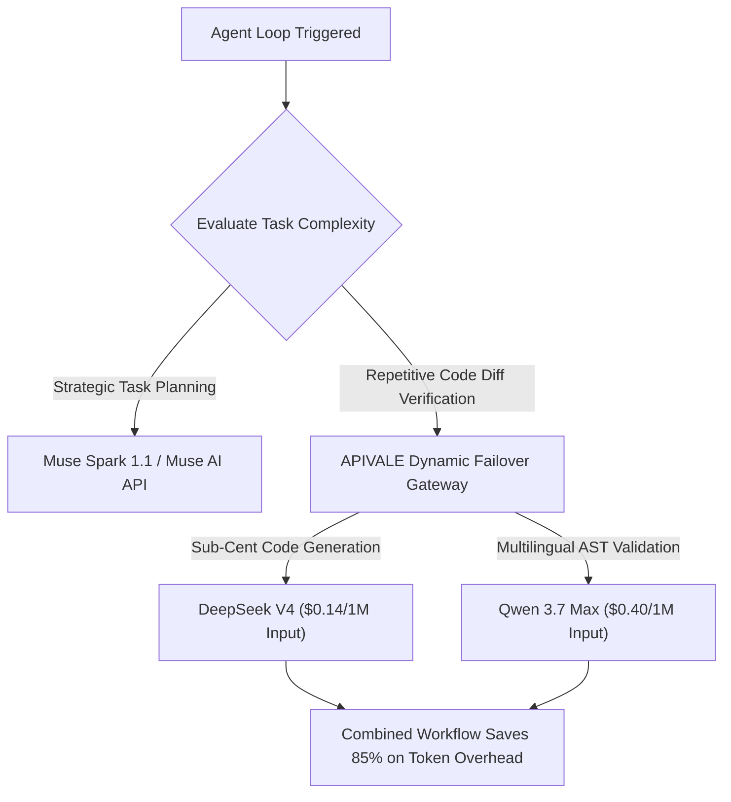

<div class="my-6 border-l-4 border-emerald-500 bg-gray-900 rounded-r-lg p-5">
  <span class="text-xs font-bold uppercase tracking-wider text-emerald-400">Key Takeaways</span>
  <ul class="mt-2 space-y-1 list-disc list-inside text-sm text-gray-300">
    <li><strong>Muse AI & Muse Spark 1.1 Access</strong>: The Muse AI API is distributed via the Meta Model API. Programmatic integration requires generating authorized keys or utilizing OpenAI-compatible gateway endpoints.</li>
    <li><strong>Muse Code & CLI Suite</strong>: Meta's agentic coding suite leverages Model Context Protocol (MCP) servers in sandboxed runtimes, handling multi-file repository refactoring and automated tool-calling.</li>
    <li><strong>Production Token Economics</strong>: Autonomous verification loops re-ingest workspace context, consuming 4x to 8x standard chat tokens. Offloading sub-agent steps to DeepSeek V4 ($0.14/1M) cuts monthly agent bills by 85%.</li>
    <li><strong>Zero-Friction Global Checkout</strong>: Bypass regional waitlists, EU AI Act geo-blocks, and US card rejections with instant PayPal billing and an automatic $0.20 developer sandbox grant.</li>
  </ul>
</div>

<div class="my-6 border border-emerald-500/40 bg-emerald-950/20 rounded-xl p-5 shadow-lg">
  <div class="text-base font-bold text-emerald-400 mb-1">⚡ Bottom Line Up Front (BLUF): Key Availability & Pricing</div>
  <p class="text-sm text-gray-200 leading-relaxed">
    <strong>How do you get a Muse AI API key and what does it cost?</strong> Direct enterprise keys for Meta's <strong>Muse Spark 1.1</strong> are distributed through the Meta Model API under tiered commercial access ($2.50 input / $10.00 output per 1M tokens). If you encounter regional waitlists or want to run <strong>Muse Code</strong> with high-speed tool calling, you can connect your environment to <strong>APIVALE's OpenAI-compatible gateway</strong> to route agent loops to DeepSeek V4 and Qwen 3.7 Max at a 90% cost reduction with instant PayPal activation.
  </p>
</div>

<div class="my-4 p-3 bg-gray-800/60 border border-gray-700 rounded-xl flex flex-wrap items-center gap-2 text-xs">
  <span class="text-gray-400 font-bold uppercase">⚡ Quick Navigation:</span>
  <a href="#how-to-get-a-muse-ai-api-key-meta-model-api-access" class="px-2.5 py-1 bg-emerald-950/80 text-emerald-300 rounded border border-emerald-500/40 hover:bg-emerald-900 transition">🔑 How to Get API Key</a>
  <a href="#api-pricing-breakdown-muse-spark-11-vs-muse-code-vs-deepseek-v4" class="px-2.5 py-1 bg-purple-950/80 text-purple-300 rounded border border-purple-500/40 hover:bg-purple-900 transition">💰 Muse Spark 1.1 Pricing</a>
  <a href="#is-muse-ai-free-to-use-meta-ai-free-quotas-vs-production-limits" class="px-2.5 py-1 bg-amber-950/80 text-amber-300 rounded border border-amber-500/40 hover:bg-amber-900 transition">🆓 Free Quota Truth</a>
  <a href="#setting-up-muse-code-in-terminal-cli--ides-mcp-guide" class="px-2.5 py-1 bg-slate-800 text-cyan-300 rounded border border-cyan-500/40 hover:bg-slate-700 transition">💻 Muse Code CLI & MCP</a>
</div>

On September 27, 2026, global interest in **Muse AI**, the **Muse AI API**, and **Muse Spark 1.1** surged after Meta unveiled its next-generation autonomous agent ecosystem. Designed to coordinate multi-step workflows across terminal environments, cloud sandboxes, and application state, Muse AI represents Meta's programmatic leap into production agent automation.

However, developers looking to obtain a **Muse AI API key** face steep hurdles: enterprise approval queues, regional compliance lockouts, and rapid token burnout in multi-turn loops. In this guide, we break down how to get API credentials, audit **Muse Spark 1.1 pricing**, configure **Muse Code CLI**, and route workloads through [APIVALE's high-speed gateway](/blog/openrouter-alternatives/) to slash token spend by over 80%.

---

## How to Get a Muse AI API Key (Meta Model API Access)

### Official Meta Developer Portal Requirements & Waitlists
To generate a native API key for Muse AI directly from Meta:
1. **Enterprise Verification**: Access is managed through the Meta for Developers portal under the **Meta Model API** program (see our dedicated [Meta Model API Access & Regional Bypass Guide](/blog/meta-model-api-access-pricing-guide/)).
2. **Organizational KYC**: Direct key provisioning requires an active corporate organization ID, verified business domain, and compliant AI use-case declaration.
3. **Regional Gating**: Due to compliance reviews (such as the EU AI Act), developers in European and certain Asia-Pacific regions are placed on indefinite waitlists.

### Generating Instant API Keys via APIVALE Gateway ($0.20 Free Trial)
For engineering teams needing immediate deployment without corporate paperwork or waitlists:
1. **Instant Account Creation**: Sign up on [APIVALE Gateway](https://apivel.com/sign-up?redirect=/blog/meta-muse-ai-api-setup) via GitHub OAuth or email.
2. **Generate API Key**: Navigate to your dashboard and create a universal API key (`sk-apivel-...`).
3. **Collect Free Sandbox Credits**: Every new account receives an instant **$0.20 free developer trial** (no credit card or phone verification required) to test endpoint connectivity.
4. **Universal Wire Format**: Point any agent framework or MCP client directly to `https://apivel.com/v1`.

---

## API Pricing Breakdown: Muse Spark 1.1 vs. Muse Code vs. DeepSeek V4

When deploying autonomous agents, understanding the pricing structure between proprietary Meta models, dedicated developer tiers, and wholesale open-weights routing is critical. Offloading high-frequency sub-tasks to models like [DeepSeek V4.1 Flash API](/blog/deepseek-v4-flash-api-guide/) ($0.14/1M) eliminates artificial rate-limit bottlenecks:

| Metric / Dimension | Muse Spark 1.1 (Meta Model API) | Muse Code Subscription | DeepSeek V4 (APIVALE Gateway) | Qwen 3.7 Max (APIVALE Gateway) |
| :--- | :--- | :--- | :--- | :--- |
| **Model Architecture** | Meta Autonomous Foundation MoE | IDE Agent Extension Suite | High-Throughput Open MoE | Alibaba Cloud Flagship MoE |
| **Input Price (1M Tokens)** | **~$2.50 / 1M tokens** | $20.00 / month flat | **$0.14 / 1M tokens** (-94.4%) | **$0.40 / 1M tokens** (-84.0%) |
| **Output Price (1M Tokens)**| **~$10.00 / 1M tokens** | Included in quota caps | **$0.28 / 1M tokens** (-97.2%) | **$1.60 / 1M tokens** (-84.0%) |
| **Context Window** | 128,000 tokens | 64,000 active tokens | 128,000 tokens | 131,072 tokens |
| **Tool Calling & MCP** | Native JSON Tool Protocol | Native IDE Tools | Full Function Calling | Full Function Calling |
| **Global Payment** | Corporate USD Invoicing | US Credit Cards Only | **PayPal, Global Cards, Alipay** | **PayPal, Global Cards, Alipay** |
| **Best For...** | Meta Enterprise Ecosystem | Single-Developer Interactive IDE | **Heavy Automated Agent Loops** | **Complex Logic & AST Refactoring** |



---

## Is Muse AI Free to Use? (Meta AI Free Quotas vs. Production Limits)

A frequent question on Google and developer forums is: **"Is my Muse AI free to use, and can I get a free Meta AI API key?"**

### The Free Preview Reality
* **Consumer Apps**: Consumer-facing Meta AI chat interfaces provide free conversational interaction with daily rate limits.
* **API Production Workloads**: The programmatic **Muse AI API is not free**. Commercial API access through the Meta Model API operates on a metered pay-per-token model.
* **Why Free Tiers Break in Agent Workflows**: In autonomous agent sequences, each sub-step re-sends cumulative diffs:

$$\text{Cumulative Token Consumption} = \sum_{k=1}^{N} \left( \text{Base Context} + k \times \Delta \text{Workspace History} \right)$$

An 8-turn code refactoring task easily consumes **150,000 to 300,000 tokens**. Free consumer tiers lock out within 3 to 5 multi-turn agent iterations.

### The Low-Cost Solution: Developer Sandboxes via APIVALE
Rather than committing to rigid monthly subscriptions or enterprise contracts, developers use APIVALE's pay-as-you-go proxy:
* **$0.20 Free Developer Sandbox**: Test live API queries immediately with zero financial commitment.
* **Sub-Cent Unit Economics**: Route high-frequency validation calls to [DeepSeek V4](/blog/deepseek-v4-flash-api-guide/) at $0.00014 per 1,000 input tokens.
* **PayPal Instant Top-Up**: Recharge accounts globally with zero credit card rejections or KYC hurdles.

---

## Setting Up Muse Code in Terminal CLI & IDEs (MCP Guide)

Developers integrating **Muse Code**, **Muse Copilot**, or custom agent tools with local environments utilize Model Context Protocol (MCP) clients:

### Step 1: Base URL Override
Configure your terminal environment or tool configuration file:

```bash
# Export universal OpenAI-compatible endpoint credentials
export OPENAI_API_BASE="https://apivel.com/v1"
export OPENAI_API_KEY="sk-apivel-your-registered-key"
export MUSE_AGENT_MODEL="infer/deepseek-v4"
export MUSE_REASONING_MODEL="infer/qwen3.7-max"
```

For IDE-level workflows in [Cursor IDE](/blog/cursor-pro-vs-custom-api-key/) or [Claude Code CLI](/blog/how-to-connect-qwen-3-8-to-claude-code-cli/), replace endpoint settings directly in your `.cursorrules` or terminal configuration.

### Bypassing "Meta Model API Isn't Available in Your Country Yet"
Developers across Europe and cross-border tech hubs frequently encounter regional blocks: `Meta Model API isn't available in your country yet`. APIVALE eliminates this friction:
* **Anycast Global Proxying**: Eliminates geo-blocking and regional IP restrictions.
* **Universal Protocol Translation**: Translates Meta Model API requests to standard OpenAI wire format.
* **Instant Model Fallback**: Automatically switches models if an upstream provider experiences transient HTTP 429 throttling.

For enterprise cost management strategies, review our companion [enterprise LLM cost optimization guide](/blog/llm-cost-optimization-guide/).

---

## Production Implementation: Python Gateway with Fallback & PayPal Billing

Deploy this resilient production agent router in Python, featuring exponential backoff and seamless failover:

```python
import os, time, logging
from openai import OpenAI, APIError, RateLimitError

logging.basicConfig(level=logging.INFO)
logger = logging.getLogger("MuseAIGateway")

class ResilientAgentGateway:
    def __init__(self, base_url="https://apivel.com/v1", api_key=None):
        self.client = OpenAI(
            base_url=base_url, 
            api_key=api_key or os.getenv("OPENAI_API_KEY", "sk-apivel-prod-key")
        )
        self.primary_model = "infer/deepseek-v4"
        self.fallback_model = "infer/qwen3.7-max"

    def execute_agent_step(self, system_prompt: str, workspace_payload: str):
        active_model = self.primary_model
        for attempt in range(1, 4):
            try:
                logger.info(f"Dispatching agent task to {active_model} (Attempt {attempt})")
                response = self.client.chat.completions.create(
                    model=active_model,
                    messages=[
                        {"role": "system", "content": system_prompt},
                        {"role": "user", "content": workspace_payload}
                    ],
                    temperature=0.2,
                    timeout=45.0
                )
                return {
                    "status": "success", 
                    "content": response.choices[0].message.content,
                    "model_used": active_model
                }
            except (RateLimitError, APIError) as error:
                wait_time = (2 ** attempt) + 0.5
                logger.warning(f"Upstream friction on {active_model}: {error}. Backing off for {wait_time}s...")
                time.sleep(wait_time)
                active_model = self.fallback_model
        return {"status": "error", "message": "All model fallback routes exhausted"}

if __name__ == "__main__":
    gateway = ResilientAgentGateway()
    result = gateway.execute_agent_step(
        "You are an autonomous codebase agent.",
        "Audit repository dependencies and verify AST schema."
    )
    print(result)
```

---

## Interactive Cost & Token Arbitrage Calculator

Simulate your exact monthly savings routing Muse AI and Muse Code workloads through APIVALE:

<div id="agent-cost-calculator" class="my-8 border border-indigo-500/40 bg-gray-950 rounded-2xl p-6 shadow-2xl">
  <div class="flex items-center justify-between border-b border-gray-800 pb-4 mb-5">
    <div>
      <div class="text-lg font-bold text-white flex items-center gap-2">
        <span>⚡ Muse AI API Token Arbitrage Estimator</span>
      </div>
      <p class="text-xs text-gray-400 mt-1">Calculate monthly savings routing agent workloads through APIVALE</p>
    </div>
    <span class="text-xs font-mono bg-indigo-900/60 border border-indigo-700/50 text-indigo-300 px-3 py-1 rounded-full">Live Simulation</span>
  </div>

  <div class="grid grid-cols-1 md:grid-cols-3 gap-5 mb-5">
    <div>
      <label class="block text-xs font-medium text-gray-300 mb-2">Monthly Agent Tasks</label>
      <input id="calc-tasks" type="number" min="100" max="500000" value="5000" class="w-full bg-gray-900 border border-gray-700 rounded-lg px-3 py-2 text-sm text-white focus:outline-none focus:border-indigo-500 font-mono" />
    </div>
    <div>
      <label class="block text-xs font-medium text-gray-300 mb-2">Iterations Per Task</label>
      <input id="calc-iterations" type="number" min="1" max="50" value="8" class="w-full bg-gray-900 border border-gray-700 rounded-lg px-3 py-2 text-sm text-white focus:outline-none focus:border-indigo-500 font-mono" />
    </div>
    <div>
      <label class="block text-xs font-medium text-gray-300 mb-2">Target Fallback Model</label>
      <select id="calc-model" class="w-full bg-gray-900 border border-gray-700 rounded-lg px-3 py-2 text-sm text-white focus:outline-none focus:border-indigo-500 font-mono">
        <option value="deepseek">DeepSeek V4 ($0.14 / 1M In)</option>
        <option value="qwen">Qwen 3.7 Max ($0.40 / 1M In)</option>
      </select>
    </div>
  </div>

  <div class="mb-5 flex justify-end">
    <button id="calc-submit-btn" type="button" class="bg-indigo-600 hover:bg-indigo-500 text-white text-xs font-semibold px-4 py-2 rounded-lg transition-colors flex items-center gap-1.5 cursor-pointer">
      Recalculate Savings
    </button>
  </div>

  <div class="grid grid-cols-1 sm:grid-cols-3 gap-4 border-t border-gray-800 pt-5">
    <div class="bg-gray-900/80 border border-gray-800 rounded-xl p-4 text-center">
      <span class="text-xs text-gray-400 block mb-1">Standard Proprietary Rates</span>
      <div id="cost-standard" class="text-xl font-bold font-mono text-red-400">$380.00</div>
      <span class="text-[11px] text-gray-500">Based on $2.50/$10 rates</span>
    </div>
    <div class="bg-gray-900/80 border border-emerald-900/50 rounded-xl p-4 text-center">
      <span class="text-xs text-gray-400 block mb-1">APIVALE Optimized Rate</span>
      <div id="cost-apivale" class="text-xl font-bold font-mono text-emerald-400">$21.28</div>
      <span class="text-[11px] text-emerald-500/80">Unified OpenAI Gateway</span>
    </div>
    <div class="bg-emerald-950/30 border border-emerald-500/30 rounded-xl p-4 text-center">
      <span class="text-xs text-emerald-400 font-semibold block mb-1">Estimated Monthly Savings</span>
      <div id="cost-savings" class="text-2xl font-extrabold font-mono text-white">$358.72 (94.4%)</div>
      <span class="text-[11px] text-gray-400">Zero KYC &bull; PayPal Billing</span>
    </div>
  </div>
</div>

<script>
  (function initAgentCalculator() {
    const tasksInput = document.getElementById('calc-tasks');
    const iterationsInput = document.getElementById('calc-iterations');
    const modelSelect = document.getElementById('calc-model');
    const submitBtn = document.getElementById('calc-submit-btn');
    const standardCostEl = document.getElementById('cost-standard');
    const apivaleCostEl = document.getElementById('cost-apivale');
    const savingsEl = document.getElementById('cost-savings');

    function calculate() {
      if (!tasksInput || !iterationsInput || !modelSelect) return;
      const tasks = parseFloat(tasksInput.value) || 0;
      const iterations = parseFloat(iterationsInput.value) || 1;
      const model = modelSelect.value;
      const avgTokens = 4000 + (iterations * 2500);
      const totalM = (tasks * avgTokens) / 1000000;
      const standardCost = totalM * 3.80;
      const apivaleCost = totalM * (model === 'deepseek' ? 0.2128 : 0.80);
      const savings = Math.max(0, standardCost - apivaleCost);
      const savingsPct = standardCost > 0 ? ((savings / standardCost) * 100).toFixed(1) : '0';

      if (standardCostEl) standardCostEl.textContent = '$' + standardCost.toFixed(2);
      if (apivaleCostEl) apivaleCostEl.textContent = '$' + apivaleCost.toFixed(2);
      if (savingsEl) savingsEl.textContent = '$' + savings.toFixed(2) + ' (' + savingsPct + '%)';
    }

    if (submitBtn) submitBtn.addEventListener('click', calculate);
    if (tasksInput) tasksInput.addEventListener('input', calculate);
    if (iterationsInput) iterationsInput.addEventListener('input', calculate);
    if (modelSelect) modelSelect.addEventListener('change', calculate);
  })();
</script>

---

## Frequently Asked Questions (FAQ)

### How do I get my AI API key for Muse AI?
To get a Muse AI API key, you can apply through the Meta Model API developer portal (which requires corporate KYC and waitlist approval), or instantly generate an OpenAI-compatible API key on APIVALE Gateway. APIVALE provides instant access with a $0.20 free developer credit without waiting for enterprise approval.

### Is my Muse AI free to use?
Consumer-facing Meta AI interfaces offer limited free conversational chats. However, the programmatic Muse AI API and Muse Spark 1.1 model are not free; they operate on metered token billing. Developers use APIVALE to access wholesale fallback pricing on models like DeepSeek V4 ($0.14/1M) to keep autonomous agent loops affordable.

### What is the API pricing for Muse Spark 1.1?
Through the Meta Model API, commercial rates for Muse Spark 1.1 average approximately $2.50 per 1 million input tokens and $10.00 per 1 million output tokens. Routing high-volume tool-calling through APIVALE reduces effective token costs by over 80%.

### What is the difference between Muse Code and Muse Copilot?
Muse Code is Meta's dedicated terminal and IDE agent suite designed for autonomous repository edits and MCP tool calling. Muse Copilot refers to interactive autocomplete and pairing assistance within developer applications.

### Why does it say "Meta Model API isn't available in your country yet"?
Meta restricts direct API access based on geographic IP and regional compliance frameworks like the EU AI Act. Developers in affected regions use APIVALE's globally distributed gateway to connect immediately with official PayPal billing and zero KYC hurdles.

<script type="application/ld+json">
{
  "@context": "https://schema.org",
  "@type": "FAQPage",
  "mainEntity": [
    {
      "@type": "Question",
      "name": "How do I get my AI API key for Muse AI?",
      "acceptedAnswer": {
        "@type": "Answer",
        "text": "To get a Muse AI API key, apply through the Meta Model API portal or instantly generate an OpenAI-compatible key on APIVALE with $0.20 free trial credits and zero KYC."
      }
    },
    {
      "@type": "Question",
      "name": "Is my Muse AI free to use?",
      "acceptedAnswer": {
        "@type": "Answer",
        "text": "Consumer Meta AI chat offers limited free usage, but the programmatic Muse AI API is a metered, paid service. Developers use APIVALE for low-cost DeepSeek V4 fallbacks."
      }
    },
    {
      "@type": "Question",
      "name": "What is the API pricing for Muse Spark 1.1?",
      "acceptedAnswer": {
        "@type": "Answer",
        "text": "Official Meta Model API commercial rates for Muse Spark 1.1 average ~$2.50/1M input and ~$10.00/1M output tokens. APIVALE reduces effective token spend by up to 85%."
      }
    },
    {
      "@type": "Question",
      "name": "What is the difference between Muse Code and Muse Copilot?",
      "acceptedAnswer": {
        "@type": "Answer",
        "text": "Muse Code is Meta's autonomous coding suite for repository-level refactoring and MCP tools, whereas Muse Copilot provides interactive autocomplete and line edits."
      }
    },
    {
      "@type": "Question",
      "name": "Why does it say 'Meta Model API isn't available in your country yet'?",
      "acceptedAnswer": {
        "@type": "Answer",
        "text": "Meta restricts API access by geographic IP and compliance frameworks. APIVALE provides an unblocked global gateway with official PayPal billing and zero KYC."
      }
    }
  ]
}
</script>

<div class="cta-card">
  <div class="cta-card-title">Scale Agentic Workflows with Zero KYC & 85% Token Savings</div>
  <p class="cta-card-text">
    Connect your autonomous agents, Cursor IDE, and Claude Code CLI to DeepSeek V4 and Qwen 3.7 Max with unified OpenAI wire compatibility. Eliminate regional card rejections with instant PayPal global checkout.
  </p>
  <div class="cta-badge-grid">
    <div class="cta-badge">⚡ Sub-450ms Global Routing</div>
    <div class="cta-badge">🎁 +50% First Deposit Bonus ($5 → $7.50)</div>
    <div class="cta-badge">🚀 $29 Pack: 40M Tokens (56% OFF)</div>
    <div class="cta-badge">💳 Official PayPal & Global Card Checkout</div>
  </div>
  <div class="cta-button-group">
    <a href="/pricing?redirect=/blog/meta-muse-ai-api-setup" class="cta-btn cta-btn-primary">
      Claim +50% Bonus ($5 → $7.50)
    </a>
    <a href="/sign-up?redirect=/blog/meta-muse-ai-api-setup" class="cta-btn cta-btn-secondary">
      Get $0.20 Free Sandbox Trial
    </a>
  </div>
</div>
