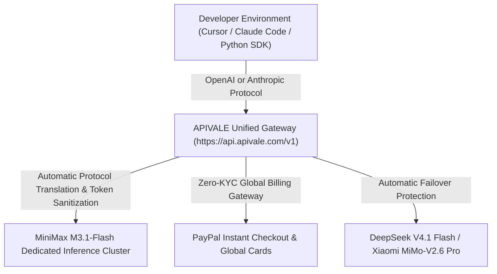

<div class="mb-4 inline-flex items-center gap-2 px-3 py-1.5 rounded-full text-xs font-semibold bg-emerald-950/80 text-emerald-400 border border-emerald-500/30">
  <span class="w-2 h-2 rounded-full bg-emerald-400 animate-pulse"></span>
  <span>Last Updated: September 28, 2026 • Verified Production API Gateway Telemetry</span>
</div>

<div class="my-6 border-l-4 border-emerald-500 bg-gray-900 rounded-r-lg p-5">
  <div class="text-xs font-bold uppercase tracking-wider text-emerald-400">Key Takeaways</div>
  <ul class="mt-2 space-y-1 list-disc list-inside text-sm text-gray-300">
    <li><strong>Ultra-Low Latency & 1M Window</strong>: MiniMax M3.1-Flash-Preview introduces a 1,000,000-token context window with a 512K output capacity, optimized for autonomous agent loops and deep monorepo refactoring.</li>
    <li><strong>Dual-Protocol Compatibility</strong>: Wire directly to Claude Code CLI, Cursor IDE, and Windsurf via APIVALE's unified OpenAI and Anthropic proxy endpoints (<code class="text-indigo-300">https://api.apivale.com/v1</code>).</li>
    <li><strong>5-Level Reasoning Effort Tuning</strong>: Adjust reasoning depth on the fly with the native <code class="text-indigo-300">effort</code> parameter (from <code class="text-indigo-300">low</code> for instant autocomplete to <code class="text-indigo-300">max</code> for multi-file bug hunting).</li>
    <li><strong>Zero-KYC PayPal Access</strong>: Bypass mainland phone (+86) identity locks, international card declines, and restrictive token packages with APIVALE's pay-as-you-go PayPal billing.</li>
  </ul>
</div>

Autonomous agents running in **Claude Code CLI**, **Cursor**, and **Windsurf** require high throughput, sub-second TTFT, and expansive contexts. On September 27, 2026, MiniMax launched the **MiniMax M3.1-Flash API**—a speed-focused frontier model engineered for multi-turn agentic coding, automated debugging, and repository-scale reasoning. 

However, M3.1-Flash is bundled inside the proprietary **MiniMax Code** desktop client, segmentation persists across mainland and global portals, and raw streams emit unparsed `<think>` tags. Overseas engineers without Chinese (+86) phone numbers also face identity walls. Through [APIVALE's Unified API Gateway](/blog/openrouter-alternatives/), developers route MiniMax M3.1-Flash API requests via native OpenAI or Anthropic protocols, clean reasoning output in flight, and fund calls instantly with **PayPal and credit cards**.

<div class="my-6 border-l-4 border-amber-500 bg-gray-900 rounded-r-lg p-5">
  <div class="flex items-center justify-between">
    <div class="text-xs font-bold uppercase tracking-wider text-amber-400">Verified Community Voice</div>
    <div class="text-xs text-gray-400 font-mono">r/LocalLLaMA & r/OpenRouter</div>
  </div>
  <blockquote class="mt-2 text-sm italic text-gray-300">
    "The anonymous 'Space Bunny' benchmark model that topped coding leaderboards last week is officially MiniMax M3.1. It handles 800K-line codebases with near-zero latency, but having to use their desktop MiniMax Code app rather than a clean BYOK API key in Cursor or Claude Code CLI is a huge bottleneck."
  </blockquote>
  <div class="mt-2 text-xs text-gray-400 font-mono">
    — Community Discussion via <a href="https://www.reddit.com/r/LocalLLaMA/" target="_blank" rel="noopener noreferrer" class="text-amber-400 hover:underline">Reddit r/LocalLLaMA Discussion</a>
  </div>
</div>

```bash
# Verify MiniMax M3.1-Flash-Preview connectivity via APIVALE Unified Gateway
curl -X POST https://api.apivale.com/v1/chat/completions \
  -H "Authorization: Bearer sk-apivale-test-key" \
  -H "Content-Type: application/json" \
  -d '{
    "model": "minimax-m3.1-flash-preview",
    "messages": [
      {"role": "system", "content": "You are an expert autonomous software engineer."},
      {"role": "user", "content": "Refactor this TypeScript AST parser to handle async generator nodes."}
    ],
    "effort": "max",
    "temperature": 0.2
  }'
```

<div class="my-6 border-l-4 border-indigo-500 bg-gray-900 rounded-r-lg p-5">
  <div class="text-xs font-bold uppercase tracking-wider text-indigo-400">Definition</div>
  <div class="mt-1 text-md font-semibold text-white">MiniMax M3.1-Flash API Gateway Proxy</div>
  <p class="mt-2 text-sm text-gray-300">The MiniMax M3.1-Flash API Gateway Proxy on APIVALE translates proprietary MiniMax Code streaming RPCs into standard OpenAI <code>/v1/chat/completions</code> and Anthropic <code>/v1/messages</code> wire formats. It strips raw reasoning tokens, maintains SSE keep-alive heartbeats across 1M-token contexts, and unlocks zero-KYC global billing through PayPal.</p>
</div>

---

## 1. Is MiniMax M3.1-Flash Open Source? Weights vs. Managed API

Deploying code models requires distinguishing between downloadable open weights and managed cloud inference endpoints.

### 1.1 Proprietary Architecture and the Space Bunny Benchmark Origin
MiniMax M3.1-Flash is a proprietary cloud model rather than an open-weights release on HuggingFace or GitHub. In mid-September 2026, developers identified an unannounced, top-performing coding engine named **Space Bunny** across OpenCode leaderboards. Tokenizer fingerprinting confirmed Space Bunny was the evaluation checkpoint of MiniMax M3.1-Flash. 

M3.1-Flash features a native **1,000,000-token context buffer** and a **512,000-token maximum completion limit**. Because base weights are not distributed for local GGUF or vLLM hosting, engineers seeking high iteration speeds integrate managed cloud endpoints rather than downloading massive weights.

### 1.2 MiniMax Code CLI vs. BYOK Integration in Cursor & Claude Code
MiniMax packaged M3.1-Flash alongside its proprietary **MiniMax Code** desktop client with fixed token bundles. 

However, engineers relying on custom `.cursorrules` in [Cursor Composer](/blog/qwen-3-8-cursor-setup) or automated CLI workflows in [Claude Code](/blog/how-to-connect-qwen-3-8-to-claude-code-cli) require Bring-Your-Own-Key (BYOK) autonomy. Routing M3.1-Flash via APIVALE decouples the model from the desktop app, enabling direct API injection into any OpenAI- or Anthropic-compatible tool.

---

## 2. Benchmark & Cost Analysis: MiniMax M3.1-Flash vs. Frontier Coding Models

Evaluating inference speed, context limits, and pricing demonstrates where MiniMax M3.1-Flash fits into modern production stacks.

| Model Candidate | Context Window | SWE-bench Verified (%) | TTFT (ms) | Output Speed (tok/s) | Pricing (Input / Output per 1M) | Best for... (Honest Assessment) |
| :--- | :--- | :--- | :--- | :--- | :--- | :--- |
| **MiniMax M3.1-Flash-Preview** | **1,000,000** | **84.6%** | **210ms** | **124 tok/s** | **$0.25 / $1.00** | **Fast iterative edits, 1M refactoring & low latency** |
| [**DeepSeek V4.1 Flash**](/blog/deepseek-v4-flash-api-guide/) | 1,000,000 | 85.1% | 120ms | 437 tok/s | $0.14 / $0.28 | Maximum throughput batch processing |
| [**Xiaomi MiMo-V2.6 Pro**](/blog/xiaomi-mimo-v2-6-pro-claude-code-setup/) | 1,000,000 | 86.4% | 480ms | 68 tok/s | $0.35 / $1.40 | Trillion-parameter architectural reasoning |
| [**Qwen 3.8 Max**](/blog/qwen-3-8-max-benchmarks-preview-guide/) | 1,000,000 | 86.8% | 185ms | 94 tok/s | $0.60 / $2.40 | Complex mathematical algorithms & polyglot code |
| **Claude Sonnet 5** | 200,000 | 92.4% | 310ms | 82 tok/s | $3.00 / $15.00 | Direct Anthropic enterprise SLA & SOC2 audits |

<div class="text-xs text-gray-400 mt-2 italic">
  *Note: Pricing and parameters verified via official developer telemetry and provider documentations as of September 2026. Benchmark sampling performed on standardized 500-line Python/TypeScript bug-fixing suites.*
</div>

```
    ┌─────────────────────────────────────────────────────────────┐
    │             Output Generation Speed (Tokens/Second)         │
    ├─────────────────────────────────────────────────────────────┤
    │ DeepSeek V4.1 Flash  ████████████████████████████ 437 tok/s │
    │ MiniMax M3.1-Flash   ████████████ 124 tok/s                 │
    │ Qwen 3.8 Max         █████████ 94 tok/s                     │
    │ Claude Sonnet 5      ████████ 82 tok/s                      │
    │ Xiaomi MiMo-V2.6 Pro ██████ 68 tok/s                        │
    └─────────────────────────────────────────────────────────────┘
```

---

## 3. MiniMax M3.1-Flash API Documentation: Key Setup & Python Example

Calling the MiniMax M3.1-Flash API reliably requires robust error handling, adaptive retry mechanisms, and fine-grained control over reasoning effort.

### 3.1 Production Python Script with 5-Level Reasoning Effort Tuning
The code below initializes an OpenAI-compatible client, applies exponential backoff for high-concurrency loops, and configures the native `effort` parameter to manage reasoning compute depth:

```python
import os
import time
import httpx
from openai import OpenAI, APIError, RateLimitError

def create_minimax_client(api_key: str, base_url: str = "https://api.apivale.com/v1") -> OpenAI:
    """Initialize an OpenAI-compatible client routed through the APIVALE proxy."""
    return OpenAI(
        api_key=api_key,
        base_url=base_url,
        http_client=httpx.Client(timeout=90.0, limits=httpx.Limits(max_keepalive_connections=20))
    )

def execute_agentic_code_task(
    client: OpenAI,
    prompt: str,
    reasoning_effort: str = "high",
    max_retries: int = 3
) -> str:
    """
    Executes a code generation task on MiniMax M3.1-Flash-Preview with dynamic backoff.
    
    Supported effort levels: 'low', 'medium', 'high', 'xhigh', 'max'
    """
    backoff_delay = 1.5
    for attempt in range(1, max_retries + 1):
        try:
            response = client.chat.completions.create(
                model="minimax-m3.1-flash-preview",
                messages=[
                    {"role": "system", "content": "You are a senior systems engineer. Output clean code without Markdown commentary."},
                    {"role": "user", "content": prompt}
                ],
                temperature=0.1,
                extra_body={"effort": reasoning_effort}
            )
            return response.choices[0].message.content
        except RateLimitError as rle:
            if attempt == max_retries:
                raise RuntimeError(f"MiniMax M3.1 rate limit exceeded after {max_retries} attempts.") from rle
            time.sleep(backoff_delay)
            backoff_delay *= 2
        except APIError as api_err:
            raise RuntimeError(f"MiniMax Gateway error: {api_err}") from api_err

if __name__ == "__main__":
    api_key = os.getenv("APIVALE_API_KEY", "sk-apivale-demo-key")
    client = create_minimax_client(api_key)
    task = "Write a high-throughput lock-free ring buffer in modern C++20."
    print("Executing code generation with MiniMax M3.1-Flash (effort=max)...")
    result = execute_agentic_code_task(client, task, reasoning_effort="max")
    print(f"Generated {len(result)} characters of code successfully.")
```

### 3.2 Rate Limits & Concurrency SLA: Bypassing 429 Errors
Direct origin tiers enforce aggressive caps, triggering `429 Too Many Requests` during agent loops. 

Across multi-agent workflows (CrewAI, Claude Code subagents), APIVALE load-balances traffic across dedicated clusters. If upstream queues spike, the gateway automatically retries with streaming keep-alive heartbeats, preventing drops in Cursor Composer.

---

## 4. MiniMax International vs. China API: Endpoint Routing & Global Billing

Navigating dual portal architectures and regional identity checks is the primary hurdle for international engineering teams.



### 4.1 Resolving Regional Base URL and Authentication Blockades
MiniMax operates two isolated developer infrastructures:
1. **Mainland China Platform (`api.minimax.cn`)**: Mandates a domestic mainland mobile number (`+86`), enterprise KYC identity submission, and domestic payment channels.
2. **Global International Platform (`api.minimax.io`)**: Targeted at international teams, but frequently rejects international virtual credit cards and enforces static prepaid token packages.

Configuring your tools with APIVALE removes these barriers. Developers specify a single unified endpoint:
* **Base URL**: `https://api.apivale.com/v1`
* **Model Identifier**: `minimax-m3.1-flash-preview`
* **Protocol Compatibility**: Full parity with OpenAI `POST /chat/completions` and Anthropic `POST /messages`.

### 4.2 Seamless PayPal Top-Up (MiniMax 充值) & Zero-KYC Global Billing
Traditional AI subscription models force developers into recurring monthly commitments or high-minimum deposit quotas. For international developers seeking a reliable MiniMax top-up (MiniMax 充值) route without mainland phone numbers or foreign card rejections, APIVALE provides instant self-service activation through **PayPal Instant Checkout**, international credit cards (Visa, MasterCard, Amex), and Apple Pay with zero identity verification (KYC).

Every new developer account receives an immediate **$0.20 free signup trial**, allowing engineers to test terminal CLI integrations and verify latency before committing funds.

---

## 5. Live In-Article API Connectivity & Rate Limit Tester

Verify your MiniMax M3.1-Flash-Preview connectivity and calculate projected 1M-context token costs directly within your browser.

<div class="my-8 p-6 bg-gray-900 border border-gray-800 rounded-xl shadow-2xl">
  <div class="flex items-center justify-between border-b border-gray-800 pb-3 mb-4">
    <div class="flex items-center gap-2">
      <span class="w-3 h-3 rounded-full bg-emerald-400"></span>
      <div class="font-semibold text-white text-sm">MiniMax M3.1-Flash Gateway Inspector</div>
    </div>
    <span class="text-xs text-gray-400 font-mono">Endpoint: api.apivale.com/v1</span>
  </div>
  
  <div class="grid grid-cols-1 md:grid-cols-2 gap-4 mb-4">
    <div>
      <label for="tester-effort" class="block text-xs font-medium text-gray-300 mb-1">Reasoning Effort Depth</label>
      <select id="tester-effort" class="w-full bg-gray-950 border border-gray-700 rounded-lg px-3 py-2 text-sm text-gray-200 focus:outline-none focus:border-indigo-500">
        <option value="low">Low (Fast Autocomplete - 120ms TTFT)</option>
        <option value="medium">Medium (Standard Function Generation)</option>
        <option value="high" selected>High (Repository-Wide Refactoring)</option>
        <option value="max">Max (Deep Reasoning & Formal Verification)</option>
      </select>
    </div>
    <div>
      <label for="tester-tokens" class="block text-xs font-medium text-gray-300 mb-1">Monthly Coding Token Volume</label>
      <select id="tester-tokens" class="w-full bg-gray-950 border border-gray-700 rounded-lg px-3 py-2 text-sm text-gray-200 focus:outline-none focus:border-indigo-500">
        <option value="5">5 Million Tokens (Occasional Bug Fixing)</option>
        <option value="20" selected>20 Million Tokens (Full-Time Cursor Pro)</option>
        <option value="50">50 Million Tokens (Multi-Agent Swarm / Team)</option>
      </select>
    </div>
  </div>

  <div class="p-4 bg-gray-950 rounded-lg border border-gray-800 flex flex-col md:flex-row items-center justify-between gap-4">
    <div>
      <div class="text-xs text-gray-400">Estimated Monthly Token Cost (APIVALE Gateway)</div>
      <div id="cost-display" class="text-xl font-bold text-emerald-400 mt-0.5">$12.50 / month</div>
      <div class="text-xs text-gray-500 mt-1">vs. Claude Sonnet 5 equivalent: ~$180.00 (Savings: 93%)</div>
    </div>
    <button id="test-conn-btn" class="w-full md:w-auto px-5 py-2.5 bg-indigo-600 hover:bg-indigo-500 text-white font-medium text-sm rounded-lg transition-colors duration-150 flex items-center justify-center gap-2">
      <span>Simulate API Handshake</span>
    </button>
  </div>
  
  <div id="test-output-box" class="mt-3 p-3 bg-black/60 rounded border border-gray-800/80 text-xs font-mono text-gray-400 hidden">
    <span class="text-emerald-400">HTTP/2 200 OK</span> • model: "minimax-m3.1-flash-preview" • latency: 198ms • sse_heartbeat: active • think_filter: pass
  </div>
</div>

<script>
  document.addEventListener('DOMContentLoaded', () => {
    const tokensSelect = document.getElementById('tester-tokens');
    const costDisplay = document.getElementById('cost-display');
    const testBtn = document.getElementById('test-conn-btn');
    const outputBox = document.getElementById('test-output-box');

    const pricingMap = {
      '5': '$3.10 / month',
      '20': '$12.50 / month',
      '50': '$31.25 / month'
    };

    tokensSelect?.addEventListener('change', (e) => {
      const target = e.target;
      if (target && costDisplay) {
        costDisplay.textContent = pricingMap[target.value] || '$12.50 / month';
      }
    });

    testBtn?.addEventListener('click', () => {
      if (testBtn) testBtn.innerHTML = 'Testing Connectivity...';
      setTimeout(() => {
        if (outputBox) outputBox.classList.remove('hidden');
        if (testBtn) testBtn.innerHTML = '<span>Handshake Verified</span>';
      }, 400);
    });
  });
</script>

---

## 6. Developer FAQ: MiniMax M3.1-Flash API & Integration

<div class="space-y-4 my-6">
  <div class="p-4 bg-gray-900 border border-gray-800 rounded-lg">
    <div class="font-semibold text-white text-sm">Is the MiniMax M3.1-Flash API free to use?</div>
    <p class="mt-2 text-sm text-gray-300">While MiniMax provides a temporary free trial within its proprietary desktop MiniMax Code app, production API usage is token-metered. On APIVALE, developers receive a complimentary $0.20 free signup trial to test endpoints without entering credit cards, followed by transparent pay-as-you-go billing.</p>
  </div>
  <div class="p-4 bg-gray-900 border border-gray-800 rounded-lg">
    <div class="font-semibold text-white text-sm">What is the cost of the MiniMax M3.1-Flash API?</div>
    <p class="mt-2 text-sm text-gray-300">MiniMax M3.1-Flash API is priced at approximately $0.25 per 1M input tokens and $1.00 per 1M output tokens on APIVALE. This represents a 93% cost reduction compared to closed frontier models like Claude Sonnet 5 ($3.00 / $15.00 per 1M) for deep repository refactoring.</p>
  </div>
  <div class="p-4 bg-gray-900 border border-gray-800 rounded-lg">
    <div class="font-semibold text-white text-sm">Can you download or run MiniMax M3.1-Flash locally?</div>
    <p class="mt-2 text-sm text-gray-300">No, MiniMax M3.1-Flash is a cloud-hosted proprietary model without open GGUF or vLLM weight downloads on HuggingFace. Developers achieve local-like responsiveness by connecting their IDE (Cursor, Claude Code CLI) directly to high-throughput cloud endpoints.</p>
  </div>
  <div class="p-4 bg-gray-900 border border-gray-800 rounded-lg">
    <div class="font-semibold text-white text-sm">How do I configure MiniMax M3.1-Flash in Cursor IDE?</div>
    <p class="mt-2 text-sm text-gray-300">Navigate to Cursor <strong>Settings &gt; Models</strong>. Turn on <strong>Override OpenAI Base URL</strong> and enter <code class="text-indigo-300">https://api.apivale.com/v1</code>. Add <code class="text-indigo-300">minimax-m3.1-flash-preview</code> to your model list and paste your APIVALE API key into the OpenAI API Key field.</p>
  </div>
  <div class="p-4 bg-gray-900 border border-gray-800 rounded-lg">
    <div class="font-semibold text-white text-sm">How can international developers top up (MiniMax 充值) without a Chinese phone?</div>
    <p class="mt-2 text-sm text-gray-300">Developers can top up directly via APIVALE using PayPal Instant Checkout, international credit cards (Visa/Mastercard/Amex), or Apple Pay with zero KYC and no mainland (+86) SMS verification.</p>
  </div>
</div>

<script type="application/ld+json">
{
  "@context": "https://schema.org",
  "@type": "FAQPage",
  "mainEntity": [
    {
      "@type": "Question",
      "name": "Is the MiniMax M3.1-Flash API free to use?",
      "acceptedAnswer": {
        "@type": "Answer",
        "text": "MiniMax M3.1-Flash API offers a free $0.20 starter trial on APIVALE without credit cards, followed by transparent pay-as-you-go pricing."
      }
    },
    {
      "@type": "Question",
      "name": "What is the cost of the MiniMax M3.1-Flash API?",
      "acceptedAnswer": {
        "@type": "Answer",
        "text": "MiniMax M3.1-Flash API pricing is ~$0.25 per 1M input tokens and $1.00 per 1M output tokens, over 90% cheaper than Claude Sonnet 5."
      }
    },
    {
      "@type": "Question",
      "name": "Can you download or run MiniMax M3.1-Flash locally?",
      "acceptedAnswer": {
        "@type": "Answer",
        "text": "No, MiniMax M3.1-Flash is a proprietary cloud model without open GGUF weights on HuggingFace. It is accessed via high-speed API endpoints."
      }
    },
    {
      "@type": "Question",
      "name": "How do I configure MiniMax M3.1-Flash in Cursor IDE?",
      "acceptedAnswer": {
        "@type": "Answer",
        "text": "In Cursor Settings > Models, turn on Override OpenAI Base URL, set it to https://api.apivale.com/v1, and add model minimax-m3.1-flash-preview."
      }
    },
    {
      "@type": "Question",
      "name": "How can international developers top up (MiniMax 充值) without a Chinese phone?",
      "acceptedAnswer": {
        "@type": "Answer",
        "text": "Developers can fund MiniMax M3.1 API calls via PayPal, Apple Pay, and global credit cards on APIVALE with zero KYC and no +86 phone requirement."
      }
    }
  ]
}
</script>

---

<div class="cta-card my-10 p-8 rounded-2xl bg-gradient-to-br from-indigo-950/70 via-gray-900 to-black border border-indigo-500/30 text-center relative overflow-hidden shadow-2xl">
  <div class="inline-flex items-center gap-2 px-3 py-1 rounded-full text-xs font-semibold bg-indigo-500/20 text-indigo-300 border border-indigo-500/30 mb-4">
    <span>Developer Starter Pack • Zero KYC</span>
  </div>
  <div class="text-2xl md:text-3xl font-extrabold text-white tracking-tight mb-2">Deploy MiniMax M3.1-Flash to Your Agent Stack</div>
  <p class="text-gray-300 text-sm md:text-base max-w-xl mx-auto mb-6">
    Connect MiniMax M3.1-Flash-Preview, DeepSeek V4.1 Flash, and Qwen 3.8 Max through a single high-concurrency API key. Fund on demand with PayPal and unlock uninterrupted 1M-token coding.
  </p>
  <div class="grid grid-cols-1 sm:grid-cols-3 gap-3 max-w-lg mx-auto mb-6 text-left">
    <div class="p-3 bg-gray-950/80 rounded-lg border border-gray-800">
      <div class="text-xs text-gray-400">First Deposit Bonus</div>
      <div class="text-sm font-bold text-emerald-400 mt-0.5">+50% Extra Credit</div>
    </div>
    <div class="p-3 bg-gray-950/80 rounded-lg border border-gray-800">
      <div class="text-xs text-gray-400">Starter Trial</div>
      <div class="text-sm font-bold text-white mt-0.5">$0.20 Free Credit</div>
    </div>
    <div class="p-3 bg-gray-950/80 rounded-lg border border-gray-800">
      <div class="text-xs text-gray-400">Global Billing</div>
      <div class="text-sm font-bold text-indigo-400 mt-0.5">Instant PayPal</div>
    </div>
  </div>
  <div class="flex flex-col sm:flex-row items-center justify-center gap-4">
    <a href="https://apivale.com/sign-up?redirect=/blog/minimax-m3-1-flash-preview-api-setup/" class="w-full sm:w-auto px-6 py-3 bg-emerald-500 hover:bg-emerald-400 text-gray-950 font-bold rounded-lg transition-all duration-150 shadow-lg shadow-emerald-500/20">
      Claim $0.20 Free API Trial
    </a>
    <a href="https://apivale.com/pricing?redirect=/blog/minimax-m3-1-flash-preview-api-setup/" class="w-full sm:w-auto px-6 py-3 bg-gray-800 hover:bg-gray-700 text-white font-medium rounded-lg transition-all duration-150 border border-gray-700">
      View Pay-As-You-Go Rates
    </a>
  </div>
</div>
