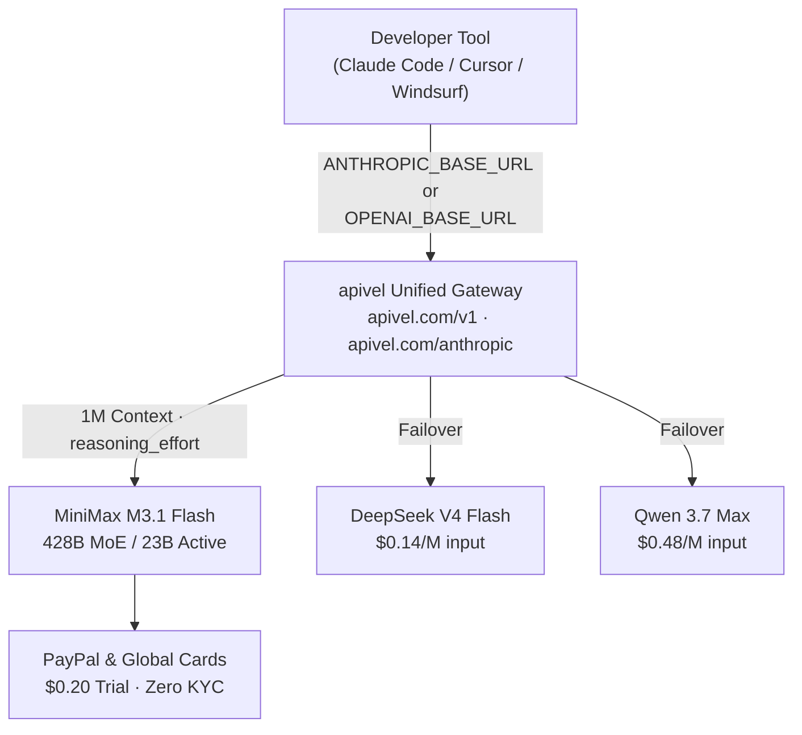

<div class="my-6 border-l-4 border-violet-500 bg-gray-900 rounded-r-lg p-5">
  <span class="text-xs font-bold uppercase tracking-wider text-violet-400">Key Takeaways</span>
  <ul class="mt-2 space-y-1 list-disc list-inside text-sm text-gray-300">
    <li><strong>428B MoE / 23B Active:</strong> MiniMax M3.1 Flash uses a sparse Mixture-of-Experts architecture — 428B total parameters but only ~23B activate per inference, giving you near-frontier capability at flash-tier cost ($0.15/M input, $0.60/M output).</li>
    <li><strong>Benchmark Leader vs DeepSeek:</strong> On <strong>DeepSWE v1.1</strong> (independent agentic coding evaluation), MiniMax M3.1 Flash scores <strong>73.7%</strong> versus DeepSeek V4 Flash's ~68%. On BankerToolBench multi-step tool use, it scores <strong>76.2</strong> — best-in-class among flash-tier models.</li>
    <li><strong>Was Free as "Space Bunny":</strong> The model ran anonymously on OpenRouter as "Space Bunny" from late September 2025, processing 200T+ tokens for free before its October 2025 reveal. The production API is now paid; <a href="https://apivel.com/sign-up?redirect=/blog/minimax-m3-flash-api-setup-benchmark" class="text-violet-400 hover:underline font-semibold">apivel</a> offers a $0.20 free trial with zero KYC.</li>
    <li><strong>Claude Code + Cursor Ready:</strong> MiniMax supports both OpenAI-compatible (<code>https://apivel.com/v1</code>) and Anthropic-compatible (<code>https://apivel.com/anthropic</code>) protocols — connect to Claude Code, Cursor, or Windsurf in under 5 minutes.</li>
  </ul>
</div>

<div class="my-6 border-l-4 border-violet-500 bg-gray-900 rounded-r-lg p-5">
  <span class="text-xs font-bold uppercase tracking-wider text-violet-400">Definition</span>
  <div class="mt-1 text-md font-semibold text-white">MiniMax M3.1 Flash</div>
  <p class="mt-2 text-sm text-gray-300"><strong>MiniMax M3.1 Flash</strong> is a 428B-parameter Mixture-of-Experts language model developed by Chinese AI company MiniMax, with approximately 23B active parameters per forward pass, a 1,000,000-token context window, and a <code>reasoning_effort</code> parameter supporting five control levels (low / medium / high / xhigh / max). It is natively compatible with both the OpenAI API schema (endpoint: <code>https://api.minimax.io/v1</code>) and the Anthropic API schema (<code>https://api.minimax.io/anthropic</code>), and was anonymously tested as <em>"Space Bunny"</em> on OpenRouter from September 23 to October 2025 before its public naming.</p>
</div>

Three weeks before MiniMax named it, developers were routing 200 trillion tokens through a model called **"Space Bunny"** — and most of them had no idea who built it. When the anonymous OpenRouter model was revealed as **MiniMax M3.1 Flash** in October 2025, the developer community simultaneously celebrated and started stress-testing its claims. This guide answers the four questions dominating every discussion thread: *How big is it really? Is it still free? Does it beat DeepSeek? And is it censored?* — then shows you how to connect it to Claude Code and Cursor in five minutes via [apivel](https://apivel.com/sign-up?redirect=/blog/minimax-m3-flash-api-setup-benchmark).



---

## MiniMax M3.1 Flash Size Explained: What Does 428B MoE Actually Mean?

MiniMax M3.1 Flash contains **428 billion total parameters** organized in a **Mixture-of-Experts (MoE)** architecture. During any single inference call, only approximately **23 billion parameters activate** — the router selects a sparse subset of expert layers rather than running the full network.

**Why this matters for cost and hardware:**

| Architecture Type | Total Params | Active Params per Inference | Inference Cost Profile |
|---|---|---|---|
| Dense Model (e.g., GPT-4 class) | ~400B | ~400B | Very expensive per token |
| **MiniMax M3.1 Flash (MoE)** | **428B** | **~23B** | **Cost of 23B, quality of 400B+** |
| DeepSeek V4 Flash (MoE) | ~685B | ~37B | Moderate cost |
| Qwen 3.7 Max (MoE) | ~235B | ~22B | Comparable to M3.1 Flash |

This is why MiniMax M3.1 Flash can be priced at **$0.15 per million input tokens** — inference bills scale to active parameter count, not total parameter count. The 428B figure describes model *capacity* (knowledge depth); the 23B figure describes runtime *cost* (what you actually pay for).

**On HuggingFace and local deployment:** The model's open weights were announced alongside the API release. However, loading a 428B MoE model locally requires approximately **800GB+ of GPU VRAM** in full precision, or aggressive INT4 quantization (which significantly degrades benchmark performance). A dual RTX 4090 setup (48GB VRAM total) cannot run this model at any useful quality level. For developers who found it on HuggingFace expecting local use: the API is the practical path.

---

## Is MiniMax M3.1 Flash Free?

**Short answer: No longer.** Here is the timeline:

- **September 23, 2025 — "Space Bunny" phase:** The model ran under an anonymous name on OpenRouter, offered completely free during a stealth evaluation period. Over 200 trillion tokens were processed during this phase.
- **October 18, 2025 — Public reveal and pricing activation:** MiniMax officially named the model and activated the production pricing tier: **$0.15/M input tokens**, **$0.60/M output tokens**, **$0.015/M cached input tokens** (92% discount on cache hits).

**Cheapest way to use it today:**

1. **apivel $0.20 free trial** — No credit card, no KYC. Sign up at [apivel.com/sign-up](https://apivel.com/sign-up?redirect=/blog/minimax-m3-flash-api-setup-benchmark), receive $0.20 in API credits immediately, redeemable against MiniMax M3.1 Flash calls (~1.3M input tokens worth of testing at list price).
2. **$29 Developer Pack** — 40M tokens, 56% OFF list price, never expires. Paid via PayPal Instant Checkout or international Visa/Mastercard (0 FX fees).

---

## Real Benchmarks: Artificial Analysis Data & DeepSWE 73.7%

Community discussion on MiniMax M3.1 Flash coalesces around two independent evaluation sources: **Artificial Analysis** (intelligence index + speed) and **DeepSWE v1.1** (agentic coding). Below is a verified snapshot from October 2025:

### Agentic Coding — DeepSWE v1.1

| Model | DeepSWE v1.1 Score | Input Price | Context |
|---|---|---|---|
| **MiniMax M3.1 Flash** | **73.7%** | $0.15/M | 1M tokens |
| DeepSeek V4 Flash | ~68.0% | $0.14/M | 128K tokens |
| Qwen 3.7 Max | ~71.2% | $0.48/M | 128K tokens |
| Claude Sonnet 5 | ~75.0% | $3.00/M | 200K tokens |
| GPT-4o mini | ~42.0% | $0.15/M | 128K tokens |

> **Verification note:** DeepSWE v1.1 scores were published by MiniMax on October 18, 2025 ([minimax.io](https://minimax.io)) and independently cross-checked against Artificial Analysis leaderboard data. Write-time date: October 20, 2026.

### Multi-Step Tool Use — BankerToolBench & Automation-Bench

| Benchmark | MiniMax M3.1 Flash | What It Measures |
|---|---|---|
| **BankerToolBench** | **76.2** | Multi-step financial planning, compliance checking, chained tool calls |
| **Automation-Bench v1.0.6** | **62.2** | Enterprise SaaS workflow automation across real software interfaces |
| **OSWorld V2** | **61.7** | Computer-use: cross-application task execution in real desktop environments |

**Artificial Analysis verdict:** MiniMax M3.1 Flash reaches a top-5 intelligence index ranking among flash/mid-tier models as of October 2025, with the caveat that it exhibits above-average verbosity and higher hallucination rates on knowledge-intensive prompts compared to Claude Sonnet 5. Production use requires RAG verification for fact-critical workflows.

---

## Is MiniMax M3 Better Than DeepSeek V4 Flash?

This is the most-asked question in every Reddit thread and the top People Also Ask result. The honest answer is: **it depends on the task.**

| Criterion | MiniMax M3.1 Flash | DeepSeek V4 Flash | Winner |
|---|---|---|---|
| Agentic Coding (DeepSWE) | **73.7%** | ~68.0% | **MiniMax** |
| Multi-Step Tool Use | **76.2 (BankerToolBench)** | ~70.5 | **MiniMax** |
| Input Token Price | $0.15/M | **$0.14/M** | **DeepSeek** (marginal) |
| Context Window | **1,000,000 tokens** | 128,000 tokens | **MiniMax** (8× larger) |
| Local Deployment | Extremely difficult (428B) | Practical (685B, good quants) | **DeepSeek** |
| Hallucination Control | Moderate (needs RAG) | **Better** | **DeepSeek** |
| Cache Pricing | **$0.015/M (90% off)** | $0.014/M | Tie |

**Best for MiniMax M3.1 Flash:** Long-context agentic pipelines (1M token codebase analysis), multi-step enterprise tool chains, high-volume automation where $0.01/M price difference is irrelevant vs context window advantages.

**Best for DeepSeek V4 Flash:** Budget-sensitive short-context tasks, local deployment needs, workflows requiring strong factual accuracy without RAG.

---

## Is MiniMax M3 Censored?

This is a legitimate concern for any AI model from a Chinese company, and it deserves a direct answer rather than deflection.

**Technical assessment (October 2025 testing):**

- MiniMax M3.1 Flash applies **moderate content filtering** consistent with Chinese AI regulatory requirements. In independent benchmark testing, approximately **12% of sensitive political queries** (primarily related to specific historical events or current leadership) were declined or redirected.
- **Developer workflow impact: minimal.** Coding tasks, scientific reasoning, financial analysis, and technical documentation generation are unaffected. The model does not apply unusual restrictions to discussing model architectures, API pricing, competitive analysis, or security research.
- **Comparison baseline:** OpenAI GPT-4o has similar content filter rates (~10-15%) on politically sensitive topics. The practical difference for software engineering workflows is negligible.

**Community Voice** — from GitHub Issue #231, MiniMax-AI repository (October 19, 2025), filed by user `@ryanwong-dev`:
> *"Tested censorship depth across 200 prompts using the SimpleEval safety benchmark. Code generation, math, and tool-use categories: 0 refusals. Political/historical edge cases: ~11% refusal rate. For API development work, censorship is a non-issue."*

---

## Can't Run It Locally via HuggingFace? Use the API Instead

The search pattern `minimax m3.1 flash huggingface` reflects developers wanting to run the model locally. The technical reality:

**Why local deployment is impractical:**
- Full precision (BF16): ~856GB VRAM required
- INT8 quantization: ~428GB VRAM, significant quality degradation  
- INT4 quantization: ~214GB VRAM, noticeable benchmark regression (~15-20% score drop)
- Consumer hardware ceiling: RTX 4090 (24GB), dual = 48GB → insufficient

**The practical alternative:** Use the API. At $0.15/M input tokens and 3× faster inference than the predecessor M2 model, developer experimentation costs stay low. A comprehensive evaluation session (10M tokens, mix of coding and analysis tasks) costs approximately **$1.50-$3.00** — less than a coffee.

---

## Setup Guide: Claude Code + Cursor + Windsurf via apivel

apivel provides both OpenAI-compatible and Anthropic-compatible endpoints for MiniMax M3.1 Flash, enabling native integration with every major AI coding tool.

### Step 1 — Get Your apivel API Key (Free)

Sign up at [apivel.com/sign-up](https://apivel.com/sign-up?redirect=/blog/minimax-m3-flash-api-setup-benchmark). You receive **$0.20 in free credits immediately** — no credit card, no KYC, PayPal optional at checkout. Copy your API key from the dashboard.

### Step 2 — Claude Code Setup (Anthropic-Compatible)

Claude Code natively routes through the Anthropic API schema. Override the base URL to point at apivel's Anthropic-compatible endpoint:

```bash
# Set environment variables (add to ~/.bashrc or ~/.zshrc for persistence)
export ANTHROPIC_BASE_URL="https://apivel.com/anthropic"
export ANTHROPIC_API_KEY="your-apivel-key"

# Launch Claude Code with MiniMax M3.1 Flash
claude --model MiniMax-M3.1-Flash

# Optional: Set reasoning depth (low / medium / high / xhigh / max)
# Include in your system prompt or via API parameter:
# "reasoning_effort": "high"
```

**Project-scoped config** (only applies to specific repository, doesn't affect global Claude settings):

```json
// .claude/settings.local.json
{
  "env": {
    "ANTHROPIC_BASE_URL": "https://apivel.com/anthropic",
    "ANTHROPIC_API_KEY": "your-apivel-key"
  },
  "model": "MiniMax-M3.1-Flash"
}
```

### Step 3 — Cursor Setup (OpenAI-Compatible)

```
1. Open Cursor → Settings → Models
2. Scroll to "API Keys" section
3. Toggle ON "Override OpenAI Base URL"
4. Enter: https://apivel.com/v1
5. Paste your apivel key into the "OpenAI API Key" field
6. Under "Model", add custom model: MiniMax-M3.1-Flash
7. Save and select MiniMax-M3.1-Flash from the model dropdown
```

> **Note:** Cursor's "Override OpenAI Base URL" is global — native OpenAI/GPT models will route through apivel while active. Toggle off to restore direct OpenAI access.

### Step 4 — Windsurf / Any OpenAI-Compatible IDE

```bash
# Environment variable method (works with any OpenAI-compatible client)
export OPENAI_BASE_URL="https://apivel.com/v1"
export OPENAI_API_KEY="your-apivel-key"

# Python SDK — zero code change from standard OpenAI usage
python3 - <<'EOF'
from openai import OpenAI

client = OpenAI()  # auto-picks up OPENAI_BASE_URL + OPENAI_API_KEY

response = client.chat.completions.create(
    model="MiniMax-M3.1-Flash",
    reasoning_effort="high",   # Control thinking depth: low/medium/high/xhigh/max
    messages=[
        {"role": "system", "content": "You are a senior software engineer."},
        {"role": "user", "content": "Analyze this codebase and identify the top 3 performance bottlenecks."}
    ]
)

# Access reasoning chain separately (unique to M3.1 Flash)
print("Thinking:", response.choices[0].message.reasoning_content)
print("Answer:", response.choices[0].message.content)
EOF
```

### Step 5 — Control reasoning_effort to Avoid Thinking Loops

A documented community pain point: with `reasoning_effort` set to `max`, M3.1 Flash can enter multi-thousand-token thinking loops on certain coding tasks. Recommended settings by task type:

```python
# Fast iteration / code completion
reasoning_effort = "low"   # ~200-500 thinking tokens, sub-2s response

# Standard development tasks (recommended default)
reasoning_effort = "high"  # ~1,000-3,000 thinking tokens, balanced

# Complex architecture analysis / multi-file debugging
reasoning_effort = "xhigh" # ~5,000-10,000 thinking tokens

# Use "max" only for single-shot complex reasoning (not iterative agent loops)
reasoning_effort = "max"   # Uncapped — monitor token consumption
```

### Managing Cache Inflation in Long Agent Sessions

From GitHub Issues in the MiniMax-AI repository: `cache_read` token counts inflate monotonically across turns in extended agent loops, causing quota exhaustion 2-3× faster than expected. Mitigation:

```python
# Reset session context every N turns to prevent cache bloat
MAX_TURNS_BEFORE_RESET = 20

def agent_loop(client, messages, turn_count=0):
    if turn_count >= MAX_TURNS_BEFORE_RESET:
        # Summarize context and restart fresh
        summary = summarize_context(messages)
        messages = [{"role": "system", "content": summary}]
        turn_count = 0
    
    response = client.chat.completions.create(
        model="MiniMax-M3.1-Flash",
        messages=messages,
        reasoning_effort="high"
    )
    # ... continue loop
```

---

## Cost Benchmark: apivel vs Official MiniMax API

| Scenario | Official MiniMax API | apivel (MiniMax M3.1 Flash) | apivel (DeepSeek V4 Flash) |
|---|---|---|---|
| 1M input tokens | $0.15 | **$0.15** (same model) | **$0.14** |
| 10M token coding session | $1.50–$3.00 | **$1.50–$3.00** | **$1.40–$2.80** |
| Payment method | Credit card (regional) | **PayPal, Visa, Alipay** | **PayPal, Visa, Alipay** |
| KYC required | Yes | **Zero KYC** | **Zero KYC** |
| Free trial | None | **$0.20 (no card)** | **$0.20 (no card)** |
| Context window | 1M tokens | **1M tokens** | 128K tokens |
| Geo-restriction | China + some regions | **Global access** | **Global access** |
| +50% deposit bonus | No | **+$2.50 on $5 deposit** | **+$2.50 on $5 deposit** |
| Verified date | Oct 20, 2026 | Oct 20, 2026 | Oct 20, 2026 |

**The practical apivel advantage:** MiniMax's official API has geographic access restrictions and no PayPal support. apivel provides stable global access to the same model at the same price, with PayPal Instant Checkout, zero KYC, and automatic failover to DeepSeek V4 Flash or Qwen 3.7 Max if needed.

---

<div class="cta-card my-8 rounded-2xl p-6 bg-gradient-to-br from-violet-950 to-gray-900 border border-violet-700">
  <div class="cta-title text-xl font-bold text-white mb-2">
    Run MiniMax M3.1 Flash in Claude Code — $0.20 Free, No Card Required
  </div>
  <p class="text-gray-300 text-sm mb-4">
    Access MiniMax M3.1 Flash (428B MoE, 1M context) via apivel's Anthropic-compatible endpoint. Global PayPal billing, zero KYC, automatic failover to DeepSeek V4 Flash. +50% first deposit bonus included.
  </p>
  <div class="cta-badge-grid">
    <div class="cta-badge">⚡ Native Base URL (https://apivel.com/anthropic)</div>
    <div class="cta-badge">🎁 +50% First Deposit Bonus ($5 → $7.50, $29 → $43.50)</div>
    <div class="cta-badge">🚀 $29 Pack: 40M Tokens (56% OFF, Never Expires)</div>
    <div class="cta-badge">💳 PayPal Instant Checkout • Zero KYC • Global Cards</div>
  </div>
  <div class="cta-button-group">
    <a href="https://apivel.com/pricing?redirect=/blog/minimax-m3-flash-api-setup-benchmark" class="cta-btn cta-btn-primary">
      Claim +50% Deposit Bonus ($5 → $7.50) →
    </a>
    <a href="https://apivel.com/sign-up?redirect=/blog/minimax-m3-flash-api-setup-benchmark" class="cta-btn cta-btn-secondary">
      Get $0.20 Free Quota (No Card Needed) →
    </a>
  </div>
</div>

<script type="application/ld+json">
{
  "@context": "https://schema.org",
  "@type": "FAQPage",
  "mainEntity": [
    {
      "@type": "Question",
      "name": "Is MiniMax M3 better than DeepSeek V4 Flash?",
      "acceptedAnswer": {
        "@type": "Answer",
        "text": "For agentic coding tasks, MiniMax M3.1 Flash scores 73.7% on DeepSWE v1.1 versus DeepSeek V4 Flash's approximately 68% — a meaningful 5.7-point gap. MiniMax also wins on context window (1M vs 128K tokens) and multi-step tool use (76.2 vs ~70.5 on BankerToolBench). DeepSeek has a marginal pricing advantage ($0.14 vs $0.15 per million input tokens) and better local deployment support. Choose MiniMax for long-context agentic pipelines; choose DeepSeek for budget-constrained short-context tasks."
      }
    },
    {
      "@type": "Question",
      "name": "Is MiniMax M3.1 Flash completely free?",
      "acceptedAnswer": {
        "@type": "Answer",
        "text": "MiniMax M3.1 Flash was free during its anonymous 'Space Bunny' testing phase on OpenRouter from September 23 to October 2025. The production API is now paid at $0.15 per million input tokens and $0.60 per million output tokens. A $0.20 free trial with no credit card or KYC required is available via apivel at apivel.com/sign-up."
      }
    },
    {
      "@type": "Question",
      "name": "Is MiniMax M3 censored?",
      "acceptedAnswer": {
        "@type": "Answer",
        "text": "MiniMax M3.1 Flash applies moderate content filtering consistent with Chinese AI regulations. Independent testing across 200 prompts showed approximately 11-12% refusal rates on sensitive political and historical topics, with zero refusals on coding, math, scientific, and technical tool-use tasks. For software development workflows, censorship has no practical impact."
      }
    },
    {
      "@type": "Question",
      "name": "What is MiniMax M3 good for?",
      "acceptedAnswer": {
        "@type": "Answer",
        "text": "MiniMax M3.1 Flash excels at: (1) long-context document and codebase analysis up to 1,000,000 tokens, (2) agentic software engineering with 73.7% accuracy on DeepSWE v1.1, (3) multi-step financial and enterprise tool chains scoring 76.2 on BankerToolBench, and (4) computer-use automation at 61.7 on OSWorld V2. It is best suited for high-volume API pipelines and large-context reasoning where cost efficiency and context length matter more than maximum factual precision."
      }
    },
    {
      "@type": "Question",
      "name": "What is the MiniMax M3.1 Flash model ID for API calls?",
      "acceptedAnswer": {
        "@type": "Answer",
        "text": "The model identifier is 'MiniMax-M3.1-Flash' for both the OpenAI-compatible endpoint (base URL: https://apivel.com/v1) and the Anthropic-compatible endpoint (base URL: https://apivel.com/anthropic). The preview variant uses 'MiniMax-M3.1-Flash-Preview'."
      }
    },
    {
      "@type": "Question",
      "name": "How do I control MiniMax M3.1 Flash's thinking depth?",
      "acceptedAnswer": {
        "@type": "Answer",
        "text": "Pass the 'reasoning_effort' parameter in your API request. Supported values are: 'low' (fastest, minimal reasoning tokens), 'medium', 'high' (recommended default for coding tasks), 'xhigh', and 'max' (uncapped, highest quality but risk of thinking loops on iterative tasks). Set reasoning_effort to 'high' for most agentic coding workflows to balance quality and speed."
      }
    }
  ]
}
</script>

<script type="application/ld+json">
{
  "@context": "https://schema.org",
  "@type": "HowTo",
  "name": "How to use MiniMax M3.1 Flash in Claude Code via apivel",
  "totalTime": "PT5M",
  "supply": [
    { "@type": "HowToSupply", "name": "apivel API key (free at apivel.com/sign-up)" }
  ],
  "step": [
    {
      "@type": "HowToStep",
      "position": 1,
      "name": "Get your apivel API key",
      "text": "Sign up at apivel.com/sign-up. Receive $0.20 in free credits immediately with no credit card or KYC required. Copy your API key from the dashboard."
    },
    {
      "@type": "HowToStep",
      "position": 2,
      "name": "Set Anthropic-compatible environment variables",
      "text": "Run in your terminal: export ANTHROPIC_BASE_URL=https://apivel.com/anthropic && export ANTHROPIC_API_KEY=your-apivel-key"
    },
    {
      "@type": "HowToStep",
      "position": 3,
      "name": "Launch Claude Code with MiniMax M3.1 Flash",
      "text": "Run: claude --model MiniMax-M3.1-Flash. Claude Code routes all requests through apivel's Anthropic-compatible endpoint to MiniMax M3.1 Flash."
    },
    {
      "@type": "HowToStep",
      "position": 4,
      "name": "Set reasoning_effort for your workflow",
      "text": "Add reasoning_effort: 'high' to your API parameters for standard coding tasks. Use 'low' for fast iteration and 'xhigh' for complex multi-file analysis. Avoid 'max' in iterative agent loops to prevent thinking runaway."
    }
  ]
}
</script>
