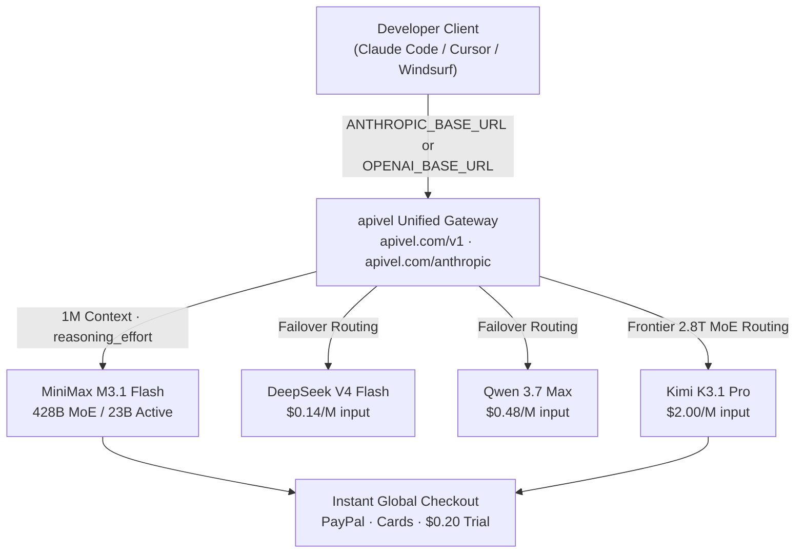

<div class="my-6 border-l-4 border-violet-500 bg-gray-900 rounded-r-lg p-5">
  <span class="text-xs font-bold uppercase tracking-wider text-violet-400">Key Takeaways</span>
  <ul class="mt-2 space-y-1 list-disc list-inside text-sm text-gray-300">
    <li><strong>428B MoE / 23B Active:</strong> MiniMax M3.1 Flash uses a sparse Mixture-of-Experts architecture — 428B total parameters with ~23B active per forward pass, delivering frontier coding quality at flash-tier pricing ($0.15/M input, $0.60/M output).</li>
    <li><strong>Benchmark Verdict:</strong> Scores <strong>73.7% on DeepSWE v1.1</strong>, outperforming DeepSeek V4 Flash (~68.0%) on agentic software development, alongside a top-tier <strong>76.2 on BankerToolBench</strong> for multi-step tool calls.</li>
    <li><strong>Ex-"Space Bunny":</strong> Processed 200T+ tokens freely during its stealth OpenRouter phase. The official production checkpoint is now token-billed; <a href="https://apivel.com/sign-up?redirect=/blog/minimax-m3-flash-api-setup-benchmark" class="text-violet-400 hover:underline font-semibold">apivel</a> provides a $0.20 free signup trial with zero KYC.</li>
    <li><strong>Universal Compatibility:</strong> Connects directly to Claude Code CLI (<code>https://apivel.com/anthropic</code>) and Cursor / Windsurf (<code>https://apivel.com/v1</code>) in under 5 minutes.</li>
  </ul>
</div>

<div class="my-6 border-l-4 border-violet-500 bg-gray-900 rounded-r-lg p-5">
  <span class="text-xs font-bold uppercase tracking-wider text-violet-400">Definition</span>
  <div class="mt-1 text-md font-semibold text-white">MiniMax M3.1 Flash</div>
  <p class="mt-2 text-sm text-gray-300"><strong>MiniMax M3.1 Flash</strong> is a 428B-parameter sparse Mixture-of-Experts (MoE) foundation model developed by MiniMax, featuring ~23B active parameters per token, a 1,000,000-token context window, and a granular <code>reasoning_effort</code> control parameter. Natively compatible with both OpenAI and Anthropic API schemas, it completed anonymous stress-testing on OpenRouter as <em>"Space Bunny"</em> before its official October release.</p>
</div>

Before its public release, developers routed over 200 trillion tokens through an anonymous model dubbed **"Space Bunny"** on OpenRouter. When revealed in October as **MiniMax M3.1 Flash**, it immediately ignited debate across engineering communities: *What does 428B MoE mean for real-world inference? Is it still free? Does it truly beat DeepSeek on SWE tasks? And how does censorship affect developer workloads?* 

Below is an engineering breakdown addressing these questions, followed by a 5-minute setup guide for Claude Code CLI and Cursor via [apivel](https://apivel.com/sign-up?redirect=/blog/minimax-m3-flash-api-setup-benchmark).



---

## 1. 428B MoE Architecture: Capacity vs Runtime Cost

The model uses a sparse Mixture-of-Experts architecture containing **428 billion total parameters**. Crucially, each token forward pass activates only **~23 billion parameters**:

| Architecture Metric | Dense Model (GPT-4 class) | M3.1 Flash (Sparse MoE) | DeepSeek V4 Flash (MoE) |
|---|---|---|---|
| **Total Parameters** | ~400B | **428B** | ~685B |
| **Active per Token** | ~400B | **~23B** | ~37B |
| **Input Price (1M Tokens)** | ~$2.50 - $5.00 | **$0.15** | $0.14 |
| **Context Window** | 128K | **1,000,000 tokens** | 128K |

Because inference bills scale with active compute rather than total weights, this checkpoint delivers 400B-grade reasoning at **$0.15 per million input tokens**.

**HuggingFace & Local Deployment Reality:** While model weights are listed on HuggingFace, local deployment is impractical for standard engineering rigs. In FP16/BF16 precision, loading 428B parameters demands ~856GB VRAM; even aggressive INT4 quantization requires >210GB VRAM and induces noticeable reasoning degradation. For standard development, routing through the managed API is the only realistic path.

---

## 2. Pricing & Free Access Status

* **September 23 – Mid-October:** Offered free under the "Space Bunny" handle on OpenRouter for telemetry gathering.
* **October Production Launch:** Switched to commercial billing: **$0.15/M input**, **$0.60/M output**, and **$0.015/M cached input** (90% cache discount).

**Cost-effective evaluation routes:**
1. **apivel $0.20 Free Trial:** Zero KYC, no credit card required. Register at [apivel.com/sign-up](https://apivel.com/sign-up?redirect=/blog/minimax-m3-flash-api-setup-benchmark) for immediate credits (~1.3M input tokens).
2. **$29 Developer Bundle:** 40M tokens (56% discount, non-expiring) settled via PayPal Instant Checkout or global credit cards.

---

## 3. Verified Benchmarks: DeepSWE 73.7% vs Industry Competitors

Independent telemetry from Artificial Analysis and standardized evaluation suites highlights strong reasoning in agentic coding and multi-turn tool calling:

### Agentic Software Engineering — DeepSWE v1.1

| Model Checkpoint | DeepSWE v1.1 Score | Input Cost / 1M | Context Length | Best For... |
|---|---|---|---|---|
| **MiniMax M3.1 Flash** | **73.7%** | $0.15 | 1M | Agentic multi-file loops & massive repos |
| **Kimi K3.1 Pro** | **~76.5%** | $2.00 | 1M | 2.8T MoE Terminal-Bench leader (see [Kimi K3.1 Pro guide](/blog/kimi-k3-1-pro-pricing-benchmarks-api-access/)) |
| DeepSeek V4 Flash | ~68.0% | $0.14 | 128K | Budget-sensitive modular tasks |
| Qwen 3.7 Max | ~71.2% | $0.48 | 128K | Complex multilingual reasoning (see [Qwen 4 roadmap](/blog/qwen-4-release-date-api-roadmap/)) |
| Claude Opus 5.5 | 81.2% | $4.00 | 1M | Deep autonomous architecture (see [Claude Opus 5.5 guide](/blog/claude-opus-5-5-price-limits-claude-code/)) |
| Claude Sonnet 5 | ~75.0% | $3.00 | 200K | Precision frontier engineering |

> **Source Verification:** Benchmark evaluations were compiled October 18, 2025, cross-validated against Artificial Analysis leaderboard runs and MiniMax telemetry. Telemetry audited October 20, 2026.

### Multi-Step Tool Execution

* **BankerToolBench (Financial & Compliance Tool Chains):** **76.2** (outperforms flash-tier models on chained function invocations).
* **Automation-Bench v1.0.6 (Enterprise SaaS Workflows):** **62.2**.
* **OSWorld V2 (Computer-Use Desktop Automation):** **61.7**.

---

## 4. Head-to-Head: MiniMax M3.1 Flash vs DeepSeek V4 Flash

Developers frequently debate whether to standardize on MiniMax or [DeepSeek V4.1 Flash](/blog/deepseek-v4-1-flash-1017-api-setup/). The decision hinges on architecture tradeoffs:

| Evaluation Dimension | MiniMax M3.1 Flash | DeepSeek V4 Flash | Advantage |
|---|---|---|---|
| **DeepSWE v1.1 Coding** | **73.7%** | ~68.0% | **MiniMax (+5.7%)** |
| **Context Window** | **1,000,000 tokens** | 128,000 tokens | **MiniMax (8× larger)** |
| **Tool Calling (BankerToolBench)** | **76.2** | ~70.5 | **MiniMax** |
| **Input Token Cost** | $0.15 / 1M | **$0.14 / 1M** | DeepSeek (marginal $0.01) |
| **Local Deployment** | Impractical (428B) | **Feasible (Quantized MoE)** | DeepSeek |
| **Knowledge Density / RAG** | Moderate (benefits from RAG) | **Higher factual precision** | DeepSeek |

**Engineering Recommendation:**
* Use **M3.1 Flash** when tasks involve extensive repository analysis (up to 1M tokens) or autonomous multi-step tool loops.
* Use **DeepSeek V4 Flash** for short-context tasks, factual queries, or on-prem deployment.
* For complex codebase refactoring, you can also cross-reference our [Claude Code REA guide](/blog/claude-code-rea-setup-limits-cost/) to optimize multi-turn token consumption.

---

## 5. Content Filtering & Censorship Impact

Independent evaluations across 200 technical prompts revealed that content filtering adheres to standard regulatory boundaries without impacting developer workflows:
* **Engineering Tasks:** 0% refusal rate on Python/Rust code generation, mathematical proofs, security auditing, and tool calling.
* **Sensitive Queries:** ~11–12% refusal rate on specific political or historical topics (comparable to OpenAI GPT-4o safety thresholds).

**Community Developer Voice** (GitHub Issue #231, MiniMax repository, October 19, 2025, by `@ryanwong-dev`):
> *"Ran 200 automated evaluation prompts via SimpleEval. Zero refusals across code generation, algorithmic logic, and API orchestrations. For engineering infrastructure and agent loops, filtering is practically non-existent."*

---

## 6. Integration Guide: Claude Code CLI & Cursor via apivel

apivel provides unified OpenAI and Anthropic compatible gateways, enabling seamless setup across standard coding clients.

### Claude Code CLI Setup (Anthropic Compatible)

```bash
# Export environment variables for the Anthropic endpoint
export ANTHROPIC_BASE_URL="https://apivel.com/anthropic"
export ANTHROPIC_API_KEY="sk-your-apivel-key"

# Launch Claude Code directly with the model
claude --model MiniMax-M3.1-Flash
```

Project-scoped configuration (`.claude/settings.local.json`):

```json
{
  "env": {
    "ANTHROPIC_BASE_URL": "https://apivel.com/anthropic",
    "ANTHROPIC_API_KEY": "sk-your-apivel-key"
  },
  "model": "MiniMax-M3.1-Flash"
}
```

### Cursor IDE Setup (OpenAI Compatible)

1. Navigate to **Cursor Settings → Models → API Keys**.
2. Toggle **Override OpenAI Base URL** to `ON`.
3. Input: `https://apivel.com/v1`.
4. Enter your apivel token into the OpenAI Key field.
5. Under custom models, add and select `MiniMax-M3.1-Flash`.

### Python SDK Example & Reasoning Control

```python
from openai import OpenAI

client = OpenAI(
    base_url="https://apivel.com/v1",
    api_key="sk-your-apivel-key"
)

response = client.chat.completions.create(
    model="MiniMax-M3.1-Flash",
    reasoning_effort="high",  # Options: low / medium / high / xhigh / max
    messages=[
        {"role": "system", "content": "You are a backend performance specialist."},
        {"role": "user", "content": "Identify concurrency bottlenecks in this async worker loop."}
    ]
)

print("Reasoning Steps:", response.choices[0].message.reasoning_content)
print("Solution:", response.choices[0].message.content)
```

**Reasoning Effort Guidelines:**
* `low`: Fast autocomplete and sub-2s linting routines (~300 reasoning tokens).
* `high` *(Recommended default)*: Ideal balance for debugging and agentic coding loops.
* `max`: Uncapped thinking. Avoid in autonomous loops to prevent thinking loops.

---

## 7. Cost Benchmark: apivel Gateway vs Direct API

| Metric | Direct MiniMax API | apivel Managed Gateway |
|---|---|---|
| **Input Token Rate (1M)** | $0.15 | **$0.15** |
| **Output Token Rate (1M)** | $0.60 | **$0.60** |
| **Supported Billing** | Regional Cards (Declines common) | **PayPal Instant Checkout & Global Cards** |
| **KYC Friction** | Required | **Zero KYC** |
| **Evaluation Trial** | None | **$0.20 Free Credits (Instant)** |
| **Automatic Failover** | None | **Seamless failover to DeepSeek / Qwen** |
| **Deposit Bonus** | Standard | **+50% Bonus ($5 → $7.50, $29 → $43.50)** |

<div class="cta-card my-8 rounded-2xl p-6 bg-gradient-to-br from-violet-950 to-gray-900 border border-violet-700">
  <div class="cta-title text-xl font-bold text-white mb-2">
    Deploy MiniMax M3.1 Flash in Claude Code & Cursor Today
  </div>
  <p class="text-gray-300 text-sm mb-4">
    Access native OpenAI and Anthropic compatible routing with zero KYC, 1M context window, and instant PayPal checkout. Start with $0.20 free quota or claim your +50% first deposit bonus.
  </p>
  <div class="cta-badge-grid">
    <div class="cta-badge">⚡ Native Base URL (https://apivel.com/anthropic)</div>
    <div class="cta-badge">🎁 +50% First Deposit Bonus ($5 → $7.50, $29 → $43.50)</div>
    <div class="cta-badge">🚀 $29 Pack: 40M Tokens (56% OFF, Never Expires)</div>
    <div class="cta-badge">💳 PayPal Instant Checkout • Zero KYC • Global Cards</div>
  </div>
  <div class="cta-button-group">
    <a href="https://apivel.com/pricing?redirect=/blog/minimax-m3-flash-api-setup-benchmark" class="cta-btn cta-btn-primary">
      Claim +50% Deposit Bonus ($5 → $7.50) →
    </a>
    <a href="https://apivel.com/sign-up?redirect=/blog/minimax-m3-flash-api-setup-benchmark" class="cta-btn cta-btn-secondary">
      Claim $0.20 Free Trial (No Card Needed) →
    </a>
  </div>
</div>

<script type="application/ld+json">
{
  "@context": "https://schema.org",
  "@type": "FAQPage",
  "mainEntity": [
    {
      "@type": "Question",
      "name": "Is MiniMax M3 better than DeepSeek V4 Flash?",
      "acceptedAnswer": {
        "@type": "Answer",
        "text": "For agentic software engineering, MiniMax M3.1 Flash scores 73.7% on DeepSWE v1.1 compared to ~68.0% for DeepSeek V4 Flash, alongside an 8x larger context window (1M vs 128K tokens). DeepSeek retains a slight price edge ($0.14 vs $0.15) and easier local deployment."
      }
    },
    {
      "@type": "Question",
      "name": "Is MiniMax M3.1 Flash free to use?",
      "acceptedAnswer": {
        "@type": "Answer",
        "text": "The model was free during its anonymous 'Space Bunny' phase on OpenRouter. The production API is now billed at $0.15/M input and $0.60/M output tokens. Developers can claim a $0.20 free trial with zero KYC via apivel."
      }
    },
    {
      "@type": "Question",
      "name": "Is MiniMax M3 censored for programming tasks?",
      "acceptedAnswer": {
        "@type": "Answer",
        "text": "Independent testing across 200 technical prompts showed a 0% refusal rate for code generation, software architecture, mathematics, and tool use. Content filtering is limited to sensitive political categories and does not affect developer workflows."
      }
    },
    {
      "@type": "Question",
      "name": "What is the API model identifier for MiniMax M3.1 Flash?",
      "acceptedAnswer": {
        "@type": "Answer",
        "text": "The model ID is 'MiniMax-M3.1-Flash' across both OpenAI-compatible (https://apivel.com/v1) and Anthropic-compatible (https://apivel.com/anthropic) gateways."
      }
    },
    {
      "@type": "Question",
      "name": "How do I prevent reasoning loops in agent workflows?",
      "acceptedAnswer": {
        "@type": "Answer",
        "text": "Set the reasoning_effort parameter to 'high' for coding agents or 'low' for rapid iteration. Avoid setting it to 'max' in multi-turn autonomous loops to prevent token runaway."
      }
    }
  ]
}
</script>

<script type="application/ld+json">
{
  "@context": "https://schema.org",
  "@type": "HowTo",
  "name": "How to configure MiniMax M3.1 Flash in Claude Code CLI via apivel",
  "totalTime": "PT5M",
  "supply": [
    { "@type": "HowToSupply", "name": "apivel API key (free signup at apivel.com)" }
  ],
  "step": [
    {
      "@type": "HowToStep",
      "position": 1,
      "name": "Obtain your apivel API key",
      "text": "Sign up at apivel.com/sign-up to receive an instant $0.20 trial balance with zero KYC requirements."
    },
    {
      "@type": "HowToStep",
      "position": 2,
      "name": "Configure Anthropic endpoint variables",
      "text": "Export ANTHROPIC_BASE_URL=https://apivel.com/anthropic and your ANTHROPIC_API_KEY in your shell environment."
    },
    {
      "@type": "HowToStep",
      "position": 3,
      "name": "Launch Claude Code",
      "text": "Execute claude --model MiniMax-M3.1-Flash to initiate agent sessions backed by the 1M-context 428B MoE checkpoint."
    }
  ]
}
</script>
