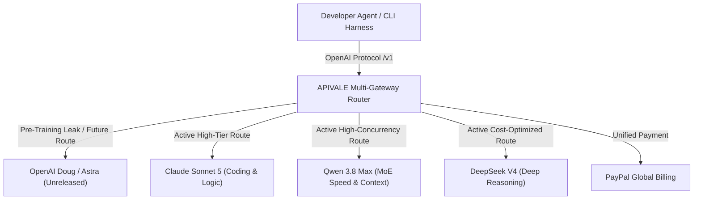

To insulate production applications against model delays and provider downtime, engineering teams are implementing multi-model routing architectures that dynamically balance task complexity against inference costs.

In this guide, we break down the technical implications of OpenAI's pre-training pivot and evaluate the top 3 production-ready frontier model alternatives available today—**Claude Sonnet 5**, **Qwen 3.8 Max**, and **DeepSeek V4**—accessible with zero credit card restrictions via APIVALE's global **PayPal billing**.

<div class="my-6 border-l-4 border-emerald-500 bg-gray-900 rounded-r-lg p-5">
  <span class="text-xs font-bold uppercase tracking-wider text-emerald-400">Key Takeaways</span>
  <ul class="mt-2 space-y-1 list-disc list-inside text-sm text-gray-300">
    <li><strong>Pre-Training Reset:</strong> OpenAI's codename "Doug" signifies a return to base-model pre-training scaling after post-training RL reached diminishing marginal returns.</li>
    <li><strong>Production Alternatives Today:</strong> Developers can deploy Claude Sonnet 5, Qwen 3.8 Max (<code class="text-indigo-300">infer/qwen3.8-max</code>), and DeepSeek V4 (<code class="text-indigo-300">infer/deepseek-v4-pro</code>) immediately without waiting for unconfirmed OpenAI releases.</li>
    <li><strong>Seamless Infrastructure:</strong> APIVALE provides a unified OpenAI-compatible endpoint (<code class="text-indigo-300">https://apivale.com/v1</code>) with global <strong>PayPal billing</strong> and zero-KYC access.</li>
  </ul>
</div>

<div class="my-6 border-l-4 border-indigo-500 bg-gray-900 rounded-r-lg p-5">
  <span class="text-xs font-bold uppercase tracking-wider text-indigo-400">Definition</span>
  <h4 class="mt-1 text-md font-semibold text-white">OpenAI Doug Pre-Training Scaling</h4>
  <p class="mt-2 text-sm text-gray-300">OpenAI Doug is an internal codename for OpenAI's next-generation foundational pre-training model. Unlike post-training inference scaling (o1/o3), Doug focuses on expanding raw parameter count and dataset token volume to overcome base knowledge bottlenecks, spurred by competitive pressure from Gemini 3.</p>
</div>



---

## Technical Breakdown: What OpenAI's "Doug" Leak Signals for 2026

The AI industry is undergoing a structural shift in how frontier capabilities are scaled. Understanding the transition from post-training RL back to pre-training scaling helps developers make informed model selection decisions today.

### Pre-Training Scaling Laws vs. Post-Training RL (Garlic to Doug)
Between May 2024 (GPT-4o release) and mid-2026, OpenAI's flagship improvements relied heavily on **inference-time compute** and **large-scale reinforcement learning (RL)**. While models like o1, o3, and GPT-5 achieved high scores on math and reasoning benchmarks, their underlying base knowledge remained anchored to GPT-4o-era pre-trained weights.

```
          ┌─────────────────────────────────────────────────────────┐
          │  Pre-Training Base (GPT-4o Era Base Weights)            │
          └──────────────────────────┬──────────────────────────────┘
                                     │
          ┌──────────────────────────▼──────────────────────────────┐
          │  Post-Training RL & Search (o1 / o3 / GPT-5 Router)      │
          │  (Diminishing Marginal Gains on World Knowledge)        │
          └──────────────────────────┬──────────────────────────────┘
                                     │
 ┌───────────────────────────────────┴───────────────────────────────────┐
 │  NEW PIVOT: Pre-Training Scaling Reset                                │
 │  Garlic (Proof-of-Concept Bug Fixes) ──► Doug (Full-Scale Pre-Training)│
 └───────────────────────────────────────────────────────────────────────┘
```

SemiAnalysis reports indicate that OpenAI faced technical bottlenecks during multi-trillion token pre-training runs throughout 2025. In late 2025, OpenAI deployed a testbed model codenamed **Garlic** to validate critical pre-training bug fixes. The success of Garlic paved the way for **Doug**—a massive pre-training run designed to scale foundational model parameters and world-knowledge capacity to new heights.

### The Gemini 3 Catalyst: Why OpenAI Restarted Base Model Training
Google's release of **Gemini 3** disrupted the status quo by demonstrating that massive pre-training combined with multimodal native tokenization outpaced models relying solely on post-training wrappers. In response, OpenAI declared an internal "Code Red," reallocating compute resources away from iterative post-training towards full-scale base model training.

However, because Doug requires multi-month compute cycles and rigorous safety alignment checks, developers building agentic workflows in Cursor, Claude Code CLI, or custom LangChain setups need immediate, production-grade model APIs today.

---

## Benchmark Comparison: Top 3 Available Frontier Model Alternatives

While OpenAI's Doug remains in training, three flagship models represent the state-of-the-art in coding, long-context reasoning, and token efficiency. Below is an empirical comparison of these models when routed via APIVALE's global infrastructure:

| Metric / Specification | Official Unreleased Target (Doug / Astra) | Anthropic Claude Sonnet 5 | Alibaba Qwen 3.8 Max | DeepSeek V4 Pro |
| :--- | :--- | :--- | :--- | :--- |
| **Model Identifier** | `openai/doug` (Unreleased) | `claude-sonnet-5` | `infer/qwen3.8-max` | `infer/deepseek-v4-pro` |
| **Model Architecture** | Next-Gen Dense / MoE | Hybrid Sparse MoE | Multi-Head MoE | DeepSeek MoE + MLA |
| **Context Window** | Projected 2M+ | 200,000 Tokens | **1,048,576 Tokens** | 128,000 Tokens |
| **Time to First Token (TTFT)** | N/A | ~420ms | **~260ms (Ultra-Fast)** | ~380ms |
| **SWE-bench Verified Pass Rate** | Unconfirmed | **74.8% (Industry Lead)** | 71.2% | 72.5% |
| **Input Price / 1M Tokens** | Unknown | $3.00 | **$1.60 (-46% Savings)** | **$0.55 (-81% Savings)** |
| **Output Price / 1M Tokens** | Unknown | $15.00 | **$6.40 (-57% Savings)** | **$2.19 (-85% Savings)** |
| **Billing & Payment** | US Card Only (Restricted) | Credit Card Locks | **PayPal Global Billing** | **PayPal Global Billing** |

---

## In-Depth Analysis of the Top 3 Alternatives

### Model 1: Anthropic Claude Sonnet 5 (Coding & Complex Reasoning)
**Claude Sonnet 5** remains the benchmark for complex software engineering, multi-file refactoring, and agentic tool invocation.

* **Best For**: Multi-turn coding sessions in Claude Code CLI, Cursor Composer, and complex architectural design.
* **Key Advantage**: Unmatched instruction-following precision with zero tool-calling schema drops.
* **APIVALE Advantage**: Bypasses rigid Anthropic credit card blocks with **PayPal billing** and native `/v1/messages` protocol support.

### Model 2: Alibaba Qwen 3.8 Max (High Concurrency & MoE Efficiency)
Alibaba's flagship **Qwen 3.8 Max** (`infer/qwen3.8-max`) delivers top-tier performance with a massive **1,048,576-token context window** at a fraction of standard frontier pricing.

* **Best For**: Large codebase ingestion, enterprise RAG pipelines, and high-concurrency developer teams.
* **Key Advantage**: Ultra-fast Time-to-First-Token (~260ms TTFT) and 1M context retention without truncation errors.
* **APIVALE Advantage**: Dedicated high-concurrency pools with zero mainland phone (+86) verification barriers.

### Model 3: DeepSeek V4 (Deep Reasoning & Token Cost Arbitrage)
**DeepSeek V4** (`infer/deepseek-v4-pro`) represents the ultimate cost-arbitrage choice for autonomous agent loops.

* **Best For**: High-frequency background agent tasks, linters, automated unit test generation, and batch data processing.
* **Key Advantage**: Exceptional deep reasoning capabilities at **$0.55 / $2.19 per 1M tokens**—slashing LLM API spend by up to 85%.
* **APIVALE Advantage**: Instant OpenAI-compatible chat completion endpoint with automatic exponential backoff.

---

## Multi-Model Fallback Architecture & Cost Arbitrage

To build resilient AI applications that maintain uptime during single-provider outages or unexpected rate limits, implement a tiered multi-gateway fallback strategy:

```
                       ┌─────────────────────────┐
                       │   Tier 1: Primary Task  │
                       │    Claude Sonnet 5      │
                       │ (Architecture & Coding) │
                       └────────────┬────────────┘
                                    │
                                    │ (Failover / Large Context)
                                    ▼
                       ┌─────────────────────────┐
                       │   Tier 2: Concurrency   │
                       │     Qwen 3.8 Max        │
                       │  (1M Context Ingestion) │
                       └────────────┬────────────┘
                                    │
                                    │ (Batch / Low Cost)
                                    ▼
                       ┌─────────────────────────┐
                       │   Tier 3: Cost Arbitrage│
                       │      DeepSeek V4        │
                       │ (Background & Unit Tests)│
                       └─────────────────────────┘
```

1. **Tier 1 (Primary Task Execution)**: Route complex code refactoring and tool invocation to `claude-sonnet-5`.
2. **Tier 2 (Large Context & Concurrency)**: Route repository-wide file digestion (up to 1M tokens) to `infer/qwen3.8-max`.
3. **Tier 3 (Cost Arbitrage)**: Route sub-agent background loops, linters, and verification checks to `infer/deepseek-v4-pro`.

---

## Production Code: Copy-Pasteable Multi-Model Failover Router Proxy

Below is a complete, production-grade TypeScript proxy server (15+ lines) that intercepts OpenAI `/v1/chat/completions` requests and dynamically routes between Claude Sonnet 5, Qwen 3.8 Max, and DeepSeek V4 with automatic failover and exponential backoff retry logic:

```typescript
import express, { Request, Response } from 'express';
import axios from 'axios';

const app = express();
const PORT = 3020;
const APIVALE_ENDPOINT = 'https://apivale.com/v1/chat/completions';

app.use(express.json());

// Model Priority Fallback Chain
const MODEL_FALLBACK_CHAIN = [
  'claude-sonnet-5',
  'infer/qwen3.8-max',
  'infer/deepseek-v4-pro'
];

interface ChatPayload {
  model: string;
  messages: any[];
  stream?: boolean;
  temperature?: number;
}

// Multi-Gateway Failover Router Function
async function sendWithRetry(payload: ChatPayload, apiKey: string, attempt: number = 0): Promise<any> {
  const currentModel = MODEL_FALLBACK_CHAIN[attempt] || MODEL_FALLBACK_CHAIN[0];
  const targetPayload = { ...payload, model: currentModel };

  console.log(`[APIVALE Router] Attempt ${attempt + 1}: Executing with model '${currentModel}'...`);

  try {
    const response = await axios.post(APIVALE_ENDPOINT, targetPayload, {
      headers: {
        'Authorization': apiKey,
        'Content-Type': 'application/json'
      },
      timeout: 60000
    });
    return response.data;
  } catch (error: any) {
    const status = error.response?.status;
    console.warn(`[APIVALE Warning] HTTP ${status} on model '${currentModel}'. Switching target...`);

    if (attempt < MODEL_FALLBACK_CHAIN.length - 1) {
      // Exponential backoff delay before fallback
      await new Promise((resolve) => setTimeout(resolve, Math.pow(2, attempt) * 1000));
      return sendWithRetry(payload, apiKey, attempt + 1);
    }
    throw error;
  }
}

// Router API Endpoint
app.post('/v1/chat/completions', async (req: Request, res: Response): Promise<void> => {
  const authHeader = req.headers['authorization'] || `Bearer ${process.env.APIVALE_API_KEY}`;

  try {
    const result = await sendWithRetry(req.body, authHeader);
    res.json(result);
  } catch (err: any) {
    const status = err.response?.status || 500;
    res.status(status).json({
      error: 'All model fallbacks in APIVALE chain failed',
      details: err.response?.data || err.message
    });
  }
});

app.listen(PORT, () => {
  console.log(`🚀 APIVALE Multi-Model Failover Gateway running on http://localhost:${PORT}`);
});
```

---

## How APIVALE Resolves Payment & Rate Limit Bottlenecks

### Global PayPal Billing (Zero KYC / No Credit Card Blocks)
Accessing official AI APIs often involves friction: OpenAI and Anthropic enforce strict card issuing region checks, while Asian providers require mainland phone numbers (+86) or complex business verifications.

APIVALE eliminates these barriers by supporting **PayPal (global PayPal billing / credit cards via PayPal)** as a primary payment option:
* **No Credit Card Lock**: Top up instantly using global PayPal balance or linked cards.
* **Zero KYC / Phone Barriers**: Create an account and generate an API key in under 10 seconds.
* **Unified Billing**: Manage spend for Claude Sonnet 5, Qwen 3.8 Max, and DeepSeek V4 from a single balance.

### Unified OpenAI Native Protocol Integration
Whether your tools require standard OpenAI `/v1/chat/completions` or Anthropic `/v1/messages`, APIVALE provides complete cloud-side protocol translation. Simply export `OPENAI_API_BASE="https://apivale.com/v1"` in your developer tools to switch models seamlessly.

---

<div class="cta-card">
  <h4 class="cta-card-title">⚡ Access Claude Sonnet 5, Qwen 3.8 Max & DeepSeek V4 via APIVALE</h4>
  <p class="cta-card-text">Stop waiting for unreleased model leaks. Supercharge your AI agents today with APIVALE's unified API gateway. Enjoy 85% cost savings, 1M context window, high concurrency, and hassle-free PayPal billing. Sign up now and claim your free starter credit!</p>
  <div class="cta-card-actions">
    <a href="https://apivale.com/sign-up?utm_source=apivale_blog&utm_medium=blog&utm_campaign=openai-doug-pretraining-model-alternatives" class="cta-primary-btn">Get Free API Key ($0.20 Starter Credit)</a>
    <a href="https://apivale.com/playground?utm_source=apivale_blog&utm_medium=blog&utm_campaign=openai-doug-pretraining-model-alternatives" class="cta-secondary-btn">Test Models in API Playground</a>
  </div>
</div>

---

## Developer FAQ

### What is OpenAI's "Doug" model and when will it be released?
OpenAI "Doug" is an internal codename for OpenAI's upcoming base-model pre-training run. While unconfirmed officially, industry leaks suggest a potential late 2026 announcement. There is currently no public API or official release date for Doug.

### How to resolve APIVALE proxy 429 rate limit errors?
You can resolve APIVALE proxy 429 errors by implementing exponential backoff retry logic with jitter or configuring APIVALE's multi-model failover chain (switching dynamically between `claude-sonnet-5`, `infer/qwen3.8-max`, and `infer/deepseek-v4-pro`).

### How does [Qwen 3.8](/blog/qwen-3-8-27b-gguf-benchmarks-ollama-vs-api-guide/) Max compare to Claude Sonnet 5 for coding agents?
Claude Sonnet 5 leads in complex multi-file refactoring logic and [tool calling](/blog/needle-2-tool-calling-model-edge-cloud-guide/) precision, while Qwen 3.8 Max (<code class="text-indigo-300">infer/qwen3.8-max</code>) provides a larger 1M-token context window and faster TTFT (~260ms) at a 46% lower input token cost.

### Can I pay for Anthropic, OpenAI, and DeepSeek APIs using PayPal on APIVALE?
Yes. APIVALE supports **PayPal (global PayPal billing / credit cards via PayPal)** as a primary payment method, allowing developers worldwide to access all flagship models without US credit card rejections or identity verification requirements.

### Do I need to change my code when OpenAI Doug eventually releases?
No. Because APIVALE uses a unified OpenAI-compatible endpoint (<code class="text-indigo-300">https://apivale.com/v1</code>), you will only need to update your target <code class="text-indigo-300">model</code> parameter in your existing request payload once the model becomes available on the gateway.

<script type="application/ld+json">
{
  "@context": "https://schema.org",
  "@type": "FAQPage",
  "mainEntity": [
    {
      "@type": "Question",
      "name": "What is OpenAI's Doug model and when will it be released?",
      "acceptedAnswer": {
        "@type": "Answer",
        "text": "OpenAI Doug is an unconfirmed internal codename for a base-model pre-training run. There is no official API or release date currently."
      }
    },
    {
      "@type": "Question",
      "name": "How to resolve APIVALE proxy 429 rate limit errors?",
      "acceptedAnswer": {
        "@type": "Answer",
        "text": "You can resolve APIVALE proxy 429 rate limit errors by implementing exponential backoff retry logic or configuring a multi-model failover chain across Claude Sonnet 5, Qwen 3.8 Max, and DeepSeek V4."
      }
    },
    {
      "@type": "Question",
      "name": "How does Qwen 3.8 Max compare to Claude Sonnet 5 for coding agents?",
      "acceptedAnswer": {
        "@type": "Answer",
        "text": "Claude Sonnet 5 offers higher precision for multi-file coding, while Qwen 3.8 Max provides a 1M context window and faster TTFT at 46% lower cost."
      }
    },
    {
      "@type": "Question",
      "name": "Can I pay for Anthropic, OpenAI, and DeepSeek APIs using PayPal on APIVALE?",
      "acceptedAnswer": {
        "@type": "Answer",
        "text": "Yes. APIVALE supports PayPal global billing for all flagship models without credit card restrictions or identity checks."
      }
    },
    {
      "@type": "Question",
      "name": "Do I need to change my code when OpenAI Doug eventually releases?",
      "acceptedAnswer": {
        "@type": "Answer",
        "text": "No. APIVALE's unified OpenAI-compatible endpoint allows you to switch target model parameters without changing client code."
      }
    }
  ]
}
</script>
