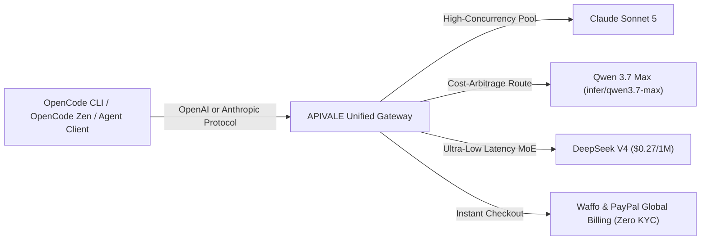

<div class="my-6 border-l-4 border-emerald-500 bg-gray-900 rounded-r-lg p-5">
  <span class="text-xs font-bold uppercase tracking-wider text-emerald-400">Key Takeaways</span>
  <ul class="mt-2 space-y-1 list-disc list-inside text-sm text-gray-300">
    <li><strong>Frictionless OpenCode PayPal & Waffo Settlement:</strong> Eliminate overseas credit card declines, +86 phone verifications, and KYC blocks by funding OpenCode Zen and OpenCode Go keys via Waffo Global Billing and PayPal.</li>
    <li><strong>Overcoming OpenCode Go & Zen Limits:</strong> Replace fixed tier caps and 5-hour rate-limit throttling with unthrottled APIVALE proxy endpoints for <strong>Claude Sonnet 5</strong>, <strong>Qwen 3.7 Max</strong> (<code>infer/qwen3.7-max</code>), and <strong>DeepSeek V4</strong>.</li>
    <li><strong>85% Token Cost Arbitrage:</strong> Routing OpenCode CLI, OpenCode Zen, and agentic loop requests to APIVALE slashes blended per-token expenses down to $0.27/$0.60 per 1M tokens.</li>
    <li><strong>Dual OpenAI & Anthropic Protocol Native:</strong> 1-line environment variable swap bridges OpenCode CLI with zero schema translation errors.</li>
  </ul>
</div>

<div class="my-4 border-l-4 border-cyan-500 bg-gray-900/90 rounded-r-lg p-4">
  <span class="text-xs font-bold uppercase tracking-wider text-cyan-400">Related OpenCode & Agent Setup Guides</span>
  <p class="mt-1 text-sm text-gray-300">
    Looking to optimize your agent stack? Read our guide on <a href="/blog/how-to-reduce-opencode-token-costs/" class="text-cyan-400 hover:underline font-semibold">slashing OpenCode token costs by 85%</a>, explore <a href="/blog/openrouter-alternatives/" class="text-cyan-400 hover:underline font-semibold">top OpenRouter alternatives with PayPal support</a>, or follow our walkthrough for <a href="/blog/ox-alpha-claude-code-cursor-setup/" class="text-cyan-400 hover:underline font-semibold">Ox Alpha in Claude Code & Cursor</a>.
  </p>
</div>

<div id="single-url-interactive-banner" class="my-6 border border-indigo-500/30 bg-gradient-to-r from-indigo-950/40 via-purple-950/20 to-gray-900 rounded-xl p-6 shadow-xl">
  <div class="flex items-center justify-between flex-wrap gap-3 mb-3">
    <span class="inline-flex items-center text-xs font-bold uppercase tracking-wider text-cyan-400 bg-cyan-950/60 border border-cyan-800/50 px-3 py-1 rounded-full">
      ⚡ Single-URL Interactive Feature
    </span>
    <span id="user-auth-status-badge" class="text-xs text-gray-400 bg-gray-800 px-3 py-1 rounded-full">
      Guest View (Default Template)
    </span>
  </div>
  <p id="user-auth-status-desc" class="text-sm text-gray-300 mb-4 leading-relaxed">
    Sign up for a free APIVALE account to claim <strong>$0.20 free starter credit</strong>. Your personal API key will automatically fill into setup commands below!
  </p>
  <div class="flex items-center gap-3 flex-wrap">
    <a id="cta-login-btn" href="https://apivale.com/sign-up?redirect=/blog/opencode-paypal-billing-api-proxy-guide/" class="inline-flex items-center text-xs font-semibold bg-indigo-600 hover:bg-indigo-500 text-white px-4 py-2.5 rounded-lg transition-all shadow-md">
      ⚡ Sign Up / Log In to Auto-Fill Your API Key
    </a>
    <button id="copy-script-btn" onclick="navigator.clipboard.writeText('OPENAI_BASE_URL=https://api.apivale.com/v1\nOPENAI_API_KEY=your_apivale_api_key'); alert('Copied OpenCode config parameters!');" class="inline-flex items-center text-xs font-semibold bg-gray-800 hover:bg-gray-700 text-gray-200 border border-gray-700 px-4 py-2.5 rounded-lg transition-all">
      📋 Copy OpenCode Config
    </button>
  </div>
</div>

Developer adoption of open-source coding agents and terminal tools like **OpenCode** (`opencode.ai`), **OpenCodeX**, and local AI client interfaces has grown exponentially. However, international engineers frequently run into severe payment walls: official billing portals routinely reject non-US credit cards, trigger automated fraud locks on foreign billing addresses, or demand local identity verifications.

As highlighted in developer forums across Reddit (`r/LocalLLaMA`, `r/OpenCode`), engineers seeking to top up credits for **OpenCode Go** and **OpenCode Zen** or self-hosted coding setups regularly search for **OpenCode PayPal billing solutions**.

By configuring APIVALE as a unified proxy layer, developers can fund their OpenCode Zen pipelines via **Waffo Global Billing and PayPal**, bypassing card blocks while unlocking wholesale token rates across flagship models including **Claude Sonnet 5**, **Qwen 3.7 Max**, and **DeepSeek V4**.



---

## 1. Why Developers Search for OpenCode PayPal Billing (Reddit & Community Pain Points)

Developers interacting with frontier agentic coding tools face three primary friction points when managing billing and quota limits:

### 1. The Overseas Payment & Fraud Filter Problem
Official AI billing portals and Stripe-gated endpoints enforce strict automated fraud rules that flag cross-border card payments from Asia, Latin America, and Eastern Europe. Developers attempting to fund **OpenCode Zen** or purchase model credits frequently experience `Card Declined: 3D Secure Verification Failed` errors.

### 2. High Context Token Depletion in Agentic Loops
Autonomous coding agents do not execute single-turn queries. In OpenCode CLI and OpenCode Zen agent modes, a single debugging session recursively reads the file tree, parses AST schemas, analyzes compiler outputs, and inspects git diffs. A 10-turn refactoring loop can consume 4.5 million tokens—quickly burning through fixed monthly quotas.

### 3. Identity Verification & Phone Number Hurdles
Certain regional model providers (e.g. Zhipu GLM, Moonshot Kimi) require mandatory +86 mainland SMS verification or domestic business licenses, blocking global developers from accessing frontier coding weights directly.

APIVALE eliminates these obstacles by providing a frictionless **Waffo Global Billing checkout** compatible with international cards, digital wallets, and PayPal with zero KYC prerequisites.

---

## 2. OpenCode Go vs. OpenCode Zen: Pricing, Limits & Token Usage Math

Understanding the OpenCode ecosystem requires analyzing the difference between **OpenCode Go** (the entry tier), **OpenCode Zen** (the extended inference service), and custom API proxy gateways:

| Parameter / Feature | OpenCode Go (Official) | OpenCode Zen (Official Tier) | APIVALE Gateway Proxy Pool |
| :--- | :--- | :--- | :--- |
| **Payment Options** | Stripe / US Cards Only | Stripe / Fixed Monthly Sub | **Waffo Global Billing (Cards, Wallets, PayPal)** |
| **Identity Verification** | Standard KYC / Phone | Standard KYC | **Zero KYC / Instant GitHub Sign-Up** |
| **Concurrency & TPM Cap** | Strict Daily TPM / RPM Caps | Tier-based Session Limits | **Shared High-Concurrency Pool (500+ RPM)** |
| **Supported Models** | Limited Curated Models | Extended Model Catalog | **Claude Sonnet 5, Qwen 3.7 Max, DeepSeek V4** |
| **Prompt Caching Discount**| N/A | Variable | **Up to 90% Cache Hit Discount** |
| **Pricing Structure** | Subscription | Fixed Credit Packs | **Pay-As-You-Go ($0.27/1M Blended)** |

### Overcoming OpenCode Go & Zen Limits
When running OpenCode Go, developers frequently hit daily request limits during continuous integration (CI) test runs. By pointing OpenCode CLI to `https://api.apivale.com/v1`, requests are routed dynamically across high-concurrency provider pools, eliminating 5-hour cooldown lockout walls.

---

## 3. Interactive OpenCode Zen & Go Token Calculator

Use this interactive simulator to calculate your monthly token usage, estimate official overage charges, and verify cost savings by routing OpenCode through APIVALE:

<div class="opencode-calc-widget">
  <form id="opencode-calc-form" onsubmit="return false;">
    <div class="widget-header">
      <span class="widget-badge">Interactive CRO Simulator</span>
      <div class="text-xl font-bold text-white mt-1">OpenCode Zen & Go Cost Calculator</div>
      <p class="widget-subtitle">Estimate token burn, rate-limit cooldown risks, and net savings via APIVALE Waffo gateway</p>
    </div>
    <div class="widget-grid">
      <div class="calculator-inputs">
        <div class="calc-input-group">
          <label for="opencode-calc-model">Primary Model Engine</label>
          <div class="select-wrapper">
            <select id="opencode-calc-model">
              <option value="deepseek" selected>DeepSeek V4 ($0.27/1M) - Max Efficiency</option>
              <option value="qwen">Qwen 3.7 Max ($0.60/1M) - High SWE Accuracy</option>
              <option value="claude">Claude Sonnet 5 ($2.80/1M) - Flagship Reasoning</option>
            </select>
          </div>
        </div>
        <div class="calc-input-group">
          <div class="slider-label-row">
            <label for="opencode-hours-slider">Daily Coding / Agent Hours</label>
            <div class="input-with-unit">
              <input type="number" id="opencode-hours-num" min="1" max="16" value="6" class="custom-number-input" />
              <span class="unit-text">hrs / day</span>
            </div>
          </div>
          <input type="range" id="opencode-hours-slider" min="1" max="16" value="6" class="custom-slider" />
        </div>
        <div class="calc-input-group">
          <label for="opencode-intensity-select">Agent Context & Loop Depth</label>
          <div class="select-wrapper">
            <select id="opencode-intensity-select">
              <option value="1">Light (Single-file edits & quick scripts - ~3M tokens/mo)</option>
              <option value="2.5" selected>Standard (OpenCode Zen & CLI loops - ~18M tokens/mo)</option>
              <option value="5">Heavy (Full-repo refactoring & autonomous loops - ~40M tokens/mo)</option>
            </select>
          </div>
        </div>
      </div>
      <div class="calculator-results">
        <div class="cost-row">
          <div class="cost-label">Official Rate-Limit Risk</div>
          <div class="cost-value cooldown-warning" id="opencode-lockout-val">~9 Cooldown Locks</div>
        </div>
        <div class="cost-row">
          <div class="cost-label">Official Sub + Overage Spend</div>
          <div class="cost-value direct-cost" id="opencode-direct-cost-val">$85.00</div>
        </div>
        <div class="cost-row">
          <div class="cost-label">APIVALE Gateway Cost</div>
          <div class="cost-value apivale-cost" id="opencode-apivale-cost-val">$12.15</div>
        </div>
        <div class="savings-card">
          <div class="savings-percentage-row">
            <span class="savings-badge">Estimated Savings</span>
            <span class="savings-percentage" id="opencode-savings-pct">85.7%</span>
          </div>
          <div class="savings-amount" id="opencode-savings-amt">$72.85 / mo</div>
          <p class="savings-note">⚡ 0 Rate-Limit Locks. Instant Waffo & PayPal checkout with zero card decline barriers.</p>
          <a href="https://apivale.com/sign-up?utm_source=apivale_blog&utm_medium=blog&utm_campaign=opencode-paypal-calc" class="calc-cta-btn">Claim Free $0.20 Starter Credit (+ 50% Bonus)</a>
        </div>
      </div>
    </div>
  </form>
</div>

<style>
.opencode-calc-widget {
  background: rgba(15, 23, 42, 0.85);
  backdrop-filter: blur(12px);
  border: 1px solid rgba(16, 185, 129, 0.25);
  border-radius: 16px;
  padding: 24px;
  margin: 32px 0;
  color: #f1f5f9;
  box-shadow: 0 10px 30px -10px rgba(0, 0, 0, 0.5);
}
.opencode-calc-widget .widget-badge {
  background: linear-gradient(135deg, #10b981 0%, #059669 100%);
  color: #ffffff;
  font-size: 0.7rem;
  font-weight: 700;
  text-transform: uppercase;
  letter-spacing: 0.05em;
  padding: 4px 10px;
  border-radius: 20px;
  display: inline-block;
  margin-bottom: 6px;
}
.opencode-calc-widget .widget-subtitle {
  font-size: 0.85rem;
  color: #94a3b8;
  margin: 4px 0 0 0;
  line-height: 1.4;
}
.opencode-calc-widget .widget-grid {
  display: grid;
  grid-template-columns: 1.2fr 1fr;
  gap: 28px;
  margin-top: 20px;
}
@media (max-width: 768px) {
  .opencode-calc-widget .widget-grid {
    grid-template-columns: 1fr;
    gap: 24px;
  }
}
.opencode-calc-widget .calculator-inputs {
  display: flex;
  flex-direction: column;
  gap: 18px;
  justify-content: center;
}
.opencode-calc-widget .calc-input-group {
  display: flex;
  flex-direction: column;
  gap: 6px;
}
.opencode-calc-widget .calc-input-group label {
  font-size: 0.85rem;
  font-weight: 600;
  color: #cbd5e1;
}
.opencode-calc-widget .select-wrapper {
  position: relative;
  width: 100%;
}
.opencode-calc-widget .select-wrapper select {
  width: 100%;
  background: #1e293b;
  border: 1px solid rgba(255, 255, 255, 0.15);
  border-radius: 8px;
  padding: 9px 32px 9px 14px;
  color: #ffffff;
  font-size: 0.85rem;
  appearance: none;
  cursor: pointer;
  outline: none;
  transition: border-color 0.2s;
}
.opencode-calc-widget .select-wrapper select:focus {
  border-color: #10b981;
}
.opencode-calc-widget .select-wrapper::after {
  content: '▼';
  font-size: 0.65rem;
  color: #94a3b8;
  position: absolute;
  right: 14px;
  top: 50%;
  transform: translateY(-50%);
  pointer-events: none;
}
.opencode-calc-widget .slider-label-row {
  display: flex;
  justify-content: space-between;
  align-items: center;
}
.opencode-calc-widget .input-with-unit {
  display: flex;
  align-items: center;
  background: #1e293b;
  border: 1px solid rgba(255, 255, 255, 0.15);
  border-radius: 6px;
  padding: 2px 8px;
}
.opencode-calc-widget .custom-number-input {
  background: transparent;
  border: none;
  color: #10b981;
  font-family: inherit;
  font-size: 0.85rem;
  font-weight: 700;
  width: 32px;
  text-align: right;
  outline: none;
  margin-right: 4px;
}
.opencode-calc-widget .unit-text {
  font-size: 0.8rem;
  color: #10b981;
  font-weight: 700;
}
.opencode-calc-widget .custom-slider {
  -webkit-appearance: none;
  width: 100%;
  height: 6px;
  border-radius: 3px;
  background: #1e293b;
  outline: none;
  margin: 6px 0;
}
.opencode-calc-widget .custom-slider::-webkit-slider-thumb {
  -webkit-appearance: none;
  appearance: none;
  width: 18px;
  height: 18px;
  border-radius: 50%;
  background: #10b981;
  cursor: pointer;
  border: 2px solid #ffffff;
  box-shadow: 0 0 8px rgba(16, 185, 129, 0.4);
  transition: transform 0.1s, background-color 0.2s;
}
.opencode-calc-widget .custom-slider::-webkit-slider-thumb:hover {
  transform: scale(1.2);
  background: #059669;
}
.opencode-calc-widget .calculator-results {
  background: rgba(15, 23, 42, 0.5);
  border: 1px solid rgba(255, 255, 255, 0.08);
  border-radius: 12px;
  padding: 18px;
  display: flex;
  flex-direction: column;
  gap: 12px;
}
.opencode-calc-widget .cost-row {
  display: flex;
  justify-content: space-between;
  align-items: center;
  border-bottom: 1px dashed rgba(255, 255, 255, 0.08);
  padding-bottom: 6px;
}
.opencode-calc-widget .cost-label {
  font-size: 0.8rem;
  color: #94a3b8;
}
.opencode-calc-widget .cost-value {
  font-size: 1rem;
  font-weight: 600;
}
.opencode-calc-widget .cooldown-warning {
  color: #fbbf24;
  font-weight: 700;
}
.opencode-calc-widget .direct-cost {
  color: #f43f5e;
}
.opencode-calc-widget .apivale-cost {
  color: #34d399;
  font-weight: 700;
}
.opencode-calc-widget .savings-card {
  background: linear-gradient(135deg, rgba(16, 185, 129, 0.15) 0%, rgba(5, 150, 105, 0.05) 100%);
  border: 1px solid rgba(16, 185, 129, 0.35);
  border-radius: 10px;
  padding: 14px;
  text-align: center;
}
.opencode-calc-widget .savings-percentage-row {
  display: flex;
  justify-content: center;
  align-items: center;
  gap: 8px;
  margin-bottom: 4px;
}
.opencode-calc-widget .savings-badge {
  background: #10b981;
  color: #ffffff;
  font-size: 0.65rem;
  font-weight: 800;
  text-transform: uppercase;
  padding: 2px 6px;
  border-radius: 4px;
}
.opencode-calc-widget .savings-percentage {
  font-size: 1.3rem;
  font-weight: 800;
  color: #34d399;
}
.opencode-calc-widget .savings-amount {
  font-size: 1.1rem;
  font-weight: 700;
  color: #ffffff;
  margin-bottom: 6px;
}
.opencode-calc-widget .savings-note {
  font-size: 0.75rem;
  color: #94a3b8;
  margin: 0 0 12px 0;
  line-height: 1.3;
}
.opencode-calc-widget .calc-cta-btn {
  display: block;
  background: linear-gradient(135deg, #10b981 0%, #059669 100%);
  color: #ffffff;
  font-size: 0.85rem;
  font-weight: 700;
  text-decoration: none;
  padding: 10px 14px;
  border-radius: 8px;
  transition: all 0.2s;
  box-shadow: 0 4px 12px rgba(16, 185, 129, 0.3);
}
.opencode-calc-widget .calc-cta-btn:hover {
  transform: translateY(-1px);
  box-shadow: 0 6px 16px rgba(16, 185, 129, 0.4);
  color: #ffffff;
}
</style>

<script>
(function() {
  function initOpenCodeCalc() {
    const hoursSlider = document.getElementById('opencode-hours-slider');
    const hoursNum = document.getElementById('opencode-hours-num');
    const modelSelect = document.getElementById('opencode-calc-model');
    const intensitySelect = document.getElementById('opencode-intensity-select');
    const lockoutEl = document.getElementById('opencode-lockout-val');
    const directCostEl = document.getElementById('opencode-direct-cost-val');
    const apivaleCostEl = document.getElementById('opencode-apivale-cost-val');
    const savingsPctEl = document.getElementById('opencode-savings-pct');
    const savingsAmtEl = document.getElementById('opencode-savings-amt');

    if (!hoursSlider || !hoursNum || !modelSelect || !intensitySelect) return;

    // Rates per 1M blended tokens (Input 80%, Output 20%)
    const modelRates = {
      deepseek: (0.27 * 0.8) + (1.10 * 0.2), // ~$0.436/1M
      qwen: (0.60 * 0.8) + (2.40 * 0.2),     // ~$0.96/1M
      claude: (2.80 * 0.8) + (14.00 * 0.2)   // ~$5.04/1M
    };

    function recalculate() {
      const hours = parseFloat(hoursSlider.value) || 6;
      const intensity = parseFloat(intensitySelect.value) || 2.5;
      const modelKey = modelSelect.value || 'deepseek';
      const apivaleRate = modelRates[modelKey] || modelRates.deepseek;

      const monthlyTokensM = (hours * intensity * 22 * 0.14);
      const lockouts = Math.round(hours * intensity * 0.60);
      lockoutEl.textContent = `~${lockouts} Cooldown Locks / mo`;

      const officialOverageRate = modelKey === 'claude' ? 8.00 : 3.50;
      const totalDirect = Math.max(20, 20 + (monthlyTokensM * officialOverageRate));
      const totalApivale = Math.max(1, monthlyTokensM * apivaleRate);

      const netSavings = Math.max(0, totalDirect - totalApivale);
      const savingsPct = totalDirect > 0 ? ((netSavings / totalDirect) * 100).toFixed(1) : '0';

      directCostEl.textContent = '$' + totalDirect.toFixed(2);
      apivaleCostEl.textContent = '$' + totalApivale.toFixed(2);
      savingsPctEl.textContent = savingsPct + '%';
      savingsAmtEl.textContent = '$' + netSavings.toFixed(2) + ' / mo';
    }

    hoursSlider.addEventListener('input', function() {
      hoursNum.value = hoursSlider.value;
      recalculate();
    });

    hoursNum.addEventListener('input', function() {
      hoursSlider.value = hoursNum.value;
      recalculate();
    });

    modelSelect.addEventListener('change', recalculate);
    intensitySelect.addEventListener('change', recalculate);
    recalculate();
  }

  if (document.readyState === 'loading') {
    document.addEventListener('DOMContentLoaded', initOpenCodeCalc);
  } else {
    initOpenCodeCalc();
  }
})();
</script>

---

## 4. Step-by-Step: Configure API Proxy for OpenCode CLI & OpenCode Zen

Connecting OpenCode CLI and OpenCode Zen agent workflows to APIVALE requires minimal configuration:

### 1. OpenCode CLI Configuration (Bash / PowerShell)
OpenCode natively supports custom OpenAI-compatible and Anthropic-compatible endpoints. Export the target variables in your active shell:

```bash
# macOS / Linux terminal setup (~/.bashrc or ~/.zshrc)
export OPENAI_BASE_URL="https://api.apivale.com/v1"
export OPENAI_API_KEY="apivale-key-xxxxxxxxxxxxxxxx"
export OPENCODE_MODEL="infer/qwen3.7-max"

# Launch OpenCode with unthrottled concurrency
opencode run
```

For Windows PowerShell developers:
```powershell
$env:OPENAI_BASE_URL="https://api.apivale.com/v1"
$env:OPENAI_API_KEY="apivale-key-xxxxxxxxxxxxxxxx"
$env:OPENCODE_MODEL="infer/qwen3.7-max"
opencode run
```

### 2. Docker & Open WebUI Client Environment Setup
For developers self-hosting local web clients (such as Open WebUI or LibreChat) alongside OpenCode, configure the OpenAI API connection in your `docker-compose.yml`:

```yaml
version: '3.8'
services:
  open-webui:
    image: ghcr.io/open-webui/open-webui:main
    container_name: open-webui
    ports:
      - "3000:8080"
    environment:
      - OPENAI_API_BASE_URL=https://api.apivale.com/v1
      - OPENAI_API_KEY=apivale-key-xxxxxxxxxxxxxxxx
      - WEBUI_AUTH=True
    volumes:
      - open-webui-data:/app/backend/data
    restart: always

volumes:
  open-webui-data:
```

---

## 5. Production Node.js Router with Exponential Backoff & Automatic Failover

For engineering teams running enterprise OpenCode and OpenCode Zen agent clusters, deploy this production Node.js proxy with automated retry logic and multi-model failover:

```typescript
import express, { Request, Response } from 'express';
import axios, { AxiosError } from 'axios';

const app = express();
const PORT = process.env.PORT || 8080;
const APIVALE_GATEWAY = 'https://api.apivale.com/v1';

app.use(express.json({ limit: '50mb' }));

const sleep = (ms: number) => new Promise(resolve => setTimeout(resolve, ms));

app.post('/v1/chat/completions', async (req: Request, res: Response): Promise<void> => {
  const apiKey = req.headers.authorization || `Bearer ${process.env.APIVALE_API_KEY}`;
  const requestedModel = req.body.model || 'infer/qwen3.7-max';
  const isStream = Boolean(req.body.stream);

  console.log(`[OpenCode Proxy] Routing model: ${requestedModel} (Stream: ${isStream})`);

  const maxRetries = 3;
  let attempt = 0;

  while (attempt < maxRetries) {
    try {
      const response = await axios.post(`${APIVALE_GATEWAY}/chat/completions`, req.body, {
        headers: {
          'Authorization': apiKey,
          'Content-Type': 'application/json',
        },
        responseType: isStream ? 'stream' : 'json',
        timeout: 60000,
      });

      if (isStream) {
        res.setHeader('Content-Type', 'text/event-stream');
        res.setHeader('Cache-Control', 'no-cache');
        res.setHeader('Connection', 'keep-alive');
        response.data.pipe(res);
      } else {
        res.status(response.status).json(response.data);
      }
      return;
    } catch (err) {
      attempt++;
      const error = err as AxiosError;
      const status = error.response?.status || 500;

      console.error(`[Proxy Failover] Attempt ${attempt}/${maxRetries} failed with status: ${status}`);

      if ((status === 429 || status >= 500) && attempt < maxRetries) {
        const backoffMs = Math.pow(2, attempt) * 1000 + Math.random() * 500;
        console.log(`[Proxy Retry] Waiting ${backoffMs.toFixed(0)}ms before retrying...`);
        await sleep(backoffMs);
      } else {
        // Fallback model routing if primary fails
        if (req.body.model !== 'deepseek-v4') {
          console.warn('[Proxy Failover] Shifting to deepseek-v4 high-throughput pool...');
          req.body.model = 'deepseek-v4';
          attempt = 0; // Reset retries for fallback route
          continue;
        }

        res.status(status).json(error.response?.data || { error: 'APIVALE Gateway failover failed' });
        return;
      }
    }
  }
});

app.listen(PORT, () => {
  console.log(`🚀 OpenCode & OpenCode Zen Production Proxy listening on port ${PORT}`);
});
```

---

<div class="cta-card">
  <h4 class="cta-card-title">⚡ Power Up OpenCode with APIVALE</h4>
  <p class="cta-card-text">Bypass overseas credit card declines, 5-hour rate limits, and KYC verification blocks. Connect OpenCode CLI, OpenCodeX, and OpenCode Zen workflows to APIVALE's high-concurrency gateway. Access Claude Sonnet 5, Qwen 3.7 Max (<code>infer/qwen3.7-max</code>), and DeepSeek V4 with Waffo Global Billing (Credit Cards, Wallets & PayPal).</p>
  <div class="cta-card-actions">
    <a href="https://apivale.com/sign-up?utm_source=apivale_blog&utm_medium=blog&utm_campaign=opencode-paypal-billing-api-proxy-guide" class="cta-primary-btn">Create Free API Key ($0.20 Credit)</a>
    <a href="https://apivale.com/pricing?utm_source=apivale_blog&utm_medium=blog&utm_campaign=opencode-paypal-billing-api-proxy-guide" class="cta-secondary-btn">View Waffo Global Pricing</a>
  </div>
</div>

---

## Frequently Asked Questions (FAQ)

### Can I use PayPal to top up OpenCode and OpenCode Zen API keys?
Yes. APIVALE natively supports **Waffo Global Billing and PayPal**, allowing developers worldwide to top up OpenCode API credits using international credit cards, digital wallets, and PayPal with zero KYC verifications or regional billing restrictions.

### What is the difference between OpenCode Go and OpenCode Zen?
OpenCode Go is the introductory tier constrained by strict daily token and request caps. OpenCode Zen is the extended inference catalog for agentic workflows. Routing requests through APIVALE allows developers to access the same frontier models (Claude Sonnet 5, Qwen 3.7 Max, DeepSeek V4) with unthrottled concurrency at wholesale pay-as-you-go pricing.

### How do I bypass rate limits in OpenCode using APIVALE?
You can bypass rate limits by pointing your OpenCode client's OpenAI Base URL to `https://api.apivale.com/v1` and supplying your APIVALE API key. APIVALE dynamically balances agent traffic across multiple high-throughput endpoint pools, preventing 429 Too Many Requests lockout errors.

### Does APIVALE support Server-Sent Events (SSE) streaming in OpenCode?
Yes. APIVALE fully supports real-time SSE streaming for smooth typewriter output, reasoning token extraction, and tool-calling execution inside OpenCode CLI and connected agent environments.

<script type="application/ld+json">
{
  "@context": "https://schema.org",
  "@type": "FAQPage",
  "mainEntity": [
    {
      "@type": "Question",
      "name": "Can I use PayPal to top up OpenCode and OpenCode Zen API keys?",
      "acceptedAnswer": {
        "@type": "Answer",
        "text": "Yes. APIVALE natively supports Waffo Global Billing and PayPal, allowing developers worldwide to top up OpenCode API credits using international credit cards, digital wallets, and PayPal with zero KYC verifications or regional billing restrictions."
      }
    },
    {
      "@type": "Question",
      "name": "What is the difference between OpenCode Go and OpenCode Zen?",
      "acceptedAnswer": {
        "@type": "Answer",
        "text": "OpenCode Go is the introductory tier constrained by strict daily token and request caps. OpenCode Zen is the extended inference catalog for agentic workflows. Routing requests through APIVALE allows developers to access the same frontier models with unthrottled concurrency at wholesale pay-as-you-go pricing."
      }
    },
    {
      "@type": "Question",
      "name": "How do I bypass rate limits in OpenCode using APIVALE?",
      "acceptedAnswer": {
        "@type": "Answer",
        "text": "You can bypass rate limits by pointing your OpenCode client's OpenAI Base URL to https://api.apivale.com/v1 and supplying your APIVALE API key. APIVALE dynamically balances agent traffic across multiple high-throughput endpoint pools, preventing 429 Too Many Requests lockout errors."
      }
    },
    {
      "@type": "Question",
      "name": "Does APIVALE support Server-Sent Events (SSE) streaming in OpenCode?",
      "acceptedAnswer": {
        "@type": "Answer",
        "text": "Yes. APIVALE fully supports real-time SSE streaming for smooth typewriter output, reasoning token extraction, and tool-calling execution inside OpenCode CLI and connected agent environments."
      }
    }
  ]
}
</script>
