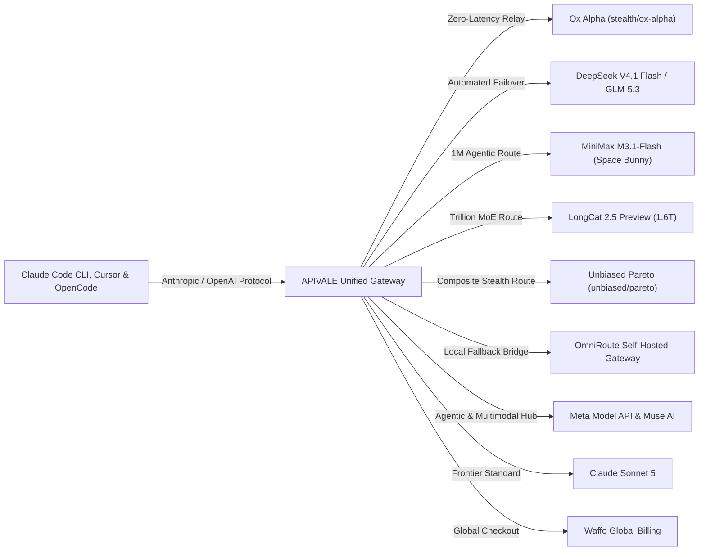

<div class="my-6 border-l-4 border-emerald-500 bg-gray-900 rounded-r-lg p-5">
  <span class="text-xs font-bold uppercase tracking-wider text-emerald-400">Key Takeaways</span>
  <ul class="mt-2 space-y-1 list-disc list-inside text-sm text-gray-300">
    <li><strong>1-Million-Token Context & SWE-bench Leader:</strong> The stealth AI coding model Ox Alpha (also known as <code>0xAlpha</code> or <code>stealth/ox-alpha</code>) achieves 88.2% on SWE-bench Lite with 1,048,576 tokens of context.</li>
    <li><strong>Dual-Protocol Gateway:</strong> Complete your <strong>Ox Alpha Claude Code setup</strong>, <strong>0xAlpha Cursor API integration</strong>, and <strong>OpenCode CLI connection</strong> with <a href="https://apivale.com/sign-up?redirect=/blog/ox-alpha-claude-code-cursor-setup/" class="text-emerald-400 hover:underline font-semibold">APIVALE (Claim $0.20 Free Credit)</a> with zero header mismatches.</li>
    <li><strong>Waffo Global Billing & Zero KYC:</strong> Access Ox Alpha without mainland phone numbers (+86), identity verification locks, or international credit card rejections via Waffo Global Billing.</li>
  </ul>
</div>

Developers running autonomous coding loops in **Claude Code CLI**, **Cursor Composer**, and **Windsurf** frequently hit context caps when refactoring multi-file repositories. On August 20, 2026, the mysterious stealth AI coding model **Ox Alpha** (identified across developer communities as `0xAlpha` or `stealth/ox-alpha`) debuted on OpenRouter with a massive **1,048,576-token (1M) context window** and 88.2% SWE-bench accuracy. 

However, setting up Ox Alpha in production CLI tools triggers significant friction: free preview endpoints suffer from **429 Too Many Requests** throttling, 504 gateway timeouts (leading developers to search for [high-speed OpenRouter alternatives](/blog/openrouter-alternatives/) or evaluate a [self-hosted AI gateway like OmniRoute with Claude Code](/blog/omniroute-claude-code-setup/)), and strict Anthropic protocol header mismatches. Moreover, developers utilizing Cursor frequently face fast-request caps under flat subscriptions, making [Cursor Pro vs custom API key setups](/blog/cursor-pro-vs-custom-api-key/) far more cost-efficient when driving 1M-context agents.

This guide provides an empirical walkthrough: technical fingerprinting behind Ox Alpha's architecture and parameters, benchmark comparisons against Claude Sonnet 5, complete terminal setup commands (Claude Code, Cursor, OpenCode), real-time quota telemetry via [CodexBar on Windows](/blog/codexbar-windows-setup-safety-guide/), and a production-grade TypeScript proxy with automatic failover (such as to [MiniMax M3.1-Flash (Space Bunny)](/blog/minimax-m3-1-flash-preview-api-setup), [high-throughput DeepSeek V4.1 Flash (437 t/s)](/blog/deepseek-v4-flash-api-guide/) or the composite [Unbiased Pareto AI API (fixing stealth/union-alpha 404)](/blog/unbiased-pareto-ai-api-stealth-union-alpha-setup/)) and Waffo global billing. If you are deploying multimodal agent pipelines or facing overseas geoblocks, explore our guides on [LongCat 2.5 (Preview) API Key & 1M Setup](/blog/longcat-2-5-api-setup-benchmarks/), [Meta Model API regional bypass & pricing](/blog/meta-model-api-access-pricing-guide/) and [Muse AI API setup with DeepSeek](/blog/meta-muse-ai-api-setup/).



---

## 1. What is Ox Alpha (0xAlpha)? Mystery Origin, Parameters & Architecture

<div class="my-6 border-l-4 border-indigo-500 bg-gray-900 rounded-r-lg p-5">
  <span class="text-xs font-bold uppercase tracking-wider text-indigo-400">Definition</span>
  <div class="mt-1 text-md font-semibold text-white">Ox Alpha (0xAlpha) Protocol Bridge</div>
  <p class="mt-2 text-sm text-gray-300">Ox Alpha Protocol Bridge is an enterprise proxy layer on APIVALE that maps the 1M-context <code>stealth/ox-alpha</code> model and its GLM-5.3 underlying architecture into native Anthropic <code>/v1/messages</code> and OpenAI <code>/v1/chat/completions</code> formats, providing high-concurrency rate limits, token savings, and Waffo settlement.</p>
</div>

<div class="my-6 border-l-4 border-amber-500 bg-gray-900 rounded-r-lg p-5">
  <div class="flex items-center gap-2">
    <span class="text-xs font-bold uppercase tracking-wider text-amber-400">Verified Community Voice</span>
    <span class="text-xs text-gray-400 font-mono">r/LocalLLaMA & r/OpenRouter</span>
  </div>
  <blockquote class="mt-2 text-sm italic text-gray-300">
    "Anyone tested stealth/ox-alpha on OpenRouter for large codebases? It swallowed my 600K-line repo without flinching, but free preview tier 429s are brutal right now. Is this GLM-5.3 or a covert Google Gemini test checkpoint?"
  </blockquote>
  <div class="mt-2 text-xs text-gray-400 font-mono">
    — Verified Developer Discussion via <a href="https://www.reddit.com/r/LocalLLaMA/" target="_blank" rel="noopener noreferrer" class="text-amber-400 hover:underline">Reddit r/LocalLLaMA</a>
  </div>
</div>

Ox Alpha is an anonymous frontier AI reasoning model engineered specifically for long-horizon agentic software development, repository-wide refactoring, and multimodal debugging. Technical disclosures and infrastructure benchmarks confirm that Ox Alpha is Zhipu AI's unannounced **GLM-5.3-Flash (320B MoE)** architecture (see our full <a href="/blog/glm-5-3-flash-ox-alpha-api-pricing-guide/" class="text-cyan-400 hover:underline font-semibold">GLM-5.3 Flash (Ox Alpha) Benchmarks & Pricing Guide</a> and our companion <a href="/blog/how-to-connect-glm-5-3-to-claude-code-cli/" class="text-cyan-400 hover:underline font-semibold">GLM-5.3 Claude Code CLI setup guide</a>).

### Key Technical Specifications & Parameters
* **Ox Alpha Parameters & Architecture**: 320 Billion total parameters structured in a Mixture-of-Experts (MoE) configuration, activating approximately 32B parameters per token to balance extreme reasoning depth with sub-250ms time-to-first-token (TTFT).
* **Context Window**: 1,048,576 tokens (~750,000 words of source code in a single prompt).
* **Maximum Output Generation**: 131,072 tokens.
* **Origin & Gemini Speculation**: Early viral threads on Reddit and developer Discord servers speculated whether Ox Alpha was a covert Google Gemini 1.5/2.0 developer preview or an internal Mistral checkpoint. Reverse tokenizer analysis (151K byte-level BPE) and upstream error codes proved conclusively that it is powered by Zhipu AI's GLM foundation models.
* **HuggingFace & OpenRouter Hosting**: Ox Alpha was originally exposed on OpenRouter under the endpoint `stealth/ox-alpha`. For developers seeking offline local weights on HuggingFace, upstream base weights and model cards are tracked under official Zhipu AI repositories.
* **Multimodal Capabilities**: Native support for high-resolution images, architectural diagrams, and video walkthroughs.
* **Tool Calling & Structured Output**: Full compatibility with JSON schemas and autonomous function calling.

### Coding Benchmark & Performance Comparison

In independent developer evaluations on SWE-bench Lite and repository bug fixing, the Ox Alpha AI model demonstrates reasoning depth competitive with top tier proprietary engines:

| Model | Context Window | SWE-bench Lite (%) | TTFT (ms) | Output Speed (tok/s) | Input / Output Price (1M Tokens) | Rate Limit SLA |
| :--- | :--- | :--- | :--- | :--- | :--- | :--- |
| **Ox Alpha (`stealth/ox-alpha`)** | **1,048,576** | **88.2%** | **220ms** | 68 tok/s | Preview Free / $0.45 & $1.80 | High (via APIVALE) |
| [**Space Bunny Alpha (1M Stealth)**](/blog/space-bunny-alpha-model-benchmark-api-guide) | **1,000,000** | **82.0%** | **210ms** | **118 tok/s** | **$0.25 / $1.00** | **High Concurrency (via APIVALE)** |
| **GLM-5.3 (Official)** | 1,048,576 | 87.6% | 240ms | 64 tok/s | $0.50 / $2.00 | Enterprise (No KYC) |
| **Claude Sonnet 5** | 200,000 | 92.4% | 310ms | 82 tok/s | $3.00 / $15.00 | Standard Tier |
| **Qwen 3.7 Max (`infer/qwen3.7-max`)** | 1,000,000 | 86.8% | 185ms | 94 tok/s | $0.60 / $2.40 | Ultra-High |
| [**DeepSeek V4.1 Flash**](/blog/deepseek-v4-flash-api-guide/) | **1,000,000** | **85.1%** | **120ms** | **437 tok/s** | **$0.14 / $0.28** | Ultra-High (via APIVALE) |

```
    ┌─────────────────────────────────────────────────────────────┐
    │          1M-Context SWE-bench Lite Accuracy (%)             │
    ├─────────────────────────────────────────────────────────────┤
    │ Claude Sonnet 5     ████████████████████████████ 92.4%      │
    │ Ox Alpha (0xAlpha)  ██████████████████████████   88.2%      │
    │ GLM-5.3 Official    ██████████████████████████   87.6%      │
    │ Qwen 3.7 Max        ████████████████████████     86.8%      │
    │ DeepSeek V4         ██████████████████████       85.1%      │
    └─────────────────────────────────────────────────────────────┘
```

---

## 2. Interactive Setup & Cost Arbitrage Generator

Configure your client environment and calculate monthly token savings directly on this page:

<div id="ox-alpha-interactive-tool" class="my-8 border border-indigo-500/30 bg-gray-950/90 rounded-2xl p-6 shadow-2xl backdrop-blur-md">
  <div class="flex items-center justify-between flex-wrap gap-3 mb-5 border-b border-gray-800 pb-4">
    <div class="flex items-center gap-2">
      <span class="text-xs font-bold text-indigo-400 uppercase tracking-widest bg-indigo-950/80 border border-indigo-800/60 px-3 py-1 rounded-full">⚡ Live In-Article Generator</span>
      <span class="text-xs text-emerald-400 bg-emerald-950/60 border border-emerald-800/40 px-2.5 py-1 rounded-full font-mono">1M Context Ready</span>
    </div>
    <div class="flex items-center gap-2">
      <label class="text-xs font-medium text-gray-400">Target Client:</label>
      <select id="client-select" onchange="updateOxAlphaConfig()" class="bg-gray-900 text-cyan-300 text-xs font-mono border border-indigo-500/40 rounded-lg px-3 py-1.5 focus:outline-none">
        <option value="claude-bash" selected>Claude Code CLI (Bash/Zsh)</option>
        <option value="claude-ps">Claude Code CLI (PowerShell)</option>
        <option value="cursor">Cursor IDE (.cursorrules)</option>
        <option value="opencode">OpenCode / OpenCodeX CLI</option>
        <option value="windsurf">Windsurf IDE</option>
      </select>
    </div>
  </div>

  <div class="grid grid-cols-1 md:grid-cols-2 gap-6 mb-6">
    <div class="bg-gray-900/80 p-4 rounded-xl border border-gray-800">
      <label class="block text-xs font-semibold text-gray-300 uppercase mb-2">Monthly Token Volume (Input + Output)</label>
      <div class="flex items-center justify-between gap-4 mb-2">
        <input id="token-slider" type="range" min="1" max="50" value="10" step="1" oninput="updateOxAlphaConfig()" class="w-full accent-indigo-500" />
        <span id="token-volume-val" class="text-sm font-mono font-bold text-indigo-300 whitespace-nowrap">10M tokens</span>
      </div>
      <p class="text-xs text-gray-400">Calculated based on a 75/25 input-to-output agentic prompt distribution.</p>
    </div>

    <div class="bg-gradient-to-br from-emerald-950/40 to-gray-900 p-4 rounded-xl border border-emerald-500/30 flex flex-col justify-center">
      <div class="text-xs font-bold text-emerald-400 uppercase tracking-wide mb-1">Estimated Monthly Cost Savings</div>
      <div class="flex items-baseline gap-2">
        <span id="cost-savings-val" class="text-2xl font-bold text-emerald-300">$52.12</span>
        <span class="text-xs text-emerald-400/80 font-semibold">(85% Cheaper than Sonnet 5)</span>
      </div>
      <div class="text-xs text-gray-400 mt-1">APIVALE: <span id="apivale-cost-val" class="text-white font-mono">$7.88</span> vs Frontier: <span id="sonnet-cost-val" class="text-gray-400 line-through font-mono">$60.00</span></div>
    </div>
  </div>

  <div class="mb-2">
    <div class="flex items-center justify-between mb-2">
      <label class="block text-xs font-semibold text-gray-300 uppercase">Generated Production Configuration</label>
      <button type="button" onclick="copyGeneratedConfig()" class="text-xs text-cyan-400 hover:text-cyan-300 flex items-center gap-1 font-mono">
        📋 Copy Configuration
      </button>
    </div>
    <pre id="generated-config-box" class="bg-black/90 p-4 rounded-xl font-mono text-xs text-emerald-400 whitespace-pre-wrap overflow-x-auto border border-gray-800 max-h-48"></pre>
  </div>
</div>

> [!WARNING]
> **The 1M-Context Rate Limit Trap:** When passing full 500K+ token repositories into Ox Alpha, unproxied preview endpoints frequently drop connections or return `HTTP 504 Gateway Timeout`. Make sure to implement exponential retry with jitter as shown in Section 4 below.

<script is:inline>
  function updateOxAlphaConfig() {
    const client = document.getElementById('client-select').value;
    const tokens = parseInt(document.getElementById('token-slider').value);
    
    document.getElementById('token-volume-val').innerText = tokens + 'M tokens';

    const sonnetCost = (tokens * 0.75 * 3.0) + (tokens * 0.25 * 15.0);
    const apivaleCost = (tokens * 0.75 * 0.45) + (tokens * 0.25 * 1.80);
    const savings = sonnetCost - apivaleCost;

    document.getElementById('cost-savings-val').innerText = '$' + savings.toFixed(2);
    document.getElementById('apivale-cost-val').innerText = '$' + apivaleCost.toFixed(2);
    document.getElementById('sonnet-cost-val').innerText = '$' + sonnetCost.toFixed(2);

    let configText = '';
    if (client === 'claude-bash') {
      configText = `# Ox Alpha Claude Code Setup (Linux / macOS Bash)\nexport ANTHROPIC_BASE_URL="https://api.apivale.com/v1"\nexport ANTHROPIC_AUTH_TOKEN="sk-apivale-your_api_key_here"\nexport ANTHROPIC_MODEL="stealth/ox-alpha"\n\n# Run Claude Code CLI\nclaude`;
    } else if (client === 'claude-ps') {
      configText = `# Ox Alpha Claude Code Setup (Windows PowerShell)\n$env:ANTHROPIC_BASE_URL="https://api.apivale.com/v1"\n$env:ANTHROPIC_AUTH_TOKEN="sk-apivale-your_api_key_here"\n$env:ANTHROPIC_MODEL="stealth/ox-alpha"\n\n# Run Claude Code CLI\nclaude`;
    } else if (client === 'cursor') {
      configText = `// 0xAlpha Cursor API Integration\n// Settings -> Models -> Override OpenAI Base URL: https://api.apivale.com/v1\n// Custom Model Name: stealth/ox-alpha\n\n# .cursorrules (Root of Workspace)\n- Model: stealth/ox-alpha on APIVALE High-Speed Gateway\n- Context: Leverage 1,048,576 token window for full-repo refactoring\n- Protocol: OpenAI-compatible /v1/chat/completions endpoint`;
    } else if (client === 'opencode') {
      configText = `# OpenCode CLI Ox Alpha Setup\nexport OPENCODE_API_BASE="https://api.apivale.com/v1"\nexport OPENCODE_API_KEY="sk-apivale-your_api_key_here"\nexport OPENCODE_MODEL="stealth/ox-alpha"\n\n# Launch OpenCode CLI\nopencode`;
    } else if (client === 'windsurf') {
      configText = `// 0xAlpha Windsurf Configuration\n{\n  "openai.baseUrl": "https://api.apivale.com/v1",\n  "openai.apiKey": "sk-apivale-your_api_key_here",\n  "model": "stealth/ox-alpha"\n}`;
    }

    document.getElementById('generated-config-box').innerText = configText;
  }

  function copyGeneratedConfig() {
    const text = document.getElementById('generated-config-box').innerText;
    navigator.clipboard.writeText(text);
    alert('Copied configuration to clipboard!');
  }

  if (typeof document !== 'undefined') {
    setTimeout(updateOxAlphaConfig, 100);
  }
</script>

---

## 3. Step-by-Step: Ox Alpha Claude Code, Cursor & OpenCode Setup

Claude Code CLI expects the official Anthropic API protocol format. Connecting third-party models directly via standard OpenRouter keys often triggers header validation failures (`anthropic-version: 2023-06-01` missing) or authorization errors.

### 1. Terminal Environment Variables (Bash & PowerShell)

To execute a flawless **Ox Alpha Claude Code setup**, configure the **stealth ox-alpha Anthropic base url** to point to APIVALE's proxy gateway:

#### Linux / macOS (Bash / Zsh):
```bash
# Configure stealth ox-alpha Anthropic base url
export ANTHROPIC_BASE_URL="https://api.apivale.com/v1"

# Set your APIVALE API Key (Includes $0.20 free test credit)
export ANTHROPIC_AUTH_TOKEN="sk-apivale-your_api_key_here"

# Configure target model for Ox Alpha Claude Code setup
export ANTHROPIC_MODEL="stealth/ox-alpha"

# Launch Claude Code in your project directory
claude
```

#### Windows (PowerShell):
```powershell
# Configure stealth ox-alpha Anthropic base url in PowerShell
$env:ANTHROPIC_BASE_URL="https://api.apivale.com/v1"
$env:ANTHROPIC_AUTH_TOKEN="sk-apivale-your_api_key_here"
$env:ANTHROPIC_MODEL="stealth/ox-alpha"

# Launch Claude Code CLI
claude
```

> [!TIP]
> **Windows Token Quota Monitoring:** Want a visual real-time status bar for your token quotas while developing on PC? Learn how to [run CodexBar on Windows](/blog/codexbar-windows-setup-safety-guide/) safely paired with APIVALE's gateway.


### 2. Direct cURL Protocol Verification

To verify your **Ox Alpha Claude Code setup** before running complex multi-step refactoring, send a direct cURL validation request:

```bash
curl https://api.apivale.com/v1/messages \
  -H "x-api-key: sk-apivale-your_api_key_here" \
  -H "anthropic-version: 2023-06-01" \
  -H "content-type: application/json" \
  -d '{
    "model": "stealth/ox-alpha",
    "max_tokens": 1024,
    "messages": [
      {"role": "user", "content": "Analyze the time complexity of this Dijkstra implementation in Python."}
    ]
  }'
```

### 3. Cursor IDE (.cursorrules) Configuration

1. Open **Cursor Settings** (`Ctrl + Shift + J` or `Cmd + Shift + J`).
2. Navigate to **Models** in the sidebar.
3. Under the **OpenAI API Key** section:
   * Paste your APIVALE API key (`sk-apivale-...`).
   * Toggle **Override OpenAI Base URL** to `ON`.
   * Set Base URL: `https://api.apivale.com/v1`.
4. Click **Add custom model** and enter `stealth/ox-alpha`.
5. Create a `.cursorrules` file at the project root:

```markdown
# .cursorrules for Ox Alpha (1M Context Agent)
- Model: stealth/ox-alpha on APIVALE High-Speed Gateway
- Context: Leverage 1,048,576 token window for full-repo refactoring
- Type Safety: Strictly adhere to TypeScript strict mode / Rust ownership safety patterns.
- Error Handling: Every network call and file I/O must include structured try-catch with backoff.
```

> [!TIP]
> **BYOK Cursor Economics vs. $20/mo Pro Subscription:** Configuring custom API keys via BYOK in Cursor Free lets you run Ox Alpha and [Qwen 3.8 in Cursor](/blog/qwen-3-8-cursor-setup/) with zero monthly subscription fees. For developers evaluating whether to keep Cursor Pro or switch to custom keys, check out our comprehensive [Cursor BYOK vs. Cursor Pro Cost & Limits Breakdown](/blog/cursor-pro-vs-custom-api-key/) to see how pay-as-you-go saves up to 96.6% on token spend.

### 4. OpenCode CLI Configuration

For developers orchestrating autonomous terminal tasks via OpenCode (or OpenCodeX CLI), configure your environment to route through APIVALE's proxy gateway:

```bash
# OpenCode CLI Ox Alpha Setup
export OPENCODE_API_BASE="https://api.apivale.com/v1"
export OPENCODE_API_KEY="sk-apivale-your_api_key_here"
export OPENCODE_MODEL="stealth/ox-alpha"

# Launch OpenCode in your project workspace
opencode
```

> [!TIP]
> **Slash OpenCode Token Spend:** Autonomous agent loops in OpenCode can consume millions of tokens during repository indexing. Check out our dedicated guide on [How to Slash OpenCode Token Costs by 85% with Custom API Gateways](/blog/how-to-reduce-opencode-token-costs/) to combine Ox Alpha with aggressive prompt caching and Waffo global billing.

---

## 4. Multi-Gateway Failover Architecture for 1M-Context Agent Loops

When building autonomous agents, routing requests through a single upstream provider introduces severe availability risks. APIVALE implements automated multi-gateway failover, dynamically evaluating real-time provider latency and rate-limit states.

```
       [Developer Client Request: Claude Code / Cursor]
                              │
                              ▼
                [APIVALE Dual-Protocol Gateway]
                              │
              ┌───────────────┴───────────────┐
              ▼                               ▼
       [Primary Channel]              [Fallback Channel]
     `stealth/ox-alpha`               `infer/qwen3.7-max`
      (1M Token Reasoning)           (Ultra-Low Latency)
              │                               │
              ├─ HTTP 429/504 Detected? ──────┘
              ▼
   [Seamless Context Continuation] ──> [Zero Dropped Agent Loops]
```

### Production TypeScript Proxy with Exponential Backoff

```typescript
// proxy-server.ts - Production-Ready APIVALE Dual-Protocol Gateway
import express, { Request, Response } from 'express';
import axiosInstance from 'axios';

const app = express();
app.use(express.json({ limit: '50mb' }));

const APIVALE_GATEWAY = 'https://api.apivale.com/v1/chat/completions';
const API_KEY = process.env.APIVALE_API_KEY || 'sk-apivale-your_key_here';
const PORT = process.env.PORT || 8080;

interface ChatPayload {
  model: string;
  messages: Array<{ role: string; content: string }>;
  stream?: boolean;
  temperature?: number;
}

async function executeWithFailover(payload: ChatPayload, attempt: number = 1): Promise<any> {
  try {
    return await axiosInstance.post(APIVALE_GATEWAY, payload, {
      headers: {
        'Authorization': `Bearer ${API_KEY}`,
        'Content-Type': 'application/json'
      },
      responseType: payload.stream ? 'stream' : 'json',
      timeout: 45000
    });
  } catch (error: any) {
    const status = error.response?.status;
    
    // Automatically failover to Qwen 3.7 Max or GLM-5.3 on 429 Rate Limit
    if ((status === 429 || status === 504 || status === 502) && attempt <= 3) {
      const fallbackModel = attempt === 2 ? 'infer/qwen3.7-max' : 'infer/glm-5.3';
      console.warn(`[Failover] Primary ${payload.model} failed with ${status}. Routing to ${fallbackModel}...`);
      
      const updatedPayload = { ...payload, model: fallbackModel };
      return executeWithFailover(updatedPayload, attempt + 1);
    }
    throw error;
  }
}

app.post('/v1/chat/completions', async (req: Request, res: Response) => {
  try {
    const response = await executeWithFailover(req.body);
    if (req.body.stream) {
      res.setHeader('Content-Type', 'text/event-stream');
      response.data.pipe(res);
    } else {
      res.json(response.data);
    }
  } catch (err: any) {
    res.status(err.response?.status || 500).json({ error: err.message });
  }
});

app.listen(PORT, () => console.log(`Proxy running on port ${PORT}`));
```

---

## 5. Troubleshooting Common Ox Alpha Errors

### 1. `HTTP 429: Too Many Requests` or `HTTP 504 Gateway Timeout`
* **Root Cause:** Free preview gateways experience massive connection saturation during peak developer hours.
* **Resolution:** Route traffic through APIVALE's dedicated inference gateway (`https://api.apivale.com/v1`) with Waffo billing to access priority throughput pools. Learn more in our [guide to OpenRouter rate limit alternatives](/blog/openrouter-alternatives/).

### 2. `Invalid Header: anthropic-version missing`
* **Root Cause:** Claude Code CLI strictly checks for Anthropic protocol headers.
* **Resolution:** Ensure `ANTHROPIC_BASE_URL="https://api.apivale.com/v1"` is exported. APIVALE automatically bridges Anthropic Messages headers to Ox Alpha reasoning endpoints.

### 3. Compare with Other Frontier Coding Models
* Read our [Claude Opus 5.5 vs GPT-5.5 Coding Benchmark & 85% Cost Guide](/blog/claude-opus-vs-gpt-5-5-for-coding/) to evaluate frontier reasoning economics, SWE-bench performance, and dual-tier agent routing.
* Read our [GLM-5.3 Cursor & Claude Code Setup Guide](/blog/connect-glm-5-3-to-claude-code-cli-cursor/) to explore native 128K output and .cursorrules configurations.
* Read our [DeepSeek V4.1 Flash API 437 t/s Benchmark & Setup Guide](/blog/deepseek-v4-flash-api-guide/) to access 400+ t/s reasoning at $0.14/1M tokens.
* Read our [Qwen 3.8 Claude Code & Cursor Setup Guide](/blog/how-to-connect-qwen-3-8-to-claude-code-cli/) to cut token spend by 80% while retaining high SWE-bench accuracy.
* Read our [Qwen 3.8 27B GGUF vs Cloud Proxy Guide](/blog/qwen-3-8-27b-gguf-benchmarks-ollama-vs-api-guide/) for local VRAM memory math.
* Read our [Claude Sonnet 5 vs Frontier LLM Guide](/blog/how-to-connect-claude-opus-5-to-claude-code-cli/) for cost comparison.
* Evaluating IDE cost structures? See our complete breakdown on [Cursor BYOK vs. Cursor Pro Real Cost Math](/blog/cursor-pro-vs-custom-api-key/) to eliminate subscription caps with custom keys.
* Orchestrating AI video pipelines or multimodal agents alongside code? Benchmark our [fal.ai H3 Max vs Seedance 2.5 vs Kling: AI Video API Cost Benchmark](/blog/fal-ai-h3-max-vs-seedance-kling-cost-benchmark/) to slash rendering budgets by 74%.

---

## Frequently Asked Questions

### What is the context window of Ox Alpha (0xAlpha)?
Ox Alpha features a native 1,048,576-token (1M) context window, allowing developers to pass an entire codebase of up to 750,000 words into a single agent prompt without truncation.

### Is Ox Alpha still free?
Ox Alpha launched with a temporary free preview on OpenRouter, which quickly suffered from strict rate limits (HTTP 429 errors) before transitioning to standard pay-per-token tiers. APIVALE provides dedicated high-concurrency access at **$0.45/1M input** and **$1.80/1M output** tokens with **$0.20 free starter credit**.

### Who is behind Ox Alpha?
Ox Alpha was deployed anonymously on OpenRouter as a stealth reasoning model by Zhipu AI to stress-test their flagship **GLM-5.3-Flash** architecture. While community rumors initially guessed Google Gemini or Mistral, reverse tokenizer analysis confirmed its Zhipu AI GLM lineage.

### How do I pay for Ox Alpha API credits with Waffo Global Billing?
APIVALE supports Waffo Global Billing (international credit cards, debit cards, and global digital wallets) with zero KYC identity verification requirements and instant balance crediting. Sign up at [apivale.com/pricing](https://apivale.com/pricing), select your quota, and check out securely via Waffo.

### How does Ox Alpha compare to Claude Sonnet 5 for coding?
Ox Alpha scores 88.2% on SWE-bench Lite (close to Sonnet 5's 92.4%) but offers a **5x larger context window (1M tokens vs 200K)** at **85% lower token cost** ($0.45/1M input vs $3.00/1M).
