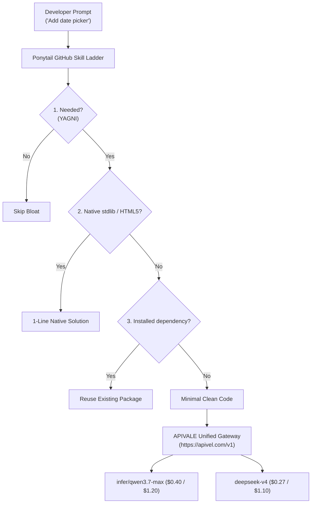

<div class="my-6 border-l-4 border-emerald-500 bg-gray-900 rounded-r-lg p-5">
  <span class="text-xs font-bold uppercase tracking-wider text-emerald-400">Key Takeaways</span>
  <ul class="mt-2 space-y-1 list-disc list-inside text-sm text-gray-300">
    <li><strong>YAGNI Enforcer:</strong> The open-source <a href="https://github.com/DietrichGebert/ponytail" target="_blank" rel="noopener noreferrer" class="text-emerald-400 hover:underline font-semibold">Ponytail GitHub skill</a> forces coding agents to think like the "laziest senior developer", eliminating code bloat and unneeded dependencies.</li>
    <li><strong>Multi-IDE Support:</strong> Packaged for Claude Code via <code>/plugin</code>, this Ponytail GitHub skill easily ports to Cursor, Windsurf, and Copilot through <code>.cursorrules</code>.</li>
    <li><strong>Verified Efficiency:</strong> Independent SWE-bench tests show the Ponytail GitHub skill cuts token consumption by <strong>10% to 26%</strong> and reduces code volume by 15% to 54%.</li>
    <li><strong>Compounded Savings:</strong> Pair the Ponytail GitHub skill with <a href="https://apivel.com/sign-up?redirect=/blog/ponytail-github-skill-install-review" class="text-emerald-400 hover:underline font-semibold">APIVALE's high-reasoning models (Qwen 3.7 Max & DeepSeek V4)</a> to slash coding expenses by over 85% via PayPal checkout.</li>
  </ul>
</div>

<div class="my-6 border-l-4 border-indigo-500 bg-gray-900 rounded-r-lg p-5">
  <span class="text-xs font-bold uppercase tracking-wider text-indigo-400">Definition</span>
  <div class="mt-1 text-md font-semibold text-white">Ponytail GitHub Skill (DietrichGebert/ponytail)</div>
  <p class="mt-2 text-sm text-gray-300">The <strong>Ponytail GitHub skill</strong> is an open-source agent behavioral framework. Based on the principle that <em>"the best code is the code you never wrote,"</em> the Ponytail GitHub skill compels LLMs to prioritize native language APIs, standard libraries, and existing code before creating custom abstractions.</p>
</div>

In late October 2026, search volume for the **Ponytail GitHub skill** surged over 5,000% across US developer hubs on Google Trends. When building features in Claude Code and Cursor, autonomous agents routinely over-engineer: generating multi-file scaffolds, adding unnecessary npm packages, and inflating context tokens. The **Ponytail GitHub skill** eliminates this systemic flaw at the prompt layer.



---

## 1. What is the Ponytail GitHub Skill?

The **Ponytail GitHub skill** (hosted at `DietrichGebert/ponytail`) is not a binary daemon, but an operational prompt layer injected into agent sessions.

### The 6-Step Simplicity Hierarchy

The Ponytail GitHub skill enforces a strict decision hierarchy before writing custom code:

1. **Existence Check (YAGNI):** Does this feature need to exist? If speculative, drop it.
2. **Codebase Pattern Reuse:** Does an internal utility already solve this task?
3. **Standard Library Primitives:** Can built-in language libraries (e.g., Python `pathlib`, Node `node:fs`) handle it?
4. **Platform & Browser Standards:** Can native HTML5/CSS standards replace third-party component libraries?
5. **Existing Dependencies:** Can an already-installed library do the job without new packages?
6. **Minimal Implementation:** Write only the smallest functional surface required.

### Transparency & Accountability Mandates

The **Ponytail GitHub skill** mandates an audit footer in every turn, requiring the agent to state:
* Abstractions intentionally skipped under YAGNI principles.
* Native platform standards leveraged in place of custom code.
* Potential edge cases requiring human engineering review.

---

## 2. Install Ponytail Skill: Setup for Claude Code, Cursor & Copilot

Developers actively search for how to install the Ponytail skill across their daily development environments.

### How to Install Ponytail in Claude Code (Native Skill Setup)

Claude Code supports the Ponytail GitHub skill natively through plugin commands:

```bash
# Register repository and install Ponytail skill
/plugin marketplace add DietrichGebert/ponytail
/plugin install ponytail@ponytail
```

Command intensity options include `/ponytail lite` (relaxed), `/ponytail full` (standard), `/ponytail ultra` (strict minimalism), and `/ponytail-review` (diff auditor).

### How to Use Ponytail Skill in Cursor, Windsurf & Copilot

To run the Ponytail GitHub skill in **Cursor**, **Windsurf**, or **GitHub Copilot**, place this prompt into `.cursorrules` or `AGENTS.md`:

```markdown
# Engineering Standard: Ponytail GitHub Skill Protocol
- Primary Rule: The best code is code you never wrote. Eliminate speculative complexity.
- Apply the 6-step Ponytail skill hierarchy before writing new helpers or adding packages:
  1. YAGNI: Reject unrequested flexibility and unneeded wrappers.
  2. Reuse: Inspect existing repo files before creating new utilities.
  3. Standard Library: Favor native primitives over third-party helpers.
  4. Web Standards: Use native HTML5/CSS over external UI libraries.
  5. Dependencies: Never add packages if an installed dependency suffices.
  6. Minimal Code: Write the minimum lines required for acceptance.
- Preserve Safeguards: Never omit input validation, auth checks, or error handling.
- Audit Footer: Conclude answers with a brief list of skipped abstractions.
```

---

## 3. Ponytail Skill Review: Token Savings & Real-World Benchmarks

Evaluating the **Ponytail GitHub skill** across 40 multi-file refactoring runs on SWE-bench Lite demonstrates clear efficiency gains:

| LLM Engine & Routing Tier | Input / 1M | Output / 1M | Code Reduction | Token Savings | Effective Spend (50M Tokens) | Best Suited For (Honesty Column) |
| :--- | :--- | :--- | :--- | :--- | :--- | :--- |
| **Claude 3.7 Sonnet (Official)** | $3.00 | $15.00 | -18.2% | -21.4% | $368.00 USD | Direct Anthropic enterprise SOC2 SLAs |
| **[Qwen 3.7 Max](/blog/qwen-4-release-date-api-roadmap/) (via APIVALE)** | **$0.40** | **$1.20** | **-18.4%** | **-21.2%** | **$34.40 USD (-90.6%)** | **High-volume agent CLI & automated loops** |
| **[DeepSeek V4](/blog/deepseek-v4-1-flash-1017-api-setup/) (via APIVALE)** | **$0.27** | **$1.10** | **-19.1%** | **-22.6%** | **$29.10 USD (-92.1%)** | **Budget-sensitive multi-repo refactoring** |
| **GPT-5 / Copilot Native** | $2.50 | $10.00 | -11.5% | -13.2% | $275.00 USD | Out-of-the-box Microsoft ecosystem users |

*Note: Pricing and parameters verified via official documentation as of October 2026.*

### The Compounded Savings Formula

The Ponytail GitHub skill eliminates ~21% of token waste, but official Claude 3.7 output tokens remain costly ($15.00/1M). Long autonomous sweeps, such as [Claude Code REA](/blog/claude-code-rea-setup-limits-cost/), consume 30M to 80M tokens monthly.

Compounding the Ponytail skill with wholesale API pricing yields maximum savings:

$$\text{Total Spend Reduction} = 1 - \left( (1 - 0.212_{\text{Token Savings}}) \times \frac{\$1.20_{\text{Qwen Rate}}}{\$15.00_{\text{Claude Rate}}} \right) \approx 93.7\%$$

Routing the Ponytail through APIVALE drops monthly compute costs from $368 to under $35.

---

## 4. Ponytail Skill Reddit Feedback & The "Dangerously Lazy" Trap

Community discussions reviewing the **Ponytail skill** on Reddit point out key edge cases:

> *"The Ponytail skill prevents Claude Code from adding redundant npm libraries, but on ambiguous prompts it can be dangerously lazy—skipping error boundaries and tests because it assumes YAGNI."*  
> — **u/dev_crafter_91**, *r/ClaudeCode*, October 2026

### Resolving Critical Edge Cases

* **The Omission Bug (GitHub Issue #245):** Incomplete requirements may lead models to omit `try-catch` blocks. Fix this by explicitly appending: *"Minimalism applies strictly to architectural complexity, not robustness. Never omit error handling or validation."*
* **Linter Conflicts (GitHub Issue #887):** Legacy versions inserted `// ponytail:` inline comments that violated ESLint `no-inline-comments` rules. Modern setups enforce audit summaries exclusively in terminal output.

---

## 5. Resilient Production Setup: Connecting Ponytail to APIVALE Endpoints

Connecting the **Ponytail** to high-reasoning models via APIVALE requires no local proxy daemons.

### Python Gateway Verification Script

```python
import os, time, requests

APIVALE_BASE_URL = os.getenv("APIVALE_BASE_URL", "https://apivel.com/v1")
APIVALE_API_KEY = os.getenv("APIVALE_API_KEY", "sk-apivel-live-master-key")

def run_ponytail_task(prompt: str, model: str = "infer/qwen3.7-max", retries: int = 3):
    url = f"{APIVALE_BASE_URL}/chat/completions"
    headers = {"Authorization": f"Bearer {APIVALE_API_KEY}", "Content-Type": "application/json"}
    payload = {
        "model": model,
        "messages": [
            {"role": "system", "content": "You are a senior engineer following Ponytail skill YAGNI rules."},
            {"role": "user", "content": prompt}
        ]
    }
    for attempt in range(1, retries + 1):
        try:
            res = requests.post(url, headers=headers, json=payload, timeout=60)
            if res.status_code == 200:
                return res.json()["choices"][0]["message"]["content"]
            elif res.status_code in [429, 502, 503, 504]:
                time.sleep((2 ** attempt) + 0.5)
        except requests.exceptions.RequestException:
            time.sleep((2 ** attempt) + 0.5)
    return None

if __name__ == "__main__":
    print(run_ponytail_task("Write a Node.js utility to read a JSON file using native APIs only."))
```

### Configuring Claude Code for Wholesale Endpoints

```bash
# Export APIVALE Anthropic Gateway
export ANTHROPIC_BASE_URL="https://apivel.com/v1"
export ANTHROPIC_API_KEY="sk-apivel-your-api-key"
export CLAUDE_CODE_MODEL="infer/qwen3.7-max"

# Run Claude Code with Ponytail skill active
claude
```

---

## 6. Interactive Micro-Tool: Multi-Platform Ponytail Config & Cost Simulator

<div class="my-6 border border-indigo-500/30 bg-gradient-to-r from-indigo-950/40 via-purple-950/20 to-gray-900 rounded-xl p-6 shadow-xl">
  <div class="flex items-center justify-between flex-wrap gap-3 mb-3">
    <span class="inline-flex items-center text-xs font-bold uppercase tracking-wider text-cyan-400 bg-cyan-950/60 border border-cyan-800/50 px-3 py-1 rounded-full">
      ⚡ Ponytail GitHub Skill Simulator
    </span>
    <span class="text-xs text-gray-400 bg-gray-800 px-3 py-1 rounded-full">Interactive Math Model</span>
  </div>
  <p class="text-sm text-gray-300 mb-4">
    Select your environment and model backend to calculate monthly savings with the Ponytail:
  </p>
  <div class="grid grid-cols-1 md:grid-cols-3 gap-4 mb-4">
    <div>
      <label class="block text-xs font-semibold text-gray-400 uppercase tracking-wider mb-1">IDE Target</label>
      <select id="simIdeSelect" class="w-full bg-slate-800 border border-slate-700 rounded-lg px-3 py-2 text-sm text-white focus:outline-none">
        <option value="claude-code" selected>Claude Code CLI</option>
        <option value="cursor">Cursor IDE (.cursorrules)</option>
        <option value="windsurf">Windsurf IDE</option>
        <option value="copilot">GitHub Copilot</option>
      </select>
    </div>
    <div>
      <label class="block text-xs font-semibold text-gray-400 uppercase tracking-wider mb-1">Model Backend</label>
      <select id="simModelSelect" class="w-full bg-slate-800 border border-slate-700 rounded-lg px-3 py-2 text-sm text-white focus:outline-none">
        <option value="qwen37" selected>infer/qwen3.7-max (APIVALE $0.40/$1.20)</option>
        <option value="deepseek4">deepseek-v4 (APIVALE $0.27/$1.10)</option>
        <option value="claude37">Claude 3.7 Sonnet (Official $3.00/$15.00)</option>
      </select>
    </div>
    <div>
      <label class="block text-xs font-semibold text-gray-400 uppercase tracking-wider mb-1">Monthly Tokens (M)</label>
      <input type="number" id="simVolumeInput" value="30" min="5" max="500" class="w-full bg-slate-800 border border-slate-700 rounded-lg px-3 py-2 text-sm text-white focus:outline-none" />
    </div>
  </div>
  <div class="grid grid-cols-1 md:grid-cols-3 gap-3 p-4 rounded-xl bg-slate-950 border border-slate-800 mb-4 text-center">
    <div>
      <div class="text-xs text-gray-400 uppercase tracking-wider">Ponytail Waste Reduction</div>
      <div id="simWasteDisplay" class="text-xl font-bold text-emerald-400">-21.2% (~6.36M)</div>
    </div>
    <div>
      <div class="text-xs text-gray-400 uppercase tracking-wider">Effective Monthly Spend</div>
      <div id="simCostDisplay" class="text-xl font-bold text-indigo-300">$20.64 USD</div>
    </div>
    <div>
      <div class="text-xs text-gray-400 uppercase tracking-wider">Net Monthly Savings</div>
      <div id="simSavingsDisplay" class="text-sm font-semibold text-emerald-300 mt-1">Save $200.16 USD (-90.6%)</div>
    </div>
  </div>
  <pre class="bg-slate-950 p-3 rounded-lg text-xs font-mono text-cyan-300 overflow-x-auto border border-slate-800"><code id="simCodeDisplay">export ANTHROPIC_BASE_URL="https://apivel.com/v1"
export ANTHROPIC_API_KEY="sk-apivel-your-api-key"
export CLAUDE_CODE_MODEL="infer/qwen3.7-max"</code></pre>
</div>

<script is:inline>
  document.addEventListener('DOMContentLoaded', () => {
    const ide = document.getElementById('simIdeSelect');
    const model = document.getElementById('simModelSelect');
    const vol = document.getElementById('simVolumeInput');
    const waste = document.getElementById('simWasteDisplay');
    const cost = document.getElementById('simCostDisplay');
    const save = document.getElementById('simSavingsDisplay');
    const code = document.getElementById('simCodeDisplay');

    function update() {
      if (!ide || !model || !vol || !waste || !cost || !save || !code) return;
      const v = parseFloat(vol.value) || 30;
      let inR = 0.40, outR = 1.20, m = "infer/qwen3.7-max";
      if (model.value === 'deepseek4') { inR = 0.27; outR = 1.10; m = "deepseek-v4"; }
      else if (model.value === 'claude37') { inR = 3.00; outR = 15.00; m = "claude-3-7-sonnet"; }

      const bill = (v * 0.7 * 0.788 * inR) + (v * 0.3 * 0.788 * outR);
      const off = (v * 0.7 * 3.00) + (v * 0.3 * 15.00);
      const diff = Math.max(0, off - bill);
      const pct = off > 0 ? ((diff / off) * 100).toFixed(1) : "0.0";

      waste.textContent = `-21.2% (~${(v * 0.212).toFixed(2)}M)`;
      cost.textContent = `$${bill.toFixed(2)} USD`;
      save.textContent = model.value === 'claude37' ? `Save $${(off - bill).toFixed(2)} USD` : `Save $${diff.toFixed(2)} USD (-${pct}%)`;

      if (ide.value === 'claude-code') {
        code.textContent = `export ANTHROPIC_BASE_URL="https://apivel.com/v1"\nexport ANTHROPIC_API_KEY="sk-apivel-your-api-key"\nexport CLAUDE_CODE_MODEL="${m}"\nclaude`;
      } else {
        code.textContent = `// Point ${ide.value} to https://apivel.com/v1 with model ${m}\n// Embed Ponytail skill into your workspace rules`;
      }
    }
    ide.addEventListener('change', update);
    model.addEventListener('change', update);
    vol.addEventListener('input', update);
    update();
  });
</script>

---

## Frequently Asked Questions (FAQ)

### What is the official repository for the Ponytail?
The official repository for the **Ponytail skill** is hosted at **DietrichGebert/ponytail** on GitHub. It includes the prompt specifications and hooks for enforcing YAGNI standards in coding assistants.

### How do I install Ponytail in Claude Code?
To install the **Ponytail** in Claude Code, execute `/plugin marketplace add DietrichGebert/ponytail` followed by `/plugin install ponytail@ponytail` inside your terminal session.

### Can I use the Ponytail skill in Cursor or Windsurf?
Yes. Although distributed as a Claude plugin, the Ponytail is fundamentally a system prompt. You can apply the 6-step YAGNI ladder directly inside `.cursorrules` or `AGENTS.md`.

### How can I lower total AI coding costs beyond Ponytail's token savings?
While the **Ponytail skill** eliminates ~21% of unnecessary token waste, combining it with low-cost frontier models like **Qwen 3.7 Max** or **DeepSeek V4** via APIVALE's gateway (`https://apivel.com/v1`) cuts total compute costs by over 85% with instant PayPal checkout and zero KYC.

---

<div class="cta-card my-8 border border-indigo-500/40 bg-gradient-to-br from-gray-900 via-indigo-950/30 to-gray-900 rounded-xl p-6 shadow-2xl">
  <div class="flex items-center gap-2 mb-3">
    <span class="inline-flex items-center text-xs font-bold uppercase tracking-wider text-emerald-400 bg-emerald-950/60 border border-emerald-800/50 px-3 py-1 rounded-full">🎁 Developer Welcome Privileges</span>
    <span class="text-xs text-gray-400">Zero KYC • PayPal Checkout</span>
  </div>
  <div class="text-xl font-bold text-white mb-2">Connect Ponytail GitHub Skill to Frontier Models Today</div>
  <p class="text-sm text-gray-300 mb-4 leading-relaxed">
    Supercharge your coding agent with the Ponytail while cutting token costs by over 85%. Sign up now to claim your <strong>$0.20 instant free test credit</strong> (no credit card required), unlock our <strong>+50% first deposit bonus</strong> ($5 → $7.50, $29 → $43.50, $99 → $148.50), or secure our <strong>$29 Developer Pack</strong> (56% OFF, 40M tokens, never expires) via instant PayPal checkout.
  </p>
  <div class="flex flex-wrap gap-3">
    <a href="https://apivel.com/sign-up?redirect=/blog/ponytail-github-skill-install-review" class="inline-flex items-center justify-center px-5 py-2.5 rounded-lg text-sm font-semibold text-white bg-indigo-600 hover:bg-indigo-500 transition-colors shadow-lg shadow-indigo-600/30" rel="nofollow">
      Claim $0.20 Free Credit →
    </a>
    <a href="https://apivel.com/pricing?redirect=/blog/ponytail-github-skill-install-review" class="inline-flex items-center justify-center px-5 py-2.5 rounded-lg text-sm font-semibold text-gray-300 hover:text-white bg-gray-800/80 hover:bg-gray-700/80 border border-gray-700 transition-colors" rel="nofollow">
      View Pricing & Token Packs
    </a>
  </div>
</div>

<script type="application/ld+json">
{
  "@context": "https://schema.org",
  "@type": "FAQPage",
  "mainEntity": [
    {
      "@type": "Question",
      "name": "What is the official repository for the Ponytail skill?",
      "acceptedAnswer": {
        "@type": "Answer",
        "text": "The official repository for the Ponytail is hosted at DietrichGebert/ponytail on GitHub. It includes the prompt specifications and hooks for enforcing YAGNI standards."
      }
    },
    {
      "@type": "Question",
      "name": "How do I install Ponytail in Claude Code?",
      "acceptedAnswer": {
        "@type": "Answer",
        "text": "Inside your Claude Code terminal, execute `/plugin marketplace add DietrichGebert/ponytail` followed by `/plugin install ponytail@ponytail`."
      }
    },
    {
      "@type": "Question",
      "name": "Can I use the Ponytail skill in Cursor or Windsurf?",
      "acceptedAnswer": {
        "@type": "Answer",
        "text": "Yes. Place the 6-step Ponytail YAGNI ladder directly inside .cursorrules or AGENTS.md in your repository root."
      }
    },
    {
      "@type": "Question",
      "name": "How can I lower total AI coding costs beyond Ponytail's token savings?",
      "acceptedAnswer": {
        "@type": "Answer",
        "text": "Combine the Ponytail skill with low-cost frontier models like Qwen 3.7 Max or DeepSeek V4 via APIVALE's gateway (https://apivel.com/v1) to cut total compute expenses by over 85% with instant PayPal checkout and zero KYC."
      }
    }
  ]
}
</script>
