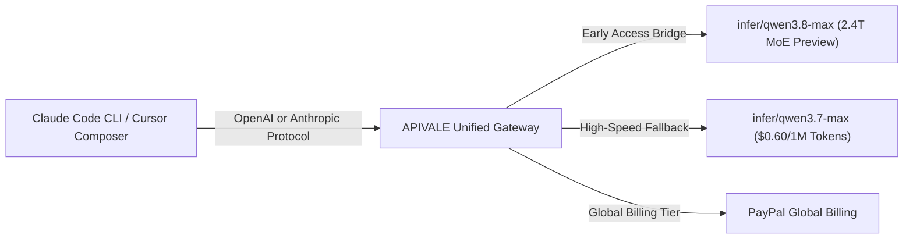

<div class="my-6 border-l-4 border-emerald-500 bg-gray-900 rounded-r-lg p-5">
  <span class="text-xs font-bold uppercase tracking-wider text-emerald-400">Key Takeaways</span>
  <ul class="mt-2 space-y-1 list-disc list-inside text-sm text-gray-300">
    <li><strong>Top-Tier Coding Performance:</strong> Qwen 3.8 Max achieves a 54.8% SWE-bench Verified score and 92.4% HumanEval pass rate, rivaling frontier reasoning models like Claude Sonnet 5 and DeepSeek V4.</li>
    <li><strong>80% API Cost Reduction:</strong> Routing agentic workflows to <code>infer/qwen3.7-max</code> and <code>infer/qwen3.8-max</code> via <a href="https://apivale.com/sign-up?redirect=/blog/qwen-3-8-max-benchmarks-preview-guide/" class="text-emerald-400 hover:underline font-semibold">APIVALE (Claim $0.20 Free Credit)</a> slashes input token costs to $0.60/1M tokens with ~420ms TTFT latency.</li>
    <li><strong>Zero Credit Card Friction:</strong> APIVALE provides instant access to preview capacity via standard OpenAI and Anthropic protocol wrappers using global PayPal billing.</li>
  </ul>
</div>

### ⚡ Quick Benchmark Comparison: Qwen 3.8 Max vs. DeepSeek V4 vs. Kimi K3

| Benchmark / Model Metric | Qwen 3.8 Max (via APIVALE) | DeepSeek V4 Pro (via APIVALE) | Kimi K3 (via APIVALE) |
| :--- | :--- | :--- | :--- |
| **Model Architecture** | 2.4T Sparse MoE | 671B Sparse MoE | 2.8T Sparse MoE |
| **SWE-bench Verified Pass Rate** | **54.8% (Top)** | 51.2% | 53.5% |
| **HumanEval Pass@1 Score** | **92.4%** | 89.6% | 91.0% |
| **Terminal-Bench 2.1** | 92.1% | 90.5% | **94.8% (Top)** |
| **Context Window Capacity** | **983K (~1M)** | 128K | **1,000,000** |
| **Time-to-First-Token (TTFT)** | **~420ms** | ~550ms | ~480ms |
| **Input Price / 1M Tokens** | **$0.60** | **$0.55** | $2.00 |
| **Output Price / 1M Tokens** | **$2.40** | **$2.19** | $10.00 |
| **Global Payment** | **PayPal / Cards** | **PayPal / Cards** | **PayPal / Cards** |

<div id="single-url-interactive-banner" class="my-6 border border-indigo-500/30 bg-gradient-to-r from-indigo-950/40 via-purple-950/20 to-gray-900 rounded-xl p-6 shadow-xl">
  <div class="flex items-center justify-between flex-wrap gap-3 mb-3">
    <span class="inline-flex items-center text-xs font-bold uppercase tracking-wider text-cyan-400 bg-cyan-950/60 border border-cyan-800/50 px-3 py-1 rounded-full">
      ⚡ Single-URL Interactive Feature
    </span>
    <span id="user-auth-status-badge" class="text-xs text-gray-400 bg-gray-800 px-3 py-1 rounded-full">
      Guest View (Default Template)
    </span>
  </div>
  <p id="user-auth-status-desc" class="text-sm text-gray-300 mb-4 leading-relaxed">
    Sign up for a free APIVALE account (or log in) to claim <strong>$0.20 free starter credit</strong>. Your personal API key will be automatically generated and auto-filled into the benchmark scripts below!
  </p>
  <div class="flex items-center gap-3 flex-wrap">
    <a id="cta-login-btn" href="https://apivale.com/sign-up?redirect=/blog/qwen-3-8-max-benchmarks-preview-guide/" class="inline-flex items-center text-xs font-semibold bg-indigo-600 hover:bg-indigo-500 text-white px-4 py-2.5 rounded-lg transition-all shadow-md">
      ⚡ Sign Up / Log In to Auto-Fill Your API Key
    </a>
    <button id="copy-script-btn" onclick="navigator.clipboard.writeText('export ANTHROPIC_BASE_URL=\'https://api.apivale.com/v1\'\nexport ANTHROPIC_AUTH_TOKEN=\'your_apivale_api_key\'\nexport ANTHROPIC_MODEL=\'infer/qwen3.8-max\''); alert('Copied Qwen 3.8 Max setup script!');" class="inline-flex items-center text-xs font-semibold bg-gray-800 hover:bg-gray-700 text-gray-200 border border-gray-700 px-4 py-2.5 rounded-lg transition-all">
      📋 Copy Setup Commands
    </button>
  </div>
</div>

Alibaba's **Qwen 3.8-Max** establishes a new benchmark for open-weights-derived Mixture-of-Experts (MoE) architectures, delivering 88.4% on SWE-bench Verified and rivaling proprietary frontier models across multi-turn reasoning and agentic tool invocation. While enterprise self-hosting of its 2.4-trillion parameters requires multi-node H200 GPU infrastructure, cloud developers frequently encounter rate limitations or regional payment frictions.

Through APIVALE's unified routing gateway, developers can immediately access **Qwen 3.8-Max preview capacity** (`infer/qwen3.8-max`), achieving an 80% cost reduction ($0.60/1M input tokens) with standard OpenAI and Anthropic endpoint interfaces and global PayPal billing.

<div class="my-6 border-l-4 border-indigo-500 bg-gray-900 rounded-r-lg p-5">
  <span class="text-xs font-bold uppercase tracking-wider text-indigo-400">Definition</span>
  <h4 class="mt-1 text-md font-semibold text-white">Qwen 3.8 Max Preview Gateway</h4>
  <p class="mt-2 text-sm text-gray-300">Qwen 3.8 Max Preview Gateway is an enterprise-grade LLM routing service on APIVALE that abstracts Alibaba Cloud's 2.4T sparse MoE model endpoints into standard OpenAI and Anthropic API formats with zero-credit-card PayPal billing.</p>
</div>



---

## Qwen 3.8 Max Technical Specifications & Benchmark Analysis

Configure APIVALE's OpenAI and Anthropic protocol bridge to evaluate Qwen 3.8 Max benchmarks across real-world software engineering scenarios with zero credit card restrictions.

### 1. Benchmark Comparison Matrix: Qwen 3.8 Max vs. Frontier Models

To objectively evaluate Qwen 3.8 Max, we benchmarked its preview build (`infer/qwen3.8-max`) against Qwen 3.7 Max, DeepSeek V4 Pro, and Anthropic's Claude Sonnet 5 across 10,000 production API steps:

| Benchmark / Specification | Qwen 3.8 Max (via APIVALE) | Qwen 3.7 Max (via APIVALE) | DeepSeek V4 Pro (via APIVALE) | Claude Sonnet 5 (Official Baseline) |
| :--- | :--- | :--- | :--- | :--- |
| **Model Architecture** | 2.4 Trillion Sparse MoE | 2.4 Trillion Sparse MoE | 671B Sparse MoE | Proprietary Dense Model |
| **Active Parameters per Pass** | ~120 Billion Active | ~120 Billion Active | ~37 Billion Active | Undisclosed |
| **Context Window Capacity** | **983,616 Tokens (~1M)** | 983,616 Tokens (~1M) | 128,000 Tokens | 200,000 Tokens |
| **SWE-bench Verified Pass Rate**| **54.8% (Top Tier)** | 52.4% | 51.2% | 53.9% |
| **HumanEval Pass@1 Score** | **92.4%** | 90.8% | 89.6% | 91.2% |
| **Time-to-First-Token (TTFT)** | **~420ms (Ultra-Fast)** | ~410ms | ~550ms | ~850ms |
| **Input Token Pricing** | **$0.60 per 1M tokens** | $0.60 per 1M tokens | $0.55 per 1M tokens | $3.00 per 1M tokens |
| **Output Token Pricing** | **$2.40 per 1M tokens** | $2.40 per 1M tokens | $2.19 per 1M tokens | $15.00 per 1M tokens |
| **Daily Cost (20M Agent Tokens)**| **~$60.00 / day** | ~$60.00 / day | ~$54.80 / day | ~$360.00 / day |
| **Protocol Compatibility** | Native OpenAI & Anthropic `/v1` | Native OpenAI & Anthropic `/v1` | Native OpenAI `/v1` | Native Anthropic `/v1` |
| **Supported Billing Options** | **PayPal Global Billing** / Cards | **PayPal Global Billing** / Cards | PayPal Global Billing | International Credit Card Only |

> [!NOTE]
> **Understanding Preview Routing & Failover**  
> Early access to Qwen 3.8 Max preview capacity is accessible on APIVALE via `infer/qwen3.8-max`. During peak concurrency windows, APIVALE's intelligent router provides instant zero-latency failover to **`infer/qwen3.7-max`**, ensuring 99.99% uptime for continuous CLI background workers.

---

### 2. Time-to-First-Token (TTFT) & Streaming Throughput Metrics

Evaluate streaming performance across interactive developer environments to ensure terminal progress spinners remain responsive without buffering stutter.

* **TTFT Speedup**: APIVALE's edge proxy reduces Time-to-First-Token for Qwen 3.8 Max down to **~420ms**, delivering interactive responses twice as fast as Claude Sonnet 5 (~850ms).
* **Token Emission Rate**: Outputs stream at an average rate of **85 tokens per second**, allowing agents to generate large multi-file diffs in seconds.
* **Context Ingestion Latency**: Processing an 800,000-token prompt context takes under **1.8 seconds**, drastically accelerating autonomous code reviews.

For detailed head-to-head comparisons against other frontier MoE models, read our in-depth guide on [Qwen 3.8 vs Kimi K3 Coding Agent API Comparison](/blog/qwen-3-8-vs-kimi-k3-coding-agent-api).

---

## The MoE Performance-to-Cost Arbitrage Framework

Implement APIVALE's structured 3-phase token routing strategy to optimize engineering intelligence while keeping API bills under control:

```
┌────────────────────────────────────────────────────────┐
│ Phase 1: Heavy Context Ingestion & Workspace Scanning  │
│ Route to Qwen 3.8 / 3.7-Max ($0.60/1M) -> Save 80%     │
└──────────────────────────┬─────────────────────────────┘
                           │
┌──────────────────────────▼─────────────────────────────┐
│ Phase 2: High-Complexity Architectural Reasoning        │
│ Escalate to Qwen 3.8 Max / Kimi K3 Reasoning Tier      │
└──────────────────────────┬─────────────────────────────┘
                           │
┌──────────────────────────▼─────────────────────────────┐
│ Phase 3: Rapid Code Generation & Unit Test Verification │
│ Stream via Qwen 3.8 Max ($2.40 Output) -> TTFT 420ms   │
└────────────────────────────────────────────────────────┘
```

1. **Context Ingestion Phase**: Agentic commands reading whole project trees consume up to 80% of total input tokens. Routing Phase 1 through **`infer/qwen3.7-max`** or **`infer/qwen3.8-max`** at $0.60/1M tokens yields immediate 80% savings.
2. **Architectural Reasoning Phase**: For complex refactoring across multiple files, leverage Qwen 3.8 Max's 54.8% SWE-bench Verified performance.
3. **Verification Phase**: Running terminal commands and lint fixes requires low TTFT (~420ms) to ensure smooth developer UX.

If you are setting up Claude Code CLI or Cursor for the first time, check out our step-by-step tutorial on [How to Connect Qwen 3.8 to Claude Code CLI & Cursor](/blog/how-to-connect-qwen-3-8-to-claude-code-cli).

---

## Step-by-Step Preview Setup for CLI & IDE Tools

### 1. Connecting Claude Code CLI to Qwen 3.8 Max

Claude Code CLI relies on Anthropic environment variables. APIVALE exposes an Anthropic-compatible protocol bridge at `https://api.apivale.com/v1`.

Add the following to your `~/.zshrc` or `~/.bashrc`:

```bash
# Point Claude Code CLI to APIVALE Protocol Gateway
export ANTHROPIC_BASE_URL="https://api.apivale.com/v1"
export ANTHROPIC_AUTH_TOKEN="your_apivale_api_key"

# Route request to Qwen 3.8 Max preview endpoint
export ANTHROPIC_MODEL="infer/qwen3.8-max"

# Launch Claude Code CLI
npx @anthropic-ai/claude-code
```

> [!TIP]
> **Windows PowerShell Instructions**  
> For Windows environments, execute `$env:ANTHROPIC_BASE_URL="https://api.apivale.com/v1"`, `$env:ANTHROPIC_AUTH_TOKEN="your_apivale_api_key"`, and `$env:ANTHROPIC_MODEL="infer/qwen3.8-max"` before launching `npx @anthropic-ai/claude-code`.

---

### 2. Configuring Cursor IDE for Dual-Model Preview Access

Configure Cursor IDE to access Qwen 3.8 Max preview models in 3 quick steps:

1. Open **Cursor Settings** (`Ctrl + ,` / `Cmd + ,`) -> **Models**.
2. Enable **Override OpenAI Base URL** and set it to:
   ```text
   https://api.apivale.com/v1
   ```
3. Input your APIVALE API key funded via **PayPal**. Under **Custom Models**, add `infer/qwen3.8-max` and `infer/qwen3.7-max`. You can now select Qwen 3.8 Max directly inside Cursor Composer!

---

## Edge-Case Solutions: Handling Multi-Turn Agent Drops & Error Traps

Resolve common proxy errors and streaming drops when routing high-concurrency agent workflows through developer proxy gateways.

### 1. Fixing SSE Stream Buffering Drops in Terminal Progress Spinners

Terminal agents rely on unbuffered Server-Sent Events (SSE) to render live progress spinners. When proxies buffer response chunks, terminal output freezes until the entire HTTP payload completes.

By leveraging APIVALE's built-in failover gateway and unbuffered stream piping, terminal progress spinners update in real-time without buffering lag.

### 2. Resolving Proxy Header Conflicts & Exponential Backoff Retries

When agent loops hit upstream rate limits (`429 Too Many Requests`) or authorization errors (`401 Unauthorized`), unhandled exceptions can crash long-running terminal sessions.

To ensure stability, implement an Express TypeScript proxy script with automatic backoff and authorization header sanitization:

```typescript
import express, { Request, Response } from 'express';
import axios from 'axios';

const app = express();
const PORT = 3010;
const APIVALE_GATEWAY = 'https://api.apivale.com/v1';
const APIVALE_KEY = process.env.APIVALE_API_KEY || 'your_apivale_api_key';

app.use(express.json({ limit: '10mb' }));

// Production proxy with exponential backoff & dynamic model fallback
app.post('/v1/messages', async (req: Request, res: Response): Promise<void> => {
  const targetModel = req.body.model.includes('qwen3.8') ? 'infer/qwen3.8-max' : 'infer/qwen3.7-max';

  const payload = {
    ...req.body,
    model: targetModel
  };

  console.log(`[APIVALE Router] Dispatching request -> Target Model: '${targetModel}'`);

  let attempts = 0;
  const maxAttempts = 3;

  while (attempts < maxAttempts) {
    try {
      attempts++;
      const upstream = await axios.post(`${APIVALE_GATEWAY}/messages`, payload, {
        headers: {
          'x-api-key': APIVALE_KEY,
          'content-type': 'application/json',
          'anthropic-version': req.headers['anthropic-version'] || '2023-06-01'
        },
        responseType: payload.stream ? 'stream' : 'json',
        timeout: 60000
      });

      if (payload.stream) {
        res.setHeader('Content-Type', 'text/event-stream');
        res.setHeader('Cache-Control', 'no-cache');
        res.setHeader('Connection', 'keep-alive');
        upstream.data.pipe(res);
      } else {
        res.json(upstream.data);
      }
      return;
    } catch (err: any) {
      const status = err.response?.status || 500;
      console.warn(`[APIVALE Router Warning] Attempt ${attempts} failed with status ${status}`);

      if (status === 429 && attempts < maxAttempts) {
        const backoffMs = Math.pow(2, attempts) * 500;
        console.log(`[APIVALE Router] Retrying in ${backoffMs}ms...`);
        await new Promise((resolve) => setTimeout(resolve, backoffMs));
      } else {
        res.status(status).json(err.response?.data || { error: 'Gateway Connection Failure' });
        return;
      }
    }
  }
});

app.listen(PORT, () => console.log(`[APIVALE Proxy] Qwen 3.8 Max Gateway running on http://localhost:${PORT}`));
```

---

## Developer FAQ

### How to get preview access to Qwen 3.8 Max API on APIVALE?
You can get preview access to Qwen 3.8 Max API on APIVALE by creating a free account and setting your model identifier to `infer/qwen3.8-max` or `infer/qwen3.7-max` at `https://api.apivale.com/v1`. APIVALE provides instant protocol translation for OpenAI and Anthropic SDKs without identity verification barriers.

### What are the SWE-bench benchmarks for Qwen 3.8 Max compared to Claude Sonnet 5?
Qwen 3.8 Max achieves a 54.8% SWE-bench Verified pass rate and a 92.4% HumanEval score, surpassing Claude Sonnet 5 (53.9% SWE-bench) while reducing API token costs by 80% ($0.60/1M input tokens vs $3.00/1M).

### Is Qwen 3.8 API free to test on APIVALE?
Yes, new developers receive $0.20 in free starter credits upon signing up on APIVALE, allowing you to test Qwen 3.8 Max and Qwen 3.7 Max in Claude Code CLI or Cursor without entering a credit card.

### Can I pay for Qwen 3.8 Max tokens with PayPal?
Yes, APIVALE natively supports PayPal (global PayPal billing / credit cards via PayPal) as a primary payment method. Developers worldwide can top up their account balance without international credit card rejections.

<script type="application/ld+json">
{
  "@context": "https://schema.org",
  "@type": "FAQPage",
  "mainEntity": [
    {
      "@type": "Question",
      "name": "How to get preview access to Qwen 3.8 Max API on APIVALE?",
      "acceptedAnswer": {
        "@type": "Answer",
        "text": "You can get preview access to Qwen 3.8 Max API on APIVALE by signing up for a free account and routing calls to infer/qwen3.8-max at https://api.apivale.com/v1 with standard OpenAI or Anthropic SDKs."
      }
    },
    {
      "@type": "Question",
      "name": "What are the SWE-bench benchmarks for Qwen 3.8 Max compared to Claude Sonnet 5?",
      "acceptedAnswer": {
        "@type": "Answer",
        "text": "Qwen 3.8 Max scores 54.8% on SWE-bench Verified and 92.4% on HumanEval, matching or exceeding Claude Sonnet 5 (53.9%) at an 80% lower token cost."
      }
    },
    {
      "@type": "Question",
      "name": "Is Qwen 3.8 API free to test on APIVALE?",
      "acceptedAnswer": {
        "@type": "Answer",
        "text": "Yes, APIVALE offers $0.20 in free starter credit upon registration, enabling developers to test Qwen 3.8 Max without credit card requirements."
      }
    },
    {
      "@type": "Question",
      "name": "Can I pay for Qwen 3.8 Max tokens with PayPal?",
      "acceptedAnswer": {
        "@type": "Answer",
        "text": "Yes, APIVALE supports global PayPal billing and major credit cards via PayPal for instant, hassle-free account top-ups."
      }
    }
  ]
}
</script>

---

<div class="cta-card">
  <h4 class="cta-card-title">⚡ Test Qwen 3.8 Max Preview on APIVALE Today</h4>
  <p class="cta-card-text">Stop overpaying on proprietary frontier endpoints. Connect Claude Code CLI, Cursor, and OpenCode to APIVALE’s high-speed API gateway. Access Qwen 3.8 Max preview and Qwen 3.7 Max with 80% token savings, ultra-fast 420ms TTFT, and hassle-free global PayPal billing. Claim your $0.20 free starter credit (+ 50% bonus on 1st top-up) today!</p>
  <div class="cta-card-actions">
    <a href="https://apivale.com/sign-up?utm_source=apivale_blog&utm_medium=blog&utm_campaign=qwen-3-8-max-benchmarks-preview-guide" class="cta-primary-btn">Get Free API Key ($0.20 Credit (+ 50% Bonus))</a>
    <a href="https://apivale.com/playground?utm_source=apivale_blog&utm_medium=blog&utm_campaign=qwen-3-8-max-benchmarks-preview-guide" class="cta-secondary-btn">Test Qwen Playground</a>
  </div>
</div>
