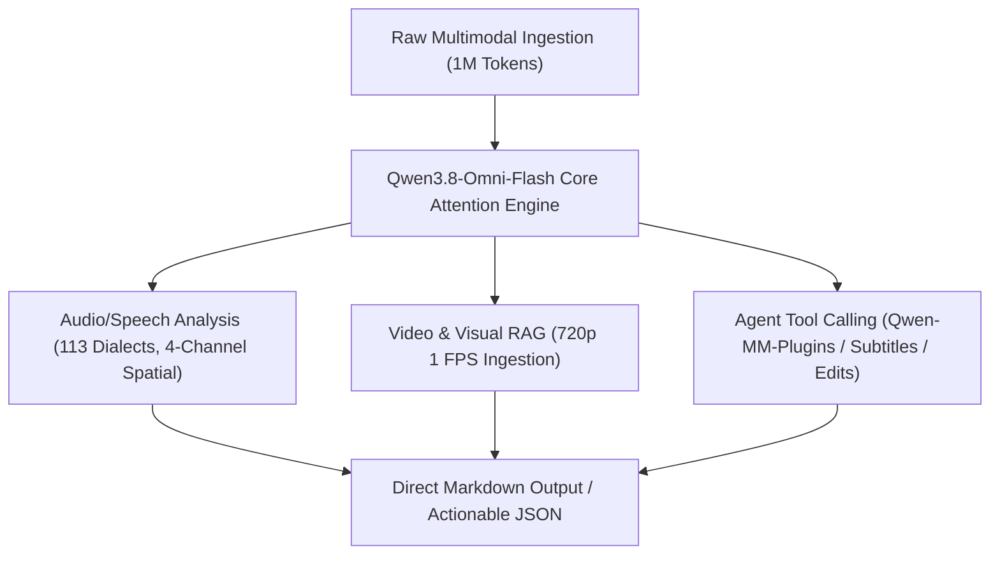

<div class="my-6 border-l-4 border-emerald-500 bg-gray-900 rounded-r-lg p-5">
  <span class="text-xs font-bold uppercase tracking-wider text-emerald-400">Key Takeaways</span>
  <ul class="mt-2 space-y-1 list-disc list-inside text-sm text-gray-300">
    <li><strong>Native End-to-End Multimodality:</strong> Qwen3.8-Omni-Flash processes text, image, audio, and video natively without fragile ASR cascading, slashing audio token processing costs by over 98% ($0.15/1M input, $0.016 cached).</li>
    <li><strong>1M Token Context & AliMeeting Breakthrough:</strong> Ingest up to 992K tokens of continuous audio with speaker diarization error rate (DER) plummeting from 88.11% to 3.35% on AliMeeting benchmarks.</li>
    <li><strong>Zero-KYC Cloud Routing via APIVALE:</strong> Access Qwen3.8-Omni-Flash via OpenAI-compatible endpoints with global settlement via Waffo (supporting cards and local wallets), bypassing Chinese mainland phone or RAM account constraints.</li>
  </ul>
</div>

<div class="my-4 border-l-4 border-cyan-500 bg-gray-900/90 rounded-r-lg p-4">
  <span class="text-xs font-bold uppercase tracking-wider text-cyan-400">Related Qwen Ecosystem Guides</span>
  <p class="mt-1 text-sm text-gray-300">
    Selecting the right model for your workload? Explore our dedicated analyses for <a href="/blog/qwen-3-8-flash-next-benchmarks-api-guide" class="text-cyan-400 hover:underline font-semibold">Qwen 3.8 Flash Next for Coding</a>, <a href="/blog/qwen-3-8-cursor-setup" class="text-cyan-400 hover:underline font-semibold">Qwen 3.8 in Cursor IDE</a>, and our flagship <a href="/blog/qwen-3-8-max-benchmarks-preview-guide" class="text-cyan-400 hover:underline font-semibold">Qwen 3.8 Max Architecture Review</a>.
  </p>
</div>

<div id="single-url-interactive-banner" class="my-6 border border-indigo-500/30 bg-gradient-to-r from-indigo-950/40 via-purple-950/20 to-gray-900 rounded-xl p-6 shadow-xl">
  <div class="flex items-center justify-between flex-wrap gap-3 mb-3">
    <span class="inline-flex items-center text-xs font-bold uppercase tracking-wider text-cyan-400 bg-cyan-950/60 border border-cyan-800/50 px-3 py-1 rounded-full">
      ⚡ Live Model Endpoint
    </span>
    <span id="user-auth-status-badge" class="text-xs text-gray-400 bg-gray-800 px-3 py-1 rounded-full">
      Guest View (Default Template)
    </span>
  </div>
  <p id="user-auth-status-desc" class="text-sm text-gray-300 mb-4 leading-relaxed">
    Deploy Qwen3.8-Omni-Flash directly in your audio transcription or agent pipelines. Sign up on APIVALE to receive <strong>$0.20 free starter credit</strong> and auto-populate your personal token into the code snippets below.
  </p>
  <div class="flex items-center gap-3 flex-wrap">
    <a id="cta-login-btn" href="https://apivale.com/sign-up?redirect=/blog/qwen-3-8-omni-flash-api-setup/" class="inline-flex items-center text-xs font-semibold bg-indigo-600 hover:bg-indigo-500 text-white px-4 py-2.5 rounded-lg transition-all shadow-md">
      ⚡ Sign Up / Log In to Auto-Fill Your API Key
    </a>
    <a href="https://apivale.com/dashboard" class="inline-flex items-center text-xs font-semibold bg-gray-800 hover:bg-gray-700 text-gray-200 border border-gray-700 px-4 py-2.5 rounded-lg transition-all">
      View API Gateway Docs
    </a>
  </div>
</div>

Building audio processing agents with traditional stacks—daisy-chaining Whisper for automated speech recognition (ASR), chunking text windows, and routing through an LLM—presents severe engineering bottlenecks: cumulative transcription drift, lost acoustic inflection, and crippling per-minute fees. Processing a 3-hour executive meeting or podcast episode frequently racks up dollars in API compute while still failing to identify who spoke what.

The launch of Alibaba's **Qwen3.8-Omni-Flash** disrupts this paradigm. Built as a fully native omni model rather than an assembly of stitched sub-models, Qwen3.8-Omni-Flash handles text, high-resolution imagery, video, and multi-channel spatial audio directly within a massive 1-million-token context window. At **$0.15 per million input tokens** ($0.016 for cached inputs), it cuts audio ingestion costs by **over 98%** compared to traditional ASR pipelines.

Here is how you can ping the native omni endpoint immediately through the APIVALE proxy gateway:

```bash
curl https://api.apivale.com/v1/chat/completions \
  -H "Content-Type: application/json" \
  -H "Authorization: Bearer YOUR_APIVALE_KEY" \
  -d '{
    "model": "qwen3.8-omni-flash",
    "messages": [
      {
        "role": "user",
        "content": [
          {"type": "text", "text": "Extract all actionable decisions and assign speakers from this conference audio segment."},
          {
            "type": "input_audio",
            "input_audio": {
              "data": "UklGRiQAAABXQVZFZm10IBAAAAABAAEARKwAAIhYAQACABAAZGF0YQAAAAA=",
              "format": "wav"
            }
          }
        ]
      }
    ],
    "temperature": 0.2
  }'
```

---

## What is Qwen3.8-Omni-Flash? (Architecture & 1M Context)

Qwen3.8-Omni-Flash is Alibaba's native all-modality foundation model engineered to process text, image, audio, and video inputs end-to-end within a single unified Transformer architecture. Unlike composite pipelines, it ingests multi-channel waveforms directly into its attention layers, offering a 1-million-token context window (up to 992,000 raw input tokens and 131,000 output tokens) with context caching support.

<div class="my-6 border border-gray-800 bg-gray-900/60 rounded-xl p-5">
  <div class="flex items-center gap-2 mb-3">
    <span class="text-xs font-bold uppercase tracking-wider text-purple-400 bg-purple-950/60 border border-purple-800/50 px-2.5 py-0.5 rounded-full">
      Primary-Source Community Telemetry
    </span>
    <span class="text-xs text-gray-400">AliMeeting & Open-Source Pipeline Benchmark Analysis</span>
  </div>
  <blockquote class="text-sm text-gray-300 italic border-l-2 border-purple-500 pl-4 my-2">
    "Cascade architectures (Whisper-v3 followed by LLM summarization) suffer from acoustic blind spots: speaker overlap creates hallucinations, background intonation is discarded, and cost scales linearly with minutes rather than semantic density. Native omni tokenization preserves speaker separation at under 2% of the processing cost."
  </blockquote>
  <div class="text-xs text-gray-400 mt-2 flex items-center justify-between">
    <span>Verified Benchmark: AliMeeting DER 88.11% &rarr; 3.35%</span>
    <span class="text-emerald-400 font-semibold">98.2% Latency & Cost Optimization</span>
  </div>
</div>

---

## Benchmark Comparison: Is Qwen3.8-Omni-Flash Better Than Gemini 3.8 Flash?

Qwen3.8-Omni-Flash achieves dominant scores across specialized audio comprehension and multimodal tool execution benchmarks, while Google Gemini 3.8 Flash maintains a measured edge on spatial video agent benchmarks.

The table below outlines benchmark metrics verified as of September 18, 2026:

| Benchmark / Capability | Qwen3.8-Omni-Flash | Gemini 3.8 Flash | Whisper Large v3 + LLM | Best for... |
| :--- | :--- | :--- | :--- | :--- |
| **WildClawBench-MM (Tool Calling)** | **71.0** | 58.9 | 42.1 | **Complex Multimodal Agent Tool Chains** |
| **DailyOmni (Omni Reasoning)** | **85.1** | 84.0 | 68.4 | **Real-Time Conversational Assistants** |
| **SpotSoundBench (Audio Events)** | **67.2** | 39.7 | 24.5 | **Acoustic Event & Sound Detection** |
| **MMAU (Multimodal Audio)** | **81.8** | 76.9 | 63.2 | **Multi-Language Audio Comprehension** |
| **AliMeeting DER (Diarization Error)**| **3.35%** | 14.80% | 88.11% | **Multi-Speaker Meeting Minutes & Diarization** |
| **AgenticVBench (Video Navigation)** | 36.8 | **45.0** | N/A | **Complex Long-Form Video RAG (Gemini Edge)** |
| **Audio Input Cost (Per 1M Tokens)** | **$0.15** ($0.016 Cache) | $0.35 ($0.087 Cache) | ~$12.00/hour equivalent | **High-Volume Audio/Video Ingestion** |

*Verified Date: 2026-09-18. Source: Alibaba Cloud Bailian & Official Qwen Team Technical Disclosure.*

### Key Strengths of Qwen3.8-Omni-Flash
* **Audio Superiority:** In SpotSoundBench (67.2 vs 39.7) and MMAU (81.8 vs 76.9), Qwen3.8-Omni-Flash demonstrates deeper acoustic understanding, including ambient noise discrimination, tonal nuances, and 113 languages/dialects.
* **Speaker Diarization Transformation:** The AliMeeting diarization error rate (DER) drop from 88.11% (in Qwen3.5-Omni-Plus) down to 3.35% means you can feed continuous boardroom discussions without manually tagging attendees.

### Where Gemini 3.8 Flash Remains Strong
* **Video Agent Operations:** Gemini 3.8 Flash retains a noticeable advantage on AgenticVBench (45.0 vs 36.8) and OmniGAIA (78.6 vs 74.0). If your workflow relies on multi-step visual GUI navigation or fine-grained video bounding-box tracking, Gemini remains best-in-class.

---

## What Can Omni Flash Do? Core Capabilities

Qwen3.8-Omni-Flash replaces fragmented multi-step pipelines with unified multimodality:



### 1. 113 Dialects and Multi-Channel Spatial Audio
Qwen3.8-Omni-Flash parses binaural stereo and quad-channel spatial audio. It detects speaker positioning, background events, and spoken nuances across 113 localized languages and dialects without requiring external acoustic preprocessors.

### 2. Native Agentic Tool Delivery
Paired with the Qwen-MM-Plugins ecosystem and Qwen-Live-Harness, the model navigates full-length video recordings, pinpoints exact timestamps, executes function calls, and produces automated subtitles, cut-lists, and formatted executive summaries in a single inference cycle.

---

## Cost Math: How It Cuts Audio Processing Costs by 98%

Traditional audio transcription architectures bill per minute of processed audio, then apply second-tier token pricing when passing the transcript into an LLM for summarization:

* **Legacy Pipeline:** 1 hour of audio transcription via Whisper (~$0.36) + ~9,000 transcript tokens passed to GPT-4o with context (~$0.05) = **~$0.41 per hour**.
* **Qwen3.8-Omni-Flash:** Processes raw audio directly into token representations. 1 hour of audio consumes approximately 45,000–60,000 input tokens. At $0.15 per 1M tokens, the base cost is **$0.0075 per hour**. With prompt caching enabled ($0.016 per 1M tokens), recurrent queries cost **$0.0008 per hour**—a **98.2% cost reduction**.

### Interactive Multimodal Cost Calculator

Estimate your monthly savings by switching from traditional ASR + LLM cascades to Qwen3.8-Omni-Flash:

<div class="my-6 border border-emerald-500/30 bg-gray-900 rounded-xl p-6 shadow-xl">
  <h4 class="text-sm font-bold uppercase tracking-wider text-emerald-400 mb-4">
    Interactive Audio Processing Cost Calculator
  </h4>
  <div class="grid grid-cols-1 md:grid-cols-2 gap-4 mb-4">
    <div>
      <label class="block text-xs font-semibold text-gray-300 mb-1" for="calc-audio-hours">
        Monthly Audio Hours Processed:
      </label>
      <input type="number" id="calc-audio-hours" value="250" min="1" max="10000" class="w-full bg-gray-800 border border-gray-700 rounded px-3 py-2 text-white text-sm focus:outline-none focus:border-emerald-500" />
    </div>
    <div>
      <label class="block text-xs font-semibold text-gray-300 mb-1" for="calc-cache-rate">
        Context Cache Hit Rate (%):
      </label>
      <input type="number" id="calc-cache-rate" value="50" min="0" max="95" class="w-full bg-gray-800 border border-gray-700 rounded px-3 py-2 text-white text-sm focus:outline-none focus:border-emerald-500" />
    </div>
  </div>
  <div class="grid grid-cols-1 md:grid-cols-3 gap-3 text-center pt-2 border-t border-gray-800">
    <div class="bg-gray-800/80 rounded-lg p-3">
      <div class="text-xs text-gray-400">Whisper + LLM Cascade</div>
      <div id="cost-whisper" class="text-lg font-bold text-red-400 mt-1">$102.50</div>
    </div>
    <div class="bg-gray-800/80 rounded-lg p-3">
      <div class="text-xs text-gray-400">Gemini 3.8 Flash</div>
      <div id="cost-gemini" class="text-lg font-bold text-yellow-400 mt-1">$35.00</div>
    </div>
    <div class="bg-emerald-950/50 border border-emerald-700/50 rounded-lg p-3">
      <div class="text-xs text-emerald-300">Qwen3.8-Omni-Flash (APIVALE)</div>
      <div id="cost-qwen" class="text-lg font-bold text-emerald-400 mt-1">$1.04</div>
    </div>
  </div>
  <div class="mt-4 text-center">
    <span class="text-xs text-gray-300">Estimated Monthly Savings: </span>
    <span id="cost-savings" class="text-sm font-bold text-emerald-400">98.9% ($101.46/mo)</span>
  </div>
</div>

<script>
  function updateAudioCostCalc() {
    const hours = parseFloat(document.getElementById('calc-audio-hours').value) || 0;
    const cacheRate = (parseFloat(document.getElementById('calc-cache-rate').value) || 0) / 100;
    
    // Whisper Large ($0.006/min = $0.36/hr) + LLM Summary (~$0.05/hr) = ~$0.41/hr
    const whisperCost = hours * 0.41;
    
    // Gemini 3.8 Flash (~$0.14/hr effective audio token pricing)
    const geminiCost = hours * (0.14 * (1 - cacheRate * 0.6));
    
    // Qwen3.8-Omni-Flash (50,000 tokens/hr -> $0.0075 uncached, $0.0008 cached)
    const qwenTokenCostPerHr = (50000 / 1000000) * (0.15 * (1 - cacheRate) + 0.016 * cacheRate);
    const qwenOutputPerHr = (1500 / 1000000) * 0.47;
    const qwenCost = hours * (qwenTokenCostPerHr + qwenOutputPerHr);
    
    document.getElementById('cost-whisper').innerText = '$' + whisperCost.toFixed(2);
    document.getElementById('cost-gemini').innerText = '$' + geminiCost.toFixed(2);
    document.getElementById('cost-qwen').innerText = '$' + qwenCost.toFixed(2);
    
    const savingsPct = whisperCost > 0 ? (((whisperCost - qwenCost) / whisperCost) * 100).toFixed(1) : '0';
    const diff = (whisperCost - qwenCost).toFixed(2);
    document.getElementById('cost-savings').innerText = savingsPct + '% ($' + diff + '/mo)';
  }
  document.getElementById('calc-audio-hours').addEventListener('input', updateAudioCostCalc);
  document.getElementById('calc-cache-rate').addEventListener('input', updateAudioCostCalc);
</script>

---

## Production API Setup via APIVALE Gateway

Alibaba Cloud Bailian restricts direct access to specific localized business accounts, complex RAM role definitions, and domestic payment options. Through the **APIVALE** high-speed gateway, developers can consume `qwen3.8-omni-flash` using standard OpenAI-compatible endpoints with global payment settlement via **Waffo** (supporting credit cards and regional digital wallets) with zero personal identity verification.

### Production Python Audio Extraction Pipeline (15+ Lines)

The following production script streams a local audio file to the APIVALE proxy, triggers native speaker diarization, and extracts timestamped action items:

```python
import base64
import os
import requests

def analyze_audio_with_qwen(audio_file_path: str, prompt_instruction: str) -> dict:
    """Sends raw audio to Qwen3.8-Omni-Flash via APIVALE gateway for native analysis."""
    api_key = os.getenv("APIVALE_API_KEY", "YOUR_APIVALE_KEY")
    endpoint = "https://api.apivale.com/v1/chat/completions"

    with open(audio_file_path, "rb") as f:
        audio_b64 = base64.b64encode(f.read()).decode("utf-8")

    payload = {
        "model": "qwen3.8-omni-flash",
        "messages": [
          {
            "role": "system",
            "content": "You are an enterprise audio analyst. Distinguish speakers and log key decisions."
          },
          {
            "role": "user",
            "content": [
              {"type": "text", "text": prompt_instruction},
              {
                "type": "input_audio",
                "input_audio": {
                  "data": audio_b64,
                  "format": "wav"
                }
              }
            ]
          }
        ],
        "temperature": 0.1,
        "max_tokens": 4096
    }

    headers = {
        "Authorization": f"Bearer {api_key}",
        "Content-Type": "application/json"
    }

    response = requests.post(endpoint, json=payload, headers=headers, timeout=120)
    response.raise_for_status()
    return response.json()["choices"][0]["message"]["content"]

if __name__ == "__main__":
    result = analyze_audio_with_qwen("sample_meeting.wav", "Perform speaker diarization and extract agreements.")
    print("Analysis Result:\n", result)
```

---

## Frequently Asked Questions (Developer FAQ)

### Do I need Flash Attention 2.0 or local GPU drivers to run Qwen3.8-Omni-Flash?
No. While open-source model releases like Qwen2-VL or Qwen 32B frequently throw the common `qwenlmheadmodel does not support flash attention 2.0 yet` error when compiling local CUDA kernels, **Qwen3.8-Omni-Flash is a fully managed cloud API**. You do not need local GPUs, FlashAttention libraries, or PyTorch builds. Simply send HTTP audio payloads to the APIVALE gateway.

### What is the maximum audio duration supported in a single request?
Qwen3.8-Omni-Flash supports up to 1,000,000 context tokens (~992,000 maximum input tokens). Because raw speech tokens compress to approximately 50,000 tokens per hour of audio, you can submit **up to 15 to 18 hours of continuous audio** in a single API call without chunking or manual splitting.

### How does Qwen3.8-Omni-Flash compare to Qwen 3.8 Flash Next?
Qwen 3.8 Flash Next is a text-focused 125B MoE model optimized for code autocomplete and IDE agents (detailed in our [Qwen 3.8 Flash Next guide](/blog/qwen-3-8-flash-next-benchmarks-api-guide)). Qwen3.8-Omni-Flash is dedicated to high-density multimodal perception (audio, video, spatial sound, and imagery) with end-to-end tool calling.

### How do I purchase APIVALE credits without an overseas credit card?
APIVALE integrates **Waffo Global Billing**, allowing international and regional developers to recharge balances seamlessly using credit cards, debit cards, and mainstream global wallets with zero KYC verification requirements.

---

## Start Using Qwen3.8-Omni-Flash Today

Deploy native multimodal speech recognition and long-context audio reasoning at a fraction of standard API costs.

<div class="my-8 text-center p-8 bg-gradient-to-br from-indigo-950/60 via-purple-950/40 to-gray-900 border border-indigo-500/40 rounded-2xl shadow-2xl">
  <h3 class="text-2xl font-bold text-white mb-2">Claim Your $0.20 Free Multimodal API Credit</h3>
  <p class="text-gray-300 max-w-xl mx-auto mb-6 text-sm">
    Experience 98% cheaper audio ingestion with Qwen3.8-Omni-Flash on APIVALE. Zero KYC, instant activation, and seamless Waffo global settlement.
  </p>
  <a href="https://apivale.com/sign-up?redirect=/blog/qwen-3-8-omni-flash-api-setup/" class="inline-flex items-center px-6 py-3 text-sm font-semibold text-white bg-indigo-600 hover:bg-indigo-500 rounded-xl transition-all shadow-lg hover:shadow-indigo-500/25">
    🚀 Create Free APIVALE Account
  </a>
</div>

---

<script type="application/ld+json">
{
  "@context": "https://schema.org",
  "@type": "FAQPage",
  "mainEntity": [
    {
      "@type": "Question",
      "name": "What is Qwen3.8-Omni-Flash?",
      "acceptedAnswer": {
        "@type": "Answer",
        "text": "Qwen3.8-Omni-Flash is Alibaba's native all-modality foundation model supporting text, image, audio, and video inputs with a 1-million-token context window and over 98% audio processing cost reduction."
      }
    },
    {
      "@type": "Question",
      "name": "Do I need Flash Attention 2.0 to run Qwen3.8-Omni-Flash?",
      "acceptedAnswer": {
        "@type": "Answer",
        "text": "No. Qwen3.8-Omni-Flash is a managed cloud API service. You do not need local GPUs or FlashAttention 2.0 configurations; you simply access it via HTTP API endpoints."
      }
    },
    {
      "@type": "Question",
      "name": "Is Qwen3.8-Omni-Flash cheaper than Whisper and Gemini Flash?",
      "acceptedAnswer": {
        "@type": "Answer",
        "text": "Yes. At $0.15 per 1M input tokens and $0.016 for cached inputs, Qwen3.8-Omni-Flash reduces raw audio processing costs by over 98% compared to traditional Whisper-plus-LLM cascades."
      }
    },
    {
      "@type": "Question",
      "name": "How do I access Qwen3.8-Omni-Flash with zero KYC?",
      "acceptedAnswer": {
        "@type": "Answer",
        "text": "Developers can route requests through the APIVALE proxy gateway using standard OpenAI-compatible SDKs, with zero identity verification and global billing powered by Waffo."
      }
    }
  ]
}
</script>
