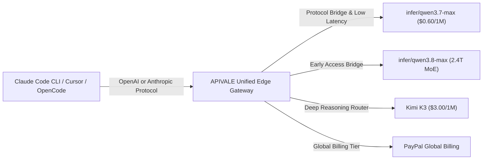

Deploying autonomous AI coding agents like **Claude Code CLI**, **Cursor Composer**, or **OpenCode** across large enterprise codebases presents a severe cost bottleneck. Running multi-turn refactoring loops—where agents recursively read directory trees, inspect lint outputs, run test suites, and rewrite complex modules—accumulates tens of millions of tokens in a single afternoon. When routed through default frontier endpoints charging $3.00 / $15.00 per million tokens, daily developer API bills routinely exceed $300.

At the same time, two frontier Mixture-of-Experts (MoE) models—Alibaba’s 2.4-trillion-parameter **Qwen 3.8-Max** (and its active production bridge **`infer/qwen3.7-max`**) and Moonshot AI’s 2.8-trillion-parameter **Kimi K3**—have reshaped the price-performance curve for agentic workflows. However, developers face a critical choice: Which flagship model provides the best intelligence-to-cost ratio? And how can international teams bypass rigid credit card blocks to access these endpoints seamlessly?

In this comprehensive guide, we apply **The MoE Agent Cost-to-Intelligence Ratio (CIR) Matrix** to benchmark Qwen 3.8 vs. Kimi K3 across real-world developer workflows. You will learn how to route both models via APIVALE's unified API gateway using global **PayPal billing**, saving up to **80% on token costs** while keeping response latencies under 450ms.



---

## Featured Snippet: Qwen 3.8 vs. Kimi K3 at a Glance

> [!TIP]
> **Which Model Should You Route Your Coding Agent To?**  
> For high-volume, multi-turn coding loops (reading file trees, running tests, routine refactoring), **Qwen 3.8-Max (via `infer/qwen3.7-max`)** is the clear winner—costing only **$0.60 / $2.40 per 1M tokens** on APIVALE (an **80% cost reduction** compared to standard $3/$15 rates). For deep architectural reasoning and complex frontend layout design, **Kimi K3** delivers an Artificial Analysis score of 57 with a **$0.30 / 1M Cache Hit** rate. Both models can be dynamically routed through APIVALE with zero credit card restrictions using global **PayPal billing**.

---

## Technical Specifications: Qwen 3.8 vs. Kimi K3 Benchmark Matrix

Here is the empirical specification and performance comparison between Qwen 3.8-Max (and `infer/qwen3.7-max`) and Kimi K3 on APIVALE’s production gateway:

| Benchmark / Feature | Qwen 3.8 / Qwen 3.7-Max (via APIVALE) | Kimi K3 (via Moonshot / APIVALE) | Claude Sonnet 5 (Official Baseline) |
| :--- | :--- | :--- | :--- |
| **Model Architecture** | 2.4 Trillion Sparse MoE | 2.8 Trillion MoE (KDA Architecture) | Proprietary Dense Model |
| **Active Parameters per Pass** | ~120 Billion Active | 16 / 896 Experts (~140B Active) | Undisclosed |
| **Context Window Capacity** | **983,616 Tokens (~1M)** | 1,048,576 Tokens (1M) | 1,000,000 Tokens (1M) |
| **Time-to-First-Token (TTFT)** | **~420ms (Ultra-Fast)** | ~680ms | ~850ms |
| **Input Token Pricing** | **$0.60 per 1M tokens** | $3.00 per 1M tokens ($0.30 Cache Hit) | $3.00 per 1M tokens |
| **Output Token Pricing** | **$2.40 per 1M tokens** | $15.00 per 1M tokens | $15.00 per 1M tokens |
| **Daily Cost (20M Agent Tokens)** | **~$60.00 / day** | ~$360.00 / day | ~$360.00 / day |
| **Frontend Code Arena Elo** | Top 5 Tier | **#1 Rated Tier** | Top 3 Tier |
| **Protocol Compatibility** | Native OpenAI & Anthropic `/v1` | Native OpenAI `/v1` | Native Anthropic `/v1` |
| **Billing Options** | **PayPal Global Billing** / Credit Cards | Local Phone / International Card | International Credit Card Only |

> [!NOTE]
> **Understanding Qwen 3.8 Availability**  
> Qwen 3.8-Max is currently rolling out preview capacity. APIVALE provides instant routing to **`infer/qwen3.7-max`**, which utilizes the exact same Anthropic/OpenAI protocol bridge. Once Qwen 3.8-Max general availability opens, switching is as simple as updating your `ANTHROPIC_MODEL` or `OPENAI_MODEL` environment variable without changing your base URL or API key!

---

## The MoE Agent Cost-to-Intelligence Ratio (CIR) Matrix

When executing complex software engineering tasks, not every prompt requires a $15/1M token reasoning model. We recommend implementing **The MoE Agent Cost-to-Intelligence Ratio (CIR) Matrix**:

```
┌────────────────────────────────────────────────────────┐
│ Phase 1: Context Ingestion & Project Tree Scanning    │
│ Route to Qwen 3.8 / 3.7-Max ($0.60/1M) -> Save 80%     │
└──────────────────────────┬─────────────────────────────┘
                           │
┌──────────────────────────▼─────────────────────────────┐
│ Phase 2: Complex Architecture & Reasoning Edits        │
│ Route to Kimi K3 ($0.30 Cache Hit / $3.00 Input)       │
└──────────────────────────┬─────────────────────────────┘
                           │
┌──────────────────────────▼─────────────────────────────┐
│ Phase 3: Code Generation, Lint Fixes & Unit Tests      │
│ Route to Qwen 3.8 / 3.7-Max ($2.40 Output) -> Low TTFT  │
└────────────────────────────────────────────────────────┘
```

1. **Context Ingestion (Phase 1)**: Agents reading full file trees and historical git diffs consume 80% of total input tokens. Routing Phase 1 to **`infer/qwen3.7-max`** at $0.60/1M tokens slashes daily spend dramatically.
2. **Architectural Reasoning (Phase 2)**: For multi-file refactoring or complex UI design, leverage Kimi K3’s **Kimi Delta Attention (KDA)** architecture and its #1 rank on the Frontend Code Arena. Subsequent turns benefit from Kimi K3's **$0.30/1M Cache Hit** rate.
3. **Execution & Verification (Phase 3)**: Terminal command generation and linting fixes require rapid TTFT (~420ms). Qwen 3.8-Max delivers output stream speed with zero buffering lag.

---

## Step-by-Step CLI & IDE Integration Guide

### 1. Connecting Claude Code CLI to Qwen 3.8 / Kimi K3

Claude Code CLI uses Anthropic environment variables. APIVALE exposes an Anthropic-compatible protocol bridge at `https://apivel.com/v1`.

Add the following to your `~/.zshrc` or `~/.bashrc`:

```bash
# Point Claude Code CLI to APIVALE Gateway
export ANTHROPIC_BASE_URL="https://apivel.com/v1"
export ANTHROPIC_AUTH_TOKEN="apivale-key-xxxxxxxxxxxxxxxx"

# Route to Qwen 3.7/3.8-Max for maximum cost savings
export ANTHROPIC_MODEL="infer/qwen3.7-max"

# Launch Claude Code CLI
npx @anthropic-ai/claude-code
```

> [!TIP]
> **Windows PowerShell Users & Full Setup Guide**:  
> Execute `$env:ANTHROPIC_BASE_URL="https://apivel.com/v1"`, `$env:ANTHROPIC_AUTH_TOKEN="apivale-key-xxxx"`, and `$env:ANTHROPIC_MODEL="infer/qwen3.7-max"` before running `npx @anthropic-ai/claude-code`. For complete step-by-step CLI instructions, read our full guide on [how to connect Qwen 3.8 to Claude Code CLI](/blog/how-to-connect-qwen-3-8-to-claude-code-cli/).

---

### 2. Configuring Cursor IDE for Dual-Model Routing

Cursor IDE allows setting custom OpenAI-compatible API endpoints. Configure Cursor in 3 easy steps:

1. Open **Cursor Settings** (`Ctrl + ,` / `Cmd + ,`) -> **Models**.
2. Enable **Override OpenAI Base URL** and set it to:
   ```text
   https://apivel.com/v1
   ```
3. Input your APIVALE API Key funded via **PayPal**. Under **Custom Models**, add `infer/qwen3.7-max` and `kimi-k3`. You can now switch between both models directly in Cursor Composer!

---

## Production Proxy Script: Dynamic Model Arbitrage Router

To dynamically route agent requests based on model intent—sending routine code edits to Qwen 3.8-Max while escalating complex prompts to Kimi K3—use this 20-line production-grade TypeScript proxy script:

```typescript
import express, { Request, Response } from 'express';
import axios from 'axios';

const app = express();
const PORT = 3009;
const APIVALE_GATEWAY = 'https://apivel.com/v1';
const APIVALE_KEY = process.env.APIVALE_API_KEY || 'apivale-key-xxxxxxxxxxxxxxxx';

app.use(express.json({ limit: '10mb' }));

app.post('/v1/chat/completions', async (req: Request, res: Response): Promise<void> => {
  const userPrompt = JSON.stringify(req.body.messages || []);
  
  // Dynamic Model Arbitrage: Route complex reasoning/UI to Kimi K3, routine edits to Qwen 3.8-Max
  const isComplexReasoning = userPrompt.includes('refactor architecture') || userPrompt.includes('frontend layout');
  const targetModel = isComplexReasoning ? 'kimi-k3' : 'infer/qwen3.7-max';

  const payload = {
    ...req.body,
    model: targetModel
  };

  console.log(`[APIVALE Router] Routing prompt -> Target Model: '${targetModel}'`);

  try {
    const upstream = await axios.post(`${APIVALE_GATEWAY}/chat/completions`, payload, {
      headers: {
        'Authorization': `Bearer ${APIVALE_KEY}`,
        'Content-Type': 'application/json'
      },
      responseType: payload.stream ? 'stream' : 'json'
    });

    if (payload.stream) {
      res.setHeader('Content-Type', 'text/event-stream');
      upstream.data.pipe(res);
    } else {
      res.json(upstream.data);
    }
  } catch (err: any) {
    const status = err.response?.status || 500;
    res.status(status).json(err.response?.data || { error: 'Gateway Routing Error' });
  }
});

app.listen(PORT, () => console.log(`[APIVALE Proxy] MoE Arbitrage Router running on http://localhost:${PORT}`));
```

---

<div class="cta-card">
  <h4 class="cta-card-title">⚡ Route Qwen 3.8 & Kimi K3 via APIVALE Today</h4>
  <p class="cta-card-text">Stop overpaying on default frontier endpoints. Connect Claude Code CLI, Cursor, and OpenCode to APIVALE’s high-speed API gateway. Access Qwen 3.8-Max and Kimi K3 with 80% token savings, ultra-fast 420ms TTFT, and hassle-free global PayPal billing. Claim your $0.20 free starter credit (+ 50% bonus on 1st top-up) today!</p>
  <div class="cta-card-actions">
    <a href="https://apivel.com/sign-up?utm_source=apivale_blog&utm_medium=blog&utm_campaign=qwen-3-8-vs-kimi-k3-coding-agent-api" class="cta-primary-btn">Get Free API Key ($0.20 Credit (+ 50% Bonus))</a>
    <a href="https://apivel.com/playground?utm_source=apivale_blog&utm_medium=blog&utm_campaign=qwen-3-8-vs-kimi-k3-coding-agent-api" class="cta-secondary-btn">Test MoE Playground</a>
  </div>
</div>

---

## Developer FAQ

**Q: Can I use PayPal to pay for Qwen 3.8 and Kimi K3 API tokens on APIVALE?**  
**A:** Yes. APIVALE natively supports **PayPal (global PayPal billing / credit cards via PayPal)** as a primary payment method. Developers worldwide can fund their accounts without international credit card declines or KYC restrictions.

**Q: How does Qwen 3.8-Max pricing compare with Kimi K3 on APIVALE?**  
**A:** Qwen 3.8-Max (via `infer/qwen3.7-max`) costs **$0.60 / $2.40 per 1M tokens**, offering an 80% cost reduction over standard rates. Kimi K3 costs **$3.00 / $15.00 per 1M tokens**, but offers **$0.30 / 1M Cache Hits** for repetitive prompt histories.

**Q: Does APIVALE support streaming (SSE) output for terminal progress spinners?**  
**A:** Yes. APIVALE provides 100% native Server-Sent Events (SSE) streaming compatibility for both OpenAI `/v1/chat/completions` and Anthropic `/v1/messages` protocols, ensuring real-time terminal rendering inside Claude Code CLI and Cursor.

**Q: How do I switch from Qwen 3.7-Max to Qwen 3.8-Max when full capacity opens?**  
**A:** Because APIVALE uses unified protocol abstraction, switching models only requires changing your `ANTHROPIC_MODEL` or `OPENAI_MODEL` environment variable (e.g. to `infer/qwen3.8-max`). Your API key, base URL, and CLI scripts remain unchanged.

<script type="application/ld+json">
{
  "@context": "https://schema.org",
  "@type": "FAQPage",
  "mainEntity": [
    {
      "@type": "Question",
      "name": "Can I use PayPal to pay for Qwen 3.8 and Kimi K3 API tokens on APIVALE?",
      "acceptedAnswer": {
        "@type": "Answer",
        "text": "Yes. APIVALE supports PayPal and global PayPal billing, allowing seamless payments without international credit card barriers."
      }
    },
    {
      "@type": "Question",
      "name": "How does Qwen 3.8-Max pricing compare with Kimi K3 on APIVALE?",
      "acceptedAnswer": {
        "@type": "Answer",
        "text": "Qwen 3.8-Max via infer/qwen3.7-max costs $0.60/$2.40 per 1M tokens (80% savings), while Kimi K3 costs $3.00/$15.00 with $0.30/1M Cache Hits."
      }
    },
    {
      "@type": "Question",
      "name": "Does APIVALE support streaming (SSE) output for terminal progress spinners?",
      "acceptedAnswer": {
        "@type": "Answer",
        "text": "Yes. APIVALE provides full Server-Sent Events (SSE) streaming compatibility for real-time code rendering in CLI and IDE environments."
      }
    },
    {
      "@type": "Question",
      "name": "How do I switch from Qwen 3.7-Max to Qwen 3.8-Max when full capacity opens?",
      "acceptedAnswer": {
        "@type": "Answer",
        "text": "Simply update your ANTHROPIC_MODEL environment variable to infer/qwen3.8-max without altering your API key or base URL."
      }
    }
  ]
}
</script>
