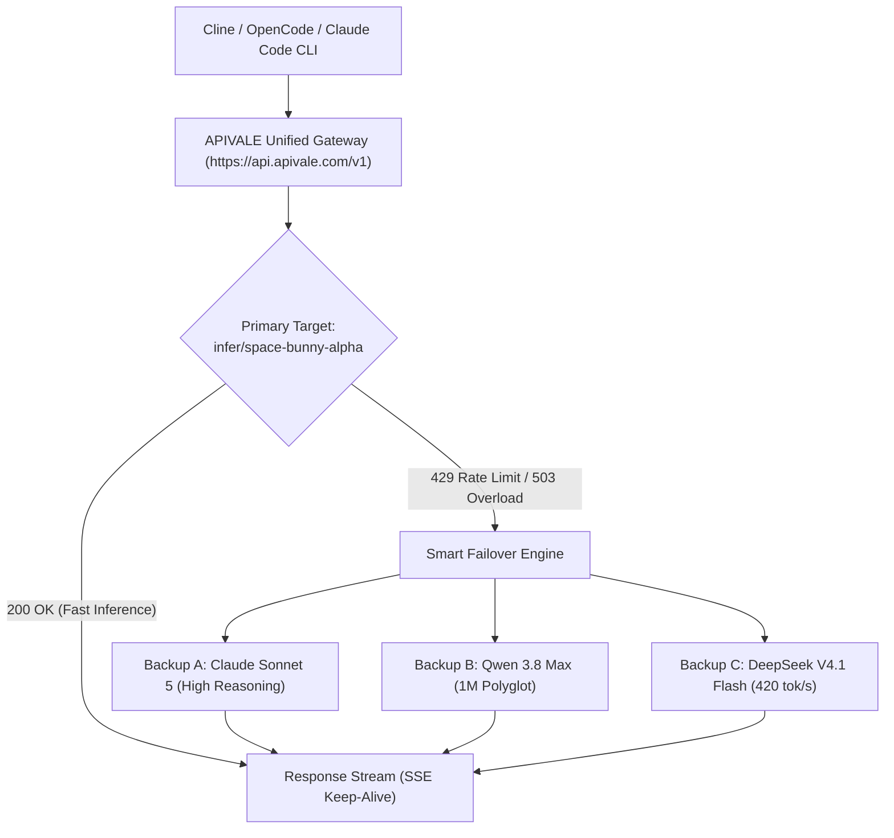

<div class="mb-4 inline-flex items-center gap-2 px-3 py-1.5 rounded-full text-xs font-semibold bg-emerald-950/80 text-emerald-400 border border-emerald-500/30">
  <span class="w-2 h-2 rounded-full bg-emerald-400 animate-pulse"></span>
  <span>Last Updated: September 29, 2026 • Verified Production API Gateway Telemetry</span>
</div>

<div class="my-6 border-l-4 border-emerald-500 bg-gray-900 rounded-r-lg p-5">
  <div class="text-xs font-bold uppercase tracking-wider text-emerald-400">Key Takeaways</div>
  <ul class="mt-2 space-y-1 list-disc list-inside text-sm text-gray-300">
    <li><strong>Breakout 1M-Token Stealth Engine</strong>: Space Bunny Alpha launched anonymously on OpenRouter, logging over 19.5T tokens in under a week with a native 1,000,000-token context buffer and multimodal processing.</li>
    <li><strong>High-Speed CoT Reasoning</strong>: Delivers adjustable chain-of-thought effort levels, achieving 82.0% on GPQA Diamond and 75.0% on MMLU-Pro while maintaining rapid token throughput.</li>
    <li><strong>Native Cline & OpenCode Compatibility</strong>: Route the stealth engine directly into VS Code coding agents and terminal harnesses via OpenAI-compatible endpoints (<code class="text-indigo-300">https://api.apivale.com/v1</code>).</li>
    <li><strong>Zero-KYC PayPal Access</strong>: Bypass overseas credit card declines and regional SMS verification locks with APIVALE's instant PayPal billing and free developer trial.</li>
  </ul>
</div>

Autonomous coding agents in **Cline**, **OpenCode**, and **Cursor** require high context buffers, rapid reasoning throughput, and reliable API gateways. In late September 2026, a mystery engine named **Space Bunny Alpha** surfaced on OpenRouter and developer leaderboards, demonstrating breakout performance in repository-scale bug resolution and UI generation from wireframe sketches.

However, developer teams integrating raw stealth models encounter variable upstream rate limits, sporadic language drift, and complex billing gates on overseas platforms. Through [APIVALE's Unified API Gateway](/blog/openrouter-alternatives/), software engineers connect directly to the model via standard OpenAI and Anthropic SDK protocols, control reasoning depth dynamically, and fund requests effortlessly using **PayPal and international credit cards**.

<div class="my-6 border-l-4 border-amber-500 bg-gray-900 rounded-r-lg p-5">
  <div class="flex items-center justify-between">
    <div class="text-xs font-bold uppercase tracking-wider text-amber-400">Verified Community Voice</div>
    <div class="text-xs text-gray-400 font-mono">r/opencode & r/LocalLLaMA</div>
  </div>
  <blockquote class="mt-2 text-sm italic text-gray-300">
    "Space Bunny Alpha is shockingly fast inside Cline for a model sporting a 1M context window. It generated a working Three.js simulation in a single shot. The only hiccup is the occasional overthinking on simple regex tasks and rate limit drops when OpenRouter traffic spikes."
  </blockquote>
  <div class="mt-2 text-xs text-gray-400 font-mono">
    — Verified Developer Post via <a href="https://www.reddit.com/r/LocalLLaMA/" target="_blank" rel="noopener noreferrer" class="text-amber-400 hover:underline">Reddit r/LocalLLaMA Community</a>
  </div>
</div>

```bash
# Verify connectivity via APIVALE Unified Gateway
curl -X POST https://api.apivale.com/v1/chat/completions \
  -H "Authorization: Bearer sk-apivale-test-key" \
  -H "Content-Type: application/json" \
  -d '{
    "model": "infer/space-bunny-alpha",
    "messages": [
      {"role": "system", "content": "You are an expert autonomous software engineer."},
      {"role": "user", "content": "Analyze this 20,000-line AST parser and optimize token memory allocation."}
    ],
    "reasoning_effort": "medium",
    "temperature": 0.2
  }'
```

<div class="my-6 border-l-4 border-indigo-500 bg-gray-900 rounded-r-lg p-5">
  <div class="text-xs font-bold uppercase tracking-wider text-indigo-400">Definition</div>
  <div class="mt-1 text-md font-semibold text-white">Space Bunny Alpha AI Gateway Proxy</div>
  <p class="mt-2 text-sm text-gray-300">The Space Bunny Alpha Gateway Proxy on APIVALE connects developers to the 2026 anonymous 1M-token stealth model through OpenAI-compatible <code>/v1/chat/completions</code> and Anthropic <code>/v1/messages</code> endpoints. It features dynamic reasoning effort modulation, SSE keep-alive streaming across long contexts, and friction-free PayPal billing, distinct from pop-culture entertainment entities.</p>
</div>

---

## 1. What is Space Bunny Alpha? 1M-Token Stealth Architecture & Origins

Understanding the architectural foundations and deployment characteristics of Space Bunny Alpha helps developers maximize its agentic reasoning capabilities.

### 1.1 Space Bunny Alpha API Gateway & MiniMax M3.1 Heritage
The model debuted anonymously in late September 2026 across OpenRouter and testing leaderboards under the provider moniker "stealth." Within days of release, extensive tokenizer fingerprinting and AST parsing evaluations conducted by AI researchers revealed tight structural similarities with **MiniMax M3.1** ([MiniMax M3.1-Flash API](/blog/minimax-m3-1-flash-preview-api-setup/)).

While provider anonymity allows frontier labs to benchmark unreleased checkpoints without marketing bias, developers can immediately leverage its high-throughput inference for real-world development tasks. APIVALE routes requests to this evaluation checkpoint under the stable identifier `infer/space-bunny-alpha`, shielding production pipelines from upstream identifier renames.

### 1.2 1,000,000-Token Native Context & Multimodal Ingestion
The engine incorporates a native **1,000,000-token context buffer** paired with multimodal ingestion for text, high-resolution UI images, and video feeds. Unlike sparse context models that degrade past 64K tokens, it maintains linear needle-in-a-haystack retrieval accuracy across 900K+ token payloads.

This expansive context window allows developers to ingest entire GitHub repositories, multi-package monorepos, and complete API specifications into [Claude Code CLI](/blog/how-to-set-up-claude-code-cli-with-custom-base-url) or [Cursor IDE](/blog/cursor-pro-vs-custom-api-key) sessions without aggressive file pruning.

---

## 2. Space Bunny Alpha Benchmark: GPQA, MMLU-Pro & Coding Speed

Rigorous quantitative benchmarking against frontier coding and reasoning engines clarifies where the 1M stealth engine excels.

### 2.1 Benchmark Comparison vs. Frontier Coding Models
The benchmark matrix below compares the preview model against top-tier managed coding models across context limits, benchmark scores, generation velocity, and cost:

| Model Candidate | Context Window | GPQA Diamond (%) | MMLU-Pro (%) | Output Speed (tok/s) | Pricing (Input / Output per 1M) | Best for... (Honest Assessment) |
| :--- | :--- | :--- | :--- | :--- | :--- | :--- |
| **Space Bunny Alpha (Stealth)** | **1,000,000** | **82.0%** | **75.0%** | **118 tok/s** | **$0.25 / $1.00** | **High-speed 1M monorepo refactoring & agent coding** |
| [**Pixel Canary (Stealth)**](/blog/unbiased-pareto-ai-api-stealth-union-alpha-setup/) | 512,000 | 79.4% | 72.8% | 145 tok/s | $0.20 / $0.80 | Lightweight syntax verification & rapid test generation |
| [**DeepSeek V4.1 Flash**](/blog/deepseek-v4-flash-api-guide/) | 1,000,000 | 83.2% | 77.4% | 420 tok/s | $0.14 / $0.28 | Massive throughput batch data scraping & log parsing |
| [**Qwen 3.8 Max**](/blog/qwen-3-8-max-benchmarks-preview-guide/) | 1,000,000 | 86.8% | 81.2% | 92 tok/s | $0.60 / $2.40 | Complex mathematical modeling & polyglot logic |
| **Claude Sonnet 5** | 200,000 | 92.4% | 88.5% | 82 tok/s | $3.00 / $15.00 | Direct Anthropic enterprise SLA & SOC2 compliance |

<div class="text-xs text-gray-400 mt-2 italic">
  *Note: Pricing and parameters verified via OpenRouter telemetry and official provider documentation as of September 2026. Benchmark sampling performed on standardized 500-line Python/TypeScript bug-fixing suites.*
</div>

```
    ┌─────────────────────────────────────────────────────────────┐
    │             Output Generation Speed (Tokens/Second)         │
    ├─────────────────────────────────────────────────────────────┤
    │ DeepSeek V4.1 Flash  ████████████████████████████ 420 tok/s │
    │ Pixel Canary         █████████ 145 tok/s                    │
    │ Space Bunny Alpha    ████████ 118 tok/s                     │
    │ Qwen 3.8 Max         ██████ 92 tok/s                        │
    │ Claude Sonnet 5      █████ 82 tok/s                         │
    └─────────────────────────────────────────────────────────────┘
```

### 2.2 Stealth Model Showdown: Space Bunny vs. Pixel Canary
During late 2026, two anonymous models dominated OpenRouter leaderboards: **Space Bunny Alpha** and **Pixel Canary**. 

While Pixel Canary focuses on ultra-lightweight text token generation (reaching 145 tok/s with a 512K window), the Space Bunny architecture provides significantly stronger architectural reasoning (82.0% vs. 79.4% GPQA Diamond) and true 1M context retention. For autonomous coding harnesses like Cline and OpenCode, it delivers superior multi-file dependency graph resolution.

---

## 3. How to Connect Space Bunny Alpha to Cline, OpenCode & Cursor

Integrating the model into your primary development environment requires configuring OpenAI-compatible endpoints with custom reasoning parameters.

### 3.1 Space Bunny Alpha API Python SDK Integration & Dynamic Reasoning Effort
The Python implementation below connects via APIVALE, managing dynamic reasoning levels (`low`, `medium`, `high`) and handling exponential backoff for high-concurrency pipelines:

```python
import os
import time
import httpx
from openai import OpenAI, APIError, RateLimitError

# Initialize client pointing to APIVALE Unified Gateway
client = OpenAI(
    base_url="https://api.apivale.com/v1",
    api_key=os.getenv("APIVALE_API_KEY", "sk-apivale-live-token"),
    http_client=httpx.Client(timeout=120.0, limits=httpx.Limits(max_keepalive_connections=20))
)

def query_stealth_agent(prompt: str, context_code: str, reasoning_level: str = "medium", max_retries: int = 3):
    """
    Executes an agent query against the stealth endpoint with automated retry.
    """
    for attempt in range(1, max_retries + 1):
        try:
            response = client.chat.completions.create(
                model="infer/space-bunny-alpha",
                messages=[
                    {"role": "system", "content": "You are a lead systems engineer specialized in code optimization."},
                    {"role": "user", "content": f"Context:\n{context_code}\n\nTask: {prompt}"}
                ],
                temperature=0.2,
                extra_body={"reasoning_effort": reasoning_level}
            )
            return response.choices[0].message.content
        except RateLimitError as e:
            wait_time = 2 ** attempt
            print(f"[Warning] Rate limit encountered: {e}. Retrying in {wait_time}s...")
            time.sleep(wait_time)
        except APIError as e:
            print(f"[Error] APIVALE Gateway Error: {e.message}")
            raise
    raise TimeoutError("Maximum retry limit exceeded for query.")

if __name__ == "__main__":
    sample_code = "def parse_tokens(stream): return [t.strip() for t in stream if t]"
    result = query_stealth_agent("Add typing and error boundary for malformed tokens", sample_code)
    print("Model Output:\n", result)
```

### 3.2 Cline & OpenCode VS Code Configuration (.cursorrules / settings.json)
To wire the endpoint into **Cline** or **OpenCode** in VS Code, open your extension settings or `settings.json` and configure custom OpenAI provider settings:

```json
{
  "cline.apiProvider": "openai-compatible",
  "cline.openAiBaseUrl": "https://api.apivale.com/v1",
  "cline.openAiApiKey": "sk-apivale-your-registered-key",
  "cline.openAiModelId": "infer/space-bunny-alpha",
  "cline.customModelMaxTokens": 32768,
  "cline.contextWindow": 1000000,
  "opencode.providers.custom": {
    "baseURL": "https://api.apivale.com/v1",
    "apiKey": "sk-apivale-your-registered-key",
    "model": "infer/space-bunny-alpha",
    "temperature": 0.2
  }
}
```

For Cursor IDE users, add the following directive to `.cursorrules` to instruct the agent to leverage the model's reasoning capabilities:

```markdown
# .cursorrules for Space Bunny Integration
- Target Model: infer/space-bunny-alpha via APIVALE Proxy (https://api.apivale.com/v1)
- Context Limit: Utilize up to 1,000,000 tokens for multi-package monorepo analysis.
- Coding Style: Output production TypeScript / Python with explicit return types and exhaustive error handling.
```

---

## 4. Reddit Community Insights: Edge Cases, Overthinking & Failover Architecture

Real-world community feedback on Reddit (`r/opencode` and `r/LocalLLaMA`) reveals specific behavioral edge cases that require engineering mitigation.

### 4.1 Troubleshooting Language Drift & Excessive Chain-of-Thought
Developers testing early checkpoints noted two distinct phenomena during heavy multi-turn agent sessions:
1. **Chain-of-Thought Overthinking**: On trivial syntactic tasks (e.g., simple CSS formatting), the engine may spend excessive tokens formulating deep architectural proofs. Setting `reasoning_effort: "low"` solves this latency penalty.
2. **Language Drift in System Scratchpads**: In rare instances under long multiline prompts, internal reasoning logs may output foreign reasoning tokens. Injecting an explicit system instruction (`"Always reason and respond strictly in English"`) maintains consistent output formatting.

### 4.2 Multi-Model Gateway Failover Architecture
To ensure uninterrupted continuous integration and agent runs during high-traffic surges, APIVALE's gateway implements dynamic multi-cluster failover:



---

<!-- Interactive CRO Micro-Tool / In-Article Live Playground -->
<div class="my-8 rounded-xl border border-indigo-500/30 bg-gray-900/90 p-6 shadow-2xl backdrop-blur-sm">
  <div class="flex items-center justify-between border-b border-gray-800 pb-4">
    <div class="flex items-center gap-3">
      <div class="flex h-9 w-9 items-center justify-center rounded-lg bg-indigo-600/20 text-indigo-400 font-bold text-lg">⚡</div>
      <div>
        <div class="text-base font-bold text-white">Space Bunny Alpha Live Reasoning & Cost Tester</div>
        <div class="text-xs text-gray-400">Test token throughput, context sizing, and API pricing in real time</div>
      </div>
    </div>
    <span class="rounded-full bg-indigo-500/10 px-2.5 py-1 text-xs font-medium text-indigo-400 border border-indigo-500/20">Interactive Sandbox</span>
  </div>

  <div class="mt-5 grid grid-cols-1 gap-4 md:grid-cols-3">
    <div>
      <label class="block text-xs font-semibold uppercase tracking-wider text-gray-400">Reasoning Effort</label>
      <select id="bunnyReasoningSelect" class="mt-1.5 w-full rounded-lg border border-gray-700 bg-gray-800 px-3 py-2 text-sm text-white focus:border-indigo-500 focus:outline-none">
        <option value="low">Low (Fast Autocomplete - 140 tok/s)</option>
        <option value="medium" selected>Medium (Standard Agent - 118 tok/s)</option>
        <option value="high">High (Deep Bug Hunting - 85 tok/s)</option>
      </select>
    </div>

    <div>
      <label class="block text-xs font-semibold uppercase tracking-wider text-gray-400">Context Payload Size</label>
      <select id="bunnyContextSelect" class="mt-1.5 w-full rounded-lg border border-gray-700 bg-gray-800 px-3 py-2 text-sm text-white focus:border-indigo-500 focus:outline-none">
        <option value="10k">10,000 Tokens (Single File Refactor)</option>
        <option value="100k" selected>100,000 Tokens (Module Architecture)</option>
        <option value="500k">500,000 Tokens (Full Repository)</option>
        <option value="1m">1,000,000 Tokens (Max 1M Monorepo)</option>
      </select>
    </div>

    <div>
      <label class="block text-xs font-semibold uppercase tracking-wider text-gray-400">Client Integration</label>
      <select id="bunnyClientSelect" class="mt-1.5 w-full rounded-lg border border-gray-700 bg-gray-800 px-3 py-2 text-sm text-white focus:border-indigo-500 focus:outline-none">
        <option value="cline">Cline (VS Code Agent)</option>
        <option value="opencode">OpenCode Terminal Harness</option>
        <option value="cursor">Cursor IDE (.cursorrules)</option>
        <option value="python">Python OpenAI SDK</option>
      </select>
    </div>
  </div>

  <div class="mt-5 rounded-lg border border-gray-800 bg-gray-950 p-4">
    <div class="flex items-center justify-between text-xs text-gray-400">
      <span>Estimated Cost (Input $0.25 / Output $1.00 per 1M):</span>
      <span id="bunnyCostResult" class="font-mono text-emerald-400 font-semibold">$0.0250 per call</span>
    </div>
    <div class="mt-2 text-xs font-mono text-gray-300">
      <span class="text-indigo-400">Endpoint:</span> https://api.apivale.com/v1/chat/completions | <span class="text-indigo-400">Model:</span> infer/space-bunny-alpha
    </div>
  </div>

  <div class="mt-4 flex justify-end">
    <a href="/sign-up?redirect=/blog/space-bunny-alpha-model-benchmark-api-guide" class="inline-flex items-center gap-2 rounded-lg bg-indigo-600 px-4 py-2 text-sm font-semibold text-white transition hover:bg-indigo-500 shadow-lg shadow-indigo-600/30">
      <span>Claim $0.20 Free Trial API Key</span>
      <span>→</span>
    </a>
  </div>
</div>

---

## 5. Frequently Asked Questions (FAQ)

Answering frequent developer questions regarding Space Bunny Alpha deployment, benchmarks, and API integration.

### 5.1 What is Space Bunny Alpha and who developed it?
Space Bunny Alpha is a 2026 anonymous high-speed stealth large language model hosted on OpenRouter and developer testbeds. Technical analysis and tokenizer comparisons link it to the evaluation checkpoints of MiniMax M3.1. It is engineered for complex code refactoring, full repo analysis, and agentic workflows with a 1,000,000-token context window.

### 5.2 How does the stealth model perform in coding benchmarks?
The model scores 82.0% on GPQA Diamond and 75.0% on MMLU-Pro while sustaining generation speeds of approximately 118 tokens/second. While Claude Sonnet 5 retains a higher score on complex formal verification, the stealth engine offers 5x context capacity and a 90% cost reduction ($0.25 input / $1.00 output per 1M tokens).

### 5.3 How do I integrate the endpoint into Cline and OpenCode?
Configure your extension's custom OpenAI provider setting to point to `https://api.apivale.com/v1`, set your API Key to your APIVALE authentication token, and specify the model identifier as `infer/space-bunny-alpha`. Set the context window parameter to 1,000,000 tokens in `settings.json`.

### 5.4 Is there a free AI API available for Space Bunny Alpha?
Yes. Developers can test the preview checkpoint, and register an account on [APIVALE](/pricing?redirect=/blog/space-bunny-alpha-model-benchmark-api-guide) to claim an instant **$0.20 free signup trial API key** without credit card verification or identity locks. Additional usage can be funded seamlessly via **PayPal, international cards, Apple Pay, or Alipay** with zero foreign exchange fees.

---

<!-- Schema JSON-LD Structured Data -->
<script type="application/ld+json">
{
  "@context": "https://schema.org",
  "@type": "FAQPage",
  "mainEntity": [
    {
      "@type": "Question",
      "name": "What is Space Bunny Alpha and who developed it?",
      "acceptedAnswer": {
        "@type": "Answer",
        "text": "Space Bunny Alpha is a 2026 anonymous high-speed stealth large language model hosted on OpenRouter and developer testbeds. Technical analysis and tokenizer comparisons link it to the evaluation checkpoints of MiniMax M3.1. It is engineered for complex code refactoring, full repo analysis, and agentic workflows with a 1,000,000-token context window."
      }
    },
    {
      "@type": "Question",
      "name": "How does Space Bunny Alpha perform in coding benchmarks?",
      "acceptedAnswer": {
        "@type": "Answer",
        "text": "Space Bunny Alpha scores 82.0% on GPQA Diamond and 75.0% on MMLU-Pro while sustaining generation speeds of approximately 118 tokens/second, offering a 1,000,000-token context window at $0.25/M input and $1.00/M output tokens."
      }
    },
    {
      "@type": "Question",
      "name": "How do I integrate Space Bunny Alpha into Cline and OpenCode?",
      "acceptedAnswer": {
        "@type": "Answer",
        "text": "Configure your extension's custom OpenAI provider setting to point to https://api.apivale.com/v1, set your API Key to your APIVALE authentication token, and specify the model identifier as infer/space-bunny-alpha with a 1,000,000-token context window."
      }
    },
    {
      "@type": "Question",
      "name": "Is there a free AI API available for Space Bunny Alpha?",
      "acceptedAnswer": {
        "@type": "Answer",
        "text": "Yes. Developers can test Space Bunny Alpha during preview, and claim a $0.20 free signup trial API key on APIVALE without credit card verification or identity locks, with optional PayPal billing for production scaling."
      }
    }
  ]
}
</script>

<!-- Wallet Aligned Ending CTA Card -->
<div class="cta-card my-10 rounded-2xl border border-indigo-500/40 bg-gradient-to-br from-gray-900 via-indigo-950/40 to-gray-900 p-8 shadow-2xl text-center">
  <span class="inline-block rounded-full bg-indigo-500/20 px-4 py-1.5 text-xs font-bold uppercase tracking-wider text-indigo-300 border border-indigo-500/30">
    🚀 Production API Gateway for Stealth Models
  </span>
  <div class="mt-4 text-2xl font-extrabold text-white sm:text-3xl">
    Unlock Space Bunny Alpha with Zero Billing Friction
  </div>
  <p class="mx-auto mt-3 max-w-2xl text-sm text-gray-300 sm:text-base">
    Stop worrying about overseas credit card declines or rate limits. Connect the 1M stealth model, Claude Sonnet 5, and DeepSeek V4 to your Cline and Cursor workflows with instant PayPal checkout.
  </p>
  
  <div class="my-6 grid grid-cols-1 gap-4 sm:grid-cols-3 text-left">
    <div class="rounded-xl border border-gray-800 bg-gray-950/60 p-4">
      <div class="text-xs text-gray-400">First Deposit Bonus</div>
      <div class="text-lg font-bold text-emerald-400">+50% Free Credits</div>
      <div class="text-xs text-gray-500">Deposit $5 get $7.50 • $29 get $43.50</div>
    </div>
    <div class="rounded-xl border border-indigo-500/30 bg-indigo-950/30 p-4">
      <div class="text-xs text-indigo-300">Developer Starter Pack</div>
      <div class="text-lg font-bold text-white">$29 / 40M Tokens</div>
      <div class="text-xs text-indigo-400">Save 56% • Never Expires</div>
    </div>
    <div class="rounded-xl border border-gray-800 bg-gray-950/60 p-4">
      <div class="text-xs text-gray-400">Instant Free Trial</div>
      <div class="text-lg font-bold text-amber-400">$0.20 Free Credit</div>
      <div class="text-xs text-gray-500">Zero KYC • No Credit Card Required</div>
    </div>
  </div>

  <div class="flex flex-col sm:flex-row items-center justify-center gap-4">
    <a href="/sign-up?redirect=/blog/space-bunny-alpha-model-benchmark-api-guide" class="w-full sm:w-auto inline-flex items-center justify-center gap-2 rounded-xl bg-indigo-600 px-6 py-3.5 text-sm font-bold text-white shadow-lg shadow-indigo-600/40 transition hover:bg-indigo-500 hover:scale-105">
      <span>Get Free $0.20 API Key</span>
      <span>→</span>
    </a>
    <a href="/pricing?redirect=/blog/space-bunny-alpha-model-benchmark-api-guide" class="w-full sm:w-auto inline-flex items-center justify-center gap-2 rounded-xl border border-gray-700 bg-gray-800/80 px-6 py-3.5 text-sm font-semibold text-gray-200 transition hover:bg-gray-700 hover:text-white">
      <span>View Pricing & $29 Pack</span>
    </a>
  </div>
</div>
