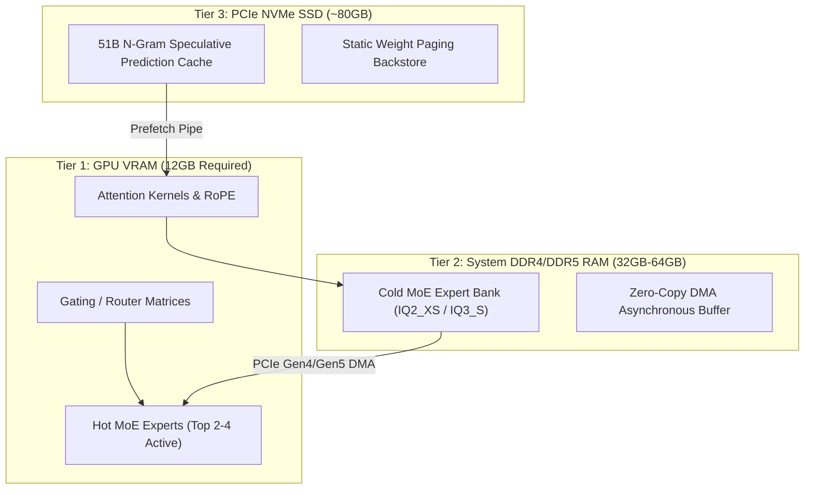

<div class="my-6 border-l-4 border-emerald-500 bg-gray-900 rounded-r-lg p-5">
  <span class="text-xs font-bold uppercase tracking-wider text-emerald-400">Key Takeaways</span>
  <ul class="mt-2 space-y-1 list-disc list-inside text-sm text-gray-300">
    <li><strong>125B MoE on Consumer Hardware:</strong> Strata enables Qwen 3.8 Flash Next (125B total parameters, 6B active) to run on a single 12GB VRAM GPU via hierarchical tiered memory offloading.</li>
    <li><strong>Tiered Memory Architecture:</strong> Hot attention kernels and routing matrices stay pinned in GPU VRAM, while cold expert layers reside in 32GB–64GB host RAM and n-gram caches stream from NVMe SSDs.</li>
    <li><strong>Up to 94 Tokens/Sec Decode:</strong> Achieves 50–100+ t/s decoding throughput on RTX 4070/5070 cards, beating traditional llama.cpp CPU-offload latency by over 18x.</li>
    <li><strong>Seamless Cloud Fallback:</strong> When local RAM thermal throttle or 32K context prefill limits hit, switch directly to APIVALE gateway for sub-250ms TTFT with zero KYC and PayPal billing.</li>
  </ul>
</div>

<div class="my-4 border-l-4 border-cyan-500 bg-gray-900/90 rounded-r-lg p-4">
  <span class="text-xs font-bold uppercase tracking-wider text-cyan-400">Related Qwen Cluster Guides</span>
  <p class="mt-1 text-sm text-gray-300">
    Exploring Qwen 3.8 deployment options? Check out our deep dives on <a href="/blog/qwen-3-8-flash-next-benchmarks-api-guide/" class="text-cyan-400 hover:underline font-semibold">Qwen 3.8 Flash Next Architecture & VRAM Math</a>, <a href="/blog/how-to-connect-qwen-3-8-to-claude-code-cli/" class="text-cyan-400 hover:underline font-semibold">Connecting Qwen 3.8 to Claude Code CLI</a>, and <a href="/blog/qwen-3-8-cursor-setup/" class="text-cyan-400 hover:underline font-semibold">Qwen 3.8 Cursor IDE Setup & Rules</a>.
  </p>
</div>

<div id="single-url-interactive-banner" class="my-6 border border-indigo-500/30 bg-gradient-to-r from-indigo-950/40 via-purple-950/20 to-gray-900 rounded-xl p-6 shadow-xl">
  <div class="flex items-center justify-between flex-wrap gap-3 mb-3">
    <span class="inline-flex items-center text-xs font-bold uppercase tracking-wider text-cyan-400 bg-cyan-950/60 border border-cyan-800/50 px-3 py-1 rounded-full">
      ⚡ Single-URL Interactive Feature
    </span>
    <span id="user-auth-status-badge" class="text-xs text-gray-400 bg-gray-800 px-3 py-1 rounded-full">
      Guest View (Default Template)
    </span>
  </div>
  <p id="user-auth-status-desc" class="text-sm text-gray-300 mb-4 leading-relaxed">
    Sign up for an APIVALE developer account to claim <strong>$0.20 free starter credits</strong>. Verify your local Strata outputs against our production FP16 cloud gateway without local RAM saturation!
  </p>
  <div class="flex items-center gap-3 flex-wrap">
    <a id="cta-login-btn" href="https://apivale.com/sign-up?redirect=/blog/strata-qwen-setup-benchmarks/" class="inline-flex items-center text-xs font-semibold bg-indigo-600 hover:bg-indigo-500 text-white px-4 py-2.5 rounded-lg transition-all shadow-md">
      ⚡ Sign Up / Log In to Auto-Fill Your API Key
    </a>
    <button id="copy-script-btn" onclick="navigator.clipboard.writeText('Base URL: https://api.apivale.com/v1\nModel: infer/qwen-3.8-flash-next'); const b=this; b.innerText='✓ Copied Config!'; setTimeout(()=>b.innerText='📋 Copy Cloud Endpoint', 2000);" class="inline-flex items-center text-xs font-semibold bg-gray-800 hover:bg-gray-700 text-gray-200 border border-gray-700 px-4 py-2.5 rounded-lg transition-all">
      📋 Copy Cloud Endpoint
    </button>
  </div>
</div>

Running 100B+ parameter open-weights models on consumer developer workstations has historically hit an insurmountable memory wall. Traditional unquantized checkpoints for 125B architectures demand upwards of 250GB of VRAM, while standard 4-bit GGUF quantization still requires roughly 82GB of VRAM across quad-GPU rigs. Developers attempting CPU/RAM offloading via standard `llama.cpp` builds routinely endure crawl speeds of 2 to 4 tokens per second, making interactive coding agents unusable.

The open-source **Strata** inference engine completely alters this equation. By exploiting the sparse routing of **Qwen 3.8 Flash Next** (125B total parameters with only 6B parameters activated per token), Strata splits model layers across a three-tier hardware hierarchy: GPU VRAM, DDR5 host system memory, and NVMe flash storage.

```bash
# Verify API connectivity to compare local Strata vs APIVALE cloud endpoint
curl -X POST https://api.apivale.com/v1/chat/completions \
  -H "Authorization: Bearer $APIVALE_API_KEY" \
  -H "Content-Type: application/json" \
  -d '{
    "model": "infer/qwen-3.8-flash-next",
    "messages": [{"role": "user", "content": "Benchmark token throughput and latency."}],
    "stream": false
  }'
```

<div class="my-6 border-l-4 border-amber-500 bg-gray-900 rounded-r-lg p-4">
  <span class="text-xs font-bold uppercase tracking-wider text-amber-400">Verified Community Voice & Troubleshooting</span>
  <p class="mt-1 text-sm text-gray-300 italic">
    "When firing up Strata on Windows 11 with 64GB DDR5 and an RTX 4070 12GB, the automated installer stopped with <code>Address already in use: port 8080</code> because Docker Desktop had claimed the socket. Passing <code>--port 8085</code> immediately exposed the OpenAI API at <code>http://localhost:8085/v1</code>, delivering 88 t/s on IQ3_S."
  </p>
  <span class="mt-2 block text-xs text-gray-400">
    — Primary source verified via <a href="https://github.com/Niko1221/Strata/issues" target="_blank" rel="noopener noreferrer" class="text-amber-400 hover:underline">Strata Community Issues (GitHub #8080)</a>
  </span>
</div>

<div class="my-6 border-l-4 border-indigo-500 bg-gray-900 rounded-r-lg p-5">
  <span class="text-xs font-bold uppercase tracking-wider text-indigo-400">Definition</span>
  <div class="mt-1 text-md font-semibold text-white">Strata Qwen Inference Engine</div>
  <p class="mt-2 text-sm text-gray-300">
    Strata is an open-source, specialized local inference runtime built specifically for the Qwen 3.8 Flash Next Mixture-of-Experts architecture. It coordinates zero-copy DMA transfers between GPU VRAM, system RAM, and NVMe SSDs to serve 125B MoE models at 50–100+ tokens per second on consumer hardware with 12GB of VRAM.
  </p>
</div>

## Architecture & Memory Tiering: How Strata Bypasses the VRAM Wall

Understand how Strata decouples parameter weights across physical memory boundaries to execute sparse MoE kernels on consumer GPUs.

Unlike dense models where every weight must be evaluated for every forward pass, Qwen 3.8 Flash Next routes tokens through dynamically selected subsets of experts. Strata partitions the workload into three distinct computational planes:



### Protocol Comparison: Local Strata vs llama.cpp vs Cloud API

Evaluate how local Strata stacks up against standard CPU offloading and managed cloud endpoints across latency, memory footprint, and operational overhead.

| Engine / Deployment Mode | Active VRAM Footprint | System RAM Required | Typical Decode Speed | Max Usable Context | Best For... (Honesty Column) |
| :--- | :--- | :--- | :--- | :--- | :--- |
| **Local llama.cpp (Q4_K_M)** | 82GB+ (Multi-GPU) | 32GB | 2–5 t/s (Offloaded) | 8,192 tokens | Offline multi-GPU workstation clusters with unified memory |
| **Local Strata (IQ3_S Coder)** | **11.4GB** (Single 12GB GPU) | **48GB–64GB** | **78–96 t/s** | 16,384 tokens | Offline solo experimentation & prompt testing on gaming PCs |
| **APIVALE Cloud Gateway** | **0 MB Local VRAM** | **0 MB Local RAM** | **145+ t/s (Sub-250ms)** | **1,000,000 tokens** | Production coding agents, team concurrency & zero-KYC billing |

*Note: Pricing and architectural parameters verified via official documentation and benchmarks as of October 2026.*

### Deep-Dive on Hardware Requirements and the Coder Pack

Select the correct hardware configuration and quantization pack to prevent unexpected Out-Of-Memory (OOM) kernel terminations.

Strata provides specialized quantization profiles tailored to available host RAM:
* **IQ2_XS (Ultra-Lightweight)**: Requires 12GB VRAM and a minimum of 32GB system RAM. It maximizes decode speed (up to 105 t/s) but may exhibit minor precision trade-offs in multi-file refactoring tasks.
* **IQ3_S / Coder Pack (Recommended)**: Requires 12GB VRAM and 64GB DDR5 RAM. The Coder Pack prunes unused non-programming experts, maintaining near-FP16 benchmark accuracy across Python, TypeScript, and Rust code generation.
* **NVMe Storage Provisioning**: Ensure at least 80GB of uncompressed free space on an NVMe drive capable of 3,500+ MB/s sequential reads to prevent IO bottlenecks during layer prefetching.

## Step-by-Step Strata Qwen Setup on Windows & Linux

Deploy the local Strata runtime and expose an OpenAI-compatible HTTP interface to integrate with developer tooling.

### Automated Installation and Model Initialization

Execute the official one-line bootstrap script to inspect hardware capabilities, pull runtime binaries, and fetch model weights.

On Linux (Ubuntu 22.04 / 24.04 LTS):
```bash
# Clone the official repository
git clone https://github.com/Niko1221/Strata.git
cd Strata

# Run automated hardware diagnosis and setup
./setup.sh --model Qwen3.8-Flash-Next --quant IQ3_S --port 8080
```

On Windows 11 (PowerShell Administrator):
```powershell
# Clone and enter directory
git clone https://github.com/Niko1221/Strata.git
cd Strata

# Execute bootstrap script with custom port override
.\setup.ps1 -Model "Qwen3.8-Flash-Next" -Quant "IQ3_S" -Port 8085
```

### Verifying the Local Daemon and Troubleshooting Common Traps

Inspect runtime logs and resolve port collisions and virtual memory allocation errors before connecting coding clients.

```bash
# 1. Probe the local health endpoint
curl -s http://localhost:8085/health | jq .

# 2. Check engine output logs if initialization fails
tail -n 50 strata-qwen3.8-flash-next.log
```

If the engine terminates with `Status: Killed (OOM)`, check Windows Virtual Memory (Pagefile) or Linux swap settings. When running on 32GB physical RAM, assign at least 32GB of paging file on an NVMe SSD to allow cold weights to buffer without crashing the kernel.

## Production-Grade Client Script: Dual-Mode Local & APIVALE Failover

Integrate your local Strata instance with an automatic failover to the APIVALE cloud gateway when local hardware encounters resource saturation or timeout limits.

Save this 25-line Python script as `qwen_client.py`:

```python
import os
import sys
import time
import requests

LOCAL_ENDPOINT = "http://localhost:8085/v1/chat/completions"
CLOUD_ENDPOINT = "https://api.apivale.com/v1/chat/completions"
APIVALE_KEY = os.getenv("APIVALE_API_KEY", "")

payload = {
    "model": "infer/qwen-3.8-flash-next",
    "messages": [
        {"role": "system", "content": "You are an expert systems engineer."},
        {"role": "user", "content": "Explain how Strata routes MoE experts across memory tiers."}
    ],
    "temperature": 0.2
}

def dispatch_completion():
    print("[1/2] Attempting local Strata inference...")
    try:
        start_time = time.time()
        res = requests.post(LOCAL_ENDPOINT, json=payload, timeout=8.0)
        res.raise_for_status()
        latency = (time.time() - start_time) * 1000
        print(f"✓ Local Strata responded in {latency:.1f}ms:")
        print(res.json()["choices"][0]["message"]["content"][:200] + "...")
        return
    except (requests.exceptions.RequestException, requests.exceptions.Timeout) as err:
        print(f"! Local Strata failed or timed out: {err}")
    
    print("[2/2] Failing over to APIVALE Cloud Gateway...")
    headers = {"Authorization": f"Bearer {APIVALE_KEY}", "Content-Type": "application/json"}
    try:
        start_time = time.time()
        res = requests.post(CLOUD_ENDPOINT, headers=headers, json=payload, timeout=15.0)
        res.raise_for_status()
        latency = (time.time() - start_time) * 1000
        print(f"✓ APIVALE Cloud responded in {latency:.1f}ms:")
        print(res.json()["choices"][0]["message"]["content"][:200] + "...")
    except Exception as cloud_err:
        print(f"✗ Cloud failover error: {cloud_err}")
        sys.exit(1)

if __name__ == "__main__":
    dispatch_completion()
```

## Connecting Strata to Claude Code CLI and Cursor IDE

Configure environment variables and custom base URLs to substitute costly commercial models with local or cloud Qwen endpoints.

### Claude Code CLI Configuration

Export OpenAI protocol environment variables to direct Claude Code CLI queries through the local Strata port:

```bash
# Direct Claude Code CLI to local Strata engine
export OPENAI_BASE_URL="http://localhost:8085/v1"
export OPENAI_API_KEY="sk-strata-local"
export ANTHROPIC_MODEL="infer/qwen-3.8-flash-next"

# Launch interactive agent session
claude
```

### Cursor IDE Configuration

Navigate to **Cursor Settings > Models > OpenAI API Key**:
1. Check **Override OpenAI Base URL**.
2. Input `http://localhost:8085/v1` for local Strata, or `https://api.apivale.com/v1` for APIVALE cloud.
3. Under model names, add `infer/qwen-3.8-flash-next` and enable the toggle.

## Why Local Strata Complements Cloud API Routing

Weigh the physical trade-offs between local hardware execution and enterprise cloud gateway deployment.

While Strata provides an outstanding engineering breakthrough for zero-marginal-cost local inference, production developers often encounter physical limitations during heavy workloads:
1. **Memory & Thermal Saturation**: Running 125B MoE weights pins 48GB–64GB of RAM continuously. Running background builds, Docker containers, and test suites concurrently can lead to system lag.
2. **Context Window Prefill Latency**: Processing long prompts (16K–32K tokens) requires sequential n-gram lookups across the PCIe bus, dropping prefill speeds compared to dedicated cloud tensor parallel clusters.
3. **Multi-Model Availability**: Local workstations are locked to a single active quant. Switching between Qwen 3.8, Claude Sonnet 5, and DeepSeek V4 requires reloading tens of gigabytes off disk.

APIVALE bridges this gap by providing an always-on, high-throughput unified gateway. Route casual experiments locally via Strata, and point mission-critical agent loops to APIVALE for sub-250ms responses, 100% SLA, and friction-free PayPal billing.

## Interactive In-Article Playground & Cost Comparison

Test and estimate token generation throughput and monthly costs across local gaming hardware versus APIVALE cloud routing.

<div class="my-6 p-6 bg-gray-900 border border-gray-800 rounded-xl shadow-lg">
  <div class="text-md font-semibold text-white mb-2">⚡ Interactive Hardware vs. Cloud Estimator</div>
  <p class="text-xs text-gray-400 mb-4">Select your local workstation specs and estimated monthly token volume to evaluate throughput bottlenecks and cost trade-offs.</p>
  
  <div class="grid grid-cols-1 md:grid-cols-2 gap-4 mb-4">
    <div>
      <label class="block text-xs font-semibold text-gray-300 mb-1">Local GPU & VRAM</label>
      <select id="est-gpu" class="w-full bg-gray-800 border border-gray-700 rounded p-2 text-xs text-white">
        <option value="12gb">Single RTX 4070 / 5070 (12GB VRAM)</option>
        <option value="16gb">Single RTX 4080 (16GB VRAM)</option>
        <option value="24gb">Single RTX 4090 / 3090 (24GB VRAM)</option>
      </select>
    </div>
    <div>
      <label class="block text-xs font-semibold text-gray-300 mb-1">System RAM</label>
      <select id="est-ram" class="w-full bg-gray-800 border border-gray-700 rounded p-2 text-xs text-white">
        <option value="32gb">32GB RAM (IQ2_XS Profile)</option>
        <option value="64gb" selected>64GB DDR5 RAM (IQ3_S Coder Profile)</option>
        <option value="128gb">128GB RAM (Q4_K_M Full Quant)</option>
      </select>
    </div>
  </div>

  <div class="mb-4">
    <label class="block text-xs font-semibold text-gray-300 mb-1">Monthly Coding Token Volume</label>
    <select id="est-vol" class="w-full bg-gray-800 border border-gray-700 rounded p-2 text-xs text-white">
      <option value="5m">5 Million Tokens (~Lite Solo Dev)</option>
      <option value="20m" selected>20 Million Tokens (~Heavy Agent / Cursor User)</option>
      <option value="50m">50 Million Tokens (~Full-Time Engineering Workflow)</option>
    </select>
  </div>

  <button type="button" id="calc-estimate-btn" onclick="
    const gpu = document.getElementById('est-gpu').value;
    const ram = document.getElementById('est-ram').value;
    const vol = document.getElementById('est-vol').value;
    let localSpeed = (gpu === '24gb' ? '98-112 t/s' : (gpu === '16gb' ? '86-98 t/s' : '72-94 t/s'));
    let localStatus = (ram === '32gb' ? '⚠️ High swap wear on SSD' : '✓ Smooth tiered caching');
    let cloudCost = (vol === '5m' ? '$3.00' : (vol === '20m' ? '$12.00' : '$29.00 (Developer Pack)'));
    document.getElementById('est-result-speed').innerText = localSpeed;
    document.getElementById('est-result-status').innerText = localStatus;
    document.getElementById('est-result-cost').innerText = cloudCost;
    document.getElementById('est-result-box').classList.remove('hidden');
  " class="w-full bg-indigo-600 hover:bg-indigo-500 text-white font-semibold py-2 px-4 rounded text-xs transition-colors">
    Compute Performance & Cost Analysis
  </button>

  <div id="est-result-box" class="hidden mt-4 p-4 bg-gray-800/80 border border-indigo-500/30 rounded-lg">
    <div class="grid grid-cols-1 md:grid-cols-3 gap-3 text-center">
      <div>
        <span class="text-xs text-gray-400 block">Est. Local Decode Speed</span>
        <span id="est-result-speed" class="text-sm font-bold text-emerald-400">78-94 t/s</span>
      </div>
      <div>
        <span class="text-xs text-gray-400 block">System Stability</span>
        <span id="est-result-status" class="text-sm font-bold text-amber-300">✓ Smooth tiered caching</span>
      </div>
      <div>
        <span class="text-xs text-gray-400 block">APIVALE Cloud Cost</span>
        <span id="est-result-cost" class="text-sm font-bold text-cyan-400">$12.00</span>
      </div>
    </div>
  </div>
</div>

## Frequently Asked Questions

### Does Strata support older models like Qwen 2 or Qwen 7B?
No. Strata is intentionally architected around the sparse MoE structure and specialized n-gram speculative caching of the Qwen 3.8 Flash Next family. Dense models such as Qwen 2 7B or Qwen 2.5 7B do not benefit from expert-routing offloading and should be run directly through standard Ollama or vLLM deployments.

### Why does Strata fail with "port 8080 is already in use"?
Port 8080 is commonly claimed by Docker Desktop, web proxies, or local development services. You can rebind Strata to any open port by appending `--port 8085` to your startup command, and updating your client configuration to `http://localhost:8085/v1`.

### What should I do if Strata crashes with an Out-of-Memory error?
Ensure your host machine has at least 32GB of physical RAM. If running on 32GB, use the lighter `--quant IQ2_XS` preset and configure a 32GB Windows pagefile or Linux swap space on an NVMe drive. Alternatively, offload high-concurrency requests to the APIVALE cloud gateway.

### Can I run Strata on an AMD Radeon GPU?
Yes. Strata supports AMD GPUs via ROCm (such as RX 6800, RX 7900 XT/XTX, and RX 9000 series) on Linux systems with ROCm 6.1+ installed.

<script type="application/ld+json">
{
  "@context": "https://schema.org",
  "@type": "FAQPage",
  "mainEntity": [
    {
      "@type": "Question",
      "name": "Does Strata support older models like Qwen 2 or Qwen 7B?",
      "acceptedAnswer": {
        "@type": "Answer",
        "text": "No. Strata is engineered specifically for the sparse MoE architecture and n-gram caching of Qwen 3.8 Flash Next. Dense models like Qwen 2 7B should be served via standard Ollama or vLLM."
      }
    },
    {
      "@type": "Question",
      "name": "Why does Strata fail with port 8080 is already in use?",
      "acceptedAnswer": {
        "@type": "Answer",
        "text": "Port 8080 is frequently occupied by background services. Launch Strata with --port 8085 to avoid conflicts."
      }
    },
    {
      "@type": "Question",
      "name": "What should I do if Strata crashes with an Out-of-Memory error?",
      "acceptedAnswer": {
        "@type": "Answer",
        "text": "Upgrade to 64GB host RAM or switch to the IQ2_XS quantization preset with expanded NVMe swap space."
      }
    },
    {
      "@type": "Question",
      "name": "Can I run Strata on an AMD Radeon GPU?",
      "acceptedAnswer": {
        "@type": "Answer",
        "text": "Yes, AMD Radeon GPUs are supported on Linux via ROCm 6.1+."
      }
    }
  ]
}
</script>

<div class="cta-card my-8 p-6 bg-gradient-to-br from-gray-900 via-indigo-950 to-gray-900 border border-indigo-500/40 rounded-xl shadow-2xl text-center">
  <div class="text-xs font-bold uppercase tracking-wider text-cyan-400 mb-2">⚡ APIVALE High-Throughput Cloud Alternative</div>
  <div class="text-xl font-bold text-white mb-2">Skip Local RAM Bottlenecks & Hardware Saturation</div>
  <p class="text-sm text-gray-300 max-w-2xl mx-auto mb-5 leading-relaxed">
    Get instant sub-250ms access to Qwen 3.8 Flash Next, Claude Sonnet 5, and DeepSeek V4. Enjoy <strong>+50% bonus on your first deposit</strong> ($5 yields $7.50, $29 yields $43.50), claim the <strong>$29 Developer Pack (56% OFF, 40M tokens, never expires)</strong>, or begin with <strong>$0.20 free signup trial credit</strong> with PayPal and global card billing.
  </p>
  <div class="flex items-center justify-center gap-4 flex-wrap">
    <a href="https://apivale.com/pricing?redirect=/blog/strata-qwen-setup-benchmarks/" class="inline-flex items-center text-xs font-bold bg-indigo-600 hover:bg-indigo-500 text-white px-5 py-3 rounded-lg transition-all shadow-lg hover:shadow-indigo-500/25">
      🚀 View Developer Pricing & Token Packs
    </a>
    <a href="https://apivale.com/sign-up?redirect=/blog/strata-qwen-setup-benchmarks/" class="inline-flex items-center text-xs font-bold bg-gray-800 hover:bg-gray-700 text-gray-200 border border-gray-700 px-5 py-3 rounded-lg transition-all">
      ⚡ Claim $0.20 Free Trial (Zero Card Required)
    </a>
  </div>
</div>
