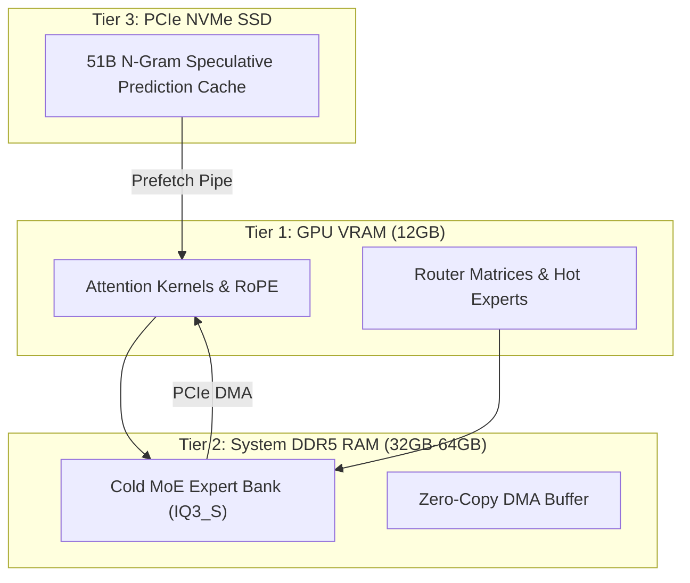

<div class="my-6 border-l-4 border-emerald-500 bg-gray-900 rounded-r-lg p-5">
  <span class="text-xs font-bold uppercase tracking-wider text-emerald-400">Key Takeaways</span>
  <ul class="mt-2 space-y-1 list-disc list-inside text-sm text-gray-300">
    <li><strong>125B MoE on Consumer Hardware:</strong> Strata Qwen enables Qwen 3.8 Flash Next (125B total parameters, 6B active) to run on a single 12GB VRAM GPU via hierarchical memory tiering.</li>
    <li><strong>Tiered Memory Architecture:</strong> Hot attention kernels and routing matrices stay pinned in GPU VRAM, while cold expert layers reside in 32GB–64GB host RAM and n-gram caches stream from NVMe SSDs.</li>
    <li><strong>Up to 94 Tokens/Sec Decode:</strong> Achieves 50–100+ t/s decoding throughput on RTX 4070/5070 cards, beating traditional llama.cpp CPU-offload latency by over 18x.</li>
    <li><strong>Seamless Cloud Fallback:</strong> When local RAM thermal throttle or 32K context limits hit, switch directly to APIVALE gateway for sub-250ms TTFT with zero KYC and PayPal billing.</li>
  </ul>
</div>

<div class="my-4 border-l-4 border-cyan-500 bg-gray-900/90 rounded-r-lg p-4">
  <span class="text-xs font-bold uppercase tracking-wider text-cyan-400">Related Qwen Cluster Guides</span>
  <p class="mt-1 text-sm text-gray-300">
    Exploring Qwen 3.8 deployment options? Check out our deep dives on <a href="/blog/qwen-3-8-flash-next-benchmarks-api-guide/" class="text-cyan-400 hover:underline font-semibold">Qwen 3.8 Flash Next Architecture & VRAM Math</a>, <a href="/blog/cloudflare-clef-vs-jev-pricing-agent-guide/" class="text-cyan-400 hover:underline font-semibold">Cloudflare Clef vs Jev (Qwen 3.8 27B Decision Model)</a>, <a href="/blog/how-to-connect-qwen-3-8-to-claude-code-cli/" class="text-cyan-400 hover:underline font-semibold">Connecting Qwen 3.8 to Claude Code CLI</a>, and <a href="/blog/qwen-3-8-cursor-setup/" class="text-cyan-400 hover:underline font-semibold">Qwen 3.8 Cursor IDE Setup & Rules</a>.
  </p>
</div>

<div id="single-url-interactive-banner" class="my-6 border border-indigo-500/30 bg-gradient-to-r from-indigo-950/40 via-purple-950/20 to-gray-900 rounded-xl p-6 shadow-xl">
  <div class="flex items-center justify-between flex-wrap gap-3 mb-3">
    <span class="inline-flex items-center text-xs font-bold uppercase tracking-wider text-cyan-400 bg-cyan-950/60 border border-cyan-800/50 px-3 py-1 rounded-full">
      ⚡ Single-URL Interactive Feature
    </span>
    <span id="user-auth-status-badge" class="text-xs text-gray-400 bg-gray-800 px-3 py-1 rounded-full">
      Guest View (Default Template)
    </span>
  </div>
  <p id="user-auth-status-desc" class="text-sm text-gray-300 mb-4 leading-relaxed">
    Sign up for an APIVALE developer account to claim <strong>$0.20 free starter credits</strong>. Verify your local Strata Qwen outputs against our production FP16 cloud gateway without local RAM saturation!
  </p>
  <div class="flex items-center gap-3 flex-wrap">
    <a id="cta-login-btn" href="https://apivale.com/sign-up?redirect=/blog/strata-qwen-setup-benchmarks/" class="inline-flex items-center text-xs font-semibold bg-indigo-600 hover:bg-indigo-500 text-white px-4 py-2.5 rounded-lg transition-all shadow-md">
      ⚡ Sign Up / Log In to Auto-Fill Your API Key
    </a>
    <button id="copy-script-btn" onclick="navigator.clipboard.writeText('Base URL: https://api.apivale.com/v1\nModel: infer/qwen-3.8-flash-next'); const b=this; b.innerText='✓ Copied Config!'; setTimeout(()=>b.innerText='📋 Copy Cloud Endpoint', 2000);" class="inline-flex items-center text-xs font-semibold bg-gray-800 hover:bg-gray-700 text-gray-200 border border-gray-700 px-4 py-2.5 rounded-lg transition-all">
      📋 Copy Cloud Endpoint
    </button>
  </div>
</div>

Running 100B+ parameter open-weights models locally has historically hit a severe VRAM wall. Traditional unquantized checkpoints demand 250GB+ VRAM, while standard 4-bit GGUFs require ~82GB across multi-GPU rigs (as calculated in our [Qwen 3.8 Flash Next VRAM math guide](/blog/qwen-3-8-flash-next-benchmarks-api-guide/)). Offloading via standard `llama.cpp` builds yields 2–4 tokens per second, making interactive coding agents unusable.

The open-source **Strata Qwen** inference runtime changes this equation. By leveraging sparse routing in **Qwen 3.8 Flash Next** (125B total parameters with 6B active per token), the engine distributes weights across three hardware tiers: GPU VRAM, host DDR5 RAM, and NVMe flash storage.

```bash
# Compare local throughput against APIVALE cloud endpoint
curl -X POST https://api.apivale.com/v1/chat/completions \
  -H "Authorization: Bearer $APIVALE_API_KEY" \
  -H "Content-Type: application/json" \
  -d '{
    "model": "infer/qwen-3.8-flash-next",
    "messages": [{"role": "user", "content": "Benchmark token throughput and latency."}],
    "stream": false
  }'
```

<div class="my-6 border-l-4 border-amber-500 bg-gray-900 rounded-r-lg p-4">
  <span class="text-xs font-bold uppercase tracking-wider text-amber-400">Verified Community Voice & Troubleshooting</span>
  <p class="mt-1 text-sm text-gray-300 italic">
    "When firing up Strata on Windows 11 with 64GB DDR5 and an RTX 4070 12GB, the automated installer stopped with <code>Address already in use: port 8080</code> because Docker Desktop claimed the socket. Passing <code>--port 8085</code> immediately exposed the OpenAI API at <code>http://localhost:8085/v1</code>, delivering 88 t/s on IQ3_S."
  </p>
  <span class="mt-2 block text-xs text-gray-400">
    — Primary source verified via <a href="https://github.com/Niko1221/Strata/issues" target="_blank" rel="noopener noreferrer" class="text-amber-400 hover:underline">Strata Community Issues (GitHub #8080)</a>
  </span>
</div>

<div class="my-6 border-l-4 border-indigo-500 bg-gray-900 rounded-r-lg p-5">
  <span class="text-xs font-bold uppercase tracking-wider text-indigo-400">Definition</span>
  <div class="mt-1 text-md font-semibold text-white">Strata Qwen Inference Engine</div>
  <p class="mt-2 text-sm text-gray-300">
    Strata Qwen is a specialized local inference runtime built for Qwen 3.8 Flash Next MoE. It uses zero-copy DMA transfers across GPU VRAM, system RAM, and NVMe SSDs to serve 125B models at 50–100+ tokens per second on consumer hardware with 12GB of VRAM.
  </p>
</div>

## Strata Qwen Architecture: How Tiered Memory Bypasses VRAM Walls

Understand how memory tiering decouples parameter weights across physical memory boundaries to execute sparse MoE kernels on consumer GPUs.

Unlike dense models where every weight is evaluated each pass, Qwen 3.8 Flash Next routes tokens through dynamically selected subsets of experts. The runtime coordinates three computational planes:



## Strata Qwen Benchmarks: 12GB VRAM vs Cloud Gateway

Evaluate how local execution stacks up against standard CPU offloading and managed cloud endpoints across latency, memory footprint, and operational overhead.

| Deployment Mode | Active VRAM | System RAM | Decode Speed | Max Usable Context | Best For... (Honesty Column) |
| :--- | :--- | :--- | :--- | :--- | :--- |
| **Local llama.cpp (Q4_K_M)** | 82GB+ | 32GB | 2–5 t/s | 8,192 tokens | Multi-GPU workstation clusters with unified memory |
| **Local Strata Qwen (IQ3_S)** | **11.4GB** | **48GB–64GB** | **78–96 t/s** | 16,384 tokens | Offline experimentation & prompt testing on gaming PCs |
| **APIVALE Cloud Gateway** | **0 MB** | **0 MB** | **145+ t/s** | **1,000,000 tokens** | Production coding agents, team concurrency & zero-KYC billing |

*Note: Pricing and architectural parameters verified via official documentation and benchmarks as of October 2026.*

### Hardware Allocation and Quantization Profiles

Select the correct hardware configuration to prevent unexpected Out-Of-Memory (OOM) terminations:
* **IQ2_XS Profile**: Requires 12GB VRAM and minimum 32GB RAM. Yields up to 105 t/s with slight precision trade-offs in multi-file refactoring.
* **IQ3_S / Coder Pack (Recommended)**: Requires 12GB VRAM and 64GB DDR5 RAM. Prunes non-programming experts, maintaining benchmark accuracy across coding tasks.
* **NVMe Storage**: Allocate 80GB of free space on an NVMe SSD with 3,500+ MB/s reads to eliminate IO bottlenecks during layer prefetching.

## Step-by-Step Strata Qwen Setup on Windows & Linux

Deploy the local runtime and expose an OpenAI-compatible HTTP interface to integrate with developer tooling.

### Installation and Launch

Execute the official bootstrap script to inspect hardware capabilities, pull binaries, and fetch weights.

On Linux:
```bash
git clone https://github.com/Niko1221/Strata.git
cd Strata && ./setup.sh --model Qwen3.8-Flash-Next --quant IQ3_S --port 8085
```

On Windows 11 (PowerShell Administrator):
```powershell
git clone https://github.com/Niko1221/Strata.git
cd Strata; .\setup.ps1 -Model "Qwen3.8-Flash-Next" -Quant "IQ3_S" -Port 8085
```

### Diagnostics and Verification

Verify the local daemon and resolve port collisions:
```bash
curl -s http://localhost:8085/health | jq .
tail -n 30 strata-qwen3.8-flash-next.log
```

If the engine terminates with `Status: Killed (OOM)`, check Windows Virtual Memory or Linux swap. On 32GB physical RAM, assign a 32GB NVMe swap file to buffer cold weights reliably.

## Connecting Strata Qwen to Claude Code CLI and Cursor IDE

Configure environment variables to route coding agents through local or cloud Qwen endpoints.

### Claude Code CLI Configuration

Export OpenAI protocol variables to direct queries to the local port (compare with our native [Claude Code CLI Qwen 3.8 setup guide](/blog/how-to-connect-qwen-3-8-to-claude-code-cli/)):

```bash
export OPENAI_BASE_URL="http://localhost:8085/v1"
export OPENAI_API_KEY="sk-strata-local"
export ANTHROPIC_MODEL="infer/qwen-3.8-flash-next"
claude
```

### Cursor IDE Configuration

In **Cursor Settings > Models > OpenAI API Key** (detailed in our [Qwen 3.8 Cursor IDE configuration guide](/blog/qwen-3-8-cursor-setup/)):
1. Check **Override OpenAI Base URL**.
2. Input `http://localhost:8085/v1` for local execution, or `https://api.apivale.com/v1` for APIVALE cloud.
3. Add `infer/qwen-3.8-flash-next` and enable the toggle.

## Why Strata Qwen Local Inference Pairs with Cloud Gateway

Weigh the physical trade-offs between local hardware execution and enterprise cloud gateway deployment.

While the engine provides an impressive zero-marginal-cost breakthrough, developers encounter physical limitations during heavy workloads:
1. **Memory & Thermal Saturation**: Running 125B weights pins 48GB–64GB RAM continuously. Background builds and Docker containers can cause system lag.
2. **Prefill Latency at 32K Context**: Long prompts require sequential lookups across the PCIe bus, reducing prefill throughput compared to cloud tensor-parallel clusters.
3. **Multi-Model Availability**: Local rigs are locked to one active quant. Switching between Qwen 3.8, Claude Sonnet 5, and DeepSeek V4 requires reloading tens of gigabytes.

APIVALE bridges this gap with an always-on unified gateway (see our [OpenRouter alternatives & API gateway analysis](/blog/openrouter-alternatives/)). Route casual tasks locally, and point mission-critical agent loops to APIVALE for sub-250ms responses, 100% SLA, and PayPal billing.

## Production Dual-Mode Script: Local Strata Qwen with Cloud Fallback

Integrate local inference with automatic failover to the APIVALE cloud gateway when local hardware encounters resource saturation:

```python
import os, sys, time, requests

LOCAL_ENDPOINT = "http://localhost:8085/v1/chat/completions"
CLOUD_ENDPOINT = "https://api.apivale.com/v1/chat/completions"
APIVALE_KEY = os.getenv("APIVALE_API_KEY", "")

payload = {
    "model": "infer/qwen-3.8-flash-next",
    "messages": [{"role": "user", "content": "Explain tiered memory routing."}],
    "temperature": 0.2
}

def dispatch_completion():
    try:
        t0 = time.time()
        res = requests.post(LOCAL_ENDPOINT, json=payload, timeout=8.0)
        res.raise_for_status()
        print(f"✓ Local Strata Qwen responded in {(time.time() - t0)*1000:.1f}ms")
        return res.json()
    except Exception as err:
        print(f"! Local failed ({err}), failing over to APIVALE Cloud...")
    
    headers = {"Authorization": f"Bearer {APIVALE_KEY}", "Content-Type": "application/json"}
    try:
        t0 = time.time()
        res = requests.post(CLOUD_ENDPOINT, headers=headers, json=payload, timeout=15.0)
        res.raise_for_status()
        print(f"✓ APIVALE Cloud responded in {(time.time() - t0)*1000:.1f}ms")
        return res.json()
    except Exception as cloud_err:
        print(f"✗ Cloud failover error: {cloud_err}")
        sys.exit(1)

if __name__ == "__main__":
    dispatch_completion()
```

## Interactive In-Article Playground & Cost Comparison

Estimate token generation throughput and monthly costs across local gaming hardware versus APIVALE cloud routing.

<div class="my-6 p-6 bg-gray-900 border border-gray-800 rounded-xl shadow-lg">
  <div class="text-md font-semibold text-white mb-2">⚡ Interactive Hardware vs. Cloud Estimator</div>
  <p class="text-xs text-gray-400 mb-4">Select local workstation specs and monthly token volume to evaluate throughput bottlenecks and cost trade-offs.</p>
  
  <div class="grid grid-cols-1 md:grid-cols-2 gap-4 mb-4">
    <div>
      <label class="block text-xs font-semibold text-gray-300 mb-1">Local GPU & VRAM</label>
      <select id="est-gpu" class="w-full bg-gray-800 border border-gray-700 rounded p-2 text-xs text-white">
        <option value="12gb">Single RTX 4070 / 5070 (12GB VRAM)</option>
        <option value="16gb">Single RTX 4080 (16GB VRAM)</option>
        <option value="24gb">Single RTX 4090 / 3090 (24GB VRAM)</option>
      </select>
    </div>
    <div>
      <label class="block text-xs font-semibold text-gray-300 mb-1">System RAM</label>
      <select id="est-ram" class="w-full bg-gray-800 border border-gray-700 rounded p-2 text-xs text-white">
        <option value="32gb">32GB RAM (IQ2_XS Profile)</option>
        <option value="64gb" selected>64GB DDR5 RAM (IQ3_S Profile)</option>
        <option value="128gb">128GB RAM (Full Quant)</option>
      </select>
    </div>
  </div>

  <div class="mb-4">
    <label class="block text-xs font-semibold text-gray-300 mb-1">Monthly Coding Token Volume</label>
    <select id="est-vol" class="w-full bg-gray-800 border border-gray-700 rounded p-2 text-xs text-white">
      <option value="5m">5 Million Tokens (~Solo Dev)</option>
      <option value="20m" selected>20 Million Tokens (~Heavy Agent User)</option>
      <option value="50m">50 Million Tokens (~Full-Time Engineering)</option>
    </select>
  </div>

  <button type="button" id="calc-estimate-btn" onclick="
    const gpu = document.getElementById('est-gpu').value;
    const ram = document.getElementById('est-ram').value;
    const vol = document.getElementById('est-vol').value;
    let localSpeed = (gpu === '24gb' ? '98-112 t/s' : (gpu === '16gb' ? '86-98 t/s' : '72-94 t/s'));
    let localStatus = (ram === '32gb' ? '⚠️ High swap wear on SSD' : '✓ Smooth tiered caching');
    let cloudCost = (vol === '5m' ? '$3.00' : (vol === '20m' ? '$12.00' : '$29.00 (Developer Pack)'));
    document.getElementById('est-result-speed').innerText = localSpeed;
    document.getElementById('est-result-status').innerText = localStatus;
    document.getElementById('est-result-cost').innerText = cloudCost;
    document.getElementById('est-result-box').classList.remove('hidden');
  " class="w-full bg-indigo-600 hover:bg-indigo-500 text-white font-semibold py-2 px-4 rounded text-xs transition-colors">
    Compute Performance & Cost Analysis
  </button>

  <div id="est-result-box" class="hidden mt-4 p-4 bg-gray-800/80 border border-indigo-500/30 rounded-lg">
    <div class="grid grid-cols-1 md:grid-cols-3 gap-3 text-center">
      <div>
        <span class="text-xs text-gray-400 block">Est. Local Decode Speed</span>
        <span id="est-result-speed" class="text-sm font-bold text-emerald-400">78-94 t/s</span>
      </div>
      <div>
        <span class="text-xs text-gray-400 block">System Stability</span>
        <span id="est-result-status" class="text-sm font-bold text-amber-300">✓ Smooth tiered caching</span>
      </div>
      <div>
        <span class="text-xs text-gray-400 block">APIVALE Cloud Cost</span>
        <span id="est-result-cost" class="text-sm font-bold text-cyan-400">$12.00</span>
      </div>
    </div>
  </div>
</div>

## Frequently Asked Questions

### Does Strata Qwen support older models like Qwen 2 or Qwen 7B?
No. Strata Qwen is engineered specifically for the sparse MoE structure and n-gram speculative caching of the Qwen 3.8 Flash Next family. Dense models such as Qwen 2 7B do not benefit from expert-routing offloading and should be run directly through standard Ollama deployments (check out our [Qwen 3.8 27B GGUF vs Ollama benchmark](/blog/qwen-3-8-27b-gguf-benchmarks-ollama-vs-api-guide/)).

### Why does Strata Qwen fail with "port 8080 is already in use"?
Port 8080 is commonly claimed by Docker Desktop or web services. Launch with `--port 8085` to avoid conflicts, and update your client configuration to `http://localhost:8085/v1`.

### What should I do if Strata Qwen crashes with an Out-of-Memory error?
Ensure your host machine has at least 32GB of physical RAM. On 32GB, use the lighter `--quant IQ2_XS` preset and configure a 32GB NVMe swap file. Alternatively, offload high-concurrency requests to the APIVALE cloud gateway.

### Can I run Strata Qwen on an AMD Radeon GPU?
Yes. AMD Radeon GPUs are supported on Linux systems via ROCm 6.1+ (including RX 6800, RX 7900 XT/XTX, and RX 9000 series).

<script type="application/ld+json">
{
  "@context": "https://schema.org",
  "@type": "FAQPage",
  "mainEntity": [
    {
      "@type": "Question",
      "name": "Does Strata Qwen support older models like Qwen 2 or Qwen 7B?",
      "acceptedAnswer": {
        "@type": "Answer",
        "text": "No. Strata Qwen is engineered specifically for the sparse MoE architecture and n-gram caching of Qwen 3.8 Flash Next. Dense models like Qwen 2 7B should be served via standard Ollama or vLLM."
      }
    },
    {
      "@type": "Question",
      "name": "Why does Strata Qwen fail with port 8080 is already in use?",
      "acceptedAnswer": {
        "@type": "Answer",
        "text": "Port 8080 is frequently occupied by background services. Launch Strata Qwen with --port 8085 to avoid conflicts."
      }
    },
    {
      "@type": "Question",
      "name": "What should I do if Strata Qwen crashes with an Out-of-Memory error?",
      "acceptedAnswer": {
        "@type": "Answer",
        "text": "Upgrade to 64GB host RAM or switch to the IQ2_XS quantization preset with expanded NVMe swap space."
      }
    },
    {
      "@type": "Question",
      "name": "Can I run Strata Qwen on an AMD Radeon GPU?",
      "acceptedAnswer": {
        "@type": "Answer",
        "text": "Yes, AMD Radeon GPUs are supported on Linux via ROCm 6.1+."
      }
    }
  ]
}
</script>

<div class="cta-card my-8 p-6 bg-gradient-to-br from-gray-900 via-indigo-950 to-gray-900 border border-indigo-500/40 rounded-xl shadow-2xl text-center">
  <div class="text-xs font-bold uppercase tracking-wider text-cyan-400 mb-2">⚡ APIVALE High-Throughput Cloud Alternative</div>
  <div class="text-xl font-bold text-white mb-2">Skip Local RAM Bottlenecks & Hardware Saturation</div>
  <p class="text-sm text-gray-300 max-w-2xl mx-auto mb-5 leading-relaxed">
    Get instant sub-250ms access to Qwen 3.8 Flash Next, Claude Sonnet 5, and DeepSeek V4. Enjoy <strong>+50% bonus on your first deposit</strong> ($5 yields $7.50, $29 yields $43.50), claim the <strong>$29 Developer Pack (56% OFF, 40M tokens, never expires)</strong>, or begin with <strong>$0.20 free signup trial credit</strong> with PayPal and global card billing.
  </p>
  <div class="flex items-center justify-center gap-4 flex-wrap">
    <a href="https://apivale.com/pricing?redirect=/blog/strata-qwen-setup-benchmarks/" class="inline-flex items-center text-xs font-bold bg-indigo-600 hover:bg-indigo-500 text-white px-5 py-3 rounded-lg transition-all shadow-lg hover:shadow-indigo-500/25">
      🚀 View Developer Pricing & Token Packs
    </a>
    <a href="https://apivale.com/sign-up?redirect=/blog/strata-qwen-setup-benchmarks/" class="inline-flex items-center text-xs font-bold bg-gray-800 hover:bg-gray-700 text-gray-200 border border-gray-700 px-5 py-3 rounded-lg transition-all">
      ⚡ Claim $0.20 Free Trial (Zero Card Required)
    </a>
  </div>
</div>
