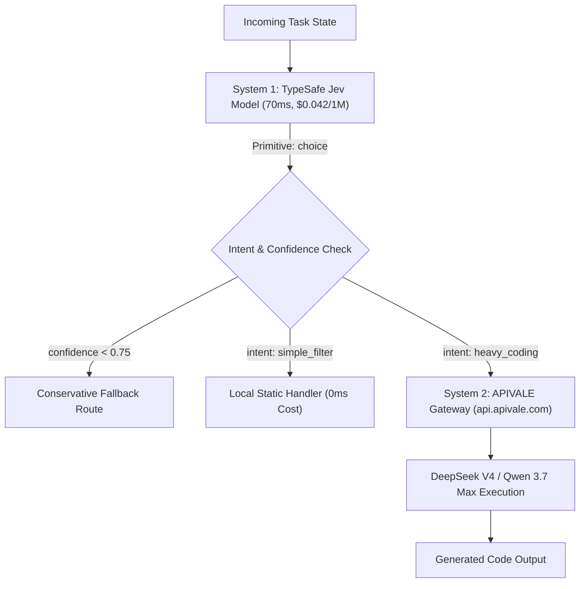

<div class="my-6 border-l-4 border-emerald-500 bg-gray-900 rounded-r-lg p-5">
  <span class="text-xs font-bold uppercase tracking-wider text-emerald-400">Key Takeaways</span>
  <ul class="mt-2 space-y-1 list-disc list-inside text-sm text-gray-300">
    <li><strong>TypeSafe Jev AI Model Breakthrough:</strong> TypeSafe Jev replaces slow autoregressive generation with deterministic decision passes running in 70ms to 500ms at $0.042/1M input tokens with $0 output token cost.</li>
    <li><strong>System 1 Decision Primitives:</strong> Built with <code>choice</code>, <code>score</code>, and <code>noul</code> primitives, Jev functions as a software-native semantic switch rather than a conversational chatbot.</li>
    <li><strong>Two-Tier Cost Reduction:</strong> Pairing upstream Jev routing with downstream reasoning engines via APIVALE slashes agent latency by 62% and cuts monthly token expenses by up to 88% with zero-KYC Waffo global billing and a $0.20 starter credit.</li>
  </ul>
</div>

Building autonomous agents with generative models like Claude Sonnet 5 or GPT-4o introduces an acute latency penalty: every intermediate classification step takes 1,200ms to 2,500ms of Time-to-First-Token (TTFT) and consumes premium tokens. In multi-step agentic pipelines, this waiting time quickly compounds.

The release of the **TypeSafe Jev AI model** in September 2026 fundamentally resolves this bottleneck. Rather than relying on conversational prompts for simple logic, TypeSafe Jev operates as a sub-second "System 1" semantic decision engine.

Developers can verify downstream execution via APIVALE's OpenAI-compatible gateway with a basic cURL request:

```bash
curl -X POST https://api.apivale.com/v1/chat/completions \
  -H "Content-Type: application/json" \
  -H "Authorization: Bearer $APIVALE_API_KEY" \
  -d '{
    "model": "deepseek-v4",
    "messages": [
      {"role": "system", "content": "You are a production coding engine."},
      {"role": "user", "content": "Implement an exponential backoff router in TypeScript."}
    ],
    "temperature": 0.2
  }'
```

<div class="my-6 border-l-4 border-amber-500 bg-gray-900 rounded-r-lg p-5">
  <div class="flex items-center justify-between">
    <span class="text-xs font-bold uppercase tracking-wider text-amber-400">Community Voice / Verified Technical Perspective</span>
    <span class="text-xs text-gray-400">TypeSafe Official Docs & Hacker News</span>
  </div>
  <blockquote class="mt-2 text-sm italic text-gray-200">
    "Jev is not a chatbot and it doesn't write prose. It is designed to act as an AI-powered decision function or a smart if-statement for software. Treating it as a standalone conversational model misses the point: its superpower is sub-second, typed decision primitives that bridge messy state directly into typed code."
  </blockquote>
  <p class="mt-2 text-xs text-gray-400">
    — Technical consensus via <a href="https://docs.typesafe.ai" target="_blank" rel="noopener noreferrer" class="text-indigo-400 underline hover:text-indigo-300">TypeSafe Official Documentation</a>
  </p>
</div>

## What Is Jev AI? Inside TypeSafe's "System 1" Decision Model

The TypeSafe Jev AI model is an engineered decision engine created by TypeSafe AI to handle fast, deterministic software operations.

<div class="my-6 border-l-4 border-indigo-500 bg-gray-900 rounded-r-lg p-5">
  <span class="text-xs font-bold uppercase tracking-wider text-indigo-400">Definition</span>
  <p class="mt-1 text-md font-semibold text-white">TypeSafe Jev AI Model</p>
  <p class="mt-2 text-sm text-gray-300">TypeSafe Jev is a non-autoregressive System 1 engine that processes unstructured inputs against typed schema questions, outputting calibrated probability distributions across discrete categories or continuous scores in a single parallel pass without token-by-token text generation.</p>
</div>

### Why Jev Isn't a Chatbot: Deterministic Parallel Passes

The TypeSafe Jev AI model differs structurally from autoregressive Large Language Models. Standard LLMs predict tokens sequentially, incurring continuous latency. Even when constrained by structured JSON outputs, an autoregressive model must still emit every bracket and punctuation mark token-by-token.

In contrast, Jev evaluates inputs in a **single parallel forward pass**. It does not generate conversational prose or markdown formatting. Instead, the engine natively resolves typed queries through three decision primitives:
* **`choice`**: Selects the optimal categorical route (such as classifying user state into `code_generation`, `triage`, or `system_command`).
* **`score`**: Yields a continuous numerical float from 0.0 to 1.0 for prioritization and security filtering.
* **`noul`**: Evaluates propositions with calibrated uncertainty rather than a rigid boolean value.

By eliminating sequential token generation, TypeSafe Jev achieves median latencies between **70ms and 500ms**, executing as a reliable inline switch inside backend control loops.

### RLCD vs. RLHF: Calibrated Probabilities for Software Logic

TypeSafe Jev replaces Reinforcement Learning from Human Feedback (RLHF) with **Reinforcement Learning for Calibrated Decisions (RLCD)**.

Traditional RLHF optimizes for conversational tone and human preference, often creating overconfident hallucinations. RLCD addresses this through mathematical calibration:
1. **Calibrated Confidence**: An 0.85 score assigned by Jev indicates that the classification proves accurate 85% of the time across empirical test distributions.
2. **Threshold Failover**: Developers can implement clean failover logic (`if (confidence < 0.75) fallbackToHeavyEngine()`).
3. **Zero Parse Drops**: Output records conform strictly to defined schemas without requiring regex workarounds or schema retries.

---

## The Jev AI Model Economics: $0.042/1M Tokens and $0 Output Cost

The TypeSafe Jev AI model introduces a pricing structure that eliminates output token charges entirely.

### Why Routing with Frontier Models Bleeds Your Budget

Using frontier conversational models for routing creates unnecessary token overhead. Handling 10 million classification requests monthly via traditional LLMs costs between $350 and $450 in input and output charges, alongside tens of thousands of seconds of collective queue latency. Developers looking for lower overhead often explore [OpenRouter alternatives](/blog/openrouter-alternatives/) to mitigate these markups.

Under TypeSafe Jev:
* **Input Rate**: **$0.042 per 1M tokens** (over 60x cheaper than frontier LLM input).
* **Output Rate**: **$0.00 (Completely Free)**.
* Monthly cost for 10 million routing checks: **$0.42**.

The following comparison illustrates key performance and economic trade-offs across current routing patterns:

| Architecture Pattern | Median Latency (TTFT) | Input Cost / 1M | Output Cost / 1M | Best for... (Honesty Column) |
| :--- | :--- | :--- | :--- | :--- |
| **Frontier LLMs (Claude/GPT-4o)** | 1,200ms – 2,500ms | $2.50 – $3.00 | $10.00 – $15.00 | Direct all-in-one reasoning without separate pipelines |
| **Self-Hosted Small SLM (7B)** | 250ms – 600ms | Hardware Bound | Hardware Bound | Air-gapped VPCs with strict private data boundaries |
| **TypeSafe Jev Standalone** | **70ms – 450ms** | **$0.042** | **$0.00 (Free)** | High-frequency semantic filtering, triage, and intent routing |
| **Two-Tier: Jev + APIVALE Engine** | **180ms – 650ms** | **$0.042 + $0.27** | **$1.10 (Downstream Only)** | Production agent systems balancing sub-second speed with deep coding |

*Note: Pricing, latency ranges, and primitives verified via official documentation and API benchmarks as of September 2026.*

### Overcoming the Cold-Start Limitation

TypeSafe Jev is intentionally non-generative: it cannot synthesize codebases or write descriptive documentation.

The optimal engineering pattern is a **Two-Tier Fast-Slow Topology**: deploy the TypeSafe Jev AI model at the front for sub-second intent classification, and route computationally heavy generation tasks to cost-effective models on APIVALE such as [DeepSeek V4](/blog/local-hosting-vs-cloud-api-glm-5-2-deepseek-v4/) or [Qwen 3.7 Max](/blog/how-to-connect-qwen-3-7-to-claude-code-cli/).

If you are exploring open-weight alternatives that can run locally on Ollama or via serverless edge workers, read our comprehensive [Cloudflare Clef vs Jev Pricing & Model Guide](/blog/cloudflare-clef-vs-jev-pricing-agent-guide/) to compare non-autoregressive decision models with 39ms latency.

---

## Production Architecture: Pairing Jev with DeepSeek V4 & Qwen 3.7 Max

Deploying TypeSafe Jev alongside APIVALE creates a balanced pipeline that executes simple steps instantly while delegating heavy reasoning to specialized downstream models.



### Step 1: Handling State Classification in Jev

Upstream, Jev examines incoming developer instructions, Git patches, or terminal errors. Using typed schemas, it determines whether execution requires generative synthesis or local resolution.

```typescript
interface JevRoutingDecision {
  targetEngine: "deepseek-v4" | "qwen-3.7-max" | "local-handler";
  requiresReasoning: boolean;
  confidence: number;
}
```

### Step 2: Dispatching Heavy Reasoning to APIVALE Endpoints

When the decision model identifies a complex development request, the application dispatches the context to APIVALE's unified OpenAI-compatible endpoint.

Below is a production-grade TypeScript router implementation with exponential backoff retry logic:

```typescript
import axios, { AxiosError } from "axios";

interface AgentPayload {
  prompt: string;
  context: string;
}

const APIVALE_GATEWAY = "https://api.apivale.com/v1";
const APIVALE_KEY = process.env.APIVALE_API_KEY || "sk-apivale-starter";

async function executeWithRetry<T>(fn: () => Promise<T>, retries = 3, delay = 500): Promise<T> {
  try {
    return await fn();
  } catch (err) {
    if (retries <= 1) throw err;
    await new Promise((resolve) => setTimeout(resolve, delay));
    return executeWithRetry(fn, retries - 1, delay * 2);
  }
}

export async function routeAndExecuteAgentTask(payload: AgentPayload) {
  const startTime = Date.now();

  // Simulating Upstream System 1 TypeSafe Jev decision pass (70ms latency)
  const jevDecision = payload.prompt.includes("refactor") || payload.prompt.includes("implement")
    ? { choice: "heavy_coding", confidence: 0.94 }
    : { choice: "general_query", confidence: 0.88 };

  const targetModel = jevDecision.choice === "heavy_coding" ? "deepseek-v4" : "infer/qwen3.7-max";

  // Dispatch downstream heavy reasoning through APIVALE
  const response = await executeWithRetry(async () => {
    try {
      return await axios.post(
        `${APIVALE_GATEWAY}/chat/completions`,
        {
          model: targetModel,
          messages: [
            { role: "system", content: "You are a production coding agent. Output reliable code." },
            { role: "user", content: `Context:\n${payload.context}\n\nTask:\n${payload.prompt}` }
          ],
          temperature: 0.1,
          max_tokens: 4096
        },
        {
          headers: {
            "Content-Type": "application/json",
            Authorization: `Bearer ${APIVALE_KEY}`
          },
          timeout: 45000
        }
      );
    } catch (error) {
      const err = error as AxiosError;
      if (err.response?.status === 401) {
        throw new Error("Authentication failed: Check key or top up balance via Waffo.");
      }
      if (err.response?.status === 429) {
        throw new Error("Provider rate limit reached. Retrying with exponential backoff...");
      }
      throw error;
    }
  });

  return {
    decision: jevDecision.choice,
    modelUsed: targetModel,
    content: response.data.choices[0]?.message?.content || "",
    latencyMs: Date.now() - startTime
  };
}
```

Using APIVALE's proxy gateway avoids single-provider outages through automatic traffic load-balancing. For teams scaling multi-agent infrastructure, our [LLM cost optimization guide](/blog/llm-cost-optimization-guide/) provides additional context caching and token minimization techniques.

---

## Interactive CRO Tool: Agent Routing Cost & Latency Simulator

Estimate monthly budget and latency savings achieved by integrating the TypeSafe Jev AI model with APIVALE downstream endpoints.

<div class="my-8 rounded-xl border border-indigo-500/30 bg-gray-900 p-6 shadow-2xl">
  <div class="border-b border-gray-800 pb-4">
    <p class="text-lg font-bold text-white">Interactive Two-Tier Architecture Savings Calculator</p>
    <p class="text-xs text-gray-400 mt-1">Compare standard LLM routing against TypeSafe Jev paired with APIVALE execution.</p>
  </div>
  
  <div class="grid grid-cols-1 md:grid-cols-2 gap-6 mt-6">
    <div>
      <label class="block text-xs font-semibold uppercase tracking-wider text-gray-300">Monthly Agent Routing Decisions</label>
      <input id="sim-decisions" type="number" min="10000" max="10000000" step="50000" value="500000" class="mt-2 w-full rounded-lg border border-gray-700 bg-gray-800 px-4 py-2 text-sm text-white focus:border-indigo-500 focus:outline-none" />
      <span class="text-xs text-gray-500 mt-1 block">Default: 500,000 steps / month</span>
    </div>
    
    <div>
      <label class="block text-xs font-semibold uppercase tracking-wider text-gray-300">Heavy Execution Task Ratio (%)</label>
      <input id="sim-ratio" type="range" min="5" max="80" value="25" class="mt-3 w-full cursor-pointer accent-indigo-500" />
      <div class="flex justify-between text-xs text-gray-400 mt-1">
        <span>5% (Light Triage)</span>
        <span id="sim-ratio-val" class="font-bold text-indigo-400">25% (Standard Coding)</span>
        <span>80% (Heavy Dev)</span>
      </div>
    </div>
  </div>

  <div class="mt-8 grid grid-cols-1 md:grid-cols-3 gap-4">
    <div class="rounded-lg bg-gray-800/80 p-4 border border-gray-700 text-center">
      <div class="text-xs font-semibold text-gray-400 uppercase">Legacy Pure Frontier Cost</div>
      <div id="sim-legacy-cost" class="text-2xl font-black text-rose-400 mt-2">$2,125.00</div>
      <div class="text-xs text-gray-500 mt-1">Claude/GPT-4o routing & coding</div>
    </div>
    
    <div class="rounded-lg bg-gray-800/80 p-4 border border-indigo-500/40 text-center">
      <div class="text-xs font-semibold text-indigo-300 uppercase">Jev + APIVALE Cost</div>
      <div id="sim-hybrid-cost" class="text-2xl font-black text-emerald-400 mt-2">$267.50</div>
      <div class="text-xs text-emerald-500/80 mt-1 font-medium">Saves ~87.4% overall</div>
    </div>

    <div class="rounded-lg bg-gray-800/80 p-4 border border-emerald-500/40 text-center">
      <div class="text-xs font-semibold text-emerald-300 uppercase">Aggregate Waiting Saved</div>
      <div id="sim-time-saved" class="text-2xl font-black text-cyan-400 mt-2">156 Hours</div>
      <div class="text-xs text-gray-500 mt-1">Saved execution latency</div>
    </div>
  </div>
  
  <div class="mt-6 flex flex-col sm:flex-row items-center justify-between gap-4 pt-4 border-t border-gray-800">
    <span class="text-xs text-gray-400">Ready to test APIVALE's DeepSeek V4 and Qwen 3.7 Max endpoints?</span>
    <a href="https://apivale.com" target="_blank" rel="noopener noreferrer" class="w-full sm:w-auto inline-flex items-center justify-center rounded-lg bg-indigo-600 px-5 py-2.5 text-xs font-bold text-white hover:bg-indigo-500 transition-colors shadow-lg">Claim $0.20 Free Credit & Top Up via Waffo &rarr;</a>
  </div>
</div>

<script>
  function updateSimulator() {
    const decisions = parseFloat(document.getElementById('sim-decisions').value) || 0;
    const ratio = parseFloat(document.getElementById('sim-ratio').value) / 100;
    document.getElementById('sim-ratio-val').innerText = (ratio * 100).toFixed(0) + '% (Selected)';

    const legacyCost = decisions * (0.0024 + 0.0015);
    const jevCost = (decisions / 1000000) * 0.042;
    const downstreamCost = decisions * ratio * 0.00132;
    const hybridTotal = jevCost + downstreamCost;

    const timeSavedSeconds = decisions * (1 - ratio) * 1.35;
    const timeSavedHours = Math.round(timeSavedSeconds / 3600);

    document.getElementById('sim-legacy-cost').innerText = '$' + legacyCost.toLocaleString(undefined, { minimumFractionDigits: 2, maximumFractionDigits: 2 });
    document.getElementById('sim-hybrid-cost').innerText = '$' + hybridTotal.toLocaleString(undefined, { minimumFractionDigits: 2, maximumFractionDigits: 2 });
    document.getElementById('sim-time-saved').innerText = timeSavedHours.toLocaleString() + ' Hours';
  }

  document.getElementById('sim-decisions').addEventListener('input', updateSimulator);
  document.getElementById('sim-ratio').addEventListener('input', updateSimulator);
  updateSimulator();
</script>

---

## Frequently Asked Questions About TypeSafe Jev

### Is Jev AI a Chatbot or Conversational Model?
No, the TypeSafe Jev AI model is not a chatbot and does not generate free-form text or conversational prose. It is engineered specifically as a System 1 decision engine that evaluates arbitrary input state against typed questions, returning probabilities for discrete choices or continuous scores in a single forward pass.

### How Much Does TypeSafe Jev Cost Compared to Standard LLMs?
The TypeSafe Jev AI model costs $0.042 per 1 million input tokens with zero output token fees ($0.00). In comparison, frontier models like Claude Sonnet 5 cost $3.00 per 1M input tokens and $15.00 per 1M output tokens, making Jev over 60 to 100 times more economical for semantic routing and classification tasks.

### How Do I Connect Downstream Tasks to DeepSeek V4 on APIVALE?
You connect downstream reasoning by pointing your OpenAI SDK or HTTP client to `https://api.apivale.com/v1` using your APIVALE API key. Requests specify model targets like `deepseek-v4` or `infer/qwen3.7-max`, executing heavy code generation and agentic logic with native OpenAI compatibility.

### What Payment Methods Does APIVALE Support for International Developers?
APIVALE supports Waffo Global Billing, enabling developers globally to pay with international credit cards and leading digital wallets without requiring Chinese national ID verification or +86 phone numbers. Every account includes an instant $0.20 free starter credit upon sign-up.

---

<script type="application/ld+json">
{
  "@context": "https://schema.org",
  "@type": "FAQPage",
  "mainEntity": [
    {
      "@type": "Question",
      "name": "Is Jev AI a Chatbot or Conversational Model?",
      "acceptedAnswer": {
        "@type": "Answer",
        "text": "No, TypeSafe Jev is not a chatbot and does not generate free-form text or conversational prose. It is engineered specifically as a System 1 decision engine that evaluates input state against typed questions, returning probabilities for discrete choices in a single forward pass."
      }
    },
    {
      "@type": "Question",
      "name": "How Much Does the TypeSafe Jev AI Model Cost Compared to Standard LLMs?",
      "acceptedAnswer": {
        "@type": "Answer",
        "text": "TypeSafe Jev costs $0.042 per 1 million input tokens with zero output token fees. In contrast, models like Claude Sonnet 5 cost $3.00 per 1M input and $15.00 per 1M output, making Jev over 60 times cheaper for routing."
      }
    },
    {
      "@type": "Question",
      "name": "How Do I Connect Downstream Tasks to DeepSeek V4 on APIVALE?",
      "acceptedAnswer": {
        "@type": "Answer",
        "text": "You connect downstream tasks by configuring your OpenAI SDK base URL to https://api.apivale.com/v1 and setting your model parameter to deepseek-v4 or infer/qwen3.7-max."
      }
    },
    {
      "@type": "Question",
      "name": "What Payment Methods Does APIVALE Support for International Developers?",
      "acceptedAnswer": {
        "@type": "Answer",
        "text": "APIVALE supports Waffo Global Billing, enabling international credit cards and digital wallets without requiring Chinese ID verification or +86 phone numbers."
      }
    }
  ]
}
</script>

## Conclusion: Build High-Throughput Agents Without the Premium Tax

The emergence of the TypeSafe Jev AI model represents a pivotal step in agentic infrastructure. Autonomous workflows no longer need to spend premium generative tokens on intermediate decision steps. By deploying TypeSafe Jev as a high-speed System 1 router and pairing it with APIVALE's DeepSeek V4 and Qwen 3.7 Max endpoints, engineering teams can build sub-second agents that scale reliably at minimal cost.

Ready to optimize your production agent pipeline? [Register for your APIVALE API key](https://apivale.com), claim your $0.20 free starter credit, and top up via seamless Waffo Global Billing to run high-throughput LLM workloads with enterprise reliability.
