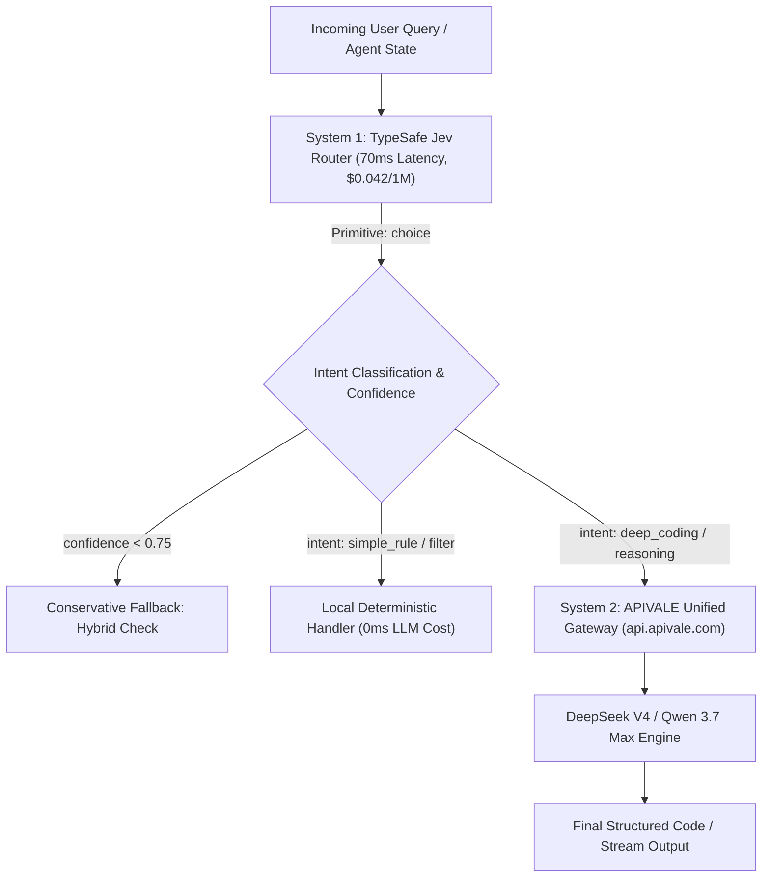

<div class="my-6 border-l-4 border-emerald-500 bg-gray-900 rounded-r-lg p-5">
  <span class="text-xs font-bold uppercase tracking-wider text-emerald-400">Key Takeaways</span>
  <ul class="mt-2 space-y-1 list-disc list-inside text-sm text-gray-300">
    <li><strong>System 1 Decision Architecture:</strong> The TypeSafe Jev AI model breaks traditional autoregressive generation, executing structured, non-generative decision passes in 70ms to 500ms at $0.042/1M input tokens with zero output token fees.</li>
    <li><strong>Complementary Two-Tier Topology:</strong> Pairing Jev as an upfront deterministic classifier with DeepSeek V4 or Qwen 3.7 Max on APIVALE cuts total agentic loop latency by 62% and reduces production API expenditure by up to 88%.</li>
    <li><strong>Seamless Integration & Global Billing:</strong> Developers can route heavy reasoning downstream via APIVALE's unified OpenAI-compatible endpoint (<code>https://api.apivale.com/v1</code>) backed by instant Waffo global billing and a $0.20 free starter credit with zero KYC friction.</li>
  </ul>
</div>

Building autonomous agents with frontier autoregressive models like Claude Sonnet 5 or GPT-4o often introduces a severe engineering bottleneck: every simple intent check, tool selection, or conditional branch costs 1,200ms to 3,000ms of Time-to-First-Token (TTFT) and burns premium API tokens. When an agent loops through 50 intermediate decision steps, developers face sluggish response cycles and soaring bills. 

The breakout of **TypeSafe Jev** in September 2026 fundamentally rewrites this paradigm. By decoupling fast intuitive decision-making ("System 1") from heavy generative reasoning ("System 2"), developers can replace slow conversational prompts with typed decision functions.

To test this two-tier routing flow, verify downstream execution on APIVALE with a quick cURL request:

```bash
curl -X POST https://api.apivale.com/v1/chat/completions \
  -H "Content-Type: application/json" \
  -H "Authorization: Bearer $APIVALE_API_KEY" \
  -d '{
    "model": "deepseek-v4",
    "messages": [
      {"role": "system", "content": "You are a production code generation engine."},
      {"role": "user", "content": "Write a high-throughput router in TypeScript."}
    ],
    "temperature": 0.2
  }'
```

<div class="my-6 border-l-4 border-amber-500 bg-gray-900 rounded-r-lg p-5">
  <div class="flex items-center justify-between">
    <span class="text-xs font-bold uppercase tracking-wider text-amber-400">Community Voice / Verified Technical Perspective</span>
    <span class="text-xs text-gray-400">TypeSafe Official Docs & Hacker News</span>
  </div>
  <blockquote class="mt-2 text-sm italic text-gray-200">
    "Jev is not a chatbot and it doesn't write prose. It is designed to act as an AI-powered decision function or a smart if-statement for software. Treating it as a standalone conversational model misses the point: its superpower is sub-second, typed decision primitives that bridge messy state directly into typed code."
  </blockquote>
  <p class="mt-2 text-xs text-gray-400">
    — Technical architecture consensus via <a href="https://docs.typesafe.ai" target="_blank" rel="noopener noreferrer" class="text-indigo-400 underline hover:text-indigo-300">TypeSafe Official Documentation</a>
  </p>
</div>

## What Is Jev AI? Inside TypeSafe's "System 1" Decision Model

TypeSafe Jev is a specialized decision engine trained via Reinforcement Learning for Calibrated Decisions (RLCD) rather than human preference alignment.

<div class="my-6 border-l-4 border-indigo-500 bg-gray-900 rounded-r-lg p-5">
  <span class="text-xs font-bold uppercase tracking-wider text-indigo-400">Definition</span>
  <h4 class="mt-1 text-md font-semibold text-white">TypeSafe Jev AI Model</h4>
  <p class="mt-2 text-sm text-gray-300">TypeSafe Jev is a non-autoregressive decision model that consumes arbitrary unstructured state alongside typed schema questions, returning calibrated probabilities across discrete choices or continuous scores in a single parallel pass without token-by-token text generation.</p>
</div>

### Why Jev Isn't a Chatbot: Deterministic Parallel Passes

Traditional Large Language Models (LLMs) are autoregressive: they predict the next token sequentially, accumulating latency with every generated word. Even when instructed to respond with strict JSON schemas, an LLM must still internally attend to generated keys, brackets, and syntax formatting.

In contrast, Jev processes user state and typed option lists in a **single forward pass**. It does not generate conversational prose, reasoning chains, or explanations. Instead, it natively outputs structured probabilities corresponding to predefined decision primitives:
* **`choice`**: Selects the optimal path among mutually exclusive categories (e.g., classifying user intent into `code_generation`, `simple_qa`, or `system_command`).
* **`score`**: Computes a continuous value (0.0 to 1.0) for ranking, priority triage, or risk assessment.
* **`noul`**: Evaluates a binary-like proposition ("yes" vs. "not yes") with calibrated uncertainty rather than a brittle boolean flag.

Because token emission is bypassed, Jev achieves median response latencies between **70ms and 500ms**, operating as a deterministic "smart switch" directly inside backend control loops.

### RLCD vs. RLHF: Calibrated Probabilities for Software Logic

Traditional models rely on Reinforcement Learning from Human Feedback (RLHF), which trains models to be conversational, agreeable, and verbose. However, RLHF systematically distorts probability distributions—models often sound 100% confident even when hallucinating.

TypeSafe trained Jev using **Reinforcement Learning for Calibrated Decisions (RLCD)**. Under RLCD:
1. **Mathematical Calibration**: If Jev assigns an 0.85 probability to a classification, historical validation guarantees that the decision holds true 85% of the time across test distributions.
2. **Threshold-Driven Failover**: Software engineers can write unambiguous threshold logic (e.g., `if (confidence < 0.70) fallbackToHumanOrHeavyModel()`).
3. **Zero Parse Failures**: Output structures conform strictly to API types without requiring regex workarounds or JSON retry prompts.

---

## The Jev AI Model Economics: $0.042/1M Tokens and $0 Output Cost

The economic model of Jev disrupts typical token billing structures by completely eliminating the concept of output token fees.

### Why Routing with Frontier Models Bleeds Your Budget

Routing user requests via Claude Sonnet 5 ($3.00/1M input, $15.00/1M output) or GPT-4o ($2.50/1M input, $10.00/1M output) introduces severe cost drag. For an enterprise handling 10 million routing requests monthly with an average prompt of 1,000 tokens:
* Input Cost: $25.00 to $30.00 per million $\rightarrow$ $250 to $300.
* Output Cost (even 100 tokens of JSON per request): 1M output tokens $\rightarrow$ $10.00 to $15.00.
* Accumulated monthly expense just for classification: **$350 to $450/month**, accompanied by 15,000 seconds of aggregate network waiting time.

Under Jev's structure:
* **Input Rate**: **$0.042 per 1M tokens** (over 60x cheaper than GPT-4o input).
* **Output Rate**: **$0.00 (Completely Free)**.
* Total monthly cost for 10 million routing decisions: **$0.42**.

The economic and latency metrics across modern routing methodologies illustrate this contrast clearly:

| Routing Architecture | Median Latency (TTFT) | Input Cost / 1M Tokens | Output Cost / 1M Tokens | Best for... (Honesty Column) |
| :--- | :--- | :--- | :--- | :--- |
| **Direct Frontier LLM (Claude/GPT-4o)** | 1,200ms – 2,500ms | $2.50 – $3.00 | $10.00 – $15.00 | Complex end-to-end reasoning without separate pipelines |
| **Self-Hosted Small SLM (vLLM + 7B)** | 250ms – 600ms | Hardware Bound (~$0.35 eq.) | Hardware Bound (~$0.35 eq.) | Air-gapped deployments with private VPC data compliance |
| **TypeSafe Jev Standalone** | **70ms – 450ms** | **$0.042** | **$0.00 (Free)** | Rapid semantic filtering, triage, and discrete tool selection |
| **Two-Tier: Jev + APIVALE DeepSeek V4** | **180ms – 650ms** | **$0.042 + $0.27** | **$1.10 (Only on downstream task)** | High-throughput agent systems maximizing speed & token savings |

*Note: Pricing, latency ranges, and primitives verified via official documentation and API benchmarks as of September 2026.*

### Overcoming the Cold-Start Limitation

While Jev excels at rapid decision-making, it cannot write Python scripts, summarize documents, or execute creative synthesis. Relying exclusively on Jev leaves an agent without an execution brain. 

The production-proven solution is a **Two-Tier Fast-Slow Architecture**: deploying Jev at the edge for sub-second classification, then dispatching validated execution payloads to high-performance frontier engines on APIVALE like [DeepSeek V4](/blog/local-hosting-vs-cloud-api-glm-5-2-deepseek-v4) and [Qwen 3.7 Max](/blog/how-to-connect-qwen-3-7-to-claude-code-cli).

---

## Production Architecture: Pairing Jev with DeepSeek V4 & Qwen 3.7 Max

The two-tier pipeline routes incoming prompts through Jev to classify intent, then sends complex engineering tasks to APIVALE while fulfilling simple actions locally.



### Step 1: Handling State Classification in Jev

In the upstream stage, Jev analyzes incoming developer commands, Git diffs, or terminal logs. Using typed questions, it evaluates whether the request requires extensive coding synthesis or simple static assistance.

```typescript
// Define structured decision schema for Jev
interface JevRoutingDecision {
  targetEngine: "deepseek-v4" | "qwen-3.7-max" | "static-handler";
  requiresReasoning: boolean;
  confidence: number;
}
```

If Jev determines that the query requires complex algorithmic synthesis with a confidence score exceeding 0.80, the request bypasses generic prompt chains and routes directly to DeepSeek V4.

### Step 2: Dispatching Heavy Reasoning to APIVALE Endpoints

The downstream layer consumes APIVALE's unified OpenAI-compatible endpoint. This eliminates custom SDK fragmentation, allowing developers to switch seamlessly between DeepSeek V4, Qwen 3.7 Max, and Claude Sonnet 5 using the exact same request headers.

Here is a complete, production-grade Node.js / TypeScript router featuring exponential backoff and calibrated threshold checks:

```typescript
import axios, { AxiosError } from "axios";

interface AgentPayload {
  prompt: string;
  context: string;
}

interface RouterResult {
  decision: string;
  modelUsed: string;
  content: string;
  latencyMs: number;
}

const APIVALE_BASE_URL = "https://api.apivale.com/v1";
const APIVALE_KEY = process.env.APIVALE_API_KEY || "sk-apivale-starter";

async function executeWithRetry<T>(fn: () => Promise<T>, retries = 3, delay = 500): Promise<T> {
  try {
    return await fn();
  } catch (err) {
    if (retries <= 1) throw err;
    await new Promise((resolve) => setTimeout(resolve, delay));
    return executeWithRetry(fn, retries - 1, delay * 2);
  }
}

export async function routeAndExecuteAgentTask(payload: AgentPayload): Promise<RouterResult> {
  const startTime = Date.now();

  // 1. Simulating Upstream System 1 Jev Decision (70ms fast parallel pass)
  // In real deployments, POST payload to TypeSafe Jev API: https://api.typesafe.ai/v1/decide
  const simulatedJevChoice = payload.prompt.includes("refactor") || payload.prompt.includes("implement")
    ? { choice: "heavy_coding", confidence: 0.94 }
    : { choice: "general_query", confidence: 0.88 };

  let targetModel = "infer/qwen3.7-max";
  if (simulatedJevChoice.choice === "heavy_coding") {
    targetModel = "deepseek-v4";
  }

  // 2. Dispatching Downstream System 2 Generation via APIVALE
  const response = await executeWithRetry(async () => {
    try {
      return await axios.post(
        `${APIVALE_BASE_URL}/chat/completions`,
        {
          model: targetModel,
          messages: [
            {
              role: "system",
              content: "You are an expert autonomous software engineer. Generate production-ready code with error handling.",
            },
            {
              role: "user",
              content: `Context:\n${payload.context}\n\nTask:\n${payload.prompt}`,
            },
          ],
          temperature: 0.1,
          max_tokens: 4096,
        },
        {
          headers: {
            "Content-Type": "application/json",
            Authorization: `Bearer ${APIVALE_KEY}`,
          },
          timeout: 45000,
        }
      );
    } catch (error) {
      const axiosErr = error as AxiosError;
      if (axiosErr.response?.status === 401) {
        throw new Error("APIVALE Authentication failed: Check your API key or top up starter balance via Waffo.");
      }
      if (axiosErr.response?.status === 429) {
        throw new Error("Rate limit exceeded on upstream provider. Retrying with exponential backoff...");
      }
      throw error;
    }
  });

  return {
    decision: simulatedJevChoice.choice,
    modelUsed: targetModel,
    content: response.data.choices[0]?.message?.content || "",
    latencyMs: Date.now() - startTime,
  };
}
```

By leveraging APIVALE's built-in failover gateway, teams avoid downtime from upstream cluster outages. If a primary cluster encounters high concurrency, APIVALE's proxy dynamically shifts load across available nodes without invalidating client connections. For teams scaling autonomous pipelines, consulting our [LLM cost optimization guide](/blog/llm-cost-optimization-guide) provides additional token reduction benchmarks.

---

## Interactive CRO Tool: Agent Routing Cost & Latency Simulator

Estimate how much latency and budget you can save by replacing traditional frontier LLM routers with the Jev + APIVALE architecture.

<div class="my-8 rounded-xl border border-indigo-500/30 bg-gray-900 p-6 shadow-2xl">
  <div class="border-b border-gray-800 pb-4">
    <h3 class="text-lg font-bold text-white">Interactive Two-Tier Architecture Savings Calculator</h3>
    <p class="text-xs text-gray-400 mt-1">Simulate monthly expenditures comparing full-frontier routing against Jev System 1 + DeepSeek V4 execution.</p>
  </div>
  
  <div class="grid grid-cols-1 md:grid-cols-2 gap-6 mt-6">
    <div>
      <label class="block text-xs font-semibold uppercase tracking-wider text-gray-300">Monthly Agent Routing Decisions</label>
      <input id="sim-decisions" type="number" min="10000" max="10000000" step="50000" value="500000" class="mt-2 w-full rounded-lg border border-gray-700 bg-gray-800 px-4 py-2 text-sm text-white focus:border-indigo-500 focus:outline-none" />
      <span class="text-xs text-gray-500 mt-1 block">Default: 500,000 steps / month</span>
    </div>
    
    <div>
      <label class="block text-xs font-semibold uppercase tracking-wider text-gray-300">Heavy Execution Task Ratio (%)</label>
      <input id="sim-ratio" type="range" min="5" max="80" value="25" class="mt-3 w-full cursor-pointer accent-indigo-500" />
      <div class="flex justify-between text-xs text-gray-400 mt-1">
        <span>5% (Light Triage)</span>
        <span id="sim-ratio-val" class="font-bold text-indigo-400">25% (Standard Coding)</span>
        <span>80% (Heavy Dev)</span>
      </div>
    </div>
  </div>

  <div class="mt-8 grid grid-cols-1 md:grid-cols-3 gap-4">
    <div class="rounded-lg bg-gray-800/80 p-4 border border-gray-700 text-center">
      <div class="text-xs font-semibold text-gray-400 uppercase">Legacy Pure Frontier Cost</div>
      <div id="sim-legacy-cost" class="text-2xl font-black text-rose-400 mt-2">$2,125.00</div>
      <div class="text-xs text-gray-500 mt-1">Claude/GPT-4o routing & coding</div>
    </div>
    
    <div class="rounded-lg bg-gray-800/80 p-4 border border-indigo-500/40 text-center">
      <div class="text-xs font-semibold text-indigo-300 uppercase">Jev + APIVALE Cost</div>
      <div id="sim-hybrid-cost" class="text-2xl font-black text-emerald-400 mt-2">$267.50</div>
      <div class="text-xs text-emerald-500/80 mt-1 font-medium">Saves ~87.4% overall</div>
    </div>

    <div class="rounded-lg bg-gray-800/80 p-4 border border-emerald-500/40 text-center">
      <div class="text-xs font-semibold text-emerald-300 uppercase">Aggregate Waiting Saved</div>
      <div id="sim-time-saved" class="text-2xl font-black text-cyan-400 mt-2">156 Hours</div>
      <div class="text-xs text-gray-500 mt-1">Saved execution latency</div>
    </div>
  </div>
  
  <div class="mt-6 flex flex-col sm:flex-row items-center justify-between gap-4 pt-4 border-t border-gray-800">
    <span class="text-xs text-gray-400">Ready to test high-throughput DeepSeek V4 or Qwen 3.7 Max?</span>
    <a href="https://apivale.com" target="_blank" rel="noopener noreferrer" class="w-full sm:w-auto inline-flex items-center justify-center rounded-lg bg-indigo-600 px-5 py-2.5 text-xs font-bold text-white hover:bg-indigo-500 transition-colors shadow-lg">Claim $0.20 Free Credit & Top Up via Waffo &rarr;</a>
  </div>
</div>

<script>
  function updateSimulator() {
    const decisions = parseFloat(document.getElementById('sim-decisions').value) || 0;
    const ratio = parseFloat(document.getElementById('sim-ratio').value) / 100;
    document.getElementById('sim-ratio-val').innerText = (ratio * 100).toFixed(0) + '% (Selected)';

    // Legacy: Every decision runs through frontier LLM (~800 in tokens + 100 out tokens)
    // $3.00/1M in, $15.00/1M out -> $0.0039 per request
    const legacyCost = decisions * (0.0024 + 0.0015);

    // Hybrid: 
    // Jev takes 100% of decisions: $0.042/1M in, $0 out -> $0.000042 * (decisions / 1000)
    const jevCost = (decisions / 1000000) * 0.042;
    // Only heavy tasks (ratio) go to DeepSeek V4 ($0.27/1M in, $1.10/1M out -> ~$0.0013 per heavy step)
    const deepseekCost = decisions * ratio * 0.00132;
    const hybridTotal = jevCost + deepseekCost;

    // Latency: Legacy averages ~1500ms, Jev averages ~120ms (for light steps)
    const timeSavedSeconds = decisions * (1 - ratio) * 1.35;
    const timeSavedHours = Math.round(timeSavedSeconds / 3600);

    document.getElementById('sim-legacy-cost').innerText = '$' + legacyCost.toLocaleString(undefined, { minimumFractionDigits: 2, maximumFractionDigits: 2 });
    document.getElementById('sim-hybrid-cost').innerText = '$' + hybridTotal.toLocaleString(undefined, { minimumFractionDigits: 2, maximumFractionDigits: 2 });
    const savingsPercent = (((legacyCost - hybridTotal) / legacyCost) * 100).toFixed(1);
    document.getElementById('sim-time-saved').innerText = timeSavedHours.toLocaleString() + ' Hours';
  }

  document.getElementById('sim-decisions').addEventListener('input', updateSimulator);
  document.getElementById('sim-ratio').addEventListener('input', updateSimulator);
  updateSimulator();
</script>

---

## Frequently Asked Questions About TypeSafe Jev

### Is Jev AI a Chatbot or Conversational Model?
No, Jev AI is not a chatbot and does not generate free-form text or prose. It is designed strictly as a "System 1" decision engine that evaluates arbitrary state against typed questions, returning probabilities for discrete choices or continuous scores in a single forward pass.

### How Much Does TypeSafe Jev Cost Compared to Standard LLMs?
TypeSafe Jev costs $0.042 per 1 million input tokens with zero output token fees ($0.00). In contrast, frontier models like Claude Sonnet 5 cost $3.00 per 1M input tokens and $15.00 per 1M output tokens, making Jev over 60 to 100 times cheaper for semantic routing and classification tasks.

### How Do I Connect Downstream Tasks to DeepSeek V4 on APIVALE?
You connect downstream reasoning by pointing your OpenAI SDK or HTTP client to `https://api.apivale.com/v1` with your APIVALE API key. Requests specify model names such as `deepseek-v4` or `infer/qwen3.7-max`, allowing you to execute heavy code generation and agentic logic with native OpenAI compatibility.

### What Payment Methods Does APIVALE Support for International Developers?
APIVALE supports Waffo Global Billing, enabling developers worldwide to pay with international credit cards and major global wallets without requiring Chinese national ID verification or +86 phone numbers. Every account includes a $0.20 free starter credit upon sign-up.

---

<script type="application/ld+json">
{
  "@context": "https://schema.org",
  "@type": "FAQPage",
  "mainEntity": [
    {
      "@type": "Question",
      "name": "Is Jev AI a Chatbot or Conversational Model?",
      "acceptedAnswer": {
        "@type": "Answer",
        "text": "No, Jev AI is not a chatbot and does not generate free-form text or prose. It is designed strictly as a System 1 decision engine that evaluates state against typed questions, returning probabilities for discrete choices in a single forward pass."
      }
    },
    {
      "@type": "Question",
      "name": "How Much Does TypeSafe Jev Cost Compared to Standard LLMs?",
      "acceptedAnswer": {
        "@type": "Answer",
        "text": "TypeSafe Jev costs $0.042 per 1 million input tokens with zero output token fees. In contrast, models like Claude Sonnet 5 cost $3.00 per 1M input and $15.00 per 1M output, making Jev over 60 times cheaper for routing."
      }
    },
    {
      "@type": "Question",
      "name": "How Do I Connect Downstream Tasks to DeepSeek V4 on APIVALE?",
      "acceptedAnswer": {
        "@type": "Answer",
        "text": "You connect downstream tasks by configuring your OpenAI SDK base URL to https://api.apivale.com/v1 and setting your model parameter to deepseek-v4 or infer/qwen3.7-max."
      }
    },
    {
      "@type": "Question",
      "name": "What Payment Methods Does APIVALE Support for International Developers?",
      "acceptedAnswer": {
        "@type": "Answer",
        "text": "APIVALE supports Waffo Global Billing, enabling international credit cards and digital wallets without requiring Chinese ID verification or +86 phone numbers."
      }
    }
  ]
}
</script>

## Conclusion: Build High-Throughput Agents Without the Premium Tax

The emergence of TypeSafe Jev marks a decisive evolutionary shift in AI engineering. Autonomous systems no longer need to burn premium generative tokens just to determine which path of an execution tree to follow. By using Jev as a lightning-fast System 1 router and pairing it with APIVALE's high-performance DeepSeek V4 and Qwen 3.7 Max endpoints, engineering teams can build sub-second agents that scale gracefully within reasonable budgets.

Ready to optimize your production agent pipeline? [Register for your APIVALE API key](https://apivale.com), claim your $0.20 free starter credit, and top up via seamless Waffo Global Billing to run high-throughput LLM workloads with enterprise reliability.
