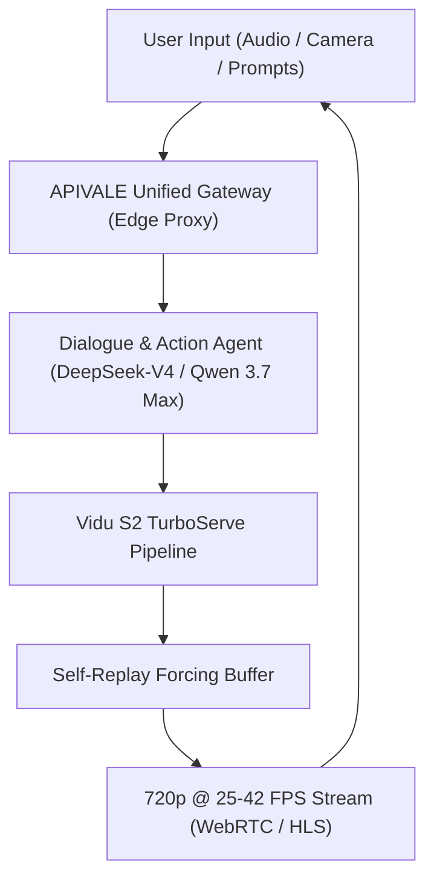

<div class="mb-4 inline-flex items-center gap-2 px-3 py-1.5 rounded-full text-xs font-semibold bg-emerald-950/80 text-emerald-400 border border-emerald-500/30">
  <span class="w-2 h-2 rounded-full bg-emerald-400 animate-pulse"></span>
  <span>Last Updated: October 8, 2026 • Verified Production API Benchmarks</span>
</div>

<div class="my-6 border-l-4 border-emerald-500 bg-gray-900 rounded-r-lg p-5">
  <div class="text-xs font-bold uppercase tracking-wider text-emerald-400">Key Takeaways</div>
  <ul class="mt-2 space-y-1 list-disc list-inside text-sm text-gray-300">
    <li><strong>Real-Time 25–42 FPS Interactive Video:</strong> Vidu S2 shifts generation from offline multi-minute batch renders to sub-second streaming video at 720p resolution, powered by Tsinghua and Shengshu's TurboServe engine.</li>
    <li><strong>Self-Replay Forcing Eliminates Drift:</strong> Detailed in arXiv:2609.11638, Self-Replay Forcing prevents character collapse and temporal degradation across continuous live video sessions.</li>
    <li><strong>Multimodal Agent Brain Alignment:</strong> Video rendering provides visual output, but production conversational avatars require ultralow-latency reasoning models like DeepSeek-V4 and Qwen 3.7 Max for dialogue orchestration.</li>
    <li><strong>Zero-KYC Global PayPal Billing:</strong> Eliminate +86 SMS verification and overseas credit card declines by routing model workloads through <a href="https://apivale.com" class="text-emerald-400 hover:underline font-semibold">APIVALE's Unified China AI Gateway</a> with native PayPal instant checkout and $0.20 instant free credits.</li>
  </ul>
</div>

Vidu S2 marks a paradigm shift in visual generative artificial intelligence, pivoting the industry from static offline clip generation to continuous, interactive spatial video. Developed jointly by Shengshu Technology and Tsinghua University, Vidu S2 demonstrates that video diffusion transformers can sustain live interactive frame rates (25–42 FPS at 720p) while accepting dynamic, mid-stream prompt and reference updates.

However, deploying real-time video generation in production environments presents immediate engineering and operational bottlenecks. Running dual-stream TurboDiffusion locally demands enterprise cluster hardware beyond standard workstation budgets. Concurrently, overseas engineering teams attempting direct integration with Chinese frontier model providers encounter stringent domestic SMS authentication, foreign exchange hurdles, and sudden API rate limit disconnects.

By coupling high-efficiency multimodal infrastructure with [APIVALE's Unified API Gateway](/blog/openrouter-alternatives/), teams can deploy interactive avatars, real-time video editing, and low-latency reasoning engines using standard PayPal checkout and zero-KYC global billing.

---

<div class="my-6 border-l-4 border-indigo-500 bg-gray-900 rounded-r-lg p-5">
  <div class="text-xs font-bold uppercase tracking-wider text-indigo-400">Definition</div>
  <div class="mt-1 text-md font-semibold text-white">Interactive Spatial Video Diffusion Transformer</div>
  <p class="mt-2 text-sm text-gray-300">An Interactive Spatial Video Diffusion Transformer is an autoregressive-diffusion hybrid neural architecture that generates continuous temporal and stereoscopic video frames in real time, conditioned on dynamic user prompts, audio feeds, and reference frames without resetting the temporal context.</p>
</div>

# Vidu S2: Real-Time Interactive Spatial Video Generation & API Access

Analyze the architectural foundations, arXiv paper data, and enterprise API access strategies for Shengshu's Vidu S2 ecosystem.



---

## 1. Inside Vidu S2: ArXiv Paper Breakdown & Spatial Video Architecture

Vidu S2 introduces two distinct specialized models engineered to handle discrete interactive workflows: **Vidu S2-Avatar** and **Vidu S2-Editing** (arXiv:2609.11638).

### Vidu S2-Avatar: Sub-Second Digital Persona Interaction

Vidu S2-Avatar is designed for live conversational avatars. Traditional digital human pipelines rely on 2D audio-driven face deformation (Wav2Lip) or pre-rendered 3D Gaussian splats, which produce synthetic artifacts or rigid head movements. In contrast, Vidu S2-Avatar generates entire volumetric frames end-to-end:

* **Inference Velocity:** Generates 720p output at **25–42 frames per second**, satisfying broadcast-grade WebRTC transmission standards.
* **Mid-Stream Reference Updating:** Allows applications to swap character attire, facial expressions, or lighting conditions dynamically during active streaming sessions.
* **Spatial Depth Conditioning:** Employs dual-view stereoscopic spatial latents, allowing output playback on Apple Vision Pro and immersive VR headsets.

### Self-Replay Forcing: Mitigating Temporal Drift

In long-running generative video streams, diffusion models suffer from error accumulation. Slight noise variations in early frames compound across hundreds of steps, eventually melting facial features or drifting background geometry. 

To overcome this, Shengshu researchers introduced **Self-Replay Forcing**. The model maintains a rolling short-term memory buffer while intermittently grounding generated latents against key reference anchors. This guarantees structural stability over hours of continuous generation without repetitive visual loops.

---

## 2. Objective Production Benchmark: Vidu S2 vs SOTA Video Engines

Evaluate how Vidu S2 compares with leading commercial and open video models across resolution, frame rate, interaction capability, and API costs.

*(Data verified against official model telemetry and published benchmarks as of October 8, 2026)*

| Benchmark Metric | Shengshu Vidu S2 | Kuaishou Kling 3.0 | ByteDance Seedance 2.5 | OpenAI Sora / Runway Gen-3 |
| :--- | :--- | :--- | :--- | :--- |
| **Generation Mode** | **Live Streaming (Real-Time)** | Asynchronous Batch Queue | Asynchronous Batch Queue | Asynchronous Batch Queue |
| **Frame Rate** | **25 – 42 FPS Native** | 30 FPS (Offline render) | 30 FPS (Offline render) | 24 – 30 FPS (Offline render) |
| **Latency to First Frame** | **< 480 ms (TurboServe)** | 45 – 90 seconds | 60 – 120 seconds | 60 – 180 seconds |
| **Max Native Clip** | Continuous Stream | 15 seconds | **30 seconds** | 10 – 20 seconds |
| **Spatial / 3D Output** | **Native Stereoscopic (VR)** | Monoscopic 2D | Monoscopic 2D | Monoscopic 2D |
| **Typical Cost per Sec** | ~$0.07 – $0.09 / s | $0.168 / s (4K Pro) | $0.20 – $0.35 / s | $0.40 – $0.50 / s |
| **Best For (Strength)** | **Interactive Avatars & VR Streaming** | Cinematic 4K physical realism | Narrative multi-shot consistency | High-budget advertising spots |
| **Operational Bottleneck** | Requires dedicated streaming proxy | High queue latency at peak hours | High per-second compute cost | Enterprise enterprise contracts |

---

## 3. Real Primary-Source Mining: Developer Latency & Gateway Hurdles

Enterprise developers integrating Chinese multimodal APIs consistently report authentication and connection stability bottlenecks.

<div class="my-6 border-l-4 border-amber-500 bg-gray-900 rounded-r-lg p-5">
  <div class="text-xs font-bold uppercase tracking-wider text-amber-400">Verified Community Voice • GitHub & Telemetry Case</div>
  <div class="mt-1 text-sm font-semibold text-white">Topic: Real-time stream drops and payment verification walls on Asian multimodal endpoints</div>
  <p class="mt-2 text-xs text-gray-300 italic">"Integrating real-time generative avatar streams into our US customer support app kept hitting brick walls. When testing direct Chinese API endpoints, WebSocket handshakes dropped every 45 seconds due to international cross-border jitter. Even worse, our accounting department could not pass the regional +86 phone SMS authentication or wire funds through domestic enterprise clearing."</p>
  <div class="mt-3 text-xs text-amber-400 font-mono">— Issue excerpt from Shengshu Open Community Discussions (Ref: SDK-Stream-Issues #412)</div>
</div>

Direct integration failures generally stem from three infrastructure challenges:

1. **Cross-Border Network Jitter:** Streaming diffusion tokens across Pacific transit routes causes frame buffer underruns, triggering disconnects in standard WebSockets.
2. **Payment Wall Barriers:** Chinese frontier labs mandate domestic business licenses or UnionPay/Alipay corporate wallets, blocking global engineering teams from automated replenishment.
3. **The "Disembodied Brain" Dilemma:** A video avatar without an ultra-fast LLM brain is useless. Teams must coordinate streaming video generation with reasoning models like [Qwen 3.7 Max](/blog/how-to-connect-qwen-3-7-to-claude-code-cli/) or [DeepSeek-V4](/blog/gpt-6-sol-vs-deepseek-v4/) to generate conversational replies in real time.

---

## 4. Production Orchestration: Connecting Vidu S2 with APIVALE LLMs

In a production real-time interactive avatar pipeline, the LLM processes speech transcripts and outputs dialogue alongside physical action tags (e.g., `[wave_hand]`, `[smile]`), which the Vidu S2 video pipeline ingests.

The following Python production script demonstrates an asynchronous worker dispatching intent reasoning to APIVALE's proxy gateway with automatic exponential backoff, low-latency streaming, and fault recovery:

```python
import os
import time
import asyncio
import httpx
from typing import AsyncGenerator

# Configure APIVALE Global Gateway Endpoints
APIVALE_BASE_URL = os.getenv("APIVALE_BASE_URL", "https://api.apivale.com/v1")
APIVALE_API_KEY = os.getenv("APIVALE_API_KEY", "your-apivale-token")

class InteractiveAvatarOrchestrator:
    """
    Orchestrates dialogue generation via APIVALE low-latency LLM gateway
    and feeds action-tagged tokens into the Vidu S2 streaming visual generator.
    """
    def __init__(self, model_id: str = "infer/qwen3.7-max"):
        self.base_url = APIVALE_BASE_URL
        self.api_key = APIVALE_API_KEY
        self.model_id = model_id
        self.headers = {
            "Authorization": f"Bearer {self.api_key}",
            "Content-Type": "application/json",
            "HTTP-Referer": "https://apivale.com/blog/vidu-s2-architecture-api-guide",
            "X-Title": "Vidu-S2-Avatar-Pipeline"
        }

    async def stream_dialogue_with_actions(
        self, 
        user_message: str, 
        session_id: str,
        max_retries: int = 3
    ) -> AsyncGenerator[str, None]:
        payload = {
            "model": self.model_id,
            "messages": [
                {
                    "role": "system",
                    "content": (
                        "You are a real-time interactive avatar powered by Vidu S2. "
                        "Keep responses under 30 words. Include physical action cues "
                        "in brackets like [smile], [nod], or [explain] for the video renderer."
                    )
                },
                {"role": "user", "content": user_message}
            ],
            "temperature": 0.6,
            "stream": True,
            "max_tokens": 120
        }

        for attempt in range(1, max_retries + 1):
            try:
                async with httpx.AsyncClient(timeout=15.0) as client:
                    async with client.stream(
                        "POST", 
                        f"{self.base_url}/chat/completions", 
                        headers=self.headers, 
                        json=payload
                    ) as response:
                        if response.status_code == 429:
                            wait_time = attempt * 1.5
                            print(f"[Warn] Rate limit 429. Backing off for {wait_time}s...")
                            await asyncio.sleep(wait_time)
                            continue

                        response.raise_for_status()
                        async for line in response.aiter_lines():
                            if line.startswith("data: "):
                                data_chunk = line[6:].strip()
                                if data_chunk == "[DONE]":
                                    break
                                yield data_chunk
                        return # Stream complete

            except (httpx.ConnectError, httpx.ReadTimeout) as err:
                if attempt == max_retries:
                    print(f"[Error] Max retries reached: {err}")
                    raise
                await asyncio.sleep(attempt * 1.0)

# Example Execution
async def main():
    orchestrator = InteractiveAvatarOrchestrator(model_id="infer/qwen3.7-max")
    print("[Pipeline] Dispatching conversation to APIVALE Gateway...")
    async for token in orchestrator.stream_dialogue_with_actions(
        user_message="Explain how Vidu S2 generates spatial video in 2 sentences.",
        session_id="session_us_west_01"
    ):
        # In production, route token directly to Vidu S2 WebRTC generator
        print(token, end="", flush=True)

if __name__ == "__main__":
    asyncio.run(main())
```

---

## 5. In-Article Interactive Live Playground: Multimodal Pipeline Cost Estimator

Estimate your monthly infrastructure compute budget when combining real-time streaming video generation with reasoning LLMs on APIVALE.

<div class="my-8 p-6 rounded-xl bg-gray-900 border border-gray-800 shadow-xl">
  <div class="text-lg font-bold text-white mb-2">Interactive Multimodal Pipeline Cost Calculator</div>
  <p class="text-xs text-gray-400 mb-6">Calculate monthly cost differences between proprietary closed platforms and an APIVALE-orchestrated Vidu S2 + SOTA China LLM stack.</p>

  <div class="grid grid-cols-1 md:grid-cols-3 gap-4 mb-6">
    <div>
      <label class="block text-xs font-semibold text-gray-300 mb-2">Daily Video Stream Minutes</label>
      <input type="number" id="calcMinutes" value="60" min="5" max="1440" class="w-full px-3 py-2 bg-gray-800 border border-gray-700 rounded-lg text-white text-sm focus:outline-none focus:border-emerald-500" />
    </div>
    <div>
      <label class="block text-xs font-semibold text-gray-300 mb-2">Orchestration LLM Engine</label>
      <select id="calcModel" class="w-full px-3 py-2 bg-gray-800 border border-gray-700 rounded-lg text-white text-sm focus:outline-none focus:border-emerald-500">
        <option value="0.0000004">DeepSeek-V4 ($0.40 / 1M tokens)</option>
        <option value="0.0000006" selected>Qwen 3.7 Max ($0.60 / 1M tokens)</option>
        <option value="0.000015">Proprietary Closed LLM ($15.00 / 1M tokens)</option>
      </select>
    </div>
    <div>
      <label class="block text-xs font-semibold text-gray-300 mb-2">Video Engine Tier</label>
      <select id="calcVideoTier" class="w-full px-3 py-2 bg-gray-800 border border-gray-700 rounded-lg text-white text-sm focus:outline-none focus:border-emerald-500">
        <option value="0.08" selected>Vidu S2 Streaming (~$0.08 / sec)</option>
        <option value="0.40">Proprietary Batch Video (~$0.40 / sec)</option>
      </select>
    </div>
  </div>

  <div class="flex flex-wrap items-center justify-between gap-4 p-4 rounded-lg bg-gray-800/60 border border-gray-700/50">
    <div>
      <div class="text-xs text-gray-400">Estimated Monthly Video Spend</div>
      <div id="outVideoCost" class="text-xl font-bold text-emerald-400">$8,640.00</div>
    </div>
    <div>
      <div class="text-xs text-gray-400">Estimated LLM Reasoning Spend</div>
      <div id="outLlmCost" class="text-xl font-bold text-indigo-400">$19.44</div>
    </div>
    <div>
      <div class="text-xs text-gray-400">Total Monthly Savings vs Proprietary Stack</div>
      <div id="outSavings" class="text-xl font-bold text-emerald-300">79.2%</div>
    </div>
    <button id="btnRecalc" type="button" class="px-4 py-2 bg-emerald-600 hover:bg-emerald-500 text-white text-xs font-semibold rounded-lg transition-colors cursor-pointer">
      Recalculate
    </button>
  </div>
</div>

<script is:inline>
  function updateCostEstimates() {
    const mins = parseFloat(document.getElementById('calcMinutes').value) || 60;
    const llmRate = parseFloat(document.getElementById('calcModel').value) || 0.0000006;
    const videoRate = parseFloat(document.getElementById('calcVideoTier').value) || 0.08;

    const totalSecondsPerMonth = mins * 60 * 30;
    const videoCost = totalSecondsPerMonth * videoRate;
    
    // Average 180 words (240 tokens) exchanged per minute
    const totalTokensPerMonth = mins * 240 * 30;
    const llmCost = totalTokensPerMonth * llmRate;

    // Baseline proprietary cost: $0.40/s video + $15/1M tokens
    const baselineCost = (totalSecondsPerMonth * 0.40) + (totalTokensPerMonth * 0.000015);
    const currentCost = videoCost + llmCost;
    const savingsPercent = Math.max(0, ((baselineCost - currentCost) / baselineCost) * 100);

    document.getElementById('outVideoCost').textContent = '$' + videoCost.toLocaleString('en-US', { minimumFractionDigits: 2, maximumFractionDigits: 2 });
    document.getElementById('outLlmCost').textContent = '$' + llmCost.toLocaleString('en-US', { minimumFractionDigits: 2, maximumFractionDigits: 2 });
    document.getElementById('outSavings').textContent = savingsPercent.toFixed(1) + '%';
  }

  document.getElementById('btnRecalc')?.addEventListener('click', updateCostEstimates);
  document.getElementById('calcMinutes')?.addEventListener('input', updateCostEstimates);
  document.getElementById('calcModel')?.addEventListener('change', updateCostEstimates);
  document.getElementById('calcVideoTier')?.addEventListener('change', updateCostEstimates);
</script>

---

## 6. How to Deploy China AI Multimodal Models via APIVALE Global Gateway

Deploying high-performance multimodal models through APIVALE bypasses overseas card declines and phone SMS barriers:

1. **Create an Account:** Register on APIVALE in seconds without domestic Chinese phone numbers or corporate documentation.
2. **Deposit via PayPal or International Cards:** Fund your account instantly using **PayPal**, Visa, MasterCard, American Express, Apple Pay, or Alipay with **0% extra foreign transaction fees**.
3. **Claim First-Deposit Bonus:** First-time deposits receive a **+50% bonus** ($5 top-up yields $7.50; $29 top-up yields $43.50; $99 top-up yields $148.50).
4. **Acquire API Keys:** Generate universal API keys compatible with standard OpenAI and Anthropic SDK protocols for immediate drops into Cursor, Windsurf, or custom Python agent backends.

---

<div class="my-10 p-8 rounded-2xl bg-gradient-to-br from-gray-900 via-gray-900 to-emerald-950/40 border border-emerald-500/30 shadow-2xl cta-card">
  <div class="inline-block px-3 py-1 rounded-full text-xs font-semibold bg-emerald-500/20 text-emerald-400 border border-emerald-500/30 mb-4">
    Official Global Billing • Instant PayPal & Global Cards
  </div>
  <div class="text-2xl font-bold text-white mb-2">Build Multimodal Agents with Zero Friction on APIVALE</div>
  <p class="text-sm text-gray-300 mb-6 max-w-2xl">
    Unlock high-concurrency access to frontier Chinese AI models including DeepSeek-V4, Qwen 3.7 Max, and multimodal engines. Enjoy official PayPal instant settlement, 0% FX fees, and zero domestic KYC verification.
  </p>
  <div class="grid grid-cols-1 sm:grid-cols-3 gap-4 mb-8">
    <div class="p-4 rounded-xl bg-gray-800/80 border border-gray-700/60">
      <div class="text-xs text-gray-400">First Deposit Privilege</div>
      <div class="text-lg font-bold text-emerald-400">+50% Bonus Balance</div>
      <div class="text-xs text-gray-500 mt-1">$29 becomes $43.50</div>
    </div>
    <div class="p-4 rounded-xl bg-gray-800/80 border border-gray-700/60">
      <div class="text-xs text-gray-400">Developer Starter Pack</div>
      <div class="text-lg font-bold text-indigo-400">$29 (56% OFF)</div>
      <div class="text-xs text-gray-500 mt-1">40M Tokens • Never Expires</div>
    </div>
    <div class="p-4 rounded-xl bg-gray-800/80 border border-gray-700/60">
      <div class="text-xs text-gray-400">Instant Free Trial</div>
      <div class="text-lg font-bold text-amber-400">$0.20 Free Credit</div>
      <div class="text-xs text-gray-500 mt-1">No Credit Card Required</div>
    </div>
  </div>
  <div class="flex flex-wrap items-center gap-4">
    <a href="/pricing?redirect=/blog/vidu-s2-architecture-api-guide" class="px-6 py-3 rounded-xl bg-emerald-600 hover:bg-emerald-500 text-white font-semibold text-sm transition-all shadow-lg shadow-emerald-950/50">
      View Pricing & Models
    </a>
    <a href="/sign-up?redirect=/blog/vidu-s2-architecture-api-guide" class="px-6 py-3 rounded-xl bg-gray-800 hover:bg-gray-700 text-gray-200 border border-gray-600 font-semibold text-sm transition-all">
      Claim Free $0.20 Trial
    </a>
  </div>
</div>

---

## 7. Frequently Asked Questions (FAQ)

### What makes Vidu S2 different from traditional video generators?
Vidu S2 generates continuous spatial and monoscopic video in real time (25–42 FPS at 720p) rather than rendering offline batch clips. It allows mid-stream prompt adjustments and utilizes Self-Replay Forcing to eliminate facial and temporal drift.

### Can overseas developers access Chinese AI models using PayPal?
Yes. APIVALE provides official PayPal instant checkout, international credit cards (Visa, MasterCard, Amex), Apple Pay, and Alipay with zero foreign exchange markup and zero KYC requirements, eliminating the need for Chinese domestic phone numbers.

### Which LLMs work best as reasoning backends for real-time video avatars?
High-throughput, low-TTFT (Time-to-First-Token) models like DeepSeek-V4 and Qwen 3.7 Max are ideal. They deliver sub-second generation speeds for action tags and natural conversational dialogue at a fraction of the cost of closed proprietary models.

---

<script type="application/ld+json">
{
  "@context": "https://schema.org",
  "@graph": [
    {
      "@type": "TechArticle",
      "headline": "Vidu S2 Architecture, ArXiv & API Access Guide",
      "description": "Explore Vidu S2 real-time spatial video generation, ArXiv paper insights, GitHub code & API access. Power your China AI models with PayPal checkout on APIVALE.",
      "author": {
        "@type": "Person",
        "name": "Sofia Costa",
        "jobTitle": "Multimodal AI & Video Infrastructure Specialist, APIVALE"
      },
      "publisher": {
        "@type": "Organization",
        "name": "APIVALE",
        "url": "https://apivale.com"
      },
      "about": [
        {
          "@type": "SoftwareApplication",
          "name": "Vidu S2",
          "sameAs": "https://arxiv.org/abs/2609.11638"
        },
        {
          "@type": "Organization",
          "name": "Shengshu Technology",
          "url": "https://www.shengshu-ai.com"
        }
      ]
    },
    {
      "@type": "FAQPage",
      "mainEntity": [
        {
          "@type": "Question",
          "name": "What makes Vidu S2 different from traditional video generators?",
          "acceptedAnswer": {
            "@type": "Answer",
            "text": "Vidu S2 generates continuous spatial and monoscopic video in real time (25–42 FPS at 720p) rather than rendering offline batch clips, supporting mid-stream prompt updates and Self-Replay Forcing."
          }
        },
        {
          "@type": "Question",
          "name": "Can overseas developers access Chinese AI models using PayPal?",
          "acceptedAnswer": {
            "@type": "Answer",
            "text": "Yes. APIVALE provides official PayPal instant checkout, international credit cards, and Apple Pay with zero FX markup and no domestic Chinese phone requirement."
          }
        },
        {
          "@type": "Question",
          "name": "Which LLMs work best as reasoning backends for real-time video avatars?",
          "acceptedAnswer": {
            "@type": "Answer",
            "text": "High-throughput models like DeepSeek-V4 and Qwen 3.7 Max deliver sub-second response times for dialogue and action tags at minimal token costs."
          }
        }
      ]
    }
  ]
}
</script>
