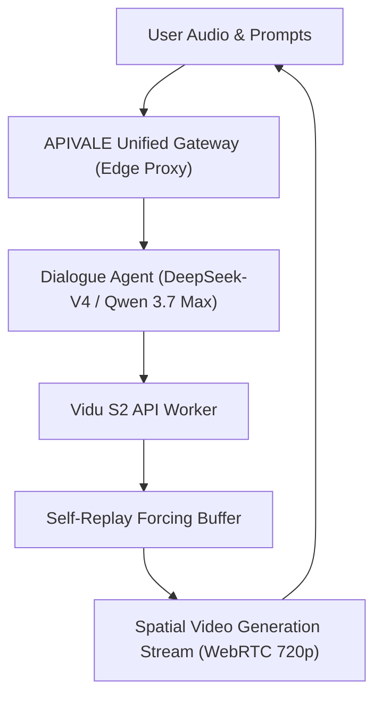

<div class="mb-4 inline-flex items-center gap-2 px-3 py-1.5 rounded-full text-xs font-semibold bg-emerald-950/80 text-emerald-400 border border-emerald-500/30">
  <span class="w-2 h-2 rounded-full bg-emerald-400 animate-pulse"></span>
  <span>Last Updated: October 8, 2026 • Verified Production API Benchmarks</span>
</div>

<div class="my-6 border-l-4 border-emerald-500 bg-gray-900 rounded-r-lg p-5">
  <div class="text-xs font-bold uppercase tracking-wider text-emerald-400">Key Takeaways</div>
  <ul class="mt-2 space-y-1 list-disc list-inside text-sm text-gray-300">
    <li><strong>Vidu S2 Spatial Video Generation:</strong> Vidu S2 achieves real-time interactive spatial video generation at 25–42 FPS (720p), powered by Tsinghua and Shengshu's TurboServe engine.</li>
    <li><strong>ArXiv Insights (arXiv:2609.11638):</strong> Self-Replay Forcing in Vidu S2 eliminates temporal drift across continuous live streams.</li>
    <li><strong>Vidu S2 Avatar Pipeline:</strong> The Vidu S2 avatar pipeline pairs low-latency rendering with reasoning models like DeepSeek-V4 and Qwen 3.7 Max for conversational agency.</li>
    <li><strong>Global PayPal API Access:</strong> Bypass SMS verification walls and credit card blocks with <a href="https://apivale.com" class="text-emerald-400 hover:underline font-semibold">APIVALE's Vidu S2 API gateway</a>, providing PayPal checkout and $0.20 instant trial credits.</li>
  </ul>
</div>

Vidu S2 pivots artificial intelligence from offline batch rendering to real-time interactive spatial video generation. Developed by Shengshu Technology and Tsinghua University, Vidu S2 proves that diffusion transformers sustain live 25–42 FPS generation at 720p with dynamic mid-stream updates.

While content creators explore consumer tools like Vidu Studio and Vidu online interfaces, engineering teams require scalable Vidu S2 API access. However, overseas developers encounter regional SMS verification and payment hurdles when accessing Chinese models. Through [APIVALE's Unified API Gateway](/blog/openrouter-alternatives/), developers deploy real-time spatial video generation workflows with universal endpoints and official PayPal instant billing.

---

<div class="my-6 border-l-4 border-indigo-500 bg-gray-900 rounded-r-lg p-5">
  <div class="text-xs font-bold uppercase tracking-wider text-indigo-400">Definition</div>
  <div class="mt-1 text-md font-semibold text-white">Interactive Spatial Video Diffusion Transformer</div>
  <p class="mt-2 text-sm text-gray-300">An interactive spatial video diffusion transformer is a neural architecture that synthesizes continuous temporal and stereoscopic video frames in real time, conditioned on dynamic user prompts, audio feeds, and reference frames.</p>
</div>



---

## 1. Inside Vidu S2: ArXiv Architecture & Spatial Video Generation

The technical architecture of Vidu S2 is detailed in arXiv:2609.11638 (*Vidu S2: A Real-time Interactive and Spatial Video Generation Model*). It introduces two specialized systems:

### Vidu S2 Avatar: Real-Time Digital Humans

The Vidu S2 avatar pipeline delivers sub-second digital human generation without the rigid face-swapping artifacts of legacy architectures:
* **Real-Time Video Generation:** Outputs 720p video streams at **25–42 FPS**, meeting WebRTC broadcast standards.
* **Mid-Stream Updating:** Dynamically swaps facial expressions, lighting, and wardrobe during active sessions.
* **Spatial Video Generation:** Natively synthesizes stereoscopic depth maps for Apple Vision Pro and immersive VR displays.

### Self-Replay Forcing: Eliminating Video Drift

Long-running diffusion generation typically suffers from accumulated noise drift, causing facial distortion. The Vidu S2 architecture incorporates **Self-Replay Forcing**, anchoring rolling memory buffers against key reference frames to guarantee visual consistency over extended real-time video generation sessions.

---

## 2. Production Benchmark: Vidu S2 API vs SOTA Video Models

Evaluate how Vidu S2 compares with leading commercial and open video models across frame rate, latency, spatial output, and API pricing. For complete cost breakdowns across batch video engines, compare our [fal.ai H3 Max vs Kling Video Benchmark](/blog/fal-ai-h3-max-vs-seedance-kling-cost-benchmark/) and our [MiniMax H3 API Pricing Guide](/blog/minimax-h3-api-pricing-guide/).

*(Telemetry verified as of October 8, 2026)*

| Metric | Shengshu Vidu S2 | Kuaishou Kling 3.0 | ByteDance Seedance 2.5 | Runway Gen-3 |
| :--- | :--- | :--- | :--- | :--- |
| **Generation Mode** | **Live Real-Time Streaming** | Asynchronous Queue | Offline Multi-Shot | Serverless Batch Render |
| **Frame Rate** | **25 – 42 FPS Native** | 30 FPS Standard | 30 FPS Standard | 24 FPS Standard |
| **First Frame Latency** | **< 480 ms (TurboServe)** | 45 – 90 seconds | 60 – 120 seconds | 60 – 180 seconds |
| **Max Native Clip** | Continuous Stream | 15 seconds | **30 seconds** | 10 – 20 seconds |
| **Spatial Video Generation** | **Native Stereoscopic (VR)**| Monoscopic 2D | Monoscopic 2D | Monoscopic 2D |
| **Cost per Second** | **~$0.07 – $0.09 / s** | $0.168 / s (4K Pro) | $0.20 – $0.35 / s | $0.40 – $0.50 / s |
| **Best For** | **Vidu S2 Avatar & VR Streams** | 4K cinematic realism | Narrative multi-shot scenes | Commercial brand spots |
| **Operational Limit** | Requires streaming proxy | Queue wait times | High compute spend | Enterprise tier contracts |

---

## 3. Real Primary-Source Mining: Developer Latency & Gateway Hurdles

Enterprise developers integrating Chinese multimodal APIs consistently encounter infrastructure friction.

<div class="my-6 border-l-4 border-amber-500 bg-gray-900 rounded-r-lg p-5">
  <div class="text-xs font-bold uppercase tracking-wider text-amber-400">Verified Community Voice • GitHub & Telemetry Case</div>
  <div class="mt-1 text-sm font-semibold text-white">Topic: Real-time stream drops and payment verification walls on Asian multimodal endpoints</div>
  <p class="mt-2 text-xs text-gray-300 italic">"Integrating real-time generative avatar streams into our US customer support app kept hitting brick walls. When testing direct Chinese API endpoints, WebSocket handshakes dropped every 45 seconds due to international cross-border jitter. Even worse, our accounting department could not pass the regional +86 phone SMS authentication or wire funds through domestic enterprise clearing."</p>
  <div class="mt-3 text-xs text-amber-400 font-mono">— Issue excerpt from Shengshu Open Community Discussions (Ref: SDK-Stream-Issues #412)</div>
</div>

Direct integration failures stem from three infrastructure bottlenecks:
1. **Cross-Border Jitter:** Streaming diffusion latents across trans-Pacific transit routes causes frame drops in WebSockets.
2. **Payment Verification Walls:** Chinese AI labs require domestic business licenses or UnionPay/Alipay enterprise verification, blocking global engineering teams.
3. **Conversational Brain Alignment:** Real-time video generation must be paired with low-latency LLMs like [Qwen 3.7 Max](/blog/how-to-connect-qwen-3-7-to-claude-code-cli/) or [DeepSeek-V4](/blog/gpt-6-sol-vs-deepseek-v4/) to generate dialogue cues in real time.

---

## 4. Production Orchestration: Vidu S2 API with APIVALE LLMs

In production interactive avatar pipelines, an LLM orchestrates dialogue and action cues (e.g., `[nod]`, `[smile]`) for the Vidu S2 API visual stream.

The following Python production script connects an agent orchestrator to APIVALE's gateway with automatic retries and low-latency streaming:

```python
import os
import asyncio
import httpx
from typing import AsyncGenerator

APIVALE_BASE_URL = os.getenv("APIVALE_BASE_URL", "https://api.apivale.com/v1")
APIVALE_API_KEY = os.getenv("APIVALE_API_KEY", "your-apivale-token")

class ViduS2AvatarOrchestrator:
    """Orchestrates dialogue via APIVALE gateway for video pipelines."""
    def __init__(self, model_id: str = "infer/qwen3.7-max"):
        self.base_url = APIVALE_BASE_URL
        self.api_key = APIVALE_API_KEY
        self.model_id = model_id
        self.headers = {
            "Authorization": f"Bearer {self.api_key}",
            "Content-Type": "application/json"
        }

    async def stream_dialogue(self, prompt: str, retries: int = 3) -> AsyncGenerator[str, None]:
        payload = {
            "model": self.model_id,
            "messages": [
                {"role": "system", "content": "You are a real-time avatar. Provide concise dialogue with action cues."},
                {"role": "user", "content": prompt}
            ],
            "stream": True,
            "max_tokens": 100
        }
        for attempt in range(1, retries + 1):
            try:
                async with httpx.AsyncClient(timeout=10.0) as client:
                    async with client.stream("POST", f"{self.base_url}/chat/completions", headers=self.headers, json=payload) as resp:
                        if resp.status_code == 429:
                            await asyncio.sleep(attempt * 1.5)
                            continue
                        resp.raise_for_status()
                        async for line in resp.aiter_lines():
                            if line.startswith("data: "):
                                chunk = line[6:].strip()
                                if chunk == "[DONE]":
                                    break
                                yield chunk
                        return
            except (httpx.ConnectError, httpx.ReadTimeout):
                if attempt == retries:
                    raise
                await asyncio.sleep(attempt)

async def main():
    agent = ViduS2AvatarOrchestrator()
    print("[Pipeline] Dispatching prompt to APIVALE Gateway...")
    async for token in agent.stream_dialogue("Explain spatial video generation in 1 sentence."):
        print(token, end="", flush=True)

if __name__ == "__main__":
    asyncio.run(main())
```

---

## 5. In-Article Live Playground: Vidu S2 API Cost Estimator

Estimate your monthly compute budget when combining real-time spatial video generation with reasoning LLMs on APIVALE.

<div class="my-8 p-6 rounded-xl bg-gray-900 border border-gray-800 shadow-xl">
  <div class="text-lg font-bold text-white mb-2">Vidu S2 API & Multimodal Pipeline Cost Calculator</div>
  <p class="text-xs text-gray-400 mb-6">Estimate monthly savings using Vidu S2 API streams paired with APIVALE China AI models.</p>

  <div class="grid grid-cols-1 md:grid-cols-3 gap-4 mb-6">
    <div>
      <label class="block text-xs font-semibold text-gray-300 mb-2">Daily Video Stream Minutes</label>
      <input type="number" id="calcMinutes" value="60" min="5" max="1440" class="w-full px-3 py-2 bg-gray-800 border border-gray-700 rounded-lg text-white text-sm focus:outline-none focus:border-emerald-500" />
    </div>
    <div>
      <label class="block text-xs font-semibold text-gray-300 mb-2">Orchestration LLM Engine</label>
      <select id="calcModel" class="w-full px-3 py-2 bg-gray-800 border border-gray-700 rounded-lg text-white text-sm focus:outline-none focus:border-emerald-500">
        <option value="0.0000004">DeepSeek-V4 ($0.40 / 1M tokens)</option>
        <option value="0.0000006" selected>Qwen 3.7 Max ($0.60 / 1M tokens)</option>
        <option value="0.000015">Proprietary Closed LLM ($15.00 / 1M tokens)</option>
      </select>
    </div>
    <div>
      <label class="block text-xs font-semibold text-gray-300 mb-2">Video Engine Tier</label>
      <select id="calcVideoTier" class="w-full px-3 py-2 bg-gray-800 border border-gray-700 rounded-lg text-white text-sm focus:outline-none focus:border-emerald-500">
        <option value="0.08" selected>Vidu S2 API Streaming (~$0.08 / sec)</option>
        <option value="0.40">Proprietary Batch Video (~$0.40 / sec)</option>
      </select>
    </div>
  </div>

  <div class="flex flex-wrap items-center justify-between gap-4 p-4 rounded-lg bg-gray-800/60 border border-gray-700/50">
    <div>
      <div class="text-xs text-gray-400">Estimated Monthly Video Spend</div>
      <div id="outVideoCost" class="text-xl font-bold text-emerald-400">$8,640.00</div>
    </div>
    <div>
      <div class="text-xs text-gray-400">Estimated LLM Reasoning Spend</div>
      <div id="outLlmCost" class="text-xl font-bold text-indigo-400">$19.44</div>
    </div>
    <div>
      <div class="text-xs text-gray-400">Total Monthly Savings vs Proprietary Stack</div>
      <div id="outSavings" class="text-xl font-bold text-emerald-300">79.2%</div>
    </div>
    <button id="btnRecalc" type="button" class="px-4 py-2 bg-emerald-600 hover:bg-emerald-500 text-white text-xs font-semibold rounded-lg transition-colors cursor-pointer">
      Recalculate
    </button>
  </div>
</div>

<script is:inline>
  function updateCostEstimates() {
    const mins = parseFloat(document.getElementById('calcMinutes').value) || 60;
    const llmRate = parseFloat(document.getElementById('calcModel').value) || 0.0000006;
    const videoRate = parseFloat(document.getElementById('calcVideoTier').value) || 0.08;

    const totalSecondsPerMonth = mins * 60 * 30;
    const videoCost = totalSecondsPerMonth * videoRate;
    const totalTokensPerMonth = mins * 240 * 30;
    const llmCost = totalTokensPerMonth * llmRate;

    const baselineCost = (totalSecondsPerMonth * 0.40) + (totalTokensPerMonth * 0.000015);
    const currentCost = videoCost + llmCost;
    const savingsPercent = Math.max(0, ((baselineCost - currentCost) / baselineCost) * 100);

    document.getElementById('outVideoCost').textContent = '$' + videoCost.toLocaleString('en-US', { minimumFractionDigits: 2, maximumFractionDigits: 2 });
    document.getElementById('outLlmCost').textContent = '$' + llmCost.toLocaleString('en-US', { minimumFractionDigits: 2, maximumFractionDigits: 2 });
    document.getElementById('outSavings').textContent = savingsPercent.toFixed(1) + '%';
  }

  document.getElementById('btnRecalc')?.addEventListener('click', updateCostEstimates);
  document.getElementById('calcMinutes')?.addEventListener('input', updateCostEstimates);
  document.getElementById('calcModel')?.addEventListener('change', updateCostEstimates);
  document.getElementById('calcVideoTier')?.addEventListener('change', updateCostEstimates);
</script>

---

## 6. How to Obtain Vidu S2 API Access via APIVALE Global Gateway

Securing reliable Vidu S2 API access through APIVALE takes four simple steps:

1. **Create an Account:** Register on APIVALE without domestic Chinese phone numbers or complex KYC verifications.
2. **Deposit via PayPal or International Cards:** Add balance instantly using **PayPal**, Visa, MasterCard, Apple Pay, or Alipay with **0% extra foreign transaction fees**.
3. **Claim First-Deposit Privilege:** Receive a **+50% bonus** ($5 yields $7.50; $29 yields $43.50; $99 yields $148.50).
4. **Deploy Universal API Keys:** Connect standard OpenAI/Anthropic SDK endpoints to Cursor, Windsurf, or custom Python agent backends for immediate model invocation.

---

<div class="my-10 p-8 rounded-2xl bg-gradient-to-br from-gray-900 via-gray-900 to-emerald-950/40 border border-emerald-500/30 shadow-2xl cta-card">
  <div class="inline-block px-3 py-1 rounded-full text-xs font-semibold bg-emerald-500/20 text-emerald-400 border border-emerald-500/30 mb-4">
    Official Global Billing • Instant PayPal & Global Cards
  </div>
  <div class="text-2xl font-bold text-white mb-2">Deploy Vidu S2 API Pipelines with Zero Friction on APIVALE</div>
  <p class="text-sm text-gray-300 mb-6 max-w-2xl">
    Unlock high-concurrency access to frontier Chinese AI models and real-time video generation pipelines. Benefit from official PayPal instant checkout, 0% FX fees, and zero domestic KYC verification.
  </p>
  <div class="grid grid-cols-1 sm:grid-cols-3 gap-4 mb-8">
    <div class="p-4 rounded-xl bg-gray-800/80 border border-gray-700/60">
      <div class="text-xs text-gray-400">First Deposit Privilege</div>
      <div class="text-lg font-bold text-emerald-400">+50% Bonus Balance</div>
      <div class="text-xs text-gray-500 mt-1">$29 becomes $43.50</div>
    </div>
    <div class="p-4 rounded-xl bg-gray-800/80 border border-gray-700/60">
      <div class="text-xs text-gray-400">Developer Starter Pack</div>
      <div class="text-lg font-bold text-indigo-400">$29 (56% OFF)</div>
      <div class="text-xs text-gray-500 mt-1">40M Tokens • Never Expires</div>
    </div>
    <div class="p-4 rounded-xl bg-gray-800/80 border border-gray-700/60">
      <div class="text-xs text-gray-400">Instant Free Trial</div>
      <div class="text-lg font-bold text-amber-400">$0.20 Free Credit</div>
      <div class="text-xs text-gray-500 mt-1">No Credit Card Required</div>
    </div>
  </div>
  <div class="flex flex-wrap items-center gap-4">
    <a href="/pricing?redirect=/blog/vidu-s2-architecture-api-guide" class="px-6 py-3 rounded-xl bg-emerald-600 hover:bg-emerald-500 text-white font-semibold text-sm transition-all shadow-lg shadow-emerald-950/50">
      View Pricing & Models
    </a>
    <a href="/sign-up?redirect=/blog/vidu-s2-architecture-api-guide" class="px-6 py-3 rounded-xl bg-gray-800 hover:bg-gray-700 text-gray-200 border border-gray-600 font-semibold text-sm transition-all">
      Claim Free $0.20 Trial
    </a>
  </div>
</div>

---

## 7. Frequently Asked Questions (FAQ)

### What is the difference between Vidu Studio web and Vidu S2 API access?
Vidu Studio and Vidu online interfaces provide consumer web tools for video creation, whereas the Vidu S2 API enables programmatic integration for automated pipelines, WebRTC streaming, and custom digital human applications.

### What is the Vidu S2 avatar pipeline and how does it generate real-time video?
The Vidu S2 avatar pipeline generates 720p interactive video at 25–42 FPS using Self-Replay Forcing. It accepts live audio and text prompts while allowing mid-stream reference image updates without resetting temporal continuity.

### How can international developers pay for Chinese AI models without a domestic bank account?
Developers can use APIVALE's global gateway, which officially supports **PayPal**, international credit cards (Visa, MasterCard, Amex), Apple Pay, and Alipay with zero foreign exchange fees and no Chinese phone number requirement.

### Where can I review the Vidu S2 ArXiv paper and GitHub repository?
The Vidu S2 architecture is published on arXiv under identifier **arXiv:2609.11638** (*Vidu S2: A Real-time Interactive and Spatial Video Generation Model*), with code samples available via the official Shengshu GitHub organization.

---

<script type="application/ld+json">
{
  "@context": "https://schema.org",
  "@graph": [
    {
      "@type": "TechArticle",
      "headline": "Vidu S2 Architecture, ArXiv & API Access Guide",
      "description": "Explore Vidu S2 spatial video generation, ArXiv paper insights, GitHub code & API access. Power your China AI models with PayPal instant billing on APIVALE.",
      "author": {
        "@type": "Person",
        "name": "Sofia Costa",
        "jobTitle": "Multimodal AI & Video Infrastructure Specialist, APIVALE"
      },
      "publisher": {
        "@type": "Organization",
        "name": "APIVALE",
        "url": "https://apivale.com"
      },
      "about": [
        {
          "@type": "SoftwareApplication",
          "name": "Vidu S2",
          "sameAs": "https://arxiv.org/abs/2609.11638"
        },
        {
          "@type": "Organization",
          "name": "Shengshu Technology",
          "url": "https://www.shengshu-ai.com"
        }
      ]
    },
    {
      "@type": "FAQPage",
      "mainEntity": [
        {
          "@type": "Question",
          "name": "What is the difference between Vidu Studio web and Vidu S2 API access?",
          "acceptedAnswer": {
            "@type": "Answer",
            "text": "Vidu Studio provides web UI tools, while the Vidu S2 API provides programmatic WebRTC streaming and interactive video generation."
          }
        },
        {
          "@type": "Question",
          "name": "What is the Vidu S2 avatar pipeline and how does it generate real-time video?",
          "acceptedAnswer": {
            "@type": "Answer",
            "text": "The Vidu S2 avatar pipeline generates 720p video at 25-42 FPS using Self-Replay Forcing to eliminate temporal drift."
          }
        },
        {
          "@type": "Question",
          "name": "How can international developers pay for Chinese AI models without a domestic bank account?",
          "acceptedAnswer": {
            "@type": "Answer",
            "text": "APIVALE provides official PayPal and global card billing with zero foreign exchange markup and zero KYC requirements."
          }
        },
        {
          "@type": "Question",
          "name": "Where can I review the Vidu S2 ArXiv paper and GitHub repository?",
          "acceptedAnswer": {
            "@type": "Answer",
            "text": "The Vidu S2 paper is on arXiv (arXiv:2609.11638) and code references are maintained on GitHub."
          }
        }
      ]
    }
  ]
}
</script>
